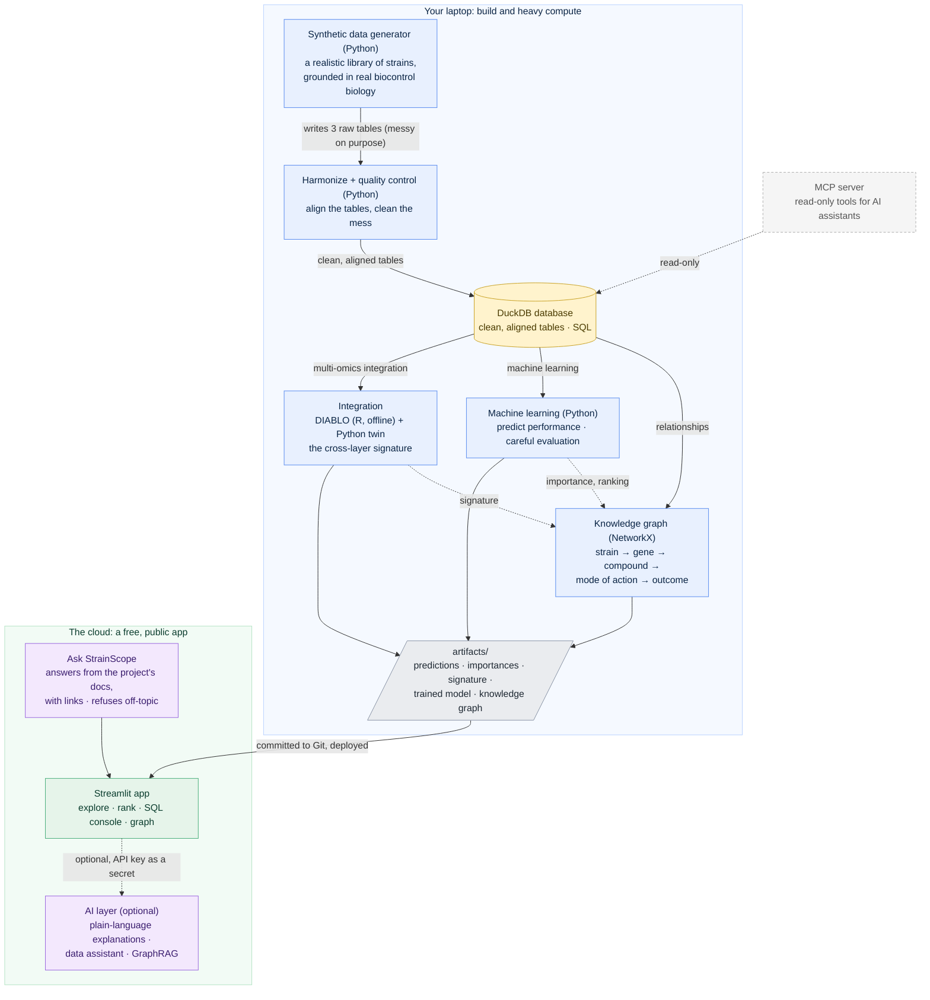

# StrainScope


**Live app:** runs on your own computer today ([how](#the-app)); online with the deployment phase (Phase 7) · **Version:** v0.2.0 plus the app (Phase 6). The analysis is complete and the app shows it; v0.3.0 arrives with Phase 6b
· 


-6f42c1)


-informational)

Reading several molecular "fingerprints" of beneficial microbes at once, and
predicting which ones are worth developing further. Built from scratch in
public, with every step explained.

> **New here? Start with the [Handbook](docs/HANDBOOK.md).** It's one document
> that walks the whole journey from a blank laptop to the finished product,
> explains *why* at every step, and links to every specialised guide.
>
> Every term used anywhere in this repo, biological or technical, is defined
> in plain language in [`docs/GLOSSARY.md`](docs/GLOSSARY.md). If a word isn't
> there, that's a documentation bug.


---

## Contents

- [**The Handbook**](docs/HANDBOOK.md): the whole journey in one document (read this first)
- [What is a beneficial microbe? (start here)](#what-is-a-beneficial-microbe-start-here)
- [The problem this project tackles](#the-problem-this-project-tackles)
- [How it works](#how-it-works)
- [The app](#the-app): rank strains, see why, score your own, ask the database (runs on your computer)
- [The data at a glance](#the-data-at-a-glance)
- [Results, phase by phase](#results-phase-by-phase) (fills in as each phase is finished)
- [Build log](#build-log): every phase, linked to its guide, with its status
- [The tutorial, in order](#the-tutorial-in-order), the documents that teach every step from a blank laptop
- [Roadmap](#roadmap): what comes next, in which order and why, including the *Ask StrainScope* documentation assistant
- [About the data (what's real and what's simulated)](#about-the-data-whats-real-and-whats-simulated)
- [Repository map](#repository-map), with every file annotated
- [How to run](#how-to-run) (every command that works today)
- [Changelog](CHANGELOG.md): what changed, version by version
- [How I work on this repo (branch model)](#how-i-work-on-this-repo-branch-model)
- [Why the documentation is so detailed](#why-the-documentation-is-so-detailed)

## What is a beneficial microbe? (start here)

Imagine a farmer whose crop is under attack by a fungal disease. Instead of
spraying a synthetic chemical, they treat the field with a *living* helper. That
could be a harmless soil bacterium that out-competes the pest, a fungus like
*Trichoderma* that parasitises the disease, a yeast that crowds it out, or an
oomycete that triggers the plant's own defences. Those helpers are **beneficial
microbes**, and using nature's own organisms like this (to protect plants or
improve soil) is the field known as **biologicals**.

Different microbes fight with different weapons. Bacteria use antibiotics and
lipopeptides, fungi use wall-digesting enzymes and toxins, and yeasts win by
competition. That variety is part of what makes picking the good ones hard.

Here's the catch that makes it a data problem. There are thousands of candidate
microbes, and only a few actually work well in the real world. Testing each one
properly is slow and expensive. But every microbe carries molecular "fingerprints"
we *can* measure cheaply:

- its **genome**, the microbe's blueprint: which useful genes it carries
  (a list of the tools in its toolbox, if you like);
- its **metabolites**, the small-molecule chemicals it actually *produces*
  (picture the goods coming off a factory's production line);
- its measured **performance**: how well it suppressed a disease in a trial
  (think of it as the microbe's grade on a field test).

One microbe is one **strain**. In this project's data, each strain gets one row
holding its three fingerprints plus its score.

**StrainScope's question:** *can we read those cheap fingerprints, combine them
sensibly, predict which strains are worth the expensive trials, and explain
why?*

## The problem this project tackles

Choosing which natural strains to develop is mostly trial and error: screen
hundreds, test them one slow assay at a time, and hope. Teams would love to
*predict* the winners from cheap molecular profiles first, but the data fights
back in some specific ways:

- **It comes in incompatible pieces.** The genomic fingerprint, the metabolomic
  fingerprint and the performance score are three very different kinds of
  table, with different units and scales. Most analyses look at one at a time
  and miss the signal that only shows up when you read them *together*.
- **It's dirty.** Real measurements have missing values, batch-to-batch drift,
  duplicates and outliers. Anything trustworthy has to start by cleaning that
  up, and you need to be able to show that you did.
- **The useful strains are rare.** Most candidates don't work, so a naive model
  can get a good score by always guessing "won't work", which tells you nothing
  useful.

Why does this matter? Better prediction means fewer wasted trials and faster
discovery of effective biologicals, and with them more sustainable crop
protection that leans on nature instead of synthetic chemistry. The methods for
this (multi-omics integration, machine learning, network analysis) are
established in the research literature, but clear end-to-end examples that a
*beginner can reproduce* are hard to find.

StrainScope is an open workflow that covers the whole process from end to end.
A Python script generates a realistic synthetic library of strains with three
fingerprint layers, grounded in real biology. A cleaning step harmonizes and
quality-controls the mess. The layers are then integrated with a recognised
multi-omics method (DIABLO, from the R package mixOmics) *and* a plain-Python
counterpart. Machine-learning models predict strain performance, checked with
careful cross-validation and error analysis, and a knowledge graph links each
strain to its genes, its compounds, the way each weapon works and the outcome,
so every ranking can be explained with sources. An interactive Streamlit
app, deployed free for anyone to use, ties it all together. Alongside it come
Ask StrainScope, a documentation assistant that answers questions about the
project from its own documents (and refuses questions that aren't about it), an
optional AI layer that explains results in plain language, and an MCP server
through which AI assistants can use the project's tools directly. Every step is
documented so that a complete beginner can rebuild and understand all of it: the
repository is the tutorial.

## How it works



In words: make the data with a transparent script and clean it into a single
queryable database. Then integrate the layers and train models on your laptop,
saving small result files, and build a relationship graph from the same data.
Finally, serve everything in a public app, with a documentation assistant and
optional AI explanations layered on top. The heavy work happens once, offline.
The app only reads the small results, and that's what keeps the public
deployment fast and free.

## The app


The app shows everything the analysis found, on your own computer, without any
code to write. After the setup in [`docs/01-setup.md`](docs/01-setup.md), from
the project folder:

```bash
python -m streamlit run app/streamlit_app.py
```

A browser tab opens on the Home page (press *Build the database now* if it asks;
it takes about 15 seconds). Then:

- **Ranking**: every strain, best first. A slider asks the question a screening
  team asks: *if we can test 50 strains, how many would work?* (47; picking at
  random would find about 12.)
- **Strain page**: one strain's chance of being effective, the reasons behind it
  as walks through the knowledge graph (each with its source), and its corner of
  the graph drawn as five columns.
- **Knowledge graph**: the network, a path finder ("how is accE linked to disease
  suppression?" gets a single statistics-only step, with no mechanism behind it), and a look-up for anything.
- **Data**: upload your own strains as a CSV file. They're checked (with a plain
  message for every problem), scored by the saved model and explained by the
  graph, and never written to disk.
- **SQL console**: ask the database anything, read-only, with the
  [Query Cookbook](docs/QUERY_COOKBOOK.md)'s recipes one click away.

It runs the same on Windows, macOS and a RHEL 8 virtual machine (reach a VM
through an SSH tunnel). The guide is [`docs/07-app.md`](docs/07-app.md).

## The data at a glance

*StrainScope's dataset is **simulated**. It's created by the generator in
[`src/strainscope/generate_data.py`](src/strainscope/generate_data.py) with a fixed random seed, so
anyone who clones the repo gets exactly the same data. It's designed to mirror a
real biocontrol-screening scenario and is grounded in real gene families and
compound classes, but it isn't real measurement data. See [About the data](#about-the-data-whats-real-and-whats-simulated).*

The shape of the dataset (numbers from the generator, fixed seed):

| Fact | Value |
| --- | --- |
| Samples (microbial strains) | 600 across 4 kingdoms: Bacteria 267, Fungi 183, Yeast 95, Oomycete 55 (+8 duplicate rows = 608 raw rows) |
| Genomic layer | 31 columns of real biocontrol gene families, grouped by kingdom: bacterial antibiotics/lipopeptides (`phlD`, `srfAA`, `ituA`, `pvdA`…), fungal/oomycete mycoparasitism & toxins (`ech42`, `prb1`, `dtxS`, `olpA`…), yeast killer-toxin/siderophore (`kilT`, `sidA`), plus housekeeping and accessory-noise genes |
| Metabolomic layer | 20 columns of secreted-compound abundances (DAPG, surfactin, iturin, six_PP, destruxin, oligandrin, killer_toxin…) plus background-noise compounds |
| Phenotype (the target) | `suppression_score` (0-100 %) and an `is_effective` label: 145 effective (24.2 %), with every kingdom producing winners (19-28 %); plus a secondary `growth_promotion` score |
| Built-in realism | different weapons per kingdom, cross-layer correlations, class imbalance (~24 %), 714 missing metabolite cells, 338 missing gene calls, 120 outliers, 8 duplicated strains, a batch effect across 6 batches, and a few impossible scores |
| What's in scope | the four cellular kingdoms that share a genome+metabolome basis are modelled; viruses and protozoa are mentioned as biocontrol agents too, but I chose not to force them into the molecular matrix |
| Reproducibility | one generator script with a fixed seed (42), so the data is identical on every machine |

## Results, phase by phase

*Each phase leaves something you can look at: a table, a chart, the app. As
phases are finished, one figure per phase appears here with a note on what it
means, matching the build log below. Nothing is shown before it exists.*

- **Phase 1 (data generation):** ✅ a reproducible generator (`src/strainscope/generate_data.py`, fixed seed) builds 600 strains across four kingdoms of biocontrol microbes (bacteria, fungi, yeasts, oomycetes), each fighting with its own real weapons, plus three omics layers based on real biology. Class imbalance, missing values, batch effects, outliers and duplicates are injected on purpose. Each kingdom carries its own arsenal:

  

  Winners are rare by design (24.2 % effective) and every kingdom produces some, so a model has to learn *how each group fights* instead of just reading the kingdom label. Interactive version: `docs/interactive/signal_scatter.html`.
- **Phase 1b (real data lands):** ✅ a pluggable ingestion framework (one contract: probe → fetch → tidy) pulls **real** data from three reference databases: real bacterial strains from BacDive (DSMZ), verified chemistry for our metabolites from PubChem (NIH), and curated compound→pathway links from KEGG (attributed; academic use). Every request is logged to a provenance file, and every raw response is kept untouched in an evidence locker. Here's the framework diagram:

  

  These real tables *complement* the synthetic library (no public source offers matched multi-omics with an outcome); the KEGG links become the knowledge graph's first real edges. Offline tests (`pytest`) verify all parsing without touching the live APIs.
- **Phase 1c (more real sources, and the secrets lesson):** ✅ two more plugs in the same socket. NCBI Datasets brings real genome metadata for all four kingdoms, so the multi-kingdom story is finally backed by real records. Metabolomics Workbench brings RefMet standard names and classification for our metabolites, plus real studies. The framework and the database loader took in both with zero changes elsewhere. This phase also introduces proper secrets handling: an optional free NCBI key lives in the environment (`.env` / shell) and never in the repository, guarded by `.gitignore` *and* the safety gate:

  
- **Phase 2 (cleaning and the database):** ✅ a six-rule cleaning pipeline with a full ledger (8 duplicate strains removed per table, 657 text cells harmonised, 3 impossible scores clipped, 41 provably absurd outlier cells capped, batch drift removed by median-scaling, 1,052 missing cells counted and left as NULLs instead of being guessed). The clean tables and the real Phase 1b tables are loaded into one DuckDB database that you can query with SQL (see the [Query Cookbook](docs/QUERY_COOKBOOK.md)). The ledger paid off straight away: it caught a textbook outlier rule quietly flattening real biology. Bimodal data breaks one-humped fences, and the doc keeps that as a lesson.

  
- **Phase 3 (multi-omics integration):** ✅ genes and chemistry read *together*, in three ways: early (glue the tables together), intermediate (DIABLO, R/mixOmics) and late (average the per-block models). All of them are scored on the same repeated cross-validation folds against two negative controls that should behave like coin flips (and do). Integration beats either block on its own, and centring each feature within its kingdom cut DIABLO's error by a third (0.22 → 0.145). Because the data is simulated, every signature can be **graded against the planted truth**. DIABLO's robust list (features picked in at least 80 % of re-fits) has 29 features, all 29 of them true drivers with no decoys, and every feature the Python lasso picks is also on DIABLO's list. R and Python talk only through plain hand-off files, checked by a contract test.

  

  

  Every kingdom's weapons on one axis; ✓ = picked in at least 80 % of re-fits. There's an interactive version in `docs/interactive/integration_explorer.html` (download it and open it in a browser; it works offline). The results are also in the database as `int_*` tables (see the [Query Cookbook §8](docs/QUERY_COOKBOOK.md#8-integration-results-phase-3)).
- **Phase 4 (machine learning):** ✅ a baseline, an elastic net, a random forest and gradient boosting compete on the same 50 folds, with the data preparation re-learned *inside* every fold. Phase 3's small leak is measured (it turns out to be harmless) and closed, and it's shown next to a real leak that "finds" signal in pure noise. The elastic net wins (balanced error 0.128 ± 0.007, AUC 0.948), which makes sense: the planted truth is a weighted sum of weapons, and a weighted sum is exactly what an elastic net is. Its probabilities are calibrated (calibration error 0.081 → 0.033), its reliably important features are graded against the planted truth (22 of 23 true drivers), and its mistakes crowd around the 65 % line that defines "effective". Here's what that means for a screening team:

  

  Of the 50 best-ranked strains, 47 are truly effective; picking at random would find 12. The calibrated model is saved (under 20 KB) together with a model card. To explore it yourself, open `docs/interactive/model_explorer.html`. The results are in the database as `ml_*` tables too (see the [Query Cookbook §9](docs/QUERY_COOKBOOK.md#9-machine-learning-results-phase-4)).
- **Phase 5 (knowledge graph):** ✅ everything the project knows becomes one network you can walk: strains, genes, compounds, modes of action and outcomes (plus real KEGG pathways, RefMet classes and BacDive strains when fetched), with a source on every connection and every connection checked against a written-down ontology. The graph keeps two kinds of evidence apart: a *mechanism* (ituA makes iturin, which attacks the pathogen's membrane) and a *statistical association* (the model leans on it). That lets it flag the one decoy the model relies on as "statistics only". Communities of features that turn up together match the planted kingdom arsenals (purity 0.94), and the most connected genes turn out to be housekeeping genes that tell you nothing. Every ranking is explained as walks through the graph:

  

  Ask it yourself with `python src/strainscope/graph.py why STRAIN_0485`, `path ituA "disease suppression"` or `show iturin`, open `docs/interactive/graph_explorer.html`, or query the `kg_*` tables (see the [Query Cookbook §10](docs/QUERY_COOKBOOK.md#10-the-knowledge-graph-phase-5)). This completes **v0.2.0**.
- **Phase 6 (the app):** ✅ a Streamlit app over everything above, on a thin, tested service layer (`src/strainscope/service.py`) that the terminal, the app and the later AI features share. The Ranking page answers "if we can test N strains, how many would work?"; each strain gets a page with its reasons and its corner of the knowledge graph; the SQL console sits behind four guards (read-only, no file access, a time limit, a row limit); and you can upload your own strains to have them checked, scored and explained, with every problem in the file named by column and row:

  

  An uploaded copy of a library strain gets exactly the explanation of the original (a test checks every strain of a hand-made project), and a slightly different score, because the ranking uses out-of-fold predictions while an upload is scored by the final model. Run it with `python -m streamlit run app/streamlit_app.py`; the guide is [`docs/07-app.md`](docs/07-app.md).
- **Phase 6b (Ask StrainScope):** *(planned)* a question answered from the docs
  with links, and an off-topic question politely refused.
- **Phase 7 (deployment and AI layer):** *(planned)* the live URL, plain-language
  explanations, the data assistant and GraphRAG.
- **Phase 7b (MCP server):** *(planned)* an AI assistant using StrainScope's tools.
- **Phase 8 (release 1.0):** *(planned)* the one-command pipeline and tests passing
  on Windows, macOS and Linux at every push.

## Build log

| # | Document | Status |
| --- | --- | --- |
| n/a | [Handbook: the whole journey, day 0 to the finished product](docs/HANDBOOK.md) | 🔨 living document |
| n/a | [Glossary: every term in plain words](docs/GLOSSARY.md) | 🔨 living document |
| n/a | [Roadmap](docs/ROADMAP.md) · [Product roadmap](docs/PRODUCT_ROADMAP.md) · [Changelog](CHANGELOG.md) | 🔨 living documents |
| 0 | [Architecture: how it all fits together](docs/00-architecture.md) | ✅ |
| 0 | [Environment setup from a blank laptop](docs/01-setup.md) | ✅ |
| 1 | [Data generation: a realistic synthetic library](docs/02-data-generation.md) | ✅ |
| 1b | [Real data lands: BacDive · PubChem · KEGG](docs/02b-real-data-ingestion.md) | ✅ |
| 1c | [More real sources: NCBI Datasets · Metabolomics Workbench + the secrets lesson](docs/02c-more-real-sources.md) | ✅ |
| 2 | [Harmonization & quality control → DuckDB + SQL](docs/03-harmonization-qc.md) | ✅ |
| 3 | [Multi-omics integration (DIABLO in R + a Python twin)](docs/04-integration.md) | ✅ **v0.1.0** |
| 3.1 | [Fix release: a safety gate that also checks new files, copy-safe commands](docs/HANDBOOK.md#stage-71-fix-release-v011-a-safer-safety-gate-and-copy-safe-commands) | ✅ **v0.1.1** |
| 4 | [Machine learning, evaluated carefully](docs/05-machine-learning.md) | ✅ |
| 5 | [Knowledge graph: ontology, sourced edges, communities, explanations](docs/06-knowledge-graph.md) | ✅ **v0.2.0** |
| 6 | [The app: ranking, strain pages, the graph, uploads, a safe SQL console](docs/07-app.md) | ✅ |
| 6b | Ask StrainScope, the documentation assistant (`docs/07b-docs-assistant.md`) | ⏳ next (**v0.3.0**) |
| 7 | Deployment + AI layer (`docs/08-deployment-ai.md`) | ⬜ planned |
| 7b | The MCP server (`docs/08b-mcp-server.md`) | ⬜ planned |
| 8 | Packaging & release 1.0 (`docs/09-packaging.md`) | ⬜ planned (**v1.0.0**) |

*Legend: ✅ done · 🔨 living / in progress · ⏳ next · ⬜ planned. Guides appear as their phase is built.*

## The tutorial, in order

Every step of this project, from an empty laptop to a deployed app, is taught in
`docs/`. The guides are written for a complete beginner, with every term defined
([glossary](docs/GLOSSARY.md)) and every command shown with its expected output.
Read them in this order:

| # | Guide | What it teaches |
| --- | --- | --- |
| first | [Handbook](docs/HANDBOOK.md) | The whole journey in order: what, why, how long, the checkpoint and the commit for every stage. Read it first and come back to it often |
| 00 | [Architecture](docs/00-architecture.md) | How all the pieces fit together; backend/frontend/database in plain words |
| 01 | [Setup](docs/01-setup.md) | Blank laptop → working workshop (Python, R, Git, `.venv`, `renv`, the `master`/`beta`/`develop` model, the safety gate) on Windows, macOS, RHEL 8 |
| 02 | [Data generation](docs/02-data-generation.md) | Random seeds & reproducibility; designing realistic synthetic multi-omics data |
| 02b | [Real-data ingestion](docs/02b-real-data-ingestion.md) | APIs, JSON, rate limits & politeness; the evidence locker and provenance log; one socket, many source plugs |
| 02c | [More real sources + secrets](docs/02c-more-real-sources.md) | API keys done right: the environment, `.env` and `.env.example`; real genomes across four kingdoms; RefMet classification |
| 03 | [Harmonization & QC](docs/03-harmonization-qc.md) | The cleaning ledger; duplicates, text, outliers (and why the textbook rule fails on bimodal data), batch correction; DuckDB + first SQL |
| 04 | [Integration](docs/04-integration.md) | What multi-omics integration *is*, three ways; DIABLO in R and a Python twin; repeated cross-validation, balanced error rate, negative controls, stability; grading against planted truth; R ↔ Python contracts; the same task in three languages |
| n/a | [Query Cookbook](docs/QUERY_COOKBOOK.md) | Tested, explained SQL recipes against the project database (it grows every phase) |
| 05 | [Machine learning](docs/05-machine-learning.md) | Four kinds of model; leak-proof pipelines and what a real leak looks like; why accuracy lies; tuning without peeking; calibration; permutation importance; error analysis; model cards |
| 06 | [Knowledge graph](docs/06-knowledge-graph.md) | Graphs in six words; ontologies (a "family tree for concepts") written before the data; a source on every edge; mechanism vs statistical association; hubs, communities and how to grade them; explaining a ranking by walking the graph; SQL vs NetworkX |
| 07 | [The app](docs/07-app.md) | Streamlit and why every click reruns the page; caching and session state; a service layer shared by every front door; SQL behind four guards; accepting somebody else's file safely; out-of-fold vs final-model scores; running on Windows, macOS and a RHEL 8 VM |
| 07b | `docs/07b-docs-assistant.md` | Search over documents, citing sources, refusing off-topic questions, golden question sets; optional local or hosted language model |
| 08 | `docs/08-deployment-ai.md` | Streamlit Community Cloud; secrets; explanations, a data assistant and GraphRAG that degrade gracefully without a key |
| 08b | `docs/08b-mcp-server.md` | The Model Context Protocol; exposing read-only tools to AI assistants safely |
| 09 | `docs/09-packaging.md` | The one-command pipeline, continuous integration on three operating systems, LICENSE, CHANGELOG, uninstall, the 1.0 tag |
| n/a | [Roadmap](docs/ROADMAP.md) · [Product roadmap](docs/PRODUCT_ROADMAP.md) | What is built next and why; what an industrial version would add, with a verdict for every technology |
| n/a | [Glossary](docs/GLOSSARY.md) | Every term, plain language, by phase |

## Roadmap

The full plan lives in [`docs/ROADMAP.md`](docs/ROADMAP.md). It covers every
phase, why each one sits where it does in the order, and the deferred items,
each with the event that would put it on the schedule. In short, after
integration came machine learning (Phase 4) and the knowledge graph (5), which
complete the analysis (v0.2.0), and then the app (6), which puts it all behind
buttons. Next:

- **Ask StrainScope** (Phase 6b): a question box over the project's own
  documentation. It answers with the matching passages and links to the exact
  sections, suggests starter and follow-up questions, and **refuses questions
  that aren't about StrainScope** instead of making up an answer. If you want, a
  language model (local on your own computer with Ollama, or hosted) can write a
  short answer *only from those passages*. A golden set of in-scope and
  off-topic questions runs with the tests. It comes right after the app because
  by then the documentation covers a complete path to a usable product.
- **Deployment and the AI layer** (Phase 7): free public hosting,
  plain-language explanations, a read-only data assistant (question → SQL →
  answer, with the query shown) and GraphRAG (answers that walk the knowledge
  graph).
- **MCP server** (Phase 7b): StrainScope's tools, offered to AI assistants
  through the [Model Context Protocol](https://modelcontextprotocol.io). They're
  read-only, validated and logged.
- **Packaging and release 1.0** (Phase 8): a one-command pipeline, tests on
  Windows, macOS and Linux at every push, the LICENSE and CHANGELOG, and the
  1.0 tag.

What a larger, industrial version would add is laid out in
[`docs/PRODUCT_ROADMAP.md`](docs/PRODUCT_ROADMAP.md): real matched laboratory
data, a multi-user web front end and API, PostgreSQL, scheduling, ontologies and
monitoring. Every technology there gets a verdict and a trigger, because I'd
rather add a tool when something calls for it than pile tools up in advance.

## About the data (what's real and what's simulated)

- **The dataset is simulated, and this is stated everywhere.** No part of
  StrainScope claims the numbers are real measurements. The data is produced by a
  single, commented generator script with a fixed random seed, so it's identical
  on every machine and anyone can read exactly how it was made.
- **Why synthetic?** Clean, matched multi-omics data on the *same* strains
  (genomics *and* metabolomics *and* a performance score, all aligned) isn't
  something you can download as one tidy package. So instead of pretending
  otherwise, StrainScope *builds* the data in the open. Designing realistic
  synthetic data (with correlations, imbalance and messiness on purpose) is a
  useful skill in its own right, and companies use synthetic data for real
  reasons: privacy, rare events, and the absence of public data.
- **Grounded in real biology:** the gene families and compound classes used are
  real ones known to matter for microbes that protect plants (antibiotic-
  biosynthesis genes, siderophores, chitinases, ACC-deaminase; lipopeptides such
  as surfactin, iturin and fengycin). That keeps the exercise realistic and
  useful for learning, without passing invented numbers off as measured ones.
- **Real data now sits alongside the synthetic library, with notes of its
  own.** Phase 1b fetches real strains (BacDive), real chemistry (PubChem),
  and real pathway links (KEGG, attributed, academic-use) through a logged,
  provenance-first ingestion framework. These tables *complement* the synthetic
  core rather than replacing it. When a source has no answer for an entry
  (proteins in a small-molecule database, for instance), that's recorded
  openly instead of hidden.
- **The main limitation:** a model trained on synthetic data shows that the
  *workflow* is correct (the integration, the cleaning, the evaluation, the
  app). It does **not** show that the predictions would hold on real-world
  strains. The docs state that limit clearly, and I think that's how
  synthetic-data work should be presented.
- **Optional real-data path:** the [roadmap](docs/ROADMAP.md#deferred-items-and-their-triggers)
  keeps a slot for swapping in a real matched dataset if one ever becomes
  available. It would plug in at the Phase 3 hand-off files.

## Repository map

The full tree, annotated with the phase that creates each piece (✅ = exists ·
⬜ = arrives in a later phase). The [Handbook's file index](docs/HANDBOOK.md#every-file-in-the-repository-and-where-it-is-explained)
says which guide explains each file.

```
strainscope/
├── README.md                      ← you are here
├── CHANGELOG.md                   ← what changed, version by version               ✅
├── LICENSE                        ← MIT (added at packaging, Phase 8)               ⬜
├── check-public-safe.sh           ← pre-push safety gate (run before every push)   ✅
├── requirements.txt               ← Python packages (the R side: renv.lock)        ✅
├── renv.lock                      ← exact R package versions (the R "receipt")     ✅
├── strainscope.Rproj              ← RStudio project file (optional)                ✅
├── .Rprofile                      ← auto-activates renv in this project            ✅
├── renv/activate.R, settings.json ← renv's switch (the library itself is ignored)  ✅
├── .env.example                   ← template for optional keys (copy to .env)      ✅
├── .gitignore                     ← incl. .venv/, data/, secrets, renv library     ✅
├── .streamlit/config.toml         ← the app's settings (no secrets in it)           ✅
│
├── docs/                          ← the tutorial (the repo IS the tutorial)
│   ├── HANDBOOK.md                ← ★ the whole journey, day 0 → product            ✅
│   ├── 00-architecture.md         ← how it all fits together                       ✅
│   ├── 01-setup.md                ← blank laptop → working workshop                ✅
│   ├── 02-data-generation.md      ← Phase 1: the synthetic library                 ✅
│   ├── 02b-real-data-ingestion.md ← Phase 1b: BacDive · PubChem · KEGG             ✅
│   ├── 02c-more-real-sources.md   ← Phase 1c: NCBI · Metabolomics WB · secrets     ✅
│   ├── 03-harmonization-qc.md     ← Phase 2: cleaning, the ledger, DuckDB + SQL    ✅
│   ├── 04-integration.md          ← Phase 3: DIABLO + Python twin                  ✅
│   ├── 05-machine-learning.md     ← Phase 4: models, leaks, calibration            ✅
│   ├── 06-knowledge-graph.md      ← Phase 5: ontology, graph, explanations         ✅
│   ├── 07-app.md                  ← Phase 6: the app                               ✅
│   ├── 07b … 09                   ← Phases 6b-8 (incl. 08b)                        ⬜
│   ├── ROADMAP.md                 ← what is built next, and why                    ✅
│   ├── PRODUCT_ROADMAP.md         ← beyond the repo: verdicts and triggers         ✅
│   ├── QUERY_COOKBOOK.md          ← tested SQL recipes (grows every phase)         ✅
│   ├── GLOSSARY.md                ← every term, plain language, by phase           ✅
│   ├── img/                       ← logo, icon, wordmark, journey map, app screenshots ✅
│   └── interactive/               ← self-contained interactive charts (Plotly)     ✅
│       ├── plotly.min.js          ← the shared chart library (works offline)
│       ├── signal_scatter.html    ← Phase 1: hover any strain
│       ├── batch_before_after.html← Phase 2: cleaning, before and after
│       ├── real_genomes.html, real_compounds.html ← Phases 1b-1c
│       ├── integration_explorer.html ← Phase 3: four linked views
│       ├── model_explorer.html    ← Phase 4: scoreboard, calibration, every strain
│       ├── graph_explorer.html    ← Phase 5: the network, communities, explanations
│       └── journey.html           ← the Handbook's journey, clickable
│
├── figures/                       ← teaching figures, each regenerated by a script
│   ├── make_phase1_figures.py     ← Phase 1                                        ✅
│   ├── make_phase2b_figures.py    ← Phase 1b: framework diagram + real-data charts ✅
│   ├── make_phase2c_figures.py    ← Phase 1c: the secrets diagram + genome charts  ✅
│   ├── make_phase2_figures.py     ← Phase 2: before/after cleaning evidence        ✅
│   ├── make_phase3_figures.py     ← Phase 3: concepts, results, the explorer       ✅
│   ├── make_phase4_figures.py     ← Phase 4: pictographs, results, model explorer  ✅
│   ├── make_phase5_figures.py     ← Phase 5: graph concepts, results, explorer     ✅
│   ├── make_phase6_figures.py     ← Phase 6: how the app works, uploads, guards    ✅
│   ├── take_app_screenshots.py    ← Phase 6: app screenshots (optional, Playwright) ✅
│   ├── make_illustrations.py      ← logo, icon, journey map + interactive journey  ✅
│   └── *.png                      ← the figures themselves                         ✅
│
├── src/strainscope/               ← the reusable backend code (Python)
│   ├── __init__.py                ← marks the folder as a Python package           ✅
│   ├── generate_data.py           ← Phase 1: the synthetic data generator          ✅
│   ├── fetch_real.py              ← Phase 1b: the real-data command (probe/fetch)  ✅
│   ├── sources/                   ← Phases 1b-1c: one plug per source (BacDive ·
│   │                                 PubChem · KEGG · NCBI · Metabolomics WB)      ✅
│   ├── harmonize.py               ← Phase 2: cleaning + ledger + database loader   ✅
│   ├── sql.py                     ← Phase 2: the read-only SQL console             ✅
│   ├── integrate.py               ← Phase 3: blocks, Python twin, grading, publish ✅
│   ├── model.py                   ← Phase 4: compare, calibrate, explain, final    ✅
│   ├── ontology.py                ← Phase 5: the domain model (types, relations)   ✅
│   ├── graph.py                   ← Phase 5: build, analyse, explain, ask          ✅
│   ├── service.py                 ← Phase 6: the service layer behind the app      ✅
│   ├── ask.py                     ← Phase 6b: Ask StrainScope                      ⬜
│   ├── explain.py                 ← Phase 7: explanations + data assistant         ⬜
│   ├── mcp_server.py              ← Phase 7b: the MCP server                       ⬜
│   └── pipeline.py                ← Phase 8: the one-command pipeline              ⬜
│
├── R/
│   └── diablo_integration.R       ← Phase 3: DIABLO (mixOmics), run on the laptop  ✅
│
├── artifacts/                     ← small results the app reads (committed)
│   ├── integration/*.csv          ← Phase 3: signature, scores, scoreboards …      ✅
│   ├── model/                     ← Phase 4: scoreboard, ranking, model + card     ✅
│   └── graph/                     ← Phase 5: nodes, edges, communities, reasons    ✅
│
├── app/                           ← the app (Phase 6; online in Phase 7)
│   ├── streamlit_app.py           ← its front door: sidebar and page list           ✅
│   ├── ui.py, charts.py           ← what the pages share; every chart               ✅
│   └── views/                     ← seven pages: home, ranking, strain, knowledge_graph,
│                                     integration, data, sql_console                 ✅
│
├── tests/                         ← automated checks (pytest): 104 today           ✅
│   ├── test_sources.py            ← ingestion parsers, offline
│   ├── test_harmonize.py          ← cleaning rules and the database loader
│   ├── test_integrate.py          ← integration, grading, the R ↔ Python contract
│   ├── test_model.py              ← leak-proof preparation, metrics, the whole ML chain
│   ├── test_graph.py              ← the ontology, sourced edges, explanations, paths
│   ├── test_service.py            ← SQL guards, cookbook recipes, uploads, explanations
│   ├── test_app.py                ← the app clicked through without a browser
│   └── test_safety_gate.py        ← the pre-push safety gate, in throw-away repos
│
├── data/                          ← NOT in Git; regenerated on demand
│   ├── raw/                       ← raw synthetic tables + real-data evidence locker
│   └── processed/                 ← clean tables, integration blocks, strainscope.duckdb
│
├── .venv/                         ← Python's sealed toolbox (NOT in Git)
└── renv/library/                  ← R's sealed library, NOT in Git (rebuilt from renv.lock)
```

| Path | What lives here |
| --- | --- |
| root files | Release surface: README, CHANGELOG, LICENSE (Phase 8), the pre-push safety gate, the two dependency receipts (`requirements.txt`, `renv.lock`) |
| `docs/` | The Handbook, the phase-by-phase tutorial, glossary, cookbook and roadmaps (the repo's teaching layer) |
| `src/strainscope/` | The reusable Python backend: generate, fetch, clean, query, integrate, then model, graph, ask, explain, serve |
| `R/` | The single specialised R script (DIABLO integration), run on the laptop |
| `artifacts/` | Small precomputed outputs the app serves; they're the bridge from laptop to cloud |
| `app/` | The Streamlit app (the frontend): seven pages over the service layer in `src/strainscope/service.py` |
| `tests/` | Automated checks that confirm the code does what it claims |
| `data/` | Raw + processed data and the DuckDB file. **Never in Git**; regenerated on demand |

Two kinds of "not in Git": `data/` because the scripts recreate it (that's the
proof they work), and `.venv/`, `renv/library/`, `.env` and `.streamlit/secrets.toml`
because they're either rebuildable or secret. Secrets never enter version control.

## How to run

Every command below works today; each phase guide explains its own in full.
Python 3.12 and R 4.x are installed per [`docs/01-setup.md`](docs/01-setup.md)
on Windows, macOS or Linux (RHEL 8).

```bash
git clone https://github.com/akannan2987/strainscope.git
cd strainscope

# Python toolbox
python -m venv .venv                      # RHEL 8: python3.12 -m venv .venv
source .venv/bin/activate                 # Windows PowerShell: .\.venv\Scripts\Activate.ps1
pip install -r requirements.txt

# R toolbox (only for the DIABLO step) - rebuilds the exact R packages from renv.lock
Rscript -e 'renv::restore()'              # Windows PowerShell: Rscript -e "renv::restore()"

# Build, phase by phase
python src/strainscope/generate_data.py   # Phase 1  - the synthetic library
python src/strainscope/fetch_real.py      # Phase 1b/1c - real data (optional, needs internet)
python src/strainscope/harmonize.py       # Phase 2  - clean + build the database
python src/strainscope/integrate.py all   # Phase 3  - prepare, DIABLO (if R is present), Python twin, publish
python src/strainscope/model.py all       # Phase 4  - compare, calibrate, explain, final model, publish
python src/strainscope/graph.py all       # Phase 5  - build the knowledge graph, analyse, explain, publish

# Look at the results
python src/strainscope/service.py status  # what the app can read, and how to fix what's missing
python -m streamlit run app/streamlit_app.py   # the app (Phase 6): opens in your browser, Ctrl+C stops it
python src/strainscope/sql.py             # the read-only SQL console (see docs/QUERY_COOKBOOK.md)
python figures/make_phase3_figures.py     # redraw the Phase 3 figures + interactive explorer
python figures/make_phase4_figures.py     # redraw the Phase 4 figures + model explorer
python figures/make_phase5_figures.py     # redraw the Phase 5 figures + graph explorer
python figures/make_phase6_figures.py     # redraw the Phase 6 figures
python src/strainscope/graph.py why STRAIN_0485   # why does this strain rank first?

# Check everything
pytest -q                                 # 104 passed
```

Coming with later phases: `python src/strainscope/ask.py "question"` (6b) and
the one-command `python src/strainscope/pipeline.py` (8).

> **Runs the same on Windows, macOS, and Linux (including RHEL 8 VMs).** The code
> uses platform-neutral file paths, and every tool in the stack is cross-platform.
> Where a command differs by OS, the docs show each variant. Set up once per
> machine; after that, editing, committing, and redeploying are the same short
> commands everywhere.

For the guided path, with every step explained from a blank machine, start at
the [Handbook](docs/HANDBOOK.md).

## How I work on this repo (branch model)

This project uses three branches: **`master`** (the stable, official version),
**`beta`** (a release-candidate preview), and **`develop`** (where day-to-day work
happens). The rhythm is: make changes on `develop`, push `develop` up to all three
at once, then bring local `master` back in step. Every phase ends with exactly this:

```bash
# safety first, before staging anything
pytest -q                     # all tests pass
./check-public-safe.sh        # must print "SAFE TO PUSH"  (Windows: bash check-public-safe.sh in Git Bash)

git switch develop
git add -A
git commit -m "clear message describing the change"
git push origin develop develop:beta develop:master

## --tags is optional, only when a release tag was created in this phase
## then switch back to local master and pull in the remote changes

git switch master
git pull --ff-only origin master
git switch develop
```

Every push is gated by `./check-public-safe.sh`. It inspects what Git tracks
**and** the new files `git add -A` is about to add, and it refuses the all-clear
if a secret (an API key, a `.env`, a database file) or a hard-coded local path
would be published. Think of `.gitignore` as the lock on the door; the script is
the guard checking your bag on the way out. Every command, commit message and
tag message in this repository uses plain keyboard characters only, because
look-alike characters such as a long dash can be garbled when pasted into a
terminal ([why](docs/01-setup.md#copy-commands-safely-plain-keyboard-characters-only)).

The push line sends local `develop` to remote `develop` and fast-forwards remote
`beta` and `master` to match, so one command keeps all three branches in
lock-step. The `master` sync-back keeps the local copy consistent with what was
just pushed. `--ff-only` means "update only if it's clean, otherwise stop and
warn." Tags (`v0.1.0`, `v0.1.1`, `v0.2.0`, `v0.3.0`, `v1.0.0`; [why these](docs/ROADMAP.md#version-tags))
are pushed with `--tags` only when a new version is cut. The full reasoning and the
"if it goes wrong" cases are in [`docs/01-setup.md`](docs/01-setup.md#part-h-initialise-git-and-push-with-the-master--beta--develop-workflow).

## Why the documentation is so detailed

Good documentation is one of the things this project sets out to deliver,
alongside the code. An analysis that can't be reproduced and explained is worth
very little, so I've written this repo so that a complete beginner can rebuild
it from scratch and learn every concept along the way. The
[Handbook](docs/HANDBOOK.md) holds it all together: one document from day 0 to
the finished product, updated in the same commit as every change. The glossary
rule at the top of this file comes from the same promise. Every term gets a
plain-language definition, and a missing one counts as a bug.

---

*StrainScope is a personal learning project built in the open. The data is
synthetic and disclosed as such. What I'm aiming for is a correct, end-to-end
workflow that is open about its limits, so that others can learn from it and
reproduce it.*
