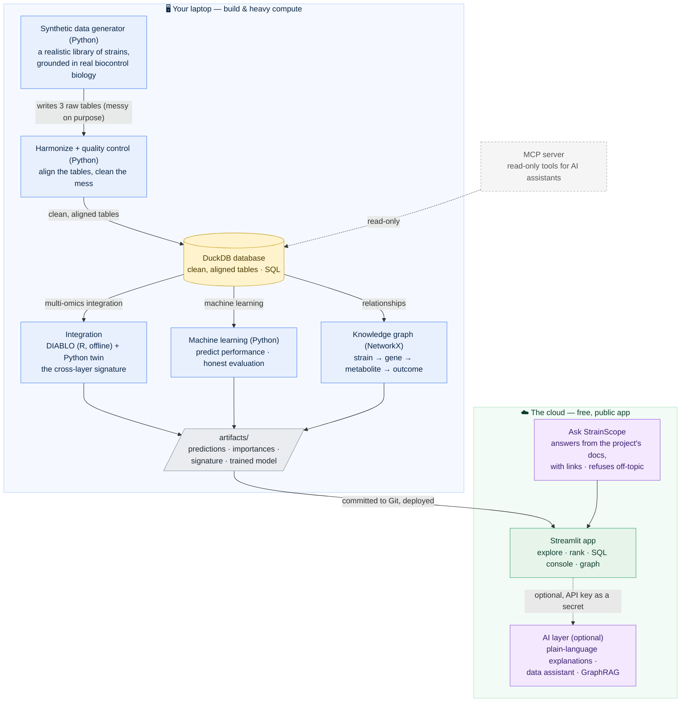

# StrainScope 🧫🧬📊


**▶ Live app — coming with the deployment phase (Phase 7)** · **v0.1.1 — data foundation and integration**
· 


-6f42c1)


-informational)

**Reading several different molecular "fingerprints" of beneficial microbes at
once, and predicting which ones are worth developing further — built from
scratch, in public, fully explained.**

> **New here? Start with the [Handbook](docs/HANDBOOK.md)** — one document that
> walks the whole journey, from a blank laptop to the finished product, explains
> *why* at every step, and links every specialised guide.
>
> Every term used anywhere in this repo — biological or technical — is defined
> in plain language in [`docs/GLOSSARY.md`](docs/GLOSSARY.md). If a word isn't
> there, that's a documentation bug.


---

## Contents

- [**The Handbook**](docs/HANDBOOK.md) — the whole journey in one document (read first)
- [What is a beneficial microbe? (start here)](#what-is-a-beneficial-microbe-start-here)
- [The problem this project tackles](#the-problem-this-project-tackles)
- [How it works](#how-it-works)
- [The data at a glance](#the-data-at-a-glance)
- [Results, phase by phase](#results-phase-by-phase) — fills in as each phase completes
- [Build log](#build-log) — every phase, linked to its guide, with status
- [**The tutorial, in order**](#the-tutorial-in-order) — the documents that teach every step from a blank laptop
- [Roadmap](#roadmap) — what comes next, in which order, and why — including the *Ask StrainScope* documentation assistant
- [About the data (honesty notes)](#about-the-data-honesty-notes)
- [Repository map](#repository-map) — every file, annotated
- [How to run](#how-to-run) — every command that works today
- [Changelog](CHANGELOG.md) — what changed, version by version
- [How I work on this repo (branch model)](#how-i-work-on-this-repo-branch-model)
- [Why the documentation is so detailed](#why-the-documentation-is-so-detailed)

## What is a beneficial microbe? (start here)

Imagine a farmer whose crop is under attack by a fungal disease. Instead of
spraying a synthetic chemical, they treat the field with a *living* helper — for
example a harmless soil **bacterium** that out-competes the pest, a **fungus**
like *Trichoderma* that parasitises the disease, a **yeast** that crowds it out,
or an **oomycete** that triggers the plant's own defences. Those helpers are
**beneficial microbes**, and using nature's own organisms this way — to protect
plants or improve soil — is the world of **biologicals**.

Different microbes fight with different weapons — bacteria with antibiotics and
lipopeptides, fungi with wall-digesting enzymes and toxins, yeasts by
competition — which is part of what makes picking the good ones hard.

Here's the catch that makes it a data problem. There are thousands of candidate
microbes, and only a few actually work well in the real world. Testing each one
properly is slow and expensive. But every microbe carries molecular "fingerprints"
we *can* measure cheaply:

- its **genome** — the microbe's blueprint, i.e. which useful genes it carries
  (think of it as a list of tools in the microbe's toolbox);
- its **metabolites** — the small-molecule chemicals it actually *produces*
  (think of it as the products coming off the microbe's production line);
- its measured **performance** — how well it suppressed a disease in a trial
  (the "job-performance score").

One microbe = one **strain**. One strain's row in this project's data = its three
fingerprints plus its score.

**StrainScope's question:** *can we read those cheap fingerprints, combine them
intelligently, and predict which strains are worth the expensive trials — and
explain why?*

## The problem this project tackles

**The pain point.** Choosing which natural strains to develop is mostly
trial-and-error: screen hundreds, test them one slow assay at a time, and hope.
Teams would love to *predict* the winners from cheap molecular profiles first —
but the data fights back in a specific way:

- **It comes in incompatible pieces.** The genomic fingerprint, the metabolomic
  fingerprint, and the performance score are three completely different kinds of
  table, in different units and scales. Most analyses look at **one** at a time
  and miss the signal that only appears when you read them **together**.
- **It's dirty.** Real measurements have missing values, batch-to-batch drift,
  duplicates, and outliers. Building anything trustworthy means cleaning that up
  first — and being able to show you did.
- **The useful strains are rare.** Most candidates don't work, so a naive model
  can score well just by always guessing "won't work" — which is useless.

**Why it matters.** Better prediction means fewer wasted trials, faster discovery
of effective biologicals, and more sustainable crop protection that leans on
nature instead of synthetic chemistry. The methods to do this — multi-omics
integration, machine learning, network analysis — are established in the
research literature, but clear, end-to-end, *beginner-reproducible* examples are
scarce.

**What StrainScope is.** An end-to-end, open workflow that does the whole thing
honestly: a Python script **generates** a realistic, biologically-grounded
synthetic library of strains with three fingerprint layers; a cleaning step
**harmonizes and quality-controls** the mess; the layers are **integrated** with a
recognised multi-omics method (DIABLO, from the R package mixOmics) *and* a
plain-Python counterpart; **machine-learning models** predict strain performance
with honest cross-validation and error analysis; a **knowledge graph** captures
the strain → gene → metabolite → outcome relationships; and an interactive
**Streamlit app**, deployed free for anyone to use, ties it together — with
**Ask StrainScope**, a documentation assistant that answers questions about the
project from its own documents (and refuses ones that aren't), an optional AI
layer that explains results in plain language, and an **MCP server** through
which AI assistants can use the project's tools directly. Every step is
documented so a complete beginner can rebuild and understand all of it — **the
repository is the tutorial.**

## How it works



In words: **make** the data with a transparent script; **clean** it into a single
queryable database; **integrate** the layers and **train** models on your laptop,
saving small result files; **build** a relationship graph from the same data;
then **serve** everything in a public app, with a documentation assistant and
optional AI explanations layered on top. The heavy work happens once, offline; the app just reads the small
results, which is what keeps the public deployment fast and free.

## The data at a glance

*StrainScope's dataset is **simulated** — created by the generator in
[`src/strainscope/generate_data.py`](src/strainscope/generate_data.py) with a fixed random seed, so
anyone who clones the repo reproduces it exactly. It is designed to mirror a real
biocontrol-screening scenario and is grounded in real gene families and compound
classes, but it is not real measurement data. See [About the data](#about-the-data-honesty-notes).*

The shape of the dataset (numbers from the generator, fixed seed):

| Fact | Value |
| --- | --- |
| Samples (microbial strains) | 600 across **4 kingdoms** — Bacteria 267, Fungi 183, Yeast 95, Oomycete 55 (+8 duplicate rows = 608 raw rows) |
| Genomic layer | 31 columns of real biocontrol gene families, grouped by kingdom: bacterial antibiotics/lipopeptides (`phlD`, `srfAA`, `ituA`, `pvdA`…), fungal/oomycete mycoparasitism & toxins (`ech42`, `prb1`, `dtxS`, `olpA`…), yeast killer-toxin/siderophore (`kilT`, `sidA`), plus housekeeping and accessory-noise genes |
| Metabolomic layer | 20 columns of secreted-compound abundances (DAPG, surfactin, iturin, six_PP, destruxin, oligandrin, killer_toxin…) plus background-noise compounds |
| Phenotype (the target) | `suppression_score` (0–100 %) and an `is_effective` label — **145 effective (24.2 %)**, every kingdom producing winners (19–28 %); plus a secondary `growth_promotion` score |
| Built-in realism | different weapons per kingdom, cross-layer correlations, class imbalance (~24 %), 714 missing metabolite cells, 338 missing gene calls, 120 outliers, 8 duplicated strains, a batch effect across 6 batches, and a few impossible scores |
| Honest scope | the four **cellular** kingdoms that share a genome+metabolome basis are modelled; viruses and protozoa are named as part of the biocontrol landscape but deliberately not forced into the molecular matrix |
| Reproducibility | one generator script, fixed seed (42) — identical data on every machine |

## Results, phase by phase

*Each phase leaves a visible artifact — a table, a chart, the app. As phases
complete, one figure per phase appears here with what it means, exactly as in the
build log below. Nothing is shown before it exists.*

- **Phase 1 — Data generation:** ✅ a reproducible generator (`src/strainscope/generate_data.py`, fixed seed) builds 600 strains across **four kingdoms** of biocontrol microbes (bacteria, fungi, yeasts, oomycetes), each fighting with its own real weapons, plus three grounded-in-real-biology omics layers — with class imbalance, missing values, batch effects, outliers, and duplicates injected on purpose. Each kingdom carries a distinct arsenal:

  

  The winners are deliberately rare (24.2 % effective) and every kingdom produces some, so a model must learn *how each group fights* rather than reading the kingdom label. Interactive version: `docs/interactive/signal_scatter.html`.
- **Phase 1b — Real data lands:** ✅ a pluggable ingestion framework (one contract: probe → fetch → tidy) pulls **real** data from three reference databases — real bacterial strains from **BacDive** (DSMZ), verified chemistry for our metabolites from **PubChem** (NIH), and curated compound→pathway links from **KEGG** (attributed; academic use) — every request logged to a provenance file and every raw response kept untouched in an evidence locker. The framework diagram:

  

  These real tables *complement* the synthetic library (no public source offers matched multi-omics with an outcome); the KEGG links become the knowledge graph's first real edges. Offline tests (`pytest`) verify all parsing without touching the live APIs.
- **Phase 1c — More real sources & the secrets lesson:** ✅ two more plugs in the same socket — **NCBI Datasets** (real genome metadata for all four kingdoms, finally backing the multi-kingdom story with real records) and **Metabolomics Workbench** (RefMet standard names + classification for our metabolites, plus real studies) — absorbed by the framework and the database loader with zero changes elsewhere. Introduces professional secrets handling: an optional free NCBI key living in the environment (`.env` / shell), never the repository, guarded by `.gitignore` *and* the safety gate:

  
- **Phase 2 — Cleaning & the database:** ✅ a six-rule cleaning pipeline with a full **ledger** (8 duplicate strains removed per table, 657 text cells harmonised, 3 impossible scores clipped, 41 provably-absurd outlier cells capped, batch drift removed by median-scaling, 1,052 missing cells counted and kept as honest NULLs) — and the clean tables plus the real Phase 1b tables loaded into one **DuckDB** database, queryable with SQL (see the [Query Cookbook](docs/QUERY_COOKBOOK.md)). The ledger earned its keep immediately: it caught a textbook outlier rule silently flattening real biology (bimodal data breaks one-humped fences — kept as a lesson in the doc).

  
- **Phase 3 — Multi-omics integration:** ✅ genes and chemistry read *together*, three ways — early (glue the tables), intermediate (**DIABLO**, R/mixOmics) and late (average per-block models) — all scored on the same repeated cross-validation folds against two negative controls that must, and do, behave like coins. Integration beats either block alone; centring each feature within its kingdom cut DIABLO's error by a third (0.22 → 0.145); and because the data is simulated, every signature is **graded against the planted truth**: DIABLO's robust list picks 29 features, all 29 true drivers, no decoys — and every feature the Python lasso picks is also in DIABLO's list. R and Python talk only through plain hand-off files, checked by a contract test.

  

  

  Every kingdom's weapons on one axis; ✓ = picked in at least 80 % of re-fits. Interactive version: `docs/interactive/integration_explorer.html` (download and open in a browser — it works offline). Results are also in the database as `int_*` tables — see the [Query Cookbook §8](docs/QUERY_COOKBOOK.md#8-integration-results-phase-3).
- **Phase 4 — Machine learning:** *(next)* model comparison with honest,
  leak-proof cross-validated scores, calibration and an error analysis.
- **Phase 5 — Knowledge graph:** *(planned)* the strain–gene–metabolite network,
  with the most connected "hub" features.
- **Phase 6 — The app:** *(planned)* screenshot of the explorer.
- **Phase 6b — Ask StrainScope:** *(planned)* a question answered from the docs
  with links — and an off-topic question politely refused.
- **Phase 7 — Deployment & AI layer:** *(planned)* the live URL, plain-language
  explanations, the data assistant and GraphRAG.
- **Phase 7b — MCP server:** *(planned)* an AI assistant using StrainScope's tools.
- **Phase 8 — Release 1.0:** *(planned)* the one-command pipeline and tests passing
  on Windows, macOS and Linux at every push.

## Build log

| # | Document | Status |
| --- | --- | --- |
| — | [**Handbook** — the whole journey, day 0 to the finished product](docs/HANDBOOK.md) | 🔨 living document |
| — | [Glossary — every term in plain words](docs/GLOSSARY.md) | 🔨 living document |
| — | [Roadmap](docs/ROADMAP.md) · [Product roadmap](docs/PRODUCT_ROADMAP.md) · [Changelog](CHANGELOG.md) | 🔨 living documents |
| 0 | [Architecture — how it all fits together](docs/00-architecture.md) | ✅ |
| 0 | [Environment setup from a blank laptop](docs/01-setup.md) | ✅ |
| 1 | [Data generation: a realistic synthetic library](docs/02-data-generation.md) | ✅ |
| 1b | [Real data lands: BacDive · PubChem · KEGG](docs/02b-real-data-ingestion.md) | ✅ |
| 1c | [More real sources: NCBI Datasets · Metabolomics Workbench + the secrets lesson](docs/02c-more-real-sources.md) | ✅ |
| 2 | [Harmonization & quality control → DuckDB + SQL](docs/03-harmonization-qc.md) | ✅ |
| 3 | [Multi-omics integration (DIABLO in R + a Python twin)](docs/04-integration.md) | ✅ **v0.1.0** |
| 3.1 | [Fix release: a safety gate that also checks new files, copy-safe commands](docs/HANDBOOK.md#stage-71--fix-release-v011-a-safer-safety-gate-and-copy-safe-commands) | ✅ **v0.1.1** |
| 4 | Machine learning & honest evaluation — `docs/05-machine-learning.md` | ⏳ next |
| 5 | Knowledge graph — `docs/06-knowledge-graph.md` | ⬜ planned (**v0.2.0**) |
| 6 | The Streamlit app — `docs/07-app.md` | ⬜ planned |
| 6b | Ask StrainScope, the documentation assistant — `docs/07b-docs-assistant.md` | ⬜ planned (**v0.3.0**) |
| 7 | Deployment + AI layer — `docs/08-deployment-ai.md` | ⬜ planned |
| 7b | The MCP server — `docs/08b-mcp-server.md` | ⬜ planned |
| 8 | Packaging & release 1.0 — `docs/09-packaging.md` | ⬜ planned (**v1.0.0**) |

*Legend: ✅ done · 🔨 living / in progress · ⏳ next · ⬜ planned. Guides appear as their phase is built.*

## The tutorial, in order

Every step of this project — from an empty laptop to a deployed app — is taught in
`docs/`, written for a complete beginner, with every term defined
([glossary](docs/GLOSSARY.md)) and every command shown with its expected output.
Read in order:

| # | Guide | What it teaches |
| --- | --- | --- |
| ★ | [Handbook](docs/HANDBOOK.md) | The whole journey in order: what, why, how long, the checkpoint and the commit for every stage — read first, return often |
| 00 | [Architecture](docs/00-architecture.md) | How all the pieces fit together; backend/frontend/database in plain words |
| 01 | [Setup](docs/01-setup.md) | Blank laptop → working workshop (Python, R, Git, `.venv`, `renv`, the `master`/`beta`/`develop` model, the safety gate) on Windows, macOS, RHEL 8 |
| 02 | [Data generation](docs/02-data-generation.md) | Random seeds & reproducibility; designing realistic synthetic multi-omics data |
| 02b | [Real-data ingestion](docs/02b-real-data-ingestion.md) | APIs, JSON, rate limits & politeness; the evidence locker and provenance log; one socket, many source plugs |
| 02c | [More real sources + secrets](docs/02c-more-real-sources.md) | API keys done right: the environment, `.env` and `.env.example`; real genomes across four kingdoms; RefMet classification |
| 03 | [Harmonization & QC](docs/03-harmonization-qc.md) | The cleaning ledger; duplicates, text, outliers (and why the textbook rule fails on bimodal data), batch correction; DuckDB + first SQL |
| 04 | [Integration](docs/04-integration.md) | What multi-omics integration *is*, three ways; DIABLO in R and a Python twin; repeated cross-validation, balanced error rate, negative controls, stability; grading against planted truth; R ↔ Python contracts; the same task in three languages |
| — | [Query Cookbook](docs/QUERY_COOKBOOK.md) | Tested, explained SQL recipes against the project database — grows every phase |
| 05 | `docs/05-machine-learning.md` *(next)* | Leak-proof pipelines, class imbalance, calibration, feature importance, error analysis |
| 06 | `docs/06-knowledge-graph.md` | Ontologies & graphs (a "family tree for concepts"); building and querying one with NetworkX |
| 07 | `docs/07-app.md` | Streamlit; turning analysis into buttons; a read-only SQL console |
| 07b | `docs/07b-docs-assistant.md` | Search over documents, citing sources, refusing off-topic questions, golden question sets; optional local or hosted language model |
| 08 | `docs/08-deployment-ai.md` | Streamlit Community Cloud; secrets; explanations, a data assistant and GraphRAG that degrade gracefully without a key |
| 08b | `docs/08b-mcp-server.md` | The Model Context Protocol; exposing read-only tools to AI assistants safely |
| 09 | `docs/09-packaging.md` | The one-command pipeline, continuous integration on three operating systems, LICENSE, CHANGELOG, uninstall, the 1.0 tag |
| — | [Roadmap](docs/ROADMAP.md) · [Product roadmap](docs/PRODUCT_ROADMAP.md) | What is built next and why; what an industrial version would add, with a verdict for every technology |
| — | [Glossary](docs/GLOSSARY.md) | Every term, plain language, by phase |

## Roadmap

The full plan lives in [`docs/ROADMAP.md`](docs/ROADMAP.md) — every phase, the
reason for its place in the order, and the deferred items with the event that
would schedule each. In short, after integration come **machine learning**
(Phase 4), the **knowledge graph** (5), the **app** (6), then:

- **Ask StrainScope** (Phase 6b) — a question box over the project's own
  documentation. It answers with the matching passages and links to the exact
  sections, suggests starter and follow-up questions, and **refuses questions
  that are not about StrainScope** rather than inventing an answer. Optionally a
  language model — local on your own computer (Ollama) or hosted — writes a short
  answer *only from those passages*. A golden set of in-scope and off-topic
  questions runs with the tests. It comes right after the app because by then the
  documentation covers a complete path to a usable product.
- **Deployment and the AI layer** (Phase 7) — free public hosting,
  plain-language explanations, a read-only data assistant (question → SQL →
  answer, query shown) and GraphRAG (answers that walk the knowledge graph).
- **MCP server** (Phase 7b) — StrainScope's tools offered to AI assistants
  through the [Model Context Protocol](https://modelcontextprotocol.io),
  read-only, validated and logged.
- **Packaging and release 1.0** (Phase 8) — one-command pipeline, tests on
  Windows, macOS and Linux at every push, LICENSE, CHANGELOG, the 1.0 tag.

What a larger, industrial version would add — real matched laboratory data, a
multi-user web front end and API, PostgreSQL, scheduling, ontologies, monitoring
— is laid out in [`docs/PRODUCT_ROADMAP.md`](docs/PRODUCT_ROADMAP.md), with a
verdict and a trigger for every technology: *justify, don't accumulate.*

## About the data (honesty notes)

- **The dataset is simulated, and this is stated everywhere.** No part of
  StrainScope claims the numbers are real measurements. The data is produced by a
  single, commented generator script with a fixed random seed, so it is identical
  on every machine and fully inspectable.
- **Why synthetic, honestly:** clean, matched multi-omics data on the *same*
  strains — genomics *and* metabolomics *and* a performance score, all aligned —
  is not something you can download as one tidy package. Rather than pretend
  otherwise, StrainScope *builds* the data transparently. Designing realistic
  synthetic data (with correlations, imbalance, and messiness on purpose) is
  itself a demonstrated skill, and companies use synthetic data for real reasons:
  privacy, rare events, and the absence of public data.
- **Grounded in real biology:** the gene families and compound classes used are
  real ones known to matter for microbes that protect plants (antibiotic-
  biosynthesis genes, siderophores, chitinases, ACC-deaminase; lipopeptides such
  as surfactin, iturin, and fengycin). This keeps the exercise realistic and
  educational without passing invented numbers off as measured ones.
- **Real data now sits alongside the synthetic library — with its own honesty
  notes.** Phase 1b fetches real strains (BacDive), real chemistry (PubChem),
  and real pathway links (KEGG, attributed, academic-use) through a logged,
  provenance-first ingestion framework. These tables *complement* the synthetic
  core rather than replace it, and entries a source genuinely cannot answer
  (proteins in a small-molecule database) are recorded as such, not hidden.
- **The honest limitation:** a model trained on synthetic data proves the
  *workflow* is correct — the integration, the cleaning, the evaluation, the app —
  **not** that the predictions would hold on real-world strains. That boundary is
  stated in the docs and is exactly how synthetic-data work should be presented.
- **Optional real-data path:** the [roadmap](docs/ROADMAP.md#deferred-items-and-their-triggers)
  keeps a slot for swapping in a real matched dataset the day one exists — the
  Phase 3 hand-off files are where it would plug in.

## Repository map

The full tree, annotated with the phase that creates each piece (✅ = exists ·
⬜ = arrives in a later phase). The [Handbook's file index](docs/HANDBOOK.md#every-file-in-the-repository-and-where-it-is-explained)
says which guide explains each file.

```
strainscope/
├── README.md                      ← you are here
├── CHANGELOG.md                   ← what changed, version by version               ✅
├── LICENSE                        ← MIT (added at packaging, Phase 8)               ⬜
├── check-public-safe.sh           ← pre-push safety gate (run before every push)   ✅
├── requirements.txt               ← Python packages (the R side: renv.lock)        ✅
├── renv.lock                      ← exact R package versions (the R "receipt")     ✅
├── strainscope.Rproj              ← RStudio project file (optional)                ✅
├── .Rprofile                      ← auto-activates renv in this project            ✅
├── renv/activate.R, settings.json ← renv's switch (the library itself is ignored)  ✅
├── .env.example                   ← template for optional keys (copy to .env)      ✅
├── .gitignore                     ← incl. .venv/, data/, secrets, renv library     ✅
├── .streamlit/config.toml         ← app settings (Phases 6–7)                       ⬜
│
├── docs/                          ← the tutorial (the repo IS the tutorial)
│   ├── HANDBOOK.md                ← ★ the whole journey, day 0 → product            ✅
│   ├── 00-architecture.md         ← how it all fits together                       ✅
│   ├── 01-setup.md                ← blank laptop → working workshop                ✅
│   ├── 02-data-generation.md      ← Phase 1: the synthetic library                 ✅
│   ├── 02b-real-data-ingestion.md ← Phase 1b: BacDive · PubChem · KEGG             ✅
│   ├── 02c-more-real-sources.md   ← Phase 1c: NCBI · Metabolomics WB · secrets     ✅
│   ├── 03-harmonization-qc.md     ← Phase 2: cleaning, the ledger, DuckDB + SQL    ✅
│   ├── 04-integration.md          ← Phase 3: DIABLO + Python twin                  ✅
│   ├── 05 … 09                    ← Phases 4–8 (incl. 07b, 08b)                    ⬜
│   ├── ROADMAP.md                 ← what is built next, and why                    ✅
│   ├── PRODUCT_ROADMAP.md         ← beyond the repo: verdicts and triggers         ✅
│   ├── QUERY_COOKBOOK.md          ← tested SQL recipes (grows every phase)         ✅
│   ├── GLOSSARY.md                ← every term, plain language, by phase           ✅
│   ├── img/                       ← logo, icon, journey map (SVG)                  ✅
│   └── interactive/               ← self-contained interactive charts (Plotly)     ✅
│       ├── plotly.min.js          ← the shared chart library (works offline)
│       ├── signal_scatter.html    ← Phase 1: hover any strain
│       ├── batch_before_after.html← Phase 2: cleaning, before and after
│       ├── real_genomes.html, real_compounds.html ← Phases 1b–1c
│       └── integration_explorer.html ← Phase 3: four linked views
│
├── figures/                       ← teaching figures, each regenerated by a script
│   ├── make_phase1_figures.py     ← Phase 1                                        ✅
│   ├── make_phase2b_figures.py    ← Phase 1b: framework diagram + real-data charts ✅
│   ├── make_phase2c_figures.py    ← Phase 1c: the secrets diagram + genome charts  ✅
│   ├── make_phase2_figures.py     ← Phase 2: before/after cleaning evidence        ✅
│   ├── make_phase3_figures.py     ← Phase 3: concepts, results, the explorer       ✅
│   ├── make_illustrations.py      ← logo, icon and journey map (docs/img/)         ✅
│   └── *.png                      ← the figures themselves                         ✅
│
├── src/strainscope/               ← the reusable backend code (Python)
│   ├── __init__.py                ← marks the folder as a Python package           ✅
│   ├── generate_data.py           ← Phase 1: the synthetic data generator          ✅
│   ├── fetch_real.py              ← Phase 1b: the real-data command (probe/fetch)  ✅
│   ├── sources/                   ← Phases 1b–1c: one plug per source (BacDive ·
│   │                                 PubChem · KEGG · NCBI · Metabolomics WB)      ✅
│   ├── harmonize.py               ← Phase 2: cleaning + ledger + database loader   ✅
│   ├── sql.py                     ← Phase 2: the read-only SQL console             ✅
│   ├── integrate.py               ← Phase 3: blocks, Python twin, grading, publish ✅
│   ├── model.py                   ← Phase 4: ML training + evaluation              ⬜
│   ├── graph.py                   ← Phase 5: the knowledge graph                   ⬜
│   ├── ask.py                     ← Phase 6b: Ask StrainScope                      ⬜
│   ├── explain.py                 ← Phase 7: explanations + data assistant         ⬜
│   ├── mcp_server.py              ← Phase 7b: the MCP server                       ⬜
│   └── pipeline.py                ← Phase 8: the one-command pipeline              ⬜
│
├── R/
│   └── diablo_integration.R       ← Phase 3: DIABLO (mixOmics), run on the laptop  ✅
│
├── artifacts/                     ← small results the app reads (committed)
│   ├── integration/*.csv          ← Phase 3: signature, scores, scoreboards …      ✅
│   └── (Phase 4+)                 ← predictions, importances, model, graph         ⬜
│
├── app/
│   └── streamlit_app.py           ← the app (Phases 6–7)                            ⬜
│
├── tests/                         ← automated checks (pytest) — 37 today           ✅
│   ├── test_sources.py            ← ingestion parsers, offline
│   ├── test_harmonize.py          ← cleaning rules and the database loader
│   ├── test_integrate.py          ← integration, grading, the R ↔ Python contract
│   └── test_safety_gate.py        ← the pre-push safety gate, in throw-away repos
│
├── data/                          ← NOT in Git; regenerated on demand
│   ├── raw/                       ← raw synthetic tables + real-data evidence locker
│   └── processed/                 ← clean tables, integration blocks, strainscope.duckdb
│
├── .venv/                         ← Python's sealed toolbox — NOT in Git
└── renv/library/                  ← R's sealed library — NOT in Git (rebuilt from renv.lock)
```

| Path | What lives here |
| --- | --- |
| root files | Release surface: README, CHANGELOG, LICENSE (Phase 8), the pre-push safety gate, the two dependency receipts (`requirements.txt`, `renv.lock`) |
| `docs/` | The Handbook, the phase-by-phase tutorial, glossary, cookbook and roadmaps — the repo's teaching layer |
| `src/strainscope/` | The reusable Python backend: generate, fetch, clean, query, integrate — then model, graph, ask, explain, serve |
| `R/` | The single specialised R script (DIABLO integration), run on the laptop |
| `artifacts/` | Small precomputed outputs the app serves — the bridge from laptop to cloud |
| `app/` | The Streamlit app (the public frontend) |
| `tests/` | Automated checks that prove the code does what it claims |
| `data/` | Raw + processed data and the DuckDB file — **never in Git**; regenerated on demand |

Two kinds of "not in Git": `data/` because the scripts recreate it (that's the
proof they work), and `.venv/`, `renv/library/`, `.env` and `.streamlit/secrets.toml`
because they're either rebuildable or secret. Secrets never enter version control.

## How to run

Every command below works today; each phase guide explains its own in full.
Python 3.12 and R 4.x are installed per [`docs/01-setup.md`](docs/01-setup.md)
on Windows, macOS or Linux (RHEL 8).

```bash
git clone https://github.com/akannan2987/strainscope.git
cd strainscope

# Python toolbox
python -m venv .venv                      # RHEL 8: python3.12 -m venv .venv
source .venv/bin/activate                 # Windows PowerShell: .\.venv\Scripts\Activate.ps1
pip install -r requirements.txt

# R toolbox (only for the DIABLO step) - rebuilds the exact R packages from renv.lock
Rscript -e 'renv::restore()'              # Windows PowerShell: Rscript -e "renv::restore()"

# Build, phase by phase
python src/strainscope/generate_data.py   # Phase 1  - the synthetic library
python src/strainscope/fetch_real.py      # Phase 1b/1c - real data (optional, needs internet)
python src/strainscope/harmonize.py       # Phase 2  - clean + build the database
python src/strainscope/integrate.py all   # Phase 3  - prepare, DIABLO (if R is present), Python twin, publish

# Look at the results
python src/strainscope/sql.py             # the read-only SQL console (see docs/QUERY_COOKBOOK.md)
python figures/make_phase3_figures.py     # redraw the Phase 3 figures + interactive explorer

# Check everything
pytest -q                                 # 37 passed
```

Coming with later phases: `python src/strainscope/model.py` (4),
`python src/strainscope/graph.py` (5), `streamlit run app/streamlit_app.py` (6),
`python src/strainscope/ask.py "question"` (6b), and the one-command
`python src/strainscope/pipeline.py` (8).

> **Runs the same on Windows, macOS, and Linux (including RHEL 8 VMs).** The code
> uses platform-neutral file paths, and every tool in the stack is cross-platform.
> Where a command differs by OS, the docs show each variant. Set up once per
> machine; after that, editing, committing, and redeploying are the same short
> commands everywhere.

For the guided path — every step explained from a blank machine — start at the
[Handbook](docs/HANDBOOK.md).

## How I work on this repo (branch model)

This project uses three branches: **`master`** (the stable, official version),
**`beta`** (a release-candidate preview), and **`develop`** (where day-to-day work
happens). The rhythm is: make changes on `develop`, push `develop` up to all three
at once, then bring local `master` back in step. Every phase ends with exactly this:

```bash
# safety first, before staging anything
pytest -q                     # all tests pass
./check-public-safe.sh        # must print "SAFE TO PUSH"  (Windows: bash check-public-safe.sh in Git Bash)

git switch develop
git add -A
git commit -m "clear message describing the change"
git push origin develop develop:beta develop:master

## --tags is optional, only when a release tag was created in this phase
## then switch back to local master and pull in the remote changes

git switch master
git pull --ff-only origin master
git switch develop
```

Every push is gated by `./check-public-safe.sh`, which inspects what Git tracks
**and** the new files `git add -A` is about to add, and refuses the all-clear if a
secret (an API key, a `.env`, a database file) or a hard-coded local path would be
published — `.gitignore` is the lock on the
door, this is the guard checking the bag on the way out. Every command, commit
message and tag message in this repository uses plain keyboard characters only —
look-alike characters such as a long dash can be garbled when pasted into a
terminal ([why](docs/01-setup.md#copy-commands-safely-plain-keyboard-characters-only)).

The push line sends local `develop` to remote `develop` and fast-forwards remote
`beta` and `master` to match — three branches kept in lock-step with one command.
The `master` sync-back keeps the local copy consistent with what was just pushed.
`--ff-only` means "update only if it's clean, otherwise stop and warn." Tags
(`v0.1.0`, `v0.2.0`, `v0.3.0`, `v1.0.0` — [why these](docs/ROADMAP.md#version-tags))
are pushed with `--tags` only when a new version is cut. The full reasoning and the
"if it goes wrong" cases are in [`docs/01-setup.md`](docs/01-setup.md#part-h--initialise-git-and-push-with-the-master--beta--develop-workflow).

## Why the documentation is so detailed

Documentation quality is a deliberate deliverable here, not an afterthought. An
analysis that can't be reproduced and explained is worth very little — so this
repo is written so that a complete beginner can rebuild it from scratch and learn
every concept along the way. The [Handbook](docs/HANDBOOK.md) is the spine — one
document from day 0 to the finished product, updated in the same commit as every
change — and the glossary rule at the top of this file is part of the same
contract: every term is defined in plain language, or it's a bug.

---

*StrainScope is a personal learning project built in the open. The data is
synthetic and disclosed as such; the goal is a correct, honest, end-to-end
workflow that others can learn from and reproduce.*
