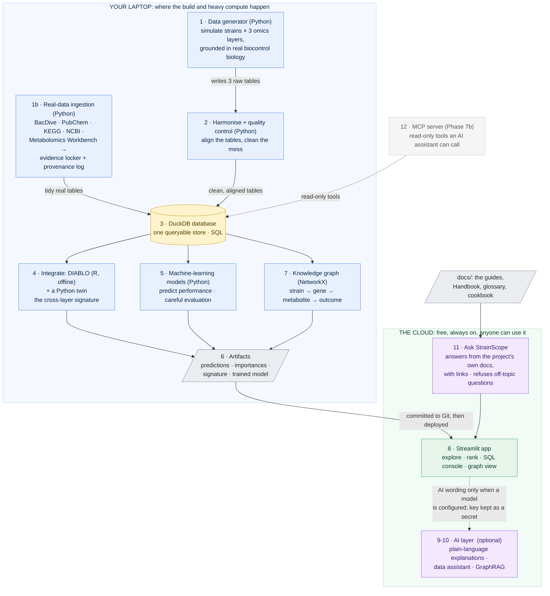

# 00 · Architecture, Explained From Scratch

[← README](../README.md) · [Handbook](HANDBOOK.md) · [All docs in order](../README.md#the-tutorial-in-order) · [Glossary](GLOSSARY.md) · [Roadmap](ROADMAP.md)

**Prerequisites:** none. If you haven't yet, skim the [Handbook](HANDBOOK.md) first. It's the map of the whole journey, and this page is its Stage 0.
**Learning goal:** after this page you'll understand what every part of StrainScope does, why it's there, and how data travels from a blank folder all the way to a public website that anyone in the world can use. You don't need to have built software before.
**Checkpoint:** you can explain, in your own words, the difference between a *backend*, a *frontend*, and a *database*, and you can name the ten boxes in the StrainScope diagram and say what each one is for.

---

## 1. What is StrainScope, in one sentence?

StrainScope is a small, self-contained data-science project that takes several different kinds of biological measurements about a collection of microbes, combines them into one picture, and uses machine learning to predict which microbes are most likely to be useful, then serves those predictions on a website that anyone can open and explore.

The rest of this page is about *how* we do that, one small step at a time.

If biology and software are both new to you, here's the same idea in ordinary terms:

> Imagine you run a seed bank, except the seeds are tiny helpers (microbes). You hold hundreds of them and can only afford to develop a handful further. Each one comes with three very different documents: a "birth certificate" (its genes), a "receipt of what it actually produces" (its chemicals), and a score from a growing trial. StrainScope reads all three documents at once for every candidate, predicts which ones are worth backing, and *explains why* it thinks so.

---

## 2. The three words you must know first

A lot of confusing software talk gets much clearer once you know these three words. I'll use a restaurant as the running comparison, because it fits all three neatly.

### Backend: "the kitchen"
The **backend** is everything that happens behind the scenes: preparing ingredients, cooking, plating. Customers never walk into the kitchen. In software, the backend is the code that does the actual work (reading data, cleaning it, running calculations, training models). Nobody "sees" the backend directly; they only see what comes out of it.

In StrainScope, the backend is where we generate the data, clean it, store it, integrate it, and train the model.

### Frontend: "the dining room"
The **frontend** is the part the customer actually sits in and interacts with: the menu, the table, the plated dish. In software, the frontend is the screen a person looks at and clicks on, with its buttons, dropdowns and charts.

In StrainScope, the frontend is the Streamlit app: the web page where someone picks a microbe from a dropdown, sees its predicted score, and reads an explanation.

### Database: "the pantry"
A **database** is an organised store of ingredients that you fetch from quickly and precisely, instead of rummaging through random bags on the floor. You ask it for exactly what you want using a language called **SQL** (think of SQL as a very polite, very literal way of saying "bring me all the microbes whose performance score is above 80").

In StrainScope, the database is a single file called a **DuckDB** database. It lives on disk like any other file, but you can ask it questions in SQL.

> **Why bother with a database at all, if we already have files?**
> For two reasons. Asking a precise question and getting an instant, correct answer is something the project needs to be able to do. And once the data lives in a database, the app, the charts and the AI features can all pull from *one* trusted source instead of five slightly different copies (one well-stocked pantry instead of five half-empty cupboards).

---

## 3. A few more terms, defined once (you'll see them everywhere)

- **Omics / multi-omics.** An "-omics" is one *type* of biological measurement. Think of one microbe as a car. Its **genome** is the blueprint (what it *could* do). Its **metabolites** are what comes out of the tailpipe and cabin: the actual chemical products of everything the cell is doing. Looking at several "-omics" together is **multi-omics**, like filming the same car from several camera angles so that no single angle can fool you. **Integration** means analysing those angles *jointly* instead of one at a time.
- **Feature.** One measured column, such as one gene or one chemical: a single clue about a sample. A model looks at many features to make a prediction.
- **Sample.** One thing you measured. Here, one microbial strain.
- **Model.** A recipe learned from examples. You show it many strains where you already know the performance score, and it learns to predict the score for strains it has never seen.
- **Supervised learning.** Learning with an answer key (we know the true score for the training strains). The opposite, *unsupervised*, has no answers to learn from and looks for natural groupings instead.
- **Pipeline.** A fixed sequence of steps that runs in order, like an assembly line: raw material in one end, finished product out the other. Our pipeline is: generate → clean → store → integrate → model → serve.
- **Artifact.** A saved output file, such as a prediction table, a trained model or a chart. We compute artifacts once (slowly, on your laptop) and reuse them many times (instantly, in the app).
- **Deployment.** Putting your app onto a computer on the internet so other people can use it, instead of it only running on your laptop.

---

## 4. The boxes, and why each one exists

Here's the whole system as a diagram, followed by a plain-language tour of every box. GitHub draws the diagram below automatically. Take it slowly the first time; you'll keep coming back to it.

*(If you're reading this as raw text, for example in a plain editor that
doesn't draw diagrams, picture it top to bottom: the generator feeds the
cleaner, which fills the database; the database feeds integration, machine
learning and the graph; those write small artifact files; the artifacts are
deployed into the public app; and the AI layer switches on only when an API
key is present. Ask StrainScope reads the project's own documentation and answers
inside the app; the MCP server, last, offers the same functions to AI
assistants. The box-by-box tour below says the same thing in words.)*

### Box 1: Data Generator (Python) · *backend*
**What it does:** creates our dataset from scratch, in code. It invents a realistic library of microbial strains and, for each one, three tables of measurements plus a performance score.
**Why it exists:** you can't download clean, matched multi-omics data on the same microbes in one tidy package. So instead of pretending, we *build* the data openly with a script, and we base it on real biology (real gene families and chemical classes known to matter for microbes that protect plants). Anyone who clones the repo runs this one script and gets exactly the same data, because we fix the "random seed": a starting number that makes randomness repeatable, a bit like shuffling a deck the same way every time.
**A note on the data:** this data is *simulated*, and the project says so everywhere. Designing a realistic synthetic dataset takes real skill, but a model trained on it shows that the *workflow* is correct. It doesn't show that the numbers would hold on real-world microbes. Being upfront about that is part of what makes the project trustworthy.

### Box 1b: Real-Data Ingestion (Python) · *backend*
**What it does:** pulls *real* data from five well-known reference databases through their public APIs: real bacterial strains from BacDive, verified chemistry from PubChem, curated compound→pathway links from KEGG (attributed, with its academic-use terms respected), real genome metadata across all four kingdoms from NCBI Datasets (with its optional API key, if you use one, handled properly as a secret), and RefMet classifications plus real studies from Metabolomics Workbench. Every response is saved untouched in an "evidence locker" (`data/raw/real/`), every request is written to a **provenance log** (who asked what, when, and how much came back), and small tidy tables land in `data/processed/real/`, ready to join the database in Phase 2.
**Why it exists:** it ties the project to reality, because the molecules and strains our synthetic library models are real things you can check. It also covers the ingestion work every data team does: calling APIs, staying polite and within rate limits, building in traceability from the start, and a "one socket, many plugs" adapter framework, so adding a new source means adding one file.
**Where it stops:** these real tables *complement* the synthetic library. No public source offers matched multi-omics with a biocontrol outcome, which is exactly why Box 1 exists.
Think of Box 1 as a flight simulator and Box 1b as bringing real aviation charts and real aircraft specs into the room. The simulation stays a simulation, but everything it's modelled on can be checked against the real thing.

### Box 2: Harmonise + Quality Control (Python) · *backend*
**What it does:** takes the three raw tables and makes them *align* (same strains, same order, same identifiers) and *clean* (handles missing values, removes duplicates, flags outliers, corrects obvious mess).
**Why it exists:** real data is dirty, and combining several dirty tables multiplies the mess. "Harmonisation" is the unglamorous work of getting three differently-shaped tables to agree on who's who. "Quality control" (QC) is checking the data is trustworthy before you build anything on top of it. We add realistic messiness to Box 1 on purpose, so that Box 2 has real problems to fix and you can watch the cleaning actually do something.
A party is a good comparison. Three people each hand you a guest list for the same party: one uses nicknames, one has duplicates, and one is missing phone numbers. Harmonisation is turning them into one clean master list.

### Box 3: Store in DuckDB (SQL) · *backend + pantry*
**What it does:** loads the cleaned tables into a single database file you can query with SQL.
**Why it exists:** it gives the model, the app and the AI features one trusted source of truth to read from. It also lets us use SQL properly. DuckDB happens to be a good *local stand-in* for the big cloud "data warehouses" companies use, so the SQL you write here carries over to those later (a bit of portability that comes for free).

### Box 4: Integrate (DIABLO in R, plus a Python version) · *backend, the specialised heart*
**What it does:** this is the multi-omics **integration**, the part that finds the *combination* of genes and chemicals that, taken together across all layers at once, best separates high-performing strains from low-performing ones.
**Why it exists:** integration is the main technique of the whole project. Analysing one table is routine; integrating several properly is the hard part. We use **DIABLO**, a well-established method from a free R package called **mixOmics** that specialists trust for exactly this job, and we *also* provide a plain-Python version so the project can run without R if you prefer. Using the tool that specialists already recognise makes the results easier to trust; the Python twin keeps the project approachable.
**Why R runs offline (a design choice worth knowing):** R is a little awkward to run on the free hosting we'll use. So DIABLO runs on your laptop, and we *save its results as small CSV files* (artifacts, in `artifacts/integration/`, also published as `int_*` tables in the database). The website reads those files instantly. This "compute once, serve many times" pattern is ordinary professional engineering, and there's nothing second-best about it.
**How R and Python stay in step:** they never call each other. Python prepares the blocks and writes them as plain CSV files; R reads them and writes its results as plain CSV files; Python reads those back, compares, grades and publishes. A test checks that both sides agree on every file name (a *contract*). ✅ Built in Phase 3: [`docs/04-integration.md`](04-integration.md).

### Box 5: ML Models (Python) · *backend*
**What it does:** trains machine-learning models (a baseline, an elastic net, a random forest, gradient boosting) to predict the *probability* that a strain is effective, and then *evaluates them carefully*, which is the part that's easiest to skip. That means the same cross-validation folds for every model, the data preparation re-learned inside every fold (no leakage), scores built for rare winners, calibrated probabilities, and an error analysis that admits what the model gets wrong.
**Why it exists:** prediction is the whole point: *"which 50 strains should we test next?"*. A model nobody has checked can't be trusted, though, so the evaluation matters as much as the model does. We also handle "class imbalance" (when good strains are rare) so the model can't score well by always guessing "bad".
**✅ Built in Phase 4:** [`docs/05-machine-learning.md`](05-machine-learning.md). The elastic net wins; of its 50 best-ranked strains, 47 are truly effective.

### Box 6: Artifacts · *the hand-off between laptop and cloud*
**What it does:** stores the small, finished outputs: the DIABLO results (`artifacts/integration/`), the ranking, the feature-importance table, the trained model and its model card (`artifacts/model/`).
**Why it exists:** artifacts are the bridge between the slow backend on your laptop and the fast frontend on the internet. The app never re-runs the heavy work; it just reads these files. This is what keeps the free deployment fast and within its memory budget.

### Box 7: Knowledge Graph (NetworkX) · *backend, our core AI feature*
**What it does:** turns the data into a *network* of entities and relationships (strain → carries → gene → encodes → metabolite → suppresses → pathogen) that you can query and visualise.
**Why it exists:** there are two reasons. First, "network-based methods" are a named part of this field, and a graph is the natural way to express *relationships* that a flat table hides. Second, the graph is the foundation for the smarter AI features later (a chatbot that answers by *walking* the graph). We build it with NetworkX, a free Python library that needs no database to start.
If an ontology is a "family tree for concepts" (the rules of what connects to what), then the knowledge graph is the filled-in family tree you can actually trace.

### Box 8: Streamlit App · *frontend, deployed to the cloud*
**What it does:** the website. A person opens a URL and can browse strains, see predictions and the reasons behind them, run their own SQL queries in a safe read-only console, view the knowledge graph, and rank new candidate strains.
**Why it exists:** results that nobody can open and try aren't much use to anyone. The app turns the analysis into something a non-specialist can *use*. Streamlit lets us build this entire web page in plain Python, with no web-development knowledge needed. We deploy it free on Streamlit Community Cloud, which connects to your GitHub repo and gives it a public URL; every time you push new code, the site updates itself.

### Box 9: AI Explanation Layer · *frontend feature (staged)*
**What it does:** turns a model's terse output ("top features: phlD gene, surfactin, siderophore") into a plain sentence a non-specialist can read.
**Why it exists:** findings are only useful if people without a technical background can follow them, and this is the cheapest way to get there. It works without any language model at all, writing template sentences filled with the computed facts. When a model is configured (a hosted one, with its API key stored safely as a secret, or a local one on your own computer), the model only rephrases those facts. If nothing is configured, nothing breaks.

### Box 10: Data assistant and GraphRAG · *frontend feature (Phase 7)*
**What it does:** someone asks a question about the *data* in ordinary language ("which chemicals are most linked to high performance?"). The **data assistant** turns it into a SQL query on the read-only database and shows the query beside the answer; the **GraphRAG** version answers by tracing the knowledge graph and citing the path it walked.
**Why it exists:** it's the most natural way for a non-expert to question the project's results. It comes later because it builds on Boxes 3, 7 and 9.

### Box 11: Ask StrainScope · *documentation assistant (Phase 6b)*
**What it does:** answers questions about the *project itself* (say, "how do I install mixOmics on Windows?" or "what is a balanced error rate?") from the project's own documents, quoting the matching passages with links to the exact sections. Questions that aren't about StrainScope get a polite refusal instead of a guess. Optionally, a language model writes a short answer from those passages only.
**Why it exists:** the documentation is large by design, and a newcomer's most frequent question is "where is that explained?". It behaves like a librarian who lends only from this one library and tells you so when you ask for a book it doesn't have. Full design: [`docs/ROADMAP.md`](ROADMAP.md#ask-strainscope-the-documentation-assistant-in-detail).

### Box 12: MCP Server · *a door for AI assistants (Phase 7b)*
**What it does:** exposes a few of the project's functions (search the docs, run a read-only query, fetch the signature, rank a strain) through the **Model Context Protocol**, a standard "USB port" that lets AI assistants call tools directly. Every call is validated and logged.
**Why it exists:** besides being code that people read, your repo becomes a tool an AI assistant can use. It's built last because it reuses functions the app and Ask StrainScope already provide; all it adds is a new door into machinery that's already there.

---

## 5. How data flows, start to finish (the one-paragraph story)

You run the **generator** (Box 1), which writes three raw tables. You run **harmonise + QC** (Box 2), which turns them into clean, aligned tables. Those load into **DuckDB** (Box 3). From the database, the **integration** step (Box 4) finds the cross-layer signature and saves it as an artifact; the **ML models** (Box 5) train and save predictions and a trained model as artifacts (Box 6); the **knowledge graph** (Box 7) is built from the same clean data. You commit everything to GitHub. Streamlit Community Cloud notices the new commit and (re)builds your **app** (Box 8), which reads the small artifacts and serves them quickly to anyone on the internet. Around it, **Ask StrainScope** (Box 11) answers questions about the project from its own docs, the optional **AI features** (Boxes 9 and 10) switch on when a language model is configured, and the **MCP server** (Box 12) offers the same functions to AI assistants.

And that's the whole system: a dozen boxes in one straight line with a couple of branches, and nothing hidden anywhere.

---

## 5b. The one design rule that makes it reproducible

If you remember one thing about how StrainScope is built, make it this: **data flows one way, and no step edits its own input.**

Follow the arrows in the diagram and you'll see they only ever point *forward*. The generator writes raw tables; cleaning *reads* raw and *writes* clean (it never overwrites raw); the database is filled from clean tables; integration, machine learning, and the graph *read* from the database and *write* artifacts; the app *reads* artifacts. Nothing ever loops back and quietly rewrites something an earlier step produced.

This matters because it makes the whole project **reproducible**. Delete everything except the *code* and the *fixed random seed*, run the pipeline again, and you get an identical result. The raw data is regenerated from the seed, and every later step is a pure "read input, write output" transformation with no hidden state. Reproducibility is what separates "it worked on my laptop once" from "anyone, anywhere, can rebuild this and get the same answer", and the second is what you want when you publish a project for others to learn from.

A factory line works the same way. Each station takes the part from the station before it, does one job and passes it on; nobody reaches back to re-cut a piece that has already moved down the line. If the final product is ever wrong, you can walk backwards station by station and find exactly where, because each station's output is kept. A pipeline that edits its own inputs is more like a kitchen that keeps re-seasoning the same pot with no record of what went in, so you can never make the dish the same way twice.

There's a second half to the rule, and it's the part that makes the *free public deployment* possible: **compute the expensive things once, offline, and save small results the app just reads.** The heavy work (integration, model training) runs on your laptop and leaves behind small artifact files; the online app never re-runs it. So the one-way flow is what keeps the project *correct and reproducible*, and computing once to serve many times is what keeps it *fast and free*.

---

## 6. Two ways to run everything (a promise the project keeps)

Every capability in StrainScope can be run in two ways, and the docs always show both:

1. **Manually, as scripts you run line by line**, so you can see, test and understand each step. This is how you *learn*.
2. **Automatically, through the app (and a single "run everything" command)**, so a stranger can reproduce the whole thing without understanding the internals. This is how you *ship*.

Both get the same care. If a feature only worked one way, the docs would be wrong about it, so we keep both paths working.

---

## 7. Why this shape, and not something fancier?

You might wonder why there's no Docker, no Airflow, no cloud warehouse and no separate database server. I followed one principle here: **match the tool to the job, and no more.** Every extra tool is another thing to install, break and explain. StrainScope's job is to show multi-omics integration, carefully evaluated machine learning, a knowledge graph and a usable deployed product, and it does all of that with a handful of free, well-chosen tools a beginner can install in an afternoon. The [product roadmap](PRODUCT_ROADMAP.md) lists the "level-up" tools (Docker, a graph database, a cloud warehouse, a React frontend, PostgreSQL, an orchestrator) with a verdict and a trigger for each, so the bigger plans are written down without weighing the build down.

I'd rather have a small setup that runs and is explained end to end than a bigger one that never quite works.

## 7b. One more principle: it runs the same everywhere

StrainScope is built to behave identically on Windows, macOS and Linux (including enterprise RHEL 8 / Rocky / Alma servers). That comes from a design choice that rests on three habits:

- **Every tool in the stack is cross-platform.** Python, R, DuckDB, NetworkX, Streamlit, and Git all run on all three operating systems. Nothing here is tied to one OS.
- **File paths are written the neutral way.** Windows separates folders with backslashes (`data\raw`) and everyone else with forward slashes (`data/raw`). Our Python code never hard-codes either. It builds paths with Python's `pathlib`, which quietly does the right thing on whatever machine it runs on (rather like writing an address in a format every country's postal service understands, so the letter arrives wherever you post it).
- **Heavy setup happens once; daily work is identical.** Installing the tools differs slightly per OS (a different "app store" command on each), but that's a one-time step. Once set up, generating data, running the app, committing, and redeploying are the *same* commands on every platform.

In practice, this means you can develop on a Windows or Mac laptop and deploy to a Linux VM without rewriting anything, and a collaborator on a different OS can clone the repo and get an identical result. The setup guide (`docs/01-setup.md`) gives the per-OS install commands side by side so nobody is left guessing.

---

## 7c. Where each phase of the build lives

Every box in the diagram is built and explained by one numbered document in `docs/`. This table maps "the picture" to "the guide that builds that part", so at any point you know which doc owns which piece.

| Phase | Guide | Which box(es) of the diagram it builds | Status |
| --- | --- | --- | --- |
| n/a | [`docs/HANDBOOK.md`](HANDBOOK.md) | the whole journey, day 0 to the finished product (read it first) | living |
| 0 | [`docs/00-architecture.md`](00-architecture.md), [`docs/01-setup.md`](01-setup.md) | this map; the workshop (Python, R, Git, the safety gate) | ✅ |
| 1 | [`docs/02-data-generation.md`](02-data-generation.md) | Box 1: the synthetic data generator → `data/raw/` | ✅ |
| 1b | [`docs/02b-real-data-ingestion.md`](02b-real-data-ingestion.md) | Box 1b: real data from BacDive · PubChem · KEGG | ✅ |
| 1c | [`docs/02c-more-real-sources.md`](02c-more-real-sources.md) | Box 1b grows: NCBI Datasets · Metabolomics Workbench; API keys handled properly | ✅ |
| 2 | [`docs/03-harmonization-qc.md`](03-harmonization-qc.md) | Boxes 2-3: harmonisation + QC → the DuckDB database | ✅ |
| 3 | [`docs/04-integration.md`](04-integration.md) | Box 4: multi-omics integration (DIABLO in R + a Python twin) → `artifacts/integration/` | ✅ |
| 4 | [`docs/05-machine-learning.md`](05-machine-learning.md) | Boxes 5-6: ML models + careful evaluation → `artifacts/model/` (ranking, model, model card) | ✅ |
| 5 | `docs/06-knowledge-graph.md` | Box 7: the knowledge graph | ⏳ next |
| 6 | `docs/07-app.md` | Box 8: the Streamlit app (local first) | ⏳ |
| 6b | `docs/07b-docs-assistant.md` | Box 11: Ask StrainScope, the documentation assistant | ⏳ |
| 7 | `docs/08-deployment-ai.md` | Box 8 online + Boxes 9-10: free public deployment, explanations, data assistant, GraphRAG | ⏳ |
| 7b | `docs/08b-mcp-server.md` | Box 12: the MCP server | ⏳ |
| 8 | `docs/09-packaging.md` | the whole picture: one-command pipeline, cross-platform CI, LICENSE, CHANGELOG, the 1.0 tag | ⏳ |

Guides without links arrive with their phase. The order, the reasons for it and the deferred items (with the event that would schedule each) are in [`docs/ROADMAP.md`](ROADMAP.md); what an industrial version would add is in [`docs/PRODUCT_ROADMAP.md`](PRODUCT_ROADMAP.md).

---

## 8. What's next

Go to **[`docs/01-setup.md`](01-setup.md)** (Stages 1 and 2 of the [Handbook](HANDBOOK.md)). It assumes a completely blank laptop and walks you, one command at a time, through installing everything and creating your repository. After each step it shows the exact output you should see, along with fixes for the errors people hit most often. By the end you'll have an empty but real project, version-controlled and pushed to GitHub, ready for Box 1.
