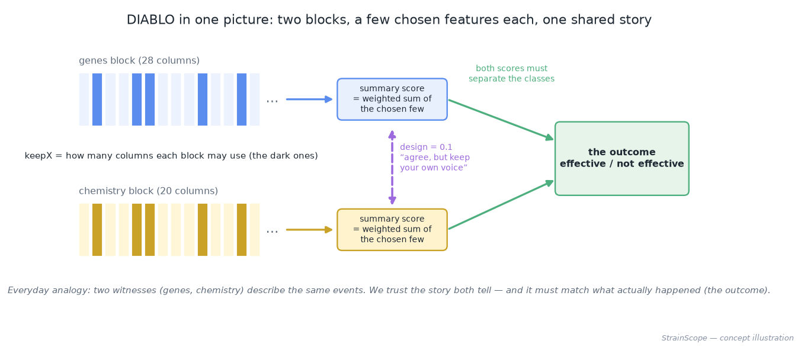
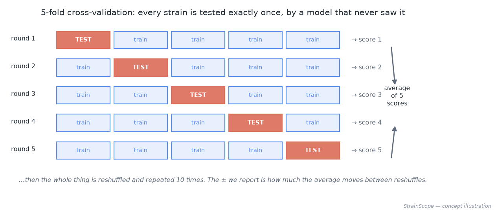
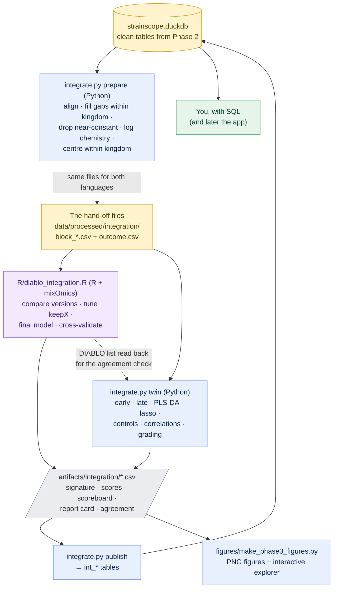
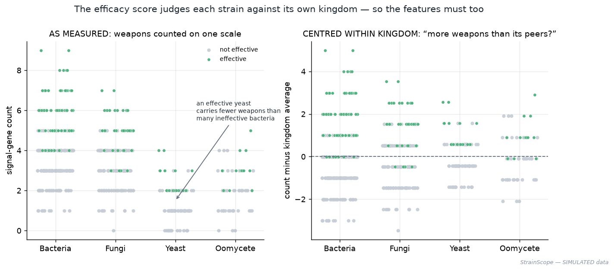
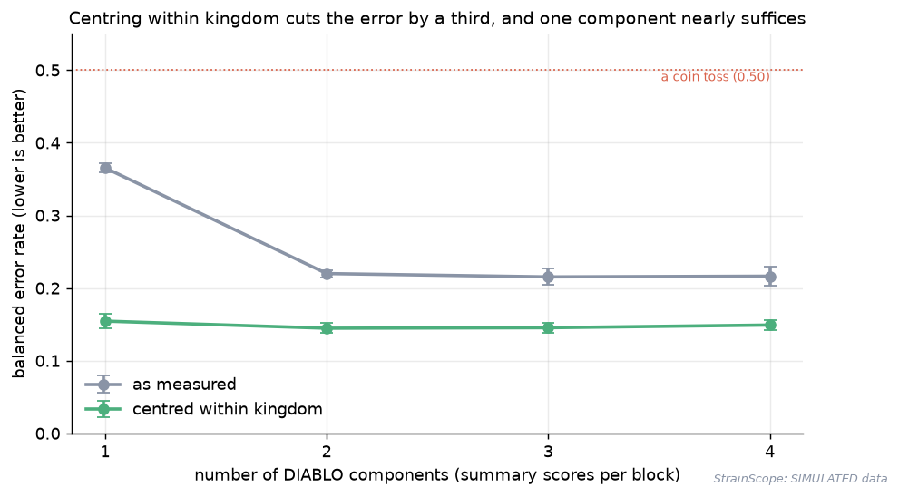
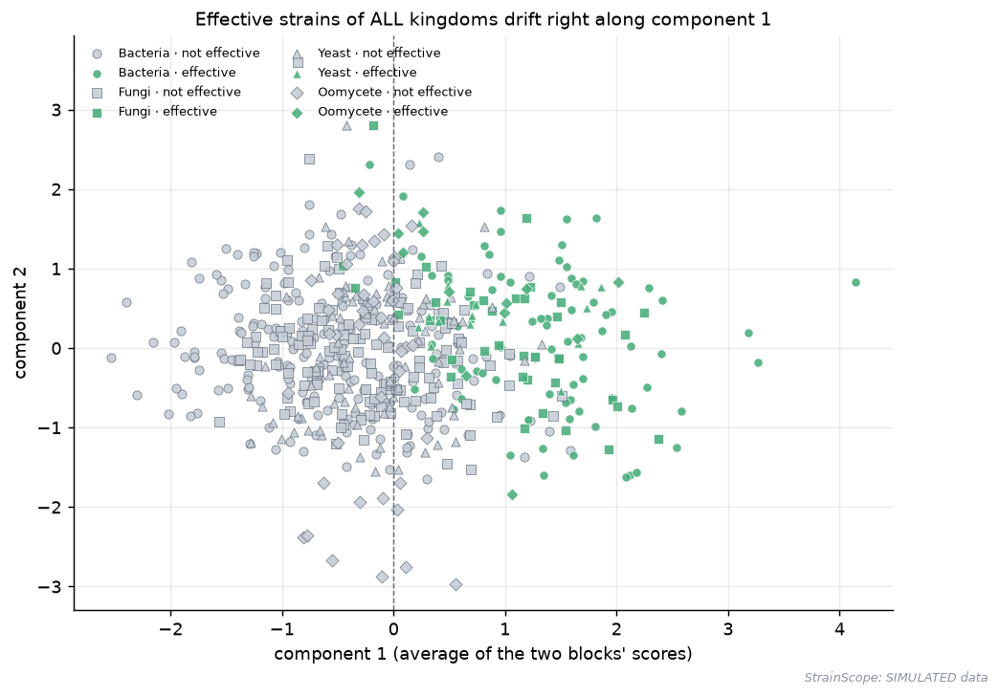
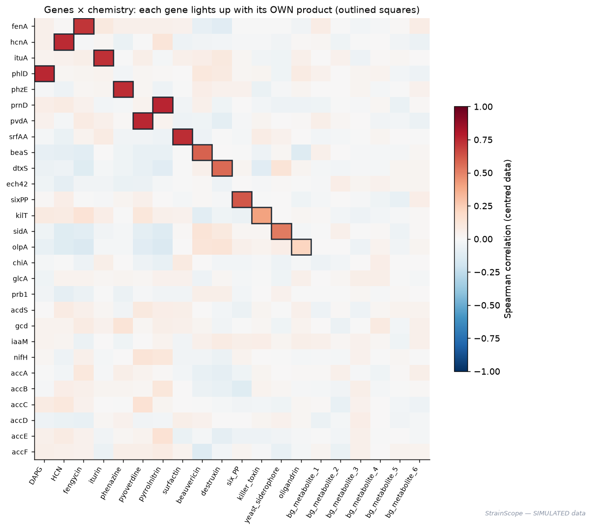
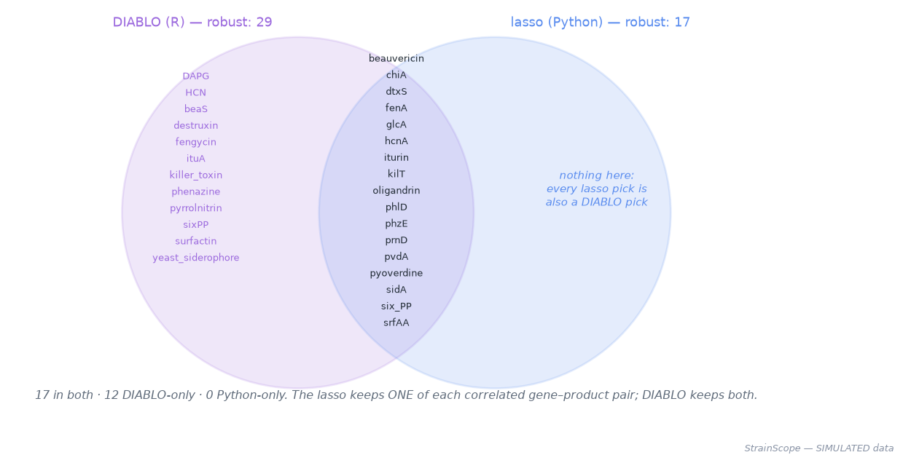

# 04 · Phase 3 — Multi-omics integration: reading genes and chemistry together (DIABLO in R + a Python twin)

[← Phase 2: cleaning & the database](03-harmonization-qc.md) · [Handbook](HANDBOOK.md) · [All docs in order](../README.md#the-tutorial-in-order) · [Glossary](GLOSSARY.md) · [Query Cookbook](QUERY_COOKBOOK.md) · [Roadmap](ROADMAP.md)

**Prerequisites:** Phase 2 complete — the database `data/processed/strainscope.duckdb` exists (rebuild it any time with `python src/strainscope/generate_data.py` then `python src/strainscope/harmonize.py`). R and renv from [`docs/01-setup.md` Part I](01-setup.md#part-i--install-r-needed-at-the-integration-phase) for the DIABLO step. **No R?** Everything except the DIABLO step still runs — the Python twin, the figures and the tests — and the guide marks which outputs need R.
**Learning goal:** after this phase you will understand what *integrating* several kinds of measurement means and the three ways to do it; how DIABLO — the field's standard supervised integration method — chooses a short list of genes and metabolites that tell one shared story; how to score any method honestly with repeated cross-validation, a balanced error rate and negative controls; how to grade a signature against known truth; and how two languages (R and Python) can check each other's answers through one shared set of files.
**Why this phase exists in a real workflow:** each kind of measurement sees only part of a microbe. Genes say what it *could* make; chemistry says what it *did* make. A scientist choosing which strain to develop wants the features that both views agree on, because agreement between independent witnesses is far more trustworthy than either one alone. This is the step that turns three separate tables into one explanation.

**Session plan** (about 4 hours in total, in three sittings):
- **Session A (~1.5 h):** concepts (§1–3), get the files (§4), prepare the blocks (§5).
- **Session B (~1 h, mostly waiting):** install mixOmics into the project's R library (§6) and run DIABLO (§7).
- **Session C (~1.5 h):** the Python twin (§8), publish and query (§9), the figures and what they mean (§10–11), tests, checkpoint, commit (§13–17).

> **How this guide works:** every action step tells you what **You should see**, **What it means**, and — when things can wobble — **If instead**. All paths are relative to the project folder (the folder that contains `README.md`).

---

## 1. Concepts, plainly

### What "integration" means

Picture three people describing the same car. One read the **blueprint** (the genome: which parts the car *could* have). One stood behind it and smelled the **exhaust** (the metabolome: which chemicals it *actually* produced). One timed it on a **track** (the phenotype: how well it performed). Each description is useful; each can mislead on its own. **Multi-omics integration** is reading the three accounts *together* and keeping what they agree on.

In data terms, each account is a **block** — a table with one row per strain and one column per **feature** (one gene, one metabolite). Integration needs the blocks **aligned**: row 17 of the genes block must be the same strain as row 17 of the chemistry block, or every comparison is between strangers.

### Three ways to combine blocks


- **Early integration** — glue the tables side by side and fit one model. Simple, but the block with more columns can drown out the other, so each block must be weighted fairly (we divide each block by the square root of its column count — *block scaling*).
- **Intermediate integration** — keep the blocks separate, compute a **summary score** per block, and require the summary scores to agree with each other *and* with the outcome. **DIABLO** works this way.
- **Late integration** — fit a separate model per block, then average their predictions ("ask each witness, then vote"). Robust, but blind to patterns that only appear across blocks.

We run all three, on the same strains, scored the same way — and compare.

### DIABLO in plain words

**DIABLO** (from the free R package **mixOmics**) is *supervised* — it is told which strains were effective — and *intermediate*. For each block it builds a **component**: a weighted sum of a *few* of that block's features. Think of a teacher's overall grade built from a handful of exam questions with different weights. The features with non-zero weight are the **signature**; their weights are the **loadings**.



Two dials control it:

- **`keepX`** — how many features each block may use: a *word limit* on each witness's statement. Short lists are readable; longer lists can be slightly more accurate. We choose it by testing.
- **`design`** — how strongly the blocks' summary scores must agree, from 0 ("ignore each other") to 1 ("agree as much as possible"). We use **0.1**, mixOmics' recommended setting when the goal is prediction: the witnesses are nudged to tell a common story but keep their own voices.

### Scoring honestly: cross-validation, BER, controls



- **Cross-validation.** You never grade a student on the exam they studied from. We split the 600 strains into 5 parts; train on 4, test on the 5th; rotate until every strain has been tested once by a model that never saw it — then reshuffle and repeat 10 times. The **±** we report is how much the average moves between reshuffles.
- **Balanced error rate (BER).** Only 24 % of strains are effective, so a lazy model that always says "not effective" is 76 % accurate — and useless. BER averages the error on the effective strains and the error on the rest. The lazy model scores **0.50**, exactly a coin. Lower is better. (AUC, the other number you'll see, is the chance that a random effective strain is ranked above a random ineffective one: 0.5 = coin, 1.0 = perfect.)
- **Negative controls.** A medical trial has a placebo arm; so do we. *Kingdom label only*: can the kingdom alone predict success? (It shouldn't — Phase 1 judged every strain against its own kingdom.) *Shuffled labels*: shuffle who was effective, train and test on the shuffled answer — any score better than a coin would mean the procedure finds "signal" in noise, i.e. something is leaking.
- **Stability.** Ask the same question 50 times (10 repeats × 5 folds) and count how often each feature is picked. A feature picked 100 % of the time is a robust finding; one picked 30 % of the time is a coin toss.

### Grading against known truth

Real projects never get an answer key. Ours has one: the generator wrote *which* features drive efficacy (the **signal** features — every kingdom's weapons) and which do not (the **decoys**: plant-growth genes, accessory genes, background chemistry). So we can grade each signature: of the features it picked, how many truly matter (*precision*); of those that truly matter, how many it found (*recall*). This is the same synthetic-data superpower that let the Phase 2 ledger catch a bad outlier rule.

## 2. The data flow of this phase



Read it top to bottom: Python reads the clean tables and writes the **hand-off files** — plain CSV, the one format every language reads. R (DIABLO) and Python (the twin) both read those *same* files, so neither can quietly analyse different data. Both write small result tables to `artifacts/integration/` (committed to Git — the app will read them later). `publish` loads those results back into the database, so SQL can question them next to everything else.

> **Why plain CSV files between the two languages, not a direct link?** A CSV is the universal language: R reads it with one built-in command, nothing extra to install, on any operating system. Everyday analogy: two colleagues who speak different languages leave each other notes in a shared folder rather than learning a phone protocol. One folder, one format, one contract — and a test (§13) that checks both sides still agree on the file names.

## 3. The decisions — in English, before any code

Five rules, applied by `integrate.py prepare`, in this order:

1. **Align on `strain_id`, and stop if any strain is missing from a block.** Integration matches rows by position; a silent mismatch would compare strangers.
2. **Fill gaps within each strain's own kingdom.** A missing gene call becomes the most common value *among that kingdom's strains*; a missing metabolite becomes that kingdom's median. Phase 2 deliberately left these 338 + 714 gaps as honest NULLs, because filling them is a *modelling* decision — this is the modelling phase, so we now decide, openly. The labels (effective or not) are **never** used to fill anything.
3. **Drop near-constant features.** If one value covers 95 % or more of strains, the feature cannot tell strains apart — a question everyone answers the same way tells you nothing. This removes exactly the three housekeeping genes (`ssu_rRNA`, `ef1a`, `rpb1`), which are present in essentially every microbe.
4. **Log-transform the chemistry.** `log(1 + x)` puts "10 vs 20" and "100 vs 200" on the same footing — abundances span orders of magnitude, and without the log the few huge values would dominate everything.
5. **Compare like with like: centre within kingdom.** Phase 1 judged every strain *against its own kingdom* (a yeast competes with yeasts). So we write a second version of each block in which every feature has its kingdom's average subtracted: a value now means "more or less than a typical member of *its* kingdom". DIABLO tests both versions and keeps the better one (§7).



*Left: counted on one scale, an effective yeast carries fewer weapons than many ineffective bacteria — a model would be fooled. Right: centred within kingdom, effective strains of every kingdom rise above zero.*

### What we deliberately do NOT do (documented honesty)

- **No filling of gaps from the other block.** It's tempting to fill a missing metabolite using its producing gene ("the gene is present, so the chemical was probably high"). That would *manufacture* the very gene–chemistry agreement we are about to measure — circular. Kingdom-wise filling uses neither block's partner.
- **No rescaling within kingdom, only centring.** Rescaling would turn a gene carried by 2 % of fungi into a huge number for those few strains — noise amplified into signal.
- **No hiding of the small leak.** Filling gaps and centring use every strain's values *before* cross-validation splits them. Both steps are label-free, so they cannot teach a model who is effective, but strictly speaking the test strains influenced the averages. Phase 4 moves every such step *inside* the cross-validation loop; here we state it.
- **No claim that the winner is DIABLO.** It is not the most accurate method on this data (§11) — and that is a finding, not a failure.

## 4. Get the Phase 3 files into your repo

All paths are relative to the project folder.

| Path | New / changed | Its job |
|---|---|---|
| `src/strainscope/integrate.py` | new | the Python side: `prepare`, `twin`, `publish`, `all` |
| `R/diablo_integration.R` | new | the R side: DIABLO with tuning, cross-validation and mixOmics' standard plots |
| `tests/test_integrate.py` | new | 14 offline tests, including the R ↔ Python file-name contract |
| `figures/make_phase3_figures.py` | new | concept pictures, result figures and the interactive explorer |
| `figures/make_illustrations.py` | new | the logo and the Handbook's journey map |
| `docs/04-integration.md` | new | this guide |
| `docs/HANDBOOK.md`, `docs/ROADMAP.md`, `docs/PRODUCT_ROADMAP.md` | new | the day-0-to-product handbook and the two roadmaps |
| `CHANGELOG.md` | new | what changed, version by version (this phase is `v0.1.0`) |
| `README.md`, `docs/00-architecture.md`, `docs/01-setup.md`, `docs/02-data-generation.md`, `docs/02b-real-data-ingestion.md`, `docs/02c-more-real-sources.md`, `docs/03-harmonization-qc.md`, `docs/GLOSSARY.md`, `docs/QUERY_COOKBOOK.md` | changed | Handbook links; Phase 3 results and terms; the new phases (6b, 7b, 8); `Rscript -e` throughout setup; cookbook §8 |
| `artifacts/integration/*.csv` | new (generated) | the small result tables, committed so the app can read them |
| `figures/*.png` (Phase 3 set), `docs/img/*.svg`, `docs/interactive/integration_explorer.html`, `docs/interactive/plotly.min.js` | new (generated) | the pictures |
| `renv.lock` | changed (by you, §6) | now records mixOmics and its exact versions |
| `check-public-safe.sh` | changed | a key must now start a word, so link anchors such as `#ask-strainscope-…` are no longer mistaken for an `sk-…` key (story in §12) |
| `__init__.py` (project root) | removed (by you, §17) | an empty file committed by mistake early on; the real one is `src/strainscope/__init__.py` |

**Files-landed check:**

```bash
ls src/strainscope/integrate.py R/diablo_integration.R tests/test_integrate.py \
   figures/make_phase3_figures.py docs/04-integration.md
```

**Read before running.** Open `src/strainscope/integrate.py` — its top docstring lists the five rules above and the four verbs — then skim `R/diablo_integration.R`, whose header explains DIABLO in one paragraph. Fifteen minutes here makes every output below readable.

## 5. Step 1 — prepare the blocks

```bash
python src/strainscope/integrate.py prepare
```

**You should see** (exact — fixed seed):

```
  ── Integration prep ledger ─────────────────────────────────
  aligned strains ........ 600 in every block (145 effective)
  genomics block ......... 31 → 28 genes (dropped near-constant: ef1a, rpb1, ssu_rRNA)
  metabolomics block ..... 20 → 20 metabolites (log(1+x) applied)
  gaps filled ............ 338 gene calls, 714 metabolite readings (kingdom-wise, labels never used)
  versions written ....... as-measured + centred within kingdom
  ─────────────────────────────────────────────────────────────
  blocks  → data/processed/integration/
  ledger  → artifacts/integration/prepare_ledger.csv
```

**What it means:** every strain is present in every block; the three housekeeping genes are gone (rule 3); the 338 + 714 gaps Phase 2 left as honest NULLs are now filled — and the counts match Phase 2's ledger exactly, which is your proof nothing was filled twice or missed. Two versions of each block exist side by side.

**If instead** you see `No database at …` — run `python src/strainscope/harmonize.py` first. If the gap counts differ from 338 and 714, your raw data came from a different seed or generator version: regenerate with `python src/strainscope/generate_data.py`, re-run `src/strainscope/harmonize.py`, then this step.

Peek at what was written (any OS — Python reads the file for you):

```bash
python -c "import pandas as pd; print(pd.read_csv('data/processed/integration/block_genomics_centred.csv', index_col=0).iloc[:3, :5].round(2))"
```

You'll see small positive and negative numbers: each strain's genes *relative to its kingdom's average*.

## 6. Step 2 — install mixOmics into the project's R library (once per machine)

**Why this step exists — "installed, but invisible."** In setup you may have installed mixOmics with `BiocManager::install()` and seen `library(mixOmics)` work. Then you switched on **renv**, the project's sealed R toolbox. From that moment, R started *inside this project* only sees the project's own library — packages installed elsewhere on your machine are invisible here, by design (exactly how a Python `.venv` ignores packages installed globally). So mixOmics must be installed **into the project**, once, and recorded in `renv.lock`. Everyday analogy: you own a hammer at home, but the workshop only lends tools from its own labelled wall — so you hang a copy there, and write it on the inventory.

From the project folder (the one with `renv.lock` in it). We use **`Rscript -e '...'`** — "start R, run this one line, quit" — because it behaves the same on every operating system. (On Windows PowerShell, never type a bare `R`: PowerShell already uses `r` as a shortcut for *repeat the last command*, so `R -e ...` silently does something else entirely.)

1. Install mixOmics into the project library. `bioc::` tells renv the package lives in **Bioconductor** (the specialist biology shop), not CRAN:
   ```bash
   Rscript -e 'renv::install(c("BiocManager", "bioc::mixOmics"))'
   ```
   **Windows PowerShell** — swap the quote marks, and use the full path if `Rscript` is not recognised:
   ```powershell
   Rscript -e "renv::install(c('BiocManager', 'bioc::mixOmics'))"
   # or, with the full path (adjust the version number):
   & "C:\Program Files\R\R-4.6.1\bin\Rscript.exe" -e "renv::install(c('BiocManager', 'bioc::mixOmics'))"
   ```
   (To avoid the long path for good, add `C:\Program Files\R\R-4.6.1\bin` to your user PATH once: Start → *Edit environment variables for your account* → `Path` → *New*; then open a fresh PowerShell.)

   **You should see** renv list the packages it will install (mixOmics plus helpers such as `igraph`, `ellipse`, `corpcor`, `rARPACK`, `BiocParallel`), download them, and finish with `Successfully installed …`. On macOS and Windows these are ready-made binaries: a few minutes. On RHEL 8 see the note below.

   Two variations are normal. If the helpers are already in renv's cache on your computer, the list shrinks to just `BiocManager` and `mixOmics` and the install takes seconds (`[linked from cache]`, `[installed binary]`). And a first line `- The project is out-of-sync -- use renv::status() for details.` may appear: it means the project library holds packages the receipt (`renv.lock`) does not list yet — exactly what the next command fixes. A real run on macOS (R 4.6.1) looked like this:
   ```
   - The project is out-of-sync -- use `renv::status()` for details.
   The following package(s) will be installed:
   - BiocManager [1.30.27]
   - mixOmics    [6.36.0]
   ...
   Successfully installed 2 packages in 0.3 seconds.
   ```

2. Record it in the lockfile (the receipt). renv scans the project's R scripts, finds `library(mixOmics)` in `R/diablo_integration.R`, and writes mixOmics with its exact version and Bioconductor source:
   ```bash
   Rscript -e 'renv::snapshot()'
   ```
   (Windows: `Rscript -e "renv::snapshot()"`.) **You should see** a long list of packages being added — about seventy, each shown as `[* -> version]` ("not in the receipt yet → this version") — grouped by where each comes from: `Bioconductor 3.23` (or your release), `CRAN`, and `https://bioc-release.r-universe.dev` (Bioconductor's own package server, where renv found the ready-made mixOmics and BiocParallel). It ends with `- Lockfile written to …/renv.lock`. This is the moment the setup guide promised: mixOmics joins the receipt because a committed script now uses it. Most of the seventy are helpers mixOmics needs for its plots and maths (`ggplot2`, `igraph`, `rARPACK`, `rgl`, …).

3. Prove it loads *inside the project*:
   ```bash
   Rscript -e 'library(mixOmics); packageVersion("mixOmics")'
   ```
   (Windows: `Rscript -e "library(mixOmics); packageVersion('mixOmics')"`.) **You should see** `Loaded mixOmics 6.x.y` and `[1] '6.x.y'`.

4. Confirm renv is consistent:
   ```bash
   Rscript -e 'renv::status()'
   ```
   (Windows: `Rscript -e "renv::status()"`.) **You should see** `No issues found -- the project is in a consistent state.`

> **A notice you will now see before every R command — harmless.** From here on, R in this project may first print:
> ```
> The following package(s) were loaded before renv activated this project:
> - BiocManager [~/Library/Caches/org.R-project.R/R/renv/cache/v5/…/BiocManager]
> These packages are not managed by renv and may cause `renv::status()`
> and `renv::snapshot()` to report inconsistencies. …
> Set `RENV_CONFIG_NAMESPACES_CHECK=FALSE` to silence this check.
> ```
> It appears because the receipt now has a Bioconductor section, and BiocManager gets loaded while renv sets that up, a moment before renv finishes switching on. Two things show it is harmless: the path points into renv's **own cache** (the project's copy, not a stray one), and `renv::status()` in step 4 still reports *No issues found*. Leave it; if it bothers you, the message itself names the switch that silences it.

> **RHEL 8 note — avoid compiling everything.** Linux gets CRAN packages as *source code* that must be compiled, which needs development libraries and can take a long time. The free **Posit Public Package Manager** serves ready-made RHEL 8 binaries. Point R at it for this one install:
> ```bash
> Rscript -e 'options(repos = c(CRAN = "https://packagemanager.posit.co/cran/__linux__/rhel8/latest")); renv::install(c("BiocManager", "bioc::mixOmics"))'
> ```
> If you prefer (or need) to compile, first install the system libraries the dependencies build against:
> `sudo dnf install -y gcc-c++ gcc-gfortran make libcurl-devel openssl-devel libxml2-devel glpk-devel gmp-devel mesa-libGLU-devel libX11-devel freetype-devel libpng-devel`.
> Either way it is a one-time cost per machine.

**If instead** renv reports `failed to resolve remote 'mixOmics'` — the `bioc::` prefix is missing. If it reports that Bioconductor's version is incompatible with your R, update renv first: `Rscript -e 'renv::upgrade()'`, then retry.

## 7. Step 3 — run DIABLO

```bash
Rscript R/diablo_integration.R
```

Run it **from the project folder** — that is what switches renv on (via `.Rprofile`) so the project's mixOmics is used. **Windows:** if `Rscript` is not recognised, run
`& "C:\Program Files\R\R-4.6.1\bin\Rscript.exe" R/diablo_integration.R` (adjust the version), or simply use the one-command path in §14, which finds Rscript for you.

It takes **about 3 minutes** (most of it is cross-validation: hundreds of model fits). **You should see:**

```
  ── DIABLO integration ─────────────────────────────────────────
  mixOmics 6.x.y · 600 strains (145 effective) · 28 genes · 20 metabolites
  step 1/4  comparing as-measured vs centred-within-kingdom (all features, 4 components) …
            as_measured  BER by component: 0.366  0.220  0.215  0.216
            centred      BER by component: 0.154  0.145  0.145  0.149
            → using 'centred' blocks; one-SD rule says 2 component(s); keeping 2
  step 2/4  tuning keepX (how many features per block) …
            → genomics keepX = 16, 16 · metabolomics keepX = 16, 4 (per component)
  step 3/4  fitting the final model and cross-validating it …
  step 4/4  drawing mixOmics' standard figures …
  ───────────────────────────────────────────────────────────────
  final model: 2 components · cross-validated BER 0.155 ± 0.011
  cost of sparsity: +0.010 BER vs using every feature (0.145) = 0.9 SD — a small, measurable price for a readable list
  error on effective strains 0.169 · on the rest 0.141
  signature: 38 distinct features · blocks agree at r = 0.77 on component 1
  results → artifacts/integration/   figures → figures/diablo_mixomics_*.png   (162 s)
  Reminder: the data is SIMULATED — this proves the workflow, not real-world accuracy.
```

> These numbers were produced twice, on two machines: mixOmics 6.37.0 on R 4.3 (Linux), and mixOmics 6.36.0 on R 4.6.1 (macOS) — **identical to the last printed digit**, step by step, with only the run time differing (160–200 s). That is the fixed seed (`set.seed(42)` and `seed = 42` in every cross-validation) doing its job. Other versions may split the folds slightly differently, so in general **expect agreement to about ±0.01**. Your exact versions are written to `artifacts/integration/diablo_summary.csv`.

**What it means, step by step:**

- **Step 1** answers *which version, how many components?* Centring within kingdom cuts the error from 0.22 to 0.145 — rule 5 earning its place. The **one-standard-deviation rule** then picks the *fewest* components whose error is within one ± of the best: simpler models that are statistically as good are preferred.
- **Step 2** chooses `keepX`: 16 genes and 16 metabolites on component 1. The grid stops at 16 on purpose — a readable list — and step 3 measures what that choice costs.
- **Step 3** is the honest score: **0.155 ± 0.011**, against 0.50 for a coin. The **cost of sparsity** line compares the short lists with "use every feature" (0.145): about one standard deviation — a small, measured price for a signature a person can read.
- **Block agreement r = 0.77**: the gene summary score and the chemistry summary score agree strongly — the two witnesses tell the same story.

**If instead** you see `mixOmics is not installed in this project's R library` — do §6. `The prepared blocks are missing` — do §5. A wall of `BiocParallel errors … zero variance` — you are running an older copy of the prepare step that kept the housekeeping genes; update `src/strainscope/integrate.py` and re-run §5 (the story is in §12).

## 8. Step 4 — the Python twin, the controls and the report card

```bash
python src/strainscope/integrate.py twin
```

**You should see** (a few seconds):

```
  ── Python counterpart: cross-validated scoreboard ─────────────
  (5-fold cross-validation × 10 repeats, same folds for every row; lower BER is better, higher AUC is better)
  Genomics only                                    BER 0.148 ± 0.008   AUC 0.936
  Metabolomics only                                BER 0.203 ± 0.011   AUC 0.883
  Early integration (concatenate, logistic)        BER 0.134 ± 0.010   AUC 0.948
  Early integration, sparse (lasso logistic)       BER 0.166 ± 0.010   AUC 0.921
  Early integration (PLS-DA, 2 components)         BER 0.137 ± 0.011   AUC 0.947
  Late integration (average of per-block models)   BER 0.123 ± 0.010   AUC 0.948
  Control: kingdom label only                      BER 0.464 ± 0.005   AUC 0.533
  Control: shuffled labels                         BER 0.490 ± 0.016   AUC 0.521
  ── Signature report card (graded against the planted truth) ───
  DIABLO comp. 1, everything selected                  32 picked · 29 true drivers · decoys: bg_metabolite_2, bg_metabolite_3, iaaM
  DIABLO comp. 1, robust (picked in >= 80 % of re-fits) 29 picked · 29 true drivers · decoys: none
  Python (lasso, picked in >= 80 % of folds)           17 picked · 17 true drivers · decoys: none
  ── Two languages, one answer? robust lists share 17 features; 12 DIABLO-only, 0 Python-only (overlap score 0.59)
  gene ↔ own-product correlations: median rho 0.72 across 14 producer pairs
  results → artifacts/integration/   (3 s)
```

**What it means:**

- **Integration wins.** Every integrated approach beats chemistry alone, and the best (late integration, 0.123) beats genes alone (0.148) by more than two ± — the multi-omics premise, demonstrated rather than assumed.
- **The controls behave.** Kingdom alone ≈ coin (0.46): Phase 1's within-kingdom design worked — you cannot cheat by reading the kingdom. Shuffled labels = coin (0.49): the procedure does not find signal in noise, so nothing leaks.
- **The report card.** DIABLO's component-1 list holds 29 true drivers and 3 decoys — but the decoys have near-zero weights and were picked in only ~30–55 % of re-fits. Keep only the *robust* features and DIABLO's list is **all** true drivers. The lasso's 17 are also all true.
- **Two languages, one answer.** Every feature the Python lasso trusts, DIABLO trusts too (0 Python-only). DIABLO's list is longer because it keeps *both* a gene and its own product (they agree, so both get weight), while the lasso keeps one of each correlated pair and drops the twin as redundant. Different philosophies, consistent conclusions.
- **Gene ↔ product correlations** (median 0.72): each gene rises and falls with the chemical it makes — the biology Phase 1 planted, recovered from the data.

If R has not run, you'll see `(DIABLO results not found yet …)` instead of the DIABLO rows — everything else is identical.

## 9. Step 5 — publish to the database, and ask it questions

```bash
python src/strainscope/integrate.py publish
```

**You should see** `published 12 tables into data/processed/strainscope.duckdb:` and twelve names starting with `int_`. Now question them with the SQL console (read-only, as always):

```bash
python src/strainscope/sql.py
```

```sql
-- The top of the signature: which features carry the most weight?
SELECT feature, block, ROUND(loading, 3) AS weight, stability
FROM int_diablo_signature
WHERE component = 1
ORDER BY ABS(loading) DESC
LIMIT 8;
```

**You should see** `pyoverdine`, `fenA`, `pvdA`, `iturin`, `dtxS`, `fengycin`, `DAPG`, `ituA` — bacterial and fungal weapons side by side, all with stability 1.0.

```sql
-- Which picks are shaky? (expect exactly the three decoys)
SELECT s.feature, a.arsenal, a.role, ROUND(s.loading, 3) AS weight, s.stability
FROM int_diablo_signature s
JOIN int_feature_annotations a USING (feature)
WHERE s.component = 1 AND s.stability < 0.8;
```

```sql
-- Bridge to the REAL world: the signature's chemistry, with its verified PubChem formula
SELECT s.feature, rc.molecular_formula, rc.cid, ROUND(s.loading, 3) AS weight
FROM int_diablo_signature s
JOIN real_compounds rc ON rc.metabolite = s.feature
WHERE s.block = 'metabolomics' AND s.component = 1 AND rc.status = 'found'
ORDER BY ABS(s.loading) DESC;
```

That last query joins a result computed on simulated strains with real chemistry fetched in Phase 1b — one database, both worlds. (It returns rows only if you ran the Phase 1b fetch on this machine.) More recipes are in the [Query Cookbook](QUERY_COOKBOOK.md#8-integration-results-phase-3).

> **Order rule:** `src/strainscope/harmonize.py` rebuilds the database from scratch — on purpose, so results can never outlive the data they came from. After re-running it, re-run `integrate.py publish` (or `integrate.py all`).

## 10. See the results (figures + interactive)

```bash
python figures/make_phase3_figures.py
```

**You should see** eleven `drew …` lines. (Without R: the DIABLO-specific figures are skipped with a note.)

### Centring earns its place



Grey: blocks as measured — error falls only when extra components are added, because DIABLO then needs **one component per kingdom** to describe each kingdom's own weapons. Green: centred within kingdom — one or two components describe *every* kingdom at once, at a third less error. Compare like with like, and the story becomes simpler and more accurate at the same time.

### The signature


Each bar is one feature's weight on component 1, coloured by whose weapon it is: blue bacteria, green fungi, gold yeast, purple oomycete, teal shared. Every kingdom's arsenal is on **one** axis — a strain scores high by carrying more weapons than its peers, whatever kingdom it belongs to. The ✓ / ✗ marks show stability: the three grey decoys at the bottom are the only ✗, with weights near zero. *DIABLO had a quota of 16 and filled the last slots with whispers* — read the weights, not just the membership.

### The scoreboard


Everything on one honest scale. Blue: one block alone. Green: Python integration. Purple: DIABLO. Grey: the controls, sitting on the coin line as they must.

### The strains on the map



Each dot is a strain, placed by its two summary scores. Effective strains (green) of all four kingdoms drift to the right along component 1 — the shared weapons axis.

### Genes × chemistry



Every gene against every metabolite. The outlined squares are each gene with its *own* product, and they light up; almost everything else stays pale. This table is the seed of the Phase 5 knowledge graph — each bright square will become an edge "gene → makes → compound".

### Two languages, one answer



### The specialist's view (mixOmics' own plots)

mixOmics draws the standard figures specialists expect; the R script saves them as `figures/diablo_mixomics_samples.png`, `figures/diablo_mixomics_loadings.png`, `figures/diablo_mixomics_circos.png` (a circle with genes and metabolites on the rim and the strongest cross-block links drawn as chords) and `figures/diablo_mixomics_cim.png` (a clustered heatmap of strains × signature features). Open them alongside the teaching versions above — same results, the field's standard look.

### ▶ Interactive

Open [`docs/interactive/integration_explorer.html`](interactive/integration_explorer.html) in any browser (double-click it). Four explorable charts on one page: hover any strain on the map and switch between the gene view, the chemistry view and their average; hover any feature in the signature for its weight, stability and biology; hover the heatmap; compare the scoreboard. The page loads its charting library from `docs/interactive/plotly.min.js` beside it — keep the two files together, and it works offline.

## 11. Reading the results like a scientist

**What the signature says, biologically.** Effective strains are the ones carrying *more of their own kingdom's weapons* than their peers: lipopeptides and siderophores for bacteria (fengycin, iturin, pyoverdine and their synthetases), insect-killing toxins for fungi (destruxin, beauvericin), iron competition for yeasts (yeast siderophore), the oligandrin elicitor for the oomycete. Plant-growth genes do not appear — they drive a *different* trait (growth promotion) — and neither does the background chemistry. That is exactly the biology the generator encoded, recovered by two independent methods.

**Why DIABLO is not the most accurate row — and why that is fine.** On this data, plain late integration predicts best (0.123) and DIABLO scores 0.155. DIABLO optimises for something else: a *short, cross-block-consistent* signature that a scientist can read and test. The right tool depends on the question. If the question is "which strain should we test next?", Phase 4's models will compete on accuracy. If it is "which molecular features explain success, and do genes and chemistry agree?", DIABLO's answer is the one to read.

**The honest limits.**
- The data is **simulated**. These results prove the workflow, not real-world biology.
- Filling gaps and centring happen before cross-validation (label-free, but a small leak — §3); Phase 4 moves them inside the loop.
- R and Python use *different random fold assignments* (each seeded), so compare their rows to about ±0.01.
- AUC values printed by the R script are measured on the training data and are optimistic; the cross-validated BER is the honest number.

## 12. Notes from the build (kept on purpose)

- **The kingdom trap — and the fix that matched the question.** The first DIABLO run used the blocks as measured: error 0.37 with one component, 0.22 with two, and each extra component simply picked up *another kingdom's* weapons. The cause: efficacy was scored within kingdom, but the features were on one shared scale, so a strong yeast looked weak next to an average bacterium. Centring each feature within its kingdom matched the features to the question and cut the error to 0.15 with one component. **Lesson:** before tuning any method, check that the data's yardstick matches the outcome's yardstick.
- **The housekeeping genes crashed the cross-validation.** DIABLO stopped with `There are features with zero variance in block 'genomics'`. Over the whole dataset the housekeeping genes vary a little (595 of 600 strains carry `ssu_rRNA`), but inside some cross-validation folds all the zeros landed in the test part, leaving a training column with no variation at all. The near-constant rule (§3, rule 3) removes them up front. **Lesson:** a feature that barely varies across all your data will, sooner or later, not vary at all in a subset.
- **Installed, but invisible.** mixOmics installed during setup loaded fine — until renv was switched on, after which the project could not see it. Not a bug: isolation is renv's whole purpose. Installing it *into* the project with `renv::install("bioc::mixOmics")` and snapshotting fixes it for good, and makes the R side as reproducible as the Python side. **Lesson:** "it works on my machine" and "it works in this project" are different claims.
- **The control that cried wolf.** The first shuffled-label control trained on *one* shuffle and scored against the *real* labels: AUC 0.65, an alarm that suggested leakage. The control itself was flawed — one shuffle is one coin toss, and mixing shuffled training with real scoring asks two questions at once. The textbook version (*y-scrambling*) uses a fresh shuffle per repeat and scores against the shuffled answer: AUC 0.52, a coin. **Lesson:** a control must be built to answer exactly one question; when a control alarms, check the control before the model.
- **A legend that lied.** In mixOmics' clustered heatmap, the class legend showed "effective" in the colour that was actually painted on the *ineffective* strains. The heatmap sorts class names alphabetically for the legend but colours rows in the factor's own order; whenever the two orders differ, the colours swap. The R script now uses alphabetical class levels, so both orders coincide. **Lesson:** check every figure against a fact you know — here, that most strains are *not* effective, so the majority colour must say so.
- **The winner sat at the edge of the grid.** The first `keepX` grid stopped at 16, and the tuning chose 16 — a classic warning sign that the best value lies beyond the grid. Widening it to "every feature" improved the error by about 0.01 (one ±) at the price of a 28-gene list. The grid stays at 16 for readability, and the script now *reports* the cost of that choice every run. **Lesson:** when a tuned value sits at the edge, widen the grid and measure — then decide openly.
- **Quotas get filled.** With room for 16 metabolites but only 14 that truly matter, DIABLO filled the last two slots with background compounds at weights near zero. Stability exposed them (picked in about half of re-fits) where the selection list alone could not. **Lesson:** a sparse method's list is a quota; weights and stability tell you which entries matter.
- **Comparable uncertainties.** The Python scoreboard first reported its ± across all 50 individual folds (±0.037) while mixOmics reports it across the 10 repeats (±0.01) — the same data looked three times less certain in Python. Both now use the across-repeats definition. **Lesson:** before comparing two "±" numbers, check they measure the same thing.
- **A library renamed its switch.** scikit-learn 1.8 renamed the lasso setting (`penalty="l1"` became `l1_ratio=1`) and warned on every fit. A small helper (`_lasso_args`) checks the installed version and uses the right spelling, so the code works quietly on old and new installations alike.
- **The guard that tripped on a word.** The first safety-gate run on this phase said NOT SAFE TO PUSH and pointed at three documentation lines. No secret anywhere: each line linked to the roadmap section *Ask StrainScope*, whose link address contains `…ask-strainscope--the-documentation…` — and inside that sits `sk-` followed by twenty-plus letters, the exact shape of a real API key. The gate now requires a key to *start* a word (the character before `sk-` may not be a letter, digit, `_` or `-`), and it was re-tested to still catch a real-shaped key after `=` or a quote. **Lesson:** a pattern check sees shapes, not meaning — when a guard alarms, read the flagged line, then make the pattern more precise, never simply weaker.

## 13. The tests

```bash
pytest -q
```

**You should see:** `32 passed` — the 18 from earlier phases plus 14 new ones: alignment (and refusal of mismatched strains), kingdom-wise gap filling with its counts, the near-constant rule, centring, the balanced error rate seeing through a lazy classifier, signature grading, gene–product correlations, the planted-truth annotations, the scikit-learn version helper, the Windows-friendly Rscript finder, `prepare` end to end on a 12-strain database, `publish` (and its idempotency), and the **R ↔ Python contract**: the file names Python writes are exactly the ones R reads, and vice versa. None of them needs R or the network. *(From v0.1.1 on you will see `37 passed`: the safety gate gained five tests of its own in `tests/test_safety_gate.py` — [Handbook Stage 7.1](HANDBOOK.md#stage-71--fix-release-v011-a-safer-safety-gate-and-copy-safe-commands).)*

## 14. Two ways to run everything (running tally)

| Capability | Manual path (now) | Automatic path |
|---|---|---|
| Generate synthetic data | `python src/strainscope/generate_data.py` | the one-command pipeline (Phase 8) |
| Probe / fetch real data | `python src/strainscope/fetch_real.py [--probe] [--source ...]` | the app's **Upload · Synthetic · Fetch-real** picker (Phase 6) |
| Clean + build the database | `python src/strainscope/harmonize.py` | the one-command pipeline (Phase 8) |
| Question the data | `python src/strainscope/sql.py` + the [Cookbook](QUERY_COOKBOOK.md) | the app's SQL console (Phase 6) |
| **Integrate (all four steps)** | `integrate.py prepare` → `Rscript R/diablo_integration.R` → `integrate.py twin` → `integrate.py publish` | **now:** `python src/strainscope/integrate.py all` — finds Rscript on any OS (or skips it politely) |
| **Integration figures** | `python figures/make_phase3_figures.py` | the app's integration page (Phase 6) |

The one-command path for this phase works today:

```bash
python src/strainscope/integrate.py all
```

It runs prepare → DIABLO → twin → publish in order. On Windows it looks for `Rscript.exe` in the standard install folders; if yours is elsewhere, set the environment variable `STRAINSCOPE_RSCRIPT` to its full path. Without R it prints `R not found — skipping DIABLO` and carries on (the Python-only path).

## 15. Same task, different language (optional, 10 min)

*"Centre each feature within its kingdom"* — rule 5 — in three languages:

**Python (pandas):**
```python
import pandas as pd
g = pd.read_csv("data/processed/integration/block_genomics.csv", index_col=0)
o = pd.read_csv("data/processed/integration/outcome.csv", index_col=0)
centred = g - g.groupby(o["kingdom"]).transform("mean")
print(centred["ituA"].head(3).round(3))
```

**R (base R — no packages needed):**
```r
g <- read.csv("data/processed/integration/block_genomics.csv", row.names = 1)
o <- read.csv("data/processed/integration/outcome.csv", row.names = 1)
centred <- as.data.frame(lapply(g, function(col) col - ave(col, o$kingdom)),
                         row.names = rownames(g))
print(round(head(centred["ituA"], 3), 3))
```

Both print `-0.011`, `-0.446`, `-0.011` for the first three strains.

**SQL (a *window function* — paste into the console):**
```sql
SELECT strain_id, kingdom, ituA,
       ROUND(ituA - AVG(ituA) OVER (PARTITION BY kingdom), 3) AS ituA_centred
FROM genomics JOIN phenotype USING (strain_id)
ORDER BY strain_id
LIMIT 5;
```

SQL gives `-0.454` for STRAIN_0002 instead of `-0.446` — and the difference is instructive: the SQL reads the *cleaned* table, where gaps are still NULL (and `AVG` skips them), while Python and R read the *prepared* block, where gaps were filled. The tiny difference **is** the imputation. `OVER (PARTITION BY kingdom)` means "compute the average within each kingdom, but keep every row" — the SQL idiom for "compare each row with its own group". Each language is at home here; the project uses Python because the same step also writes the hand-off files.

## 16. What could go wrong (mini-FAQ)

- **`No database at …`** — build it: `python src/strainscope/generate_data.py`, then `python src/strainscope/harmonize.py`.
- **`Missing data/processed/integration/…` or R says `The prepared blocks are missing`** — run `python src/strainscope/integrate.py prepare` first.
- **R: `mixOmics is not installed in this project's R library`** — do §6. It is "installed, but invisible" (see §12).
- **R: `failed to resolve remote 'mixOmics'`** — add the `bioc::` prefix: `renv::install("bioc::mixOmics")`.
- **`Rscript` / `R` "is not recognized" (Windows)** — R's installer does not add itself to PATH. Use the full path (`& "C:\Program Files\R\R-4.6.1\bin\Rscript.exe" R/diablo_integration.R`), add that `bin` folder to PATH once, or use `python src/strainscope/integrate.py all`, which searches the standard folders.
- **R runs but renv prints `The project is out-of-sync`** — the lockfile and the library disagree; run `Rscript -e 'renv::status()'` to see why, usually fixed by `Rscript -e 'renv::snapshot()'` after §6.
- **`The following package(s) were loaded before renv activated this project: BiocManager`** — harmless; see the note at the end of §6. Check with `Rscript -e 'renv::status()'`: if it says *No issues found*, carry on.
- **`The project is out-of-sync`** — the project library has packages the receipt does not list yet. `Rscript -e 'renv::snapshot()'` records them; `renv::status()` should then report *No issues found*.
- **Windows: `R -e ...` does nothing useful, or re-runs an old command** — in PowerShell `r` is a built-in shortcut for *repeat the last command*. Use `Rscript -e ...` (or `R.exe -e …`).
- **R: `There are features with zero variance`** — an old `src/strainscope/integrate.py` kept the housekeeping genes; update it and re-run `prepare`.
- **My DIABLO numbers differ in the third decimal** — expected across mixOmics/R versions (they split folds differently). Differences above ~0.02, or a different chosen version (`as_measured`), mean something else changed — check the prepare ledger first.
- **The twin prints `(DIABLO results not found yet …)`** — run the R step, then `twin` again for the agreement check.
- **`publish` says `Conflicting lock` / `database is locked`** — another program has the database open *for writing* (a Python session from earlier?). The SQL console is read-only and is never the culprit. Close other sessions and re-run.
- **SQL: `Table with name int_diablo_signature does not exist`** — you re-ran `src/strainscope/harmonize.py` (which rebuilds the database) after publishing; re-run `integrate.py publish`.
- **The interactive page is blank** — `docs/interactive/plotly.min.js` must sit in the same folder as `docs/interactive/integration_explorer.html`; re-run `python figures/make_phase3_figures.py` to restore it.
- **RHEL 8: the mixOmics install compiles for a very long time or fails on a missing library** — use the binary repository in the §6 note, or install the listed `-devel` packages and retry.

## 17. Save your work (safety gate, then the commit ritual)

The checks come first — there is no point committing until the tests pass and nothing sensitive is about to go public:

```bash
pytest -q                     # 32 passed (37 from v0.1.1 on)
./check-public-safe.sh        # SAFE TO PUSH  (Windows: run it from Git Bash with `bash check-public-safe.sh`)
```

`git status` should list the new code, docs, figures, `artifacts/integration/*.csv` and the updated `renv.lock` — and **never** anything under `data/` (the prepared blocks are regenerable and gitignored).

If you have a stray, empty `__init__.py` in the project **root** (an early copy-paste accident — the package's real one lives in `src/strainscope/`), remove it from Git and from disk now; nothing imports it:

```bash
git rm __init__.py
```

Then, on `develop`:

```bash
git switch develop
git add -A
git commit -m "feat: add multi-omics integration (DIABLO in R + Python twin), handbook and roadmaps"
git push origin develop develop:beta develop:master

## --tags is optional, only when a release tag was created in this phase
## then switch back to local master and pull in the remote changes

git switch master
git pull --ff-only origin master
git switch develop
```

**This phase earns the first version tag, `v0.1.0`** — from a blank laptop to a graded multi-omics signature ([why these tags](ROADMAP.md#version-tags)). A **tag** is a bookmark on one exact commit, so anyone can return to precisely this state later. Create it on the commit you just pushed, then push it — this is the "`--tags` when required" case:

```bash
git tag -a v0.1.0 -m "v0.1.0: data foundation and multi-omics integration"
git push origin develop develop:beta develop:master --tags
```

**You should see** `* [new tag]  v0.1.0 -> v0.1.0` (the branches report `Everything up-to-date`, because they were pushed a moment ago). Check with `git tag` → `v0.1.0`. On GitHub the tag appears under *Tags*; turning it into a *Release* with the `CHANGELOG.md` entry as its text is optional. (`-a` makes an *annotated* tag that records who tagged it, when, and why.)

> **Type tag and commit messages with plain keyboard characters.** When this tag was first made, its message was pasted with a long dash (`—`) in it; the terminal mangled the character and the tag arrived as `v0.1. data foundation and multi-omics integration0`. The tag itself (name and commit) was right — only its description was wrong. Check yours with `git tag -n1 v0.1.0`. If it is garbled, replace the message and re-push the tag:
> ```bash
> git tag -a -f v0.1.0 -m "v0.1.0: data foundation and multi-omics integration"
> git push -f origin v0.1.0
> ```
> **You should see** `Updated tag 'v0.1.0' (was ...)`, then a push line ending in `v0.1.0 -> v0.1.0 (forced update)`. `-f` ("force") replaces the old tag. Rewriting a tag that others may already have downloaded is normally avoided; for a tag that has been public a few minutes in a one-person repository it is the right fix. Why look-alike characters break terminals, with a table of the usual suspects: [`docs/01-setup.md` Part H](01-setup.md#copy-commands-safely-plain-keyboard-characters-only).

Then update the [Handbook](HANDBOOK.md) status for Stage 7 if anything about your run differed — the Handbook is the first document a newcomer reads, so it must describe what *you* got.

## 18. What you learned, and what's next

**You learned:** what multi-omics integration is and the three ways to do it; how DIABLO builds per-block summary scores that must agree with each other and with the outcome, and what `keepX` and `design` control; why the data's yardstick must match the outcome's (centring within kingdom); how to earn a score honestly — repeated cross-validation, a balanced error rate, and negative controls that must behave like coins; how stability separates findings from quota-filling; how to grade a signature against known truth; and how two languages can check each other through plain files and a contract test.

**Try it yourself (extensions):**
- In `R/diablo_integration.R`, change the design from `0.1` to `1` (blocks must agree as much as possible) and re-run. Does the block agreement rise? What happens to the error? (Put it back.)
- In `src/strainscope/integrate.py`, lower `NEAR_CONSTANT_SHARE` to `0.90` and re-run `prepare`. Which extra features disappear, and does the scoreboard change?
- Write a cookbook query that lists, per kingdom, how many of its weapons are in DIABLO's robust signature (hint: join `int_diablo_signature` with `int_feature_annotations` and `GROUP BY arsenal`).

**Next:** `docs/05-machine-learning.md` (arrives with the phase; [Handbook Stage 8](HANDBOOK.md#stage-8--phase-4-machine-learning-honestly-evaluated)) — **Phase 4**, where prediction becomes the goal: random forests, elastic net and gradient boosting compete inside a leak-proof cross-validation pipeline (gap filling and centring moved inside the loop), with class-imbalance handling, calibration ("when it says 80 %, is it right 80 % of the time?") and an error analysis of the strains every model gets wrong.
