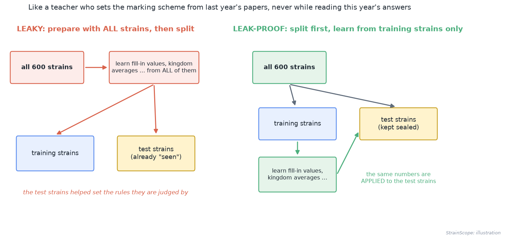
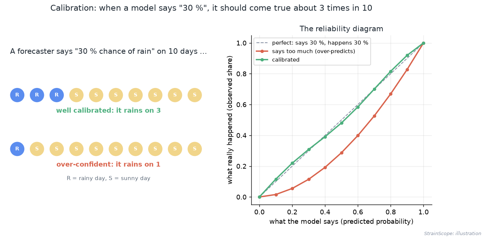
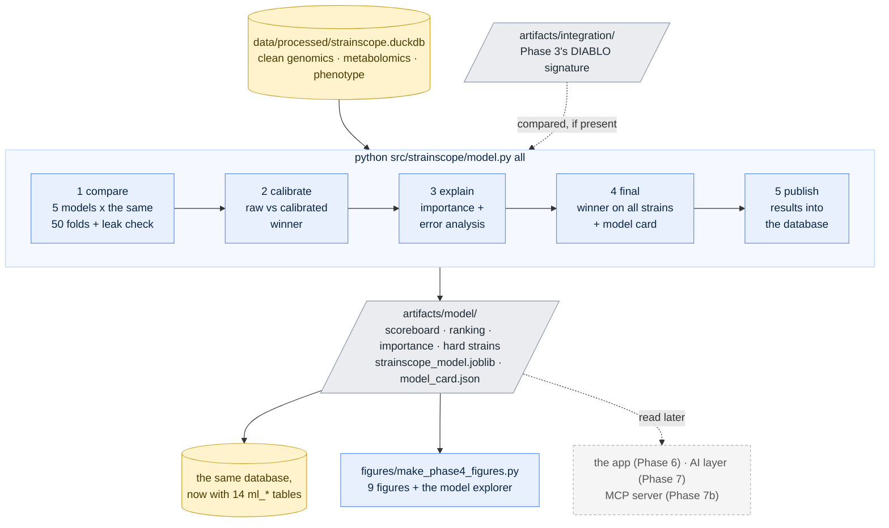
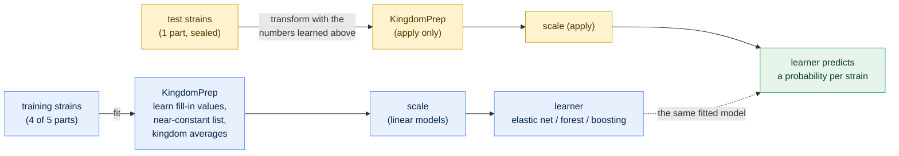
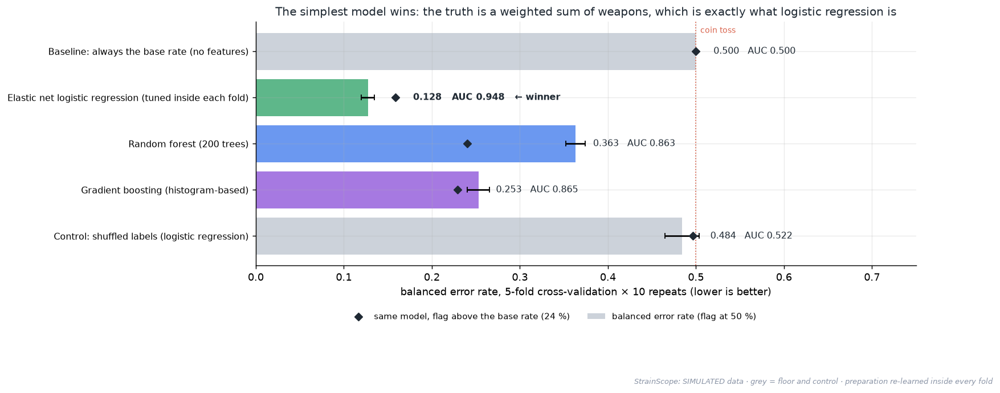
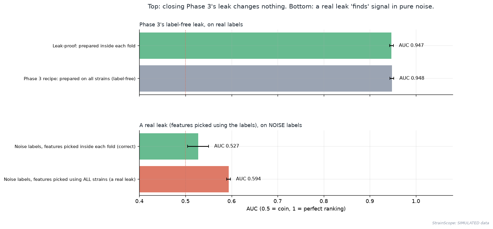
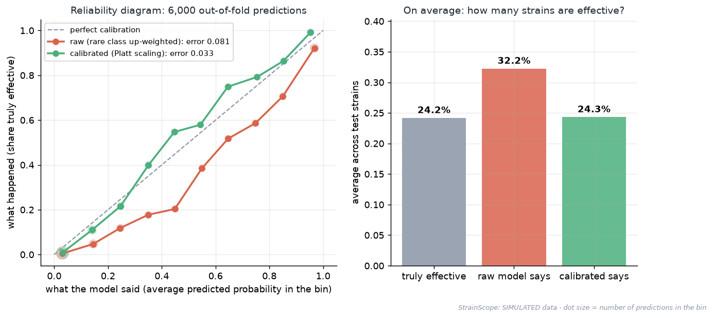
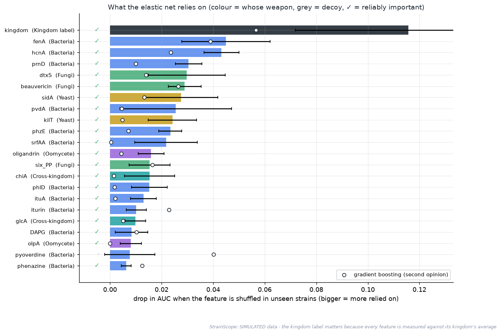
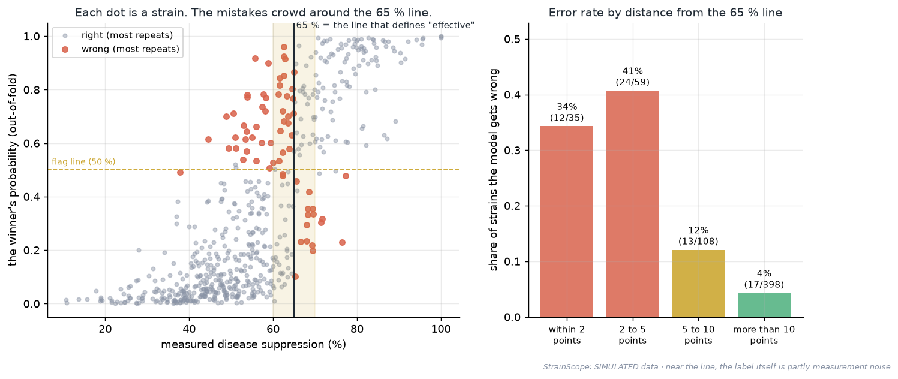

# 05 · Phase 4: Machine learning, measured carefully (predicting which strains will work)

[← Phase 3: integration](04-integration.md) · [Handbook](HANDBOOK.md) · [All docs in order](../README.md#the-tutorial-in-order) · [Glossary](GLOSSARY.md) · [Query Cookbook](QUERY_COOKBOOK.md) · [Roadmap](ROADMAP.md)

**Prerequisites:** Phase 2 complete, so the database `data/processed/strainscope.duckdb` exists (rebuild it any time with `python src/strainscope/generate_data.py` then `python src/strainscope/harmonize.py`). Phase 3 is recommended but not required: if its results are present, this phase compares itself with DIABLO; if not, that one comparison is skipped. **No R needed:** this phase is pure Python.
**Learning goal:** after this phase you will understand what a prediction model is and how four very different kinds work (a baseline, an elastic net, a random forest, gradient boosting); why preparation must be learned *inside* each cross-validation fold, and what a real leak looks like; why accuracy lies when winners are rare; how to tune a model without peeking (nested cross-validation); what calibration is and how to check it; how to ask a model what it relies on (permutation importance); how to study its mistakes; and how to save a model responsibly, with a model card.
**Why this phase exists in a real workflow:** Phase 3 answered *which* genes and chemicals matter. A screening team's next question is practical: *"we can afford to test 50 strains next season. Which 50?"* Answering it takes a model that predicts, a number that says how much to trust each prediction, and a clear record of where the model goes wrong. This phase builds all of that, and saves the result in a form that the app (Phase 6, [`docs/07-app.md`](07-app.md)) the AI layer (Phase 7, [`docs/08-deployment-ai.md`](08-deployment-ai.md)) and the MCP server (Phase 7b, [`docs/08b-mcp-server.md`](08b-mcp-server.md)) use.

**Session plan** (about 3½ hours in total, in three sittings):
- **Session A (~1.25 h):** concepts (§1 to 3), get the files (§4), compare the models (§5).
- **Session B (~1 h):** calibration (§6), what the models rely on and where they fail (§7), the final model and its card (§8).
- **Session C (~1.25 h):** publish and query (§9), the figures and what they mean (§10 and 11), tests, checkpoint, commit (§13 to 17).

> **How this guide works:** every action step tells you what **You should see**, **What it means**, and, when things can wobble, **If instead**. All paths are relative to the project folder (the folder that contains `README.md`). Every command uses plain keyboard characters, so it is safe to copy ([why](01-setup.md#copy-commands-safely-plain-keyboard-characters-only)).

---

## 1. The ideas behind this phase

### What a prediction model is

A **prediction model** is a recipe learned from examples. You show it 480 strains whose outcome you know (their genes, their chemistry, and whether they turned out effective), and it works out a rule that turns the measurements into a guess. Then you hand it strains it has never seen and compare its guesses with the truth.

Think of an estate agent who has watched hundreds of houses sell. They learn that size, garden and distance to the station predict the price. Nobody gave them a formula; the examples taught them. A good agent also says *how sure* they are ("between 400 and 450 thousand"), and that's what calibration (below) is about.

### Four contenders, from "no idea" to "many small experts"

| Model | How it decides, in one picture | In everyday terms |
|---|---|---|
| **Baseline** | ignores the strain; always says "24 % chance", the share of winners in the training data | a weather forecaster who announces the yearly average every single day |
| **Elastic net logistic regression** | gives every feature a *weight*, adds them up into a score, and squeezes the score into a probability between 0 and 1 with an S-shaped curve. It is *held back* (**regularised**) so it can't lean too hard on any one feature: weak weights are shrunk, many to exactly zero. *Elastic net* mixes the two classic ways of holding back: the **lasso** (pushes weights to zero, picking features) and **ridge** (shrinks all weights a little). The setting **C** says how loose the leash is. | a judge with a scoring sheet: points for each weapon a strain carries, a total and a verdict, plus a rule against giving any single item too many points |
| **Random forest** | grows 200 **decision trees** and averages their votes. Each tree is a flow-chart of yes/no questions ("carries fenA?" → "pyoverdine above 3?" → …) learned on a random sample of strains and features | asking 200 people who each saw part of the evidence, then taking the average opinion |
| **Gradient boosting** | builds small trees one after another, each one concentrating on the strains the previous ones got wrong | a team of proof-readers where each reads only the mistakes left by the one before |


*(Phase 3's picture, as a reminder: all four models here are fed both blocks glued side by side, the "early integration" option, after the kingdom-wise preparation.)*

Which one will win? Nobody knows before measuring, and the answer depends on the shape of the truth. That's why we compare them on exactly the same folds.

### Leakage: the mistake that flatters every model

Cross-validation (recap: [`docs/04-integration.md` §1](04-integration.md#keeping-the-score-fair-cross-validation-ber-controls)) only works if the test strains are truly *unseen*. **Leakage** is any way information from the test strains sneaks into training. The awkward part is that it often happens *before* the model, in the preparation.



Phase 3 filled gaps and centred each kingdom using all 600 strains at once, and only then split them into folds. So the test strains had a (tiny) say in the numbers they were later judged with. Phase 3 documented this as a small, *label-free* leak (no outcome was used). This phase closes it: the preparation becomes a step inside the model's **pipeline**, re-learned from the training strains of every fold. Then we *measure* how small the leak was, next to a real one.

### Rare winners: why accuracy lies


Only 24 % of strains are effective. A lazy model that says "no" to everything is **76 % accurate** and tells you nothing at all. That's why the main score, as in Phase 3, is the **balanced error rate** (the average of the error on winners and the error on the rest; lazy = 0.50). Two further habits follow:
- **Class weights.** During training, each winner counts about three times as much as a non-winner (`class_weight="balanced"`), so the model can't ignore the rare class. (It's like a teacher giving extra attention to the few pupils who need it.)
- **Two more scores built for rare winners.** **Average precision** asks "how pure is the top of the ranking?" (the base rate, 0.24, is what random ordering scores). The **Brier score** is the average squared distance between the probability and the truth (0 = perfect).

### Tuning without peeking: nested cross-validation

The elastic net has one setting, C. Choosing it by trying values on the test strains would be another leak, because the score would be the best of several tries and would flatter the model. So, inside every outer training fold, a small **inner** 3-fold cross-validation tries C = 0.05, 0.2 and 1.0 on the training strains only and keeps the best. Students work the same way: they may practise on past papers as often as they like, but never on the exam itself.

### Calibration: does "30 %" mean 30 %?



A model's probability is **calibrated** if, of all strains it calls "30 % likely", about 30 % really are effective. Class weights help a model *sort* strains, but they push its probabilities up: it starts saying "40 %" for strains that are effective 20 % of the time. **Platt scaling** fixes that by learning a smooth S-shaped correction on strains the model did not train on. A **reliability diagram** plots "what the model said" against "what happened"; the **calibration error** is the average gap.

Why it matters for a product: a scientist reading "this strain: 85 %" will plan budgets around that number, so the number needs to mean 85 %.

### Asking a model what it relies on: permutation importance

Take the test strains, scramble one column (say, `fenA`) so it no longer matches its strain, and score the model again. If the score drops a lot, the model relied on `fenA`; if it doesn't move, the model ignored it. That drop is the feature's **permutation importance**. It works for any model, and because it's measured on unseen strains, it shows what the model actually *uses* rather than what it memorised.

### Model card: the label on the jar

A **model card** is a short, plain document that travels with a saved model: what it is, what it was trained on, how well it scored and how that was measured, what it is for and *not* for, and which software versions built it. (The label on a medicine bottle does the same job for a medicine.) Ours is `artifacts/model/model_card.json`.

---

## 2. The data flow of this phase



And here is what happens inside **one** fold. This is the picture that makes the whole phase leak-proof:



What runs where: everything on your laptop, in about two to four minutes. Every result is a small file in `artifacts/model/` (committed, because the app reads them) and, after `publish`, a table in the database.

---

## 3. The decisions in English, before any code

1. **Leak-proof preparation.** Phase 3's rules (fill gaps within kingdom, drop near-constant features, log-transform chemistry, centre within kingdom) become one pipeline step, `KingdomPrep`, learned per fold. The outcome is never used to prepare anything.
2. **Same folds for every model:** 5-fold stratified cross-validation, repeated 10 times, seed 42 (the yardstick of Phase 3).
3. **Tuning inside the loop** (nested cross-validation) for the elastic net's C. The random forest and gradient boosting use fixed, conventional settings, written in `src/strainscope/model.py`. Searching their many settings would cost far more time than 600 strains justify, and every search is another chance to flatter the score.
4. **Rare winners are weighted up**, and judged by the balanced error rate.
5. **The simplest good model wins:** among models within one standard deviation of the best, choose the simplest (elastic net, then random forest, then gradient boosting). This is Phase 3's one-SD rule again.
6. **Calibrate before trusting probabilities** (Platt scaling, learned inside the training strains).
7. **Judge importance on unseen strains**, and call a feature *reliably important* only if its average drop is at least 0.002 in AUC and clearly above zero across the five folds.
8. **Fair predictions for strains we already know:** the ranking the app shows uses each strain's *out-of-fold* probability, which comes from models that never saw that strain.

### What we leave out on purpose, and why

- **No synthetic over-sampling** (inventing extra "winner" strains, a technique called SMOTE). Class weights achieve the same balance without making up data. The project already discloses one layer of simulation, and I didn't want to add a second.
- **No deep learning.** Neural networks shine with tens of thousands of examples; with 600 strains they would mostly memorise.
- **No threshold chosen on the test strains.** Thresholds are fixed in advance: 0.5 for the weighted models, the training base rate for the calibrated one.
- **No claim of real-world accuracy.** The data is simulated; every number here proves the *workflow*.

---

## 4. Get the Phase 4 files into your repo

All paths are relative to the project folder.

| Path | New / changed | Its job |
|---|---|---|
| `src/strainscope/model.py` | new | the five verbs: `compare`, `calibrate`, `explain`, `final`, `publish` (and `all`) |
| `tests/test_model.py` | new | 12 offline tests, including the whole chain on 90 hand-made strains |
| `figures/make_phase4_figures.py` | new | three concept pictures, six result figures, the interactive model explorer |
| `docs/05-machine-learning.md` | new | this guide |
| `figures/make_illustrations.py` | changed | the journey map now shows Stage 8 done, Stage 9 next |
| `README.md`, `CHANGELOG.md`, `docs/HANDBOOK.md`, `docs/ROADMAP.md`, `docs/PRODUCT_ROADMAP.md`, `docs/00-architecture.md`, `docs/04-integration.md`, `docs/GLOSSARY.md`, `docs/QUERY_COOKBOOK.md` | changed | Phase 4 everywhere it belongs: status, results, terms, recipes (§9 of the cookbook) |
| `artifacts/model/*.csv`, `artifacts/model/model_card.json`, `artifacts/model/strainscope_model.joblib` | new (generated by you, §5 to 8) | the small result tables, the model and its card, committed so the app can read them |
| `figures/*.png` (Phase 4 set), `docs/interactive/model_explorer.html`, `docs/img/journey_map.svg` | new / changed (generated by you, §10) | the pictures |

**Files-landed check:**

```bash
ls src/strainscope/model.py tests/test_model.py figures/make_phase4_figures.py docs/05-machine-learning.md
```

**Read before running.** Open `src/strainscope/model.py`: its top docstring lists the five verbs and the eight decisions above, and the class `KingdomPrep` carries the marking-scheme analogy in its comment. Ten minutes there makes every output below much easier to read.

No new packages are needed: scikit-learn, pandas, numpy, matplotlib, plotly and DuckDB are already in `requirements.txt`, and `joblib` (which saves the model) comes with scikit-learn.

---

## 5. Step 1: compare every model on the same folds

```bash
python src/strainscope/model.py compare
```

It takes about **one to three minutes** (most of it is 250 model fits plus the tuning inside them). **You should see:**

```
  ── Phase 4: the model scoreboard ───────────────────────────────
  (5-fold cross-validation × 10 repeats, the same folds for every row; preparation re-learned inside every fold)
  model                                                                BER  BER@base    AUC     AP  Brier   acc.
  Baseline: always the base rate (no features)               0.500 ± 0.000     0.500  0.500  0.242  0.183  0.758
  Elastic net logistic regression (tuned inside each fold)   0.128 ± 0.007     0.159  0.948  0.866  0.092  0.878  ← winner
  Random forest (200 trees)                                  0.363 ± 0.011     0.240  0.863  0.709  0.133  0.816
  Gradient boosting (histogram-based)                        0.253 ± 0.013     0.229  0.865  0.704  0.124  0.824
  Control: shuffled labels (logistic regression)             0.484 ± 0.019     0.496  0.522  0.285  0.265  0.551
  winner: Elastic net logistic regression (the best score): a weighted sum of features you can read line by line
  elastic net's C chosen inside the folds: 0.05 ×10, 0.2 ×35, 1.0 ×5  → final C = 0.2
  ── The leak check ───────────────────────────────────────────────
  A1 Phase 3 recipe: prepared on all strains (label-free)            AUC 0.948   BER 0.134
  A2 Leak-proof: prepared inside each fold                           AUC 0.947   BER 0.133
  B1 Noise labels, features picked using ALL strains (a real leak)   AUC 0.594   BER 0.445
  B2 Noise labels, features picked inside each fold (correct)        AUC 0.527   BER 0.483
  results → artifacts/model/   (172 s)
```

> These numbers come from scikit-learn 1.9 on two processor cores. Different scikit-learn versions can split ties in trees or converge the elastic net a hair differently, so **expect agreement to about ±0.01**; the run time depends on your computer (a recent laptop is faster). Your versions are written to `artifacts/model/model_card.json` in Step 4.

**What it means, row by row:**

- **Baseline** is the floor, with balanced error 0.500 and AUC 0.500. Look at its accuracy, though: **0.758**. The lazy model "wins" on accuracy, and that one number is the reason accuracy isn't our yardstick.
- **Elastic net is the winner**, by a wide margin: balanced error 0.128 ± 0.007, AUC 0.948, average precision 0.866 (versus 0.242 for random ordering). It matches the best of Phase 3 (0.123 to 0.134), and this time with no leak at all.
- **Random forest and gradient boosting** sort strains well (AUC ≈ 0.86) but clearly worse than the elastic net. The reason is the shape of the truth. In this data, efficacy is a *weighted sum* of many weapons (which is exactly what logistic regression computes), while trees have to build a sum out of many yes/no steps, and 600 strains are too few to do that well. The forest's balanced error at the 50 % line (0.363) is much worse than at the base-rate line (0.240), because its probabilities rarely climb past 50 % for the rare class. The **BER@base** column, which flags any strain above the 24 % base rate, is fairer to it. Even there, the elastic net wins.
- **Control: shuffled labels** scores 0.484, about what a coin toss would get, as it should. The procedure finds nothing where there is nothing to find.
- **C chosen inside the folds:** 0.2 in 35 of 50 folds. The final model uses C = 0.2.
- **The leak check, part A:** Phase 3's leak is real but harmless. The AUC is 0.948 with it and 0.947 without. Nothing about the outcome leaked, so nothing was flattered.
- **The leak check, part B** shows what a *real* leak looks like. With labels that are pure noise, picking the five "best" features using all strains and then cross-validating "finds" signal: AUC **0.594**. Picking them inside each fold gives 0.527, a coin toss give or take. The data and the model are the same in both runs; the only difference is *when* the labels were looked at.

**If instead** you see `No database at …`, build it: `python src/strainscope/harmonize.py`. If the scoreboard's winner isn't the elastic net, or the numbers are more than about 0.02 away, check that `data/raw/` came from the seed-42 generator (`python src/strainscope/generate_data.py`), then run `harmonize.py`, then re-run.

---

## 6. Step 2: calibration (can the probabilities be taken at face value?)

```bash
python src/strainscope/model.py calibrate
```

About **10 to 30 seconds**. **You should see:**

```
  ── Calibration: does "30 %" mean 30 %? ─────────────────────────
  winner: Elastic net logistic regression, final setting C = 0.2 (the value chosen most often inside the folds)
  strains really effective in the test folds: 24.2% on average
  raw model        says 32.2% on average · calibration error 0.081 · Brier 0.088 · BER 0.124 (threshold 0.5)
  calibrated model says 24.3% on average · calibration error 0.033 · Brier 0.078 · BER 0.129 (threshold = base rate)
  (calibration error = average gap between predicted and observed rates, pooled over all out-of-fold predictions; 0 = perfect)
  ranking quality is unchanged: AUC 0.950 → 0.950
  results → artifacts/model/   (9 s)
```

**What it means:**

- **The raw model says too much.** On average it predicts 32.2 % for a group of strains in which 24.2 % are effective. That's a side effect of up-weighting the rare class.
- **Calibration fixes the level** (24.3 % vs 24.2 %) and cuts the calibration error from 0.081 to 0.033, and the Brier score from 0.088 to 0.078 (lower is better on both).
- **It does not change the ranking** (AUC 0.950 both times). Calibration re-labels the scale and leaves the order of the strains alone.
- **The balanced error stays about the same** (0.124 vs 0.129), because the calibrated model flags strains above the base rate instead of above 50 %.
- *Why 0.124 here, but 0.128 in Step 1?* Step 1 re-tuned C inside every fold; this step uses the final setting, C = 0.2, everywhere, which is a hair kinder. Neither number cheats.

---

## 7. Step 3: what the models rely on, and where they go wrong

```bash
python src/strainscope/model.py explain
```

About **one minute**. **You should see:**

```
  ── What the models rely on (shuffle a feature in unseen strains, watch AUC drop) ─
  Elastic net logistic regression top 6: kingdom (0.116), fenA (0.045), hcnA (0.043), prnD (0.030), dtxS (0.030), beauvericin (0.029)
  Gradient boosting          top 6: kingdom (0.057), pyoverdine (0.040), fenA (0.039), beauvericin (0.026), hcnA (0.024), iturin (0.023)
  Elastic net logistic regression: reliably important features 23 picked · 22 true drivers · decoys: accE
  Gradient boosting: reliably important features             18 picked · 17 true drivers · decoys: accF
  vs Phase 3 (DIABLO robust signature): 21 shared · 2 only here (accE, olpA) · 8 only in DIABLO
  ── Where the winner goes wrong (out-of-fold, majority of 10 repeats) ─
  within 2 points                     12 of  35 strains wrong (34%)
  2 to 5 points                       24 of  59 strains wrong (41%)
  5 to 10 points                      13 of 108 strains wrong (12%)
  more than 10 points                 17 of 398 strains wrong (4%)
  by kingdom: Bacteria 9% · Fungi 15% · Yeast 12% · Oomycete 9%
  53 strains are wrong in at least 8 of 10 repeats; 19 of them are missed by all three models
  results → artifacts/model/   (40 s)
```

**What it means:**

- **The kingdom label tops both lists, and that is expected behaviour.** Every feature is read *relative to its kingdom's average* (decision 1). Scramble the kingdom label and every strain is measured against the wrong yardstick, so every feature misleads at once. In effect the kingdom is the ruler the weapons are measured with, rather than a weapon of its own.
- **Then come the weapons:** `fenA`, `hcnA`, `prnD` (bacterial), `dtxS` and beauvericin (fungal)… Two very different models tell the same story.
- **Graded against the planted truth:** of the elastic net's 23 reliably important features, **22 are true drivers** and one is a decoy (`accE`, with an AUC drop of 0.006, which is real but small). Gradient boosting gets 17 of 18.
- **Against Phase 3:** 21 features are shared with DIABLO's robust signature. The 8 that only DIABLO keeps are mostly *chemical products* of genes the elastic net already uses (HCN from `hcnA`, pyrrolnitrin from `prnD`, …). Gene and product are two witnesses to the same story. A penalised model keeps one witness, while DIABLO (built to find what the blocks *agree* on) keeps both. Neither is wrong; they're answering different questions.
- **Where the mistakes are:** almost all near the 65 % line that defines "effective". Within 5 points of it, the model is wrong about 4 strains in 10; more than 10 points away, 4 in 100. Near the line, a strain's label depends on a few points of measurement noise, so no model can do much better there, and a fair report should say so. By kingdom the error rates are similar (9 to 15 %), so no kingdom is left behind.
- **19 strains are missed by all three models.** These are the hardest cases, listed in `artifacts/model/hard_strains.csv` (and the `ml_hard_strains` table), and they're the first place to look when real data arrives.

---

## 8. Step 4: the final model and its card

```bash
python src/strainscope/model.py final
```

A few seconds. **You should see:**

```
  ── The final model ─────────────────────────────────────────────
  Elastic net logistic regression, C = 0.2, calibrated (Platt scaling), fitted on all 600 strains · 48 features
  ranking check: of the top 50 strains (out-of-fold probabilities), 47 are truly effective; chance alone would give 12
  saved → artifacts/model/strainscope_model.joblib (18.8 KB) + artifacts/model/model_card.json
  ranking → artifacts/model/predictions.csv   (0 s)
  Reminder: the data is SIMULATED. This proves the workflow, not real-world accuracy.
```

**What it means:**

- **The headline for a screening team:** test the 50 best-ranked strains and **47 are winners**; picking 50 at random would find about 12. That ranking uses each strain's out-of-fold probability, so no strain was ranked by a model that had seen it.
- **The model file** (`artifacts/model/strainscope_model.joblib`, under 20 KB) is the calibrated winner trained on all 600 strains, meant for scoring strains the project has *not* seen yet. It reads the clean tables' format directly (a `kingdom` column plus the raw gene and metabolite columns, gaps allowed) and copes with a kingdom it has never met.
- **The model card** (`artifacts/model/model_card.json`) is worth opening in VS Code. It says what the model is, its settings and how they were chosen, the data it learned from, its cross-validated scores, the decision threshold and what it means, its intended use (*rank candidates for testing; research use*) and what it is **not** for (*regulatory decisions; any real-world claim, since the data is simulated*), and the exact software versions.

> **Safety note: a model file is a program.** A `.joblib` file is a Python *pickle*: loading it runs code stored inside it. Load only model files you built yourself, like this one (rebuilt any time by this step). Never load one downloaded from an unknown source. The loader, `load_model()` in `src/strainscope/model.py`, also warns when your scikit-learn version differs from the one in the card; the cure is to re-run this step.

Score a strain from Python, the way the app does (paste into `python` started from the project folder; the app's version is the upload on its Data page, [`docs/07-app.md` §8](07-app.md#8-step-4-score-your-own-strains)):

```python
import sys; sys.path.insert(0, "src")
from strainscope.model import build_dataset, load_model, score_strains
X, y, outcome, genes, metabs = build_dataset()
model, card = load_model()
print(score_strains(X.head(5), model, card))
```

**You should see** five strains with a `probability` between 0 and 1 and a `predicted_effective` flag (1 when the probability beats the base rate, 0.2417).

---

## 9. Step 5: publish to the database, and ask it questions

```bash
python src/strainscope/model.py publish
```

**You should see** `published 14 tables into data/processed/strainscope.duckdb:` and fourteen names starting with `ml_`. Then, in the read-only SQL console (`python src/strainscope/sql.py`):

```sql
-- The ranking a screening team would use: the top 10
SELECT rank, strain_id, kingdom, ROUND(probability, 3) AS probability, is_effective
FROM ml_predictions
ORDER BY rank
LIMIT 10;
```

**You should see** ten strains, all `is_effective = 1`, led by bacteria, with a yeast, an oomycete and a fungus already in the top 10.

```sql
-- Which kingdoms make the top 50, and how many of them really work?
SELECT kingdom, COUNT(*) AS in_top_50, SUM(is_effective)::INT AS truly_effective
FROM ml_predictions
WHERE rank <= 50
GROUP BY kingdom
ORDER BY in_top_50 DESC;
```

**You should see** Bacteria 34 (32 effective), Fungi 11 (11), Yeast 4 (3), Oomycete 1 (1).

More recipes (the strains decided by a hair, the decoys, the features only DIABLO keeps) are in the [Query Cookbook §9](QUERY_COOKBOOK.md#9-machine-learning-results-phase-4).

> **Order rule (as in Phase 3):** `src/strainscope/harmonize.py` rebuilds the database from scratch, so after re-running it, re-run `python src/strainscope/integrate.py publish` and `python src/strainscope/model.py publish`.

**One command for all five steps:**

```bash
python src/strainscope/model.py all
```

---

## 10. See the results (figures + interactive)

```bash
python figures/make_phase4_figures.py
```

**You should see** nine `drew figures/…` lines and `drew docs/interactive/model_explorer.html (interactive, 4 charts)`.

### The scoreboard



Bars are the balanced error rate at the 50 % line, with ± from the ten repeats; diamonds are the same model flagging above the base rate. The elastic net wins either way.

### The leak, measured



Top: closing Phase 3's leak changes nothing. Bottom: a real leak manufactures signal from noise, which is why "prepare inside the fold" is treated as a firm rule here.

### Calibration



Red sits below the diagonal: the raw model says more than happens. Green follows the diagonal much more closely, though not perfectly (in the middle it says slightly *too little*). That's typical of Platt scaling on 600 strains, and you can only see it because we plot it.

### What the winner relies on



Colour = whose weapon (blue bacteria, green fungi, gold yeast, purple oomycete, teal shared; dark = the kingdom label); grey = decoy; ✓ = reliably important; white dots = gradient boosting's view of the same feature, a second opinion.

### Where the mistakes are



Red dots (strains the model gets wrong in most repeats) crowd into the gold band around the 65 % line.

### What a screening team gets


Testing in the model's order finds the winners early: 47 in the first 50, 89 in the first 100. Random order would find 12 and 24.

### Interactive version

Open `docs/interactive/model_explorer.html` in a browser (double-click it in your file manager). It has four charts (the scoreboard, the calibration curve, the importance bars, and every strain plotted by measured suppression against predicted probability), with hover details for every bar and dot; click a kingdom in the legend to hide or show it. It works offline: the charting library sits beside it as `docs/interactive/plotly.min.js`, shared with the Phase 3 explorer.

---

## 11. Reading the results like a scientist

- **What this phase shows:** the workflow can predict strain efficacy from genes and chemistry with a balanced error near 0.13 and a near-perfect top of the ranking, *on data built to contain that signal*; it does so without leakage, with probabilities that mean what they say, and it can explain itself in terms that match the planted biology.
- **What it does not show:** that these numbers would hold on real strains. Real biology adds interactions, measurement problems and confounders this simulation does not. The model card says so, in the field `not_for`.
- **Why the simplest model won:** because the truth here *is* a weighted sum. On real data, interactions (two weapons that only work together) could favour the trees, and that's why the comparison stays in the workflow even though the trees lost this time.
- **Mistakes near the line come from the question as much as from the model.** A strain scoring 64.8 % and one scoring 65.2 % are, biologically, the same strain. A product should show them as *borderline* instead of as a confident "no" and "yes", and the app does: a calibrated chance between 30 % and 70 % is labelled *borderline* on its Ranking and Strain pages ([`docs/07-app.md` §7](07-app.md#7-step-3-a-tour-of-the-app)).

---

## 12. Notes from the build (kept on purpose)

- **The leak that wasn't, and the one that was.** Phase 3 documented a small, label-free leak and promised to close it. Measuring before and after showed it changed nothing (AUC 0.948 → 0.947). To show what a *real* leak does, the same check first picks features using the labels of all strains (shuffled, meaningless labels) and "finds" AUC 0.594. The leaks to worry about are the ones that use the outcome, and measuring is the only way to know how much a leak matters.
- **The preparation step that was 26 times too slow.** The first `KingdomPrep` was written with pandas loops: 0.2 seconds per fit. Re-learned inside every fold *and* every inner tuning fold, that made one `compare` take 7½ minutes. Rewritten with plain numpy arrays it takes 0.008 seconds, and a check on 10 folds proved the output identical to the last decimal. Code inside a loop runs hundreds of times, so small costs add up fast. And a speed-up isn't finished until it's shown not to change the answer.
- **The saved model that only loaded in one place.** Run as a script, Python names the file `__main__`, and the first saved model remembered its preparation step under that name, so the app couldn't load it. Loading the model from a different folder before shipping caught it. The fix is to always use the step under its package name, `strainscope.model`, and a regression test now guards it. The wider habit: test a hand-off the way the receiving side will use it.
- **The decoys that looked "reliably important".** The first rule called a feature important if its AUC drop was above zero by two standard errors, computed over 50 shuffles. It flagged four decoys whose drops were around 0.0005. The 10 shuffles inside a fold are not independent (same fitted model, same test strains), so treating them as 50 measurements overstated the certainty. The rule now judges uncertainty across the five folds and requires a drop of at least 0.002. One decoy remains (`accE`, drop 0.006), and it's reported in the results. Whether a drop is "statistically detectable" and whether it "matters" are separate questions, and it pays to ask both.
- **The forest's threshold problem.** The random forest's AUC (0.863) said it sorts strains decently, but its balanced error (0.363) said it classifies badly. Its probabilities for winners rarely pass 50 %, even with class weights. Flagging strains above the base rate instead cuts its error to 0.240. The scoreboard now shows both columns so every model is judged fairly. A ranking score and a decision score can disagree like this, which makes the threshold part of the model.
- **Calibration error was mostly noise, at first.** Measured per fold (120 strains spread over ten bins) the error barely moved (0.096 → 0.070). Measured once on all 6,000 out-of-fold predictions it dropped clearly (0.081 → 0.033). Small groups make calibration look worse than it is, so it's worth settling how you'll measure before you trust a comparison.
- **The strain decided by the second decimal.** `STRAIN_0082` shows a suppression of 65.00 % but is labelled *not effective*. Its true score was a hair under 65 and was rounded to two decimals when stored; the label was set from the unrounded value. All three models call it effective, and in any sense that matters they're right. Cases like this only turn up when you look at the hardest strains one by one, and some of the "errors" turn out to belong to the label.
- **Two witnesses, one vote.** DIABLO keeps both a gene and its chemical product; the elastic net usually keeps one of the two, because once one is in the model the other adds little. Eight of DIABLO's robust features are such second witnesses. The two methods are answering different questions: DIABLO asks "what do the blocks agree on?", the elastic net asks "what is the shortest recipe that predicts?".

---

## 13. The tests

```bash
pytest -q
```

**You should see:** `49 passed`. That's the 37 from before plus 12 new ones in `tests/test_model.py`, which check: gaps filled from each strain's own kingdom; near-constant features dropped and centring within kingdom; the preparation learning only from the rows it is fitted on and never from the outcome; a kingdom never seen before; a lazy model scoring 0.50 (and 76 % accuracy); calibration error 0 when probabilities match reality; the ± measured across repeats; the scikit-learn version helper; every model keeping its preparation inside the pipeline; the preparation step keeping its package name even when run as a script (the regression test from §12); the whole chain end to end on 90 hand-made strains (compare, calibrate, explain, final, reload, score two new strains, publish twice); and the contract between `figures/make_phase4_figures.py` and `src/strainscope/model.py` on file names. None needs the network or the real database; the end-to-end test takes a few seconds.

**If instead** the last line says `49 passed` plus a number of warnings (76 on a Mac with Python 3.14 and NumPy 2.5), and the warnings summary shows a `DeprecationWarning` from `joblib/numpy_pickle.py` ("Setting the shape on a NumPy array has been deprecated"), your setup is fine. Newer NumPy versions complain about an older trick joblib uses when it saves and loads arrays. The warning comes from inside joblib, not from StrainScope's code, and the tests that save and reload the model still pass, so no result is affected. You can leave it.

---

## 14. Two ways to run everything (running tally)

| Task | Manual (learn) | Automatic (ship) |
|---|---|---|
| Generate synthetic data | `python src/strainscope/generate_data.py` | the one-command pipeline (Phase 8) |
| Fetch real data | `python src/strainscope/fetch_real.py [--probe] [--source ...]` | the app's **Upload · Synthetic · Fetch-real** picker |
| Clean + build the database | `python src/strainscope/harmonize.py` | the one-command pipeline (Phase 8) |
| Integrate (Phase 3) | `integrate.py prepare` → `Rscript R/diablo_integration.R` → `integrate.py twin` → `integrate.py publish` | `python src/strainscope/integrate.py all` |
| **Machine learning (this phase)** | `model.py compare` → `calibrate` → `explain` → `final` → `publish` | **`python src/strainscope/model.py all`** |
| Score new strains | `score_strains()` from Python (§8), or `python src/strainscope/service.py score FILE.csv` | the app's **Data** page, *Upload your strains* ([`docs/07-app.md` §8](07-app.md#8-step-4-score-your-own-strains)); a library strain's score, for an AI assistant app, through the MCP tool `rank_strain` (Phase 7b; uploads stay in the app) |
| Question the data | `python src/strainscope/sql.py` + the [Cookbook](QUERY_COOKBOOK.md) | the app's SQL console, cookbook built in |

---

## 15. Same task, different language (optional, 10 min)

The task is to **build the calibration table**: group strains into ten probability bins, and per bin compare what the model *said* with what *happened*. Run from the project folder, after `publish`.

**Python (pandas):**

```python
import pandas as pd
d = pd.read_csv("artifacts/model/calibrated_oof.csv")
d["bin"] = (d["p_calibrated"] * 10).astype(int).clip(upper=9)
print(d.groupby("bin").agg(n=("is_effective", "size"), said=("p_calibrated", "mean"),
                           happened=("is_effective", "mean")).round(3))
```

**R (base R only, no packages needed):**

```bash
Rscript -e 'd <- read.csv("artifacts/model/calibrated_oof.csv"); d$bin <- pmin(floor(d$p_calibrated * 10), 9); t <- aggregate(cbind(said = p_calibrated, happened = is_effective) ~ bin, data = d, FUN = mean); t$n <- as.vector(table(d$bin)); print(round(t, 3), row.names = FALSE)'
```

(Windows PowerShell: swap the quote marks, using double quotes outside and single quotes inside.)

**SQL (the console):**

```sql
SELECT LEAST(FLOOR(p_calibrated * 10), 9)::INT AS bin,
       COUNT(*) AS n,
       ROUND(AVG(p_calibrated), 3) AS said,
       ROUND(AVG(is_effective), 3) AS happened
FROM ml_calibrated_oof
GROUP BY bin
ORDER BY bin;
```

**All three give the same table.** For example, bin 0: 307 strains, said 0.033, happened 0.003; bin 9: 33 strains, said 0.952, happened 1.000. (These use each strain's *average* out-of-fold probability, 600 rows; the reliability diagram in §10 pools all 6,000 individual predictions, so its numbers differ slightly.) Pandas is the natural home for the modelling itself, and base R does the same grouping in one line. SQL is the quickest way to ask the question of results already in the database, which is what the app's SQL console does.

---

## 16. What could go wrong (mini-FAQ)

- **`compare` is slow (more than ~5 minutes).** It fits about 250 models plus the tuning inside them. On a laptop with few processor cores it just takes longer; nothing is wrong. For a quick trial, `python src/strainscope/model.py compare --repeats 2` (the numbers will wobble more, so use the full run for anything you report).
- **`Missing artifacts/model/scoreboard.csv`** when running `calibrate`, `explain` or `final`: run `compare` first, because each step reads the one before.
- **`ConvergenceWarning` messages.** The elastic net's solver is silenced inside the loops on purpose (the scores themselves are the check); if you see them elsewhere, they're harmless.
- **`UserWarning: model built with scikit-learn X, running Y`** means your scikit-learn changed since the model was saved. Rebuild it: `python src/strainscope/model.py final`.
- **`AttributeError: Can't get attribute 'KingdomPrep'`** when loading the model: either it's an old model file saved before the fix in §12, or `src/` isn't importable. Rebuild with `final`, and load from a script that starts with `sys.path.insert(0, "src")` (or the full path to `src`), as in §8.
- **SQL: `Table with name ml_predictions does not exist`.** You re-ran `harmonize.py` after publishing; re-run `python src/strainscope/model.py publish`.
- **The interactive page is blank.** `docs/interactive/plotly.min.js` must sit beside `model_explorer.html`; re-run `python figures/make_phase4_figures.py`.
- **`git status` shows `docs/interactive/plotly.min.js` as modified.** The figure scripts rewrite the shared charting library, so if your plotly version changed, the file changes too. Commit it with the phase.

---

## 17. Save your work (safety gate, then the commit ritual)

The checks come first:

```bash
pytest -q                     # 49 passed
./check-public-safe.sh        # must end with: SAFE TO PUSH  (Windows: bash check-public-safe.sh in Git Bash)
```

`git status` should list the new code, this guide, the changed docs, the new figures, `docs/interactive/model_explorer.html` and everything under `artifacts/model/` (including the small `strainscope_model.joblib`), and **never** anything under `data/`.

Then, on `develop`:

```bash
git switch develop
git add -A
git commit -m "feat: add leak-proof machine learning with calibration, importance and error analysis"
git push origin develop develop:beta develop:master

## --tags is optional, only when required
## (no tag this phase: v0.2.0 arrives with Phase 5, see docs/ROADMAP.md)
## then switch back to local master and pull in the remote changes

git switch master
git pull --ff-only origin master
git switch develop
```

**No tag this time.** Version tags mark the points where the project is usable at a new level ([why these tags](ROADMAP.md#version-tags)); **v0.2.0** ("the analysis is complete") arrives with Phase 5. Until then, this phase is listed under *Unreleased* in `CHANGELOG.md`.

Then update the [Handbook](HANDBOOK.md) Stage 8 checkpoint if anything about your run differed. It's the first document a newcomer reads, so it must describe what *you* got.

---

## 18. What you learned, and what's next

**You learned:** what a prediction model is and how four kinds decide; why preparation belongs inside each fold, and the difference between a harmless label-free leak and a dangerous label-using one; why accuracy misleads when winners are rare, and what to use instead (balanced error, average precision, Brier score); how to tune without peeking; what calibration is, how to measure it fairly and how to fix it; how to ask a model what it relies on and judge the answer against the truth; how to study mistakes one strain at a time; and how to hand a model over responsibly, with a small file, a model card, a safety note and a loader that checks versions.

**Try it yourself (extensions):**
- In `src/strainscope/model.py`, change the random forest's `n_estimators=200` to `50` and re-run `compare --repeats 3`. How much worse does it get, and how much faster? (Put it back.)
- Change `ELASTIC_NET_C` to `(0.01, 0.05, 0.2, 1.0, 5.0)` and re-run `compare`. Does the chosen C move?
- Write a cookbook query that lists, per kingdom, how many of its strains are *borderline*, meaning a calibrated probability between 0.3 and 0.7 (hint: `ml_predictions`, `GROUP BY kingdom`).

**Next:** [`docs/06-knowledge-graph.md`](06-knowledge-graph.md) ([Handbook Stage 9](HANDBOOK.md#stage-9-phase-5-the-knowledge-graph)) covers **Phase 5**, where the project's knowledge becomes a map you can walk: strains, genes, compounds and modes of action as dots, their relationships as lines, and a source on every line. The map uses the real KEGG and RefMet links of Phases 1b and 1c, Phase 3's gene ↔ product correlations and this phase's importances, and explains every ranking you made here. The phase ends with the release of **v0.2.0**.
