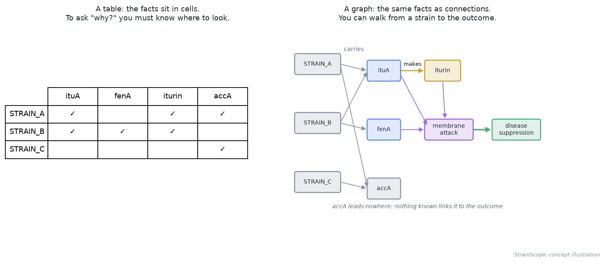
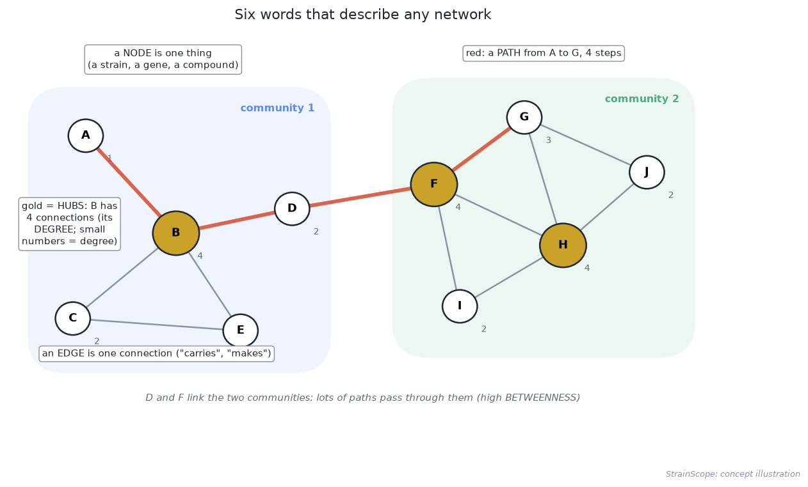
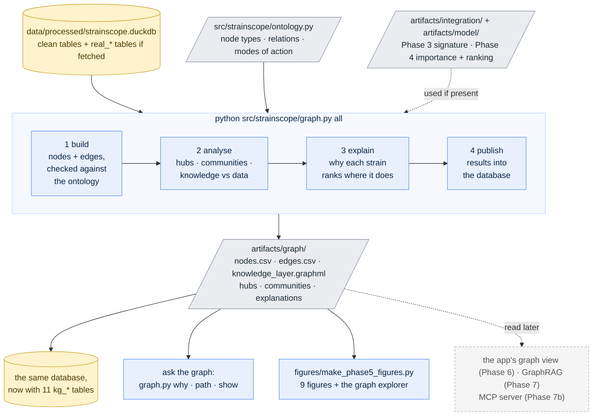
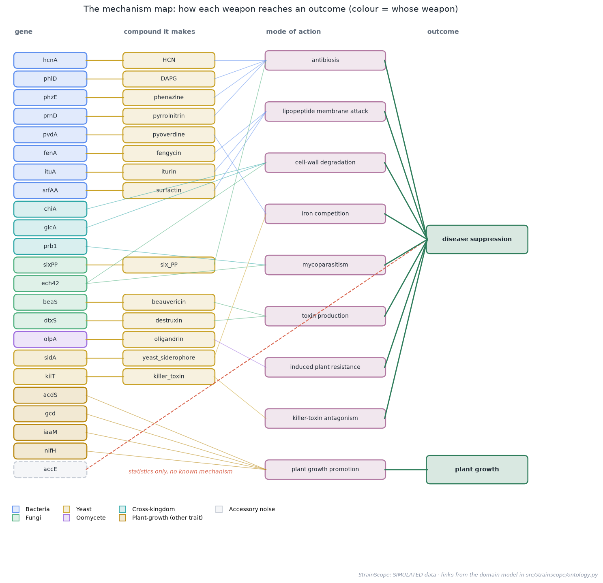
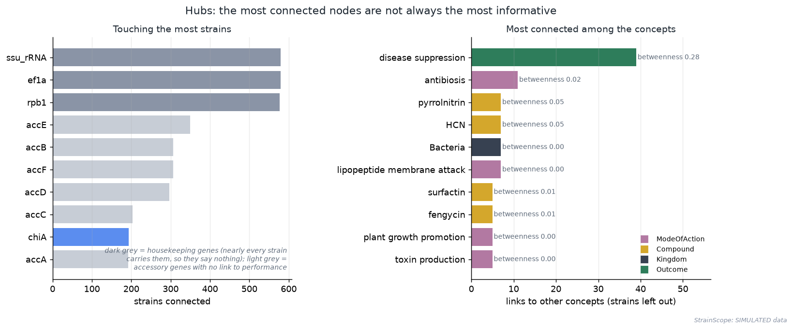
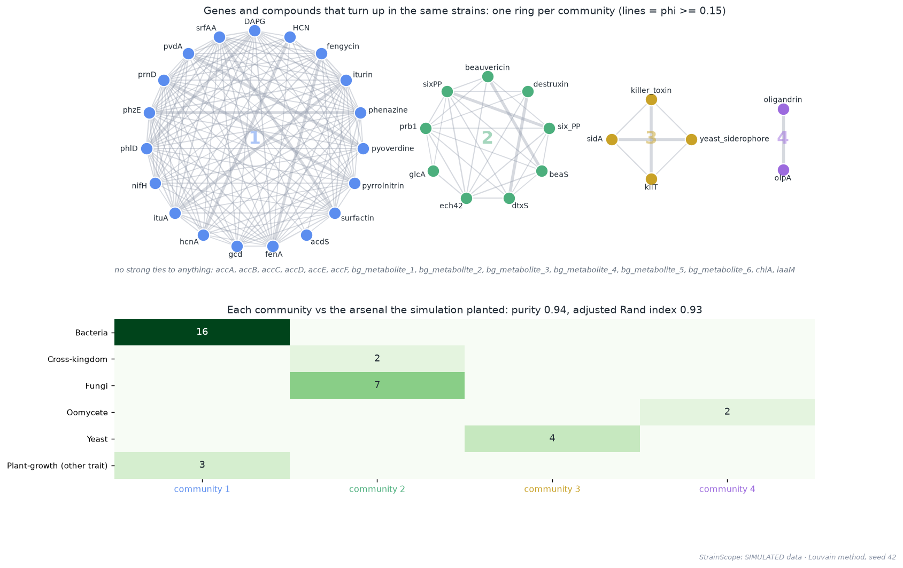
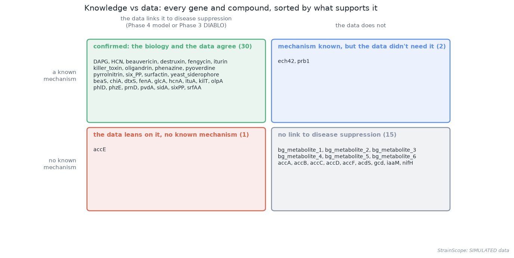

# 06 · Phase 5: The knowledge graph (walking from a strain to the reason it works)

[← Phase 4: machine learning](05-machine-learning.md) · [Handbook](HANDBOOK.md) · [All docs in order](../README.md#the-tutorial-in-order) · [Glossary](GLOSSARY.md) · [Query Cookbook](QUERY_COOKBOOK.md) · [Roadmap](ROADMAP.md)

**Prerequisites:** Phases 2 to 4 complete: the database `data/processed/strainscope.duckdb` exists, and `artifacts/integration/` (Phase 3) and `artifacts/model/` (Phase 4) hold their results. The graph still builds without the Phase 3 and 4 results (it says what it skipped), but the rankings and explanations need them. The real tables from Phases 1b and 1c are optional: when they're in the database the graph uses them, and when they aren't it says so. **No R and no internet needed:** this phase is pure Python.
**Learning goal:** after this phase you will understand what a graph (a network) is and the handful of words that describe one; what an ontology is and why it's written before any data is loaded; how a knowledge graph differs from a table, and why every connection in it carries its source; the difference between a *mechanism* ("this is how it works") and a *statistical association* ("these go together in the data"); how to find hubs and communities, and how to grade communities against a known answer; and how to answer "why does this strain rank here?" by walking the graph.
**Why this phase exists in a real workflow:** Phase 4 gave a screening team a ranked list. The next question is always *why*: "why is STRAIN_0485 first, and why is STRAIN_0220 last?" A score alone can't answer that. The knowledge graph links each strain to the weapons it carries, each weapon to the way it works, and each way of working to the outcome, with a source on every step. That turns a number into an argument a scientist can check. It's also the foundation for later phases: the app's strain pages and graph view (Phase 6, [`docs/07-app.md`](07-app.md)), GraphRAG answers (Phase 7) and the MCP server (Phase 7b) all walk this graph.

**Session plan** (about 3 hours in total, in two sittings):
- **Session A (~1.5 h):** concepts (§1 to 3), get the files (§4), build the graph (§5), hubs and communities (§6).
- **Session B (~1.5 h):** explanations (§7), asking the graph questions (§8), publish and query (§9), the figures and how to read them (§10 and 11), tests, two ways to run, commit and the **v0.2.0** release (§13 to 17).

> **How this guide works:** every action step tells you what **You should see**, **What it means**, and, when things can wobble, **If instead**. All paths are relative to the project folder (the folder that contains `README.md`). Every command uses plain keyboard characters, so it is safe to copy ([why](01-setup.md#copy-commands-safely-plain-keyboard-characters-only)).

---

## 1. The ideas behind this phase

### Tables hold facts; graphs let you follow them

Everything the project knows already sits in tables: which genes each strain carries, how much of each compound it makes, which genes make which compounds. The facts are all there, but they're scattered. To answer "why does this strain work?" you have to know which table to open, which column to read, and which other table to join it to.



A **graph** stores the same facts as *things* and *connections between things*. The table says STRAIN_A has a tick under `ituA`. The graph says STRAIN_A **carries** ituA, ituA **makes** iturin, iturin works by **membrane attack**, and membrane attack **contributes to** disease suppression. You can start at the strain and walk to the outcome, one connection at a time. A record of who phoned whom works the same way: as a table it's just rows, but drawn as a network you can see at once that two people are linked through a third.

### Six words that describe any network



- A **node** is one thing (a strain, a gene, a compound, a pathway).
- An **edge** is one connection between two nodes. Ours have a *direction* (STRAIN_A carries ituA, never the other way round) and a *relation* name (`carries`, `makes`, `acts_by`).
- The **degree** of a node is how many edges touch it.
- A **hub** is a node with unusually many edges.
- A **path** is a walk from one node to another along edges; the **shortest path** is the walk with the fewest steps.
- A **community** is a group of nodes more tightly linked to each other than to the rest.

One more word turns up in the results: **betweenness**, the share of shortest paths between other nodes that pass through a node. A railway junction has high betweenness: lots of journeys go through it, even if few start there.

### An ontology first: agreeing on the kinds of things

Before loading a single fact, we write down which *kinds* of node exist and which kinds of connection are allowed between them. That list is an **ontology**, a family tree for concepts. It says "a strain belongs to a genus", "a gene can make a compound", "a compound can sit in a pathway". Just as important, it rules out nonsense: a pathway can't "carry" a strain.


Ours lives in one small, readable file, `src/strainscope/ontology.py`, and the picture above is drawn straight from it, so the two can't drift apart. It has ten node types and eleven relations. The three dashed boxes only fill up when you have the real tables from Phases 1b and 1c. The build refuses to save a graph with an edge the ontology doesn't allow, and a test checks the same rule.

Why bother? Without agreed types, a graph slowly fills with near-duplicates and connections that mean different things in different places. With them, every query and every explanation can rely on what an edge means. Large shared ontologies exist for exactly this reason (NCBI Taxonomy for organisms, ChEBI for chemicals, the Gene Ontology for gene functions); [`docs/PRODUCT_ROADMAP.md`](PRODUCT_ROADMAP.md#c5-ontologies-and-a-graph-database) explains when StrainScope would adopt them.

### A knowledge graph: the ontology, filled in, with a source on every edge

A **knowledge graph** is the ontology filled with actual facts: 600 strains, 31 genes, 20 compounds, 9 modes of action and so on, joined by thousands of edges. Every edge records where it came from, its **provenance**: the synthetic library, the domain model, KEGG, RefMet, BacDive, or the results of Phases 3 and 4. When the graph later says "iturin sits in a KEGG pathway", you can see that KEGG said so, and when it says "accE goes with disease suppression", you can see that only a statistic said so.

### Two kinds of evidence: how it works, and what goes together

The graph holds two different kinds of link between a feature and the outcome:

- **`acts_by` → `contributes_to` (a mechanism).** ituA makes iturin, iturin attacks the pathogen's membrane, and membrane attack suppresses disease. That's a *how*. Here it comes from the domain model: the descriptions that define the simulated library, written into `src/strainscope/ontology.py` as each gene's **mode of action**. In a real project it would come from the literature.
- **`associated_with` (a statistic).** Phase 4's model leaned on the feature, or Phase 3's DIABLO kept it in at least 80 % of re-fits. That's a *what goes together*, with no claim about why.

A doctor uses both: "smokers get more lung cancer" is an association, and "tar damages lung cells" is the mechanism behind it. Each is useful on its own, and the two agreeing is far more convincing than either alone. When they disagree, something deserves a closer look. The graph keeps them apart so it can tell you which situation you're in.

### Communities, and how to grade them

Some genes and compounds keep turning up in the same strains. To find those groups, the graph links two features when they appear together more often than chance would predict, measured with the **phi correlation** (an ordinary correlation for yes/no data: 0 means no pattern, 1 means always together). Then the **Louvain method** splits the linked features into communities: it keeps moving nodes between groups as long as that makes the groups more tightly knit inside than between, a bit like seating wedding guests so that each table is full of people who know each other.

Because the data is simulated, we know which kingdom's *arsenal* each weapon belongs to, so the communities can be graded against that answer. **Purity** asks: of the weapons in each community, what share belong to that community's most common arsenal? The **adjusted Rand index** compares the two groupings as a whole: 1 means identical, 0 means no better than chance.

---

## 2. The data flow of this phase



What runs where: everything on your laptop, in well under a minute. The graph itself is two plain tables in `artifacts/graph/` (`nodes.csv` and `edges.csv`, committed because the app reads them), plus a copy of the knowledge layer in GraphML, a standard format that Gephi and Cytoscape open directly and Neo4j can import (through its APOC plugin).

---

## 3. The decisions in English, before any code

1. **Ontology first.** The node types and relations are fixed in `src/strainscope/ontology.py` before any data is read. An edge the ontology doesn't allow stops the build, and nothing is saved.
2. **A source on every edge.** Each connection records its provenance, so any claim the graph makes can be traced back and checked.
3. **"Produces" means clearly above background.** The lab reads a little of every compound in every strain. A strain counts as producing a compound when its cleaned level is at least **4 times** that compound's median across all strains. Producers in this library typically sit 5 to 20 times above the median, while background readings sit near it. A missing reading creates no edge: the graph doesn't treat "not measured" as "not produced".
4. **Mechanism and statistics stay apart.** `acts_by` edges say how something could work; `associated_with` edges say the data links it to the outcome. Explanations use both and say which is which.
5. **Communities from co-occurrence, graded.** Features are linked when their phi correlation across strains is at least **0.15**, then grouped with the Louvain method, seed 42. Housekeeping genes are left out because a gene every strain carries "co-occurs" with everything. I chose phi rather than the simpler overlap score (the Jaccard index) because overlap rewards common features: two accessory genes that half of all strains carry would look strongly linked purely by chance.
6. **Concept analyses ignore the 600 strains.** Betweenness and path questions run on the **knowledge layer** (every node type except strains), so 600 strain nodes don't drown out a few dozen concepts. A strain can be the start or end of a path, never a stepping stone.
7. **Paths prefer a mechanism to a shortcut.** A statistics-only edge counts as 2.5 steps in a path search, so "ituA → disease suppression" is answered with the mechanism (two steps) rather than the one-step statistic, while "accE → disease suppression" still finds the statistic, because no mechanism exists.
8. **Explanations are computed, never written.** Every sentence in an explanation is built from edges in the graph. Nothing comes from a language model in this phase.

### What we leave out on purpose, and why

- **No graph database (Neo4j) yet.** About 700 nodes and 8,000 edges fit comfortably in memory with NetworkX. A database earns its place when the graph outgrows memory or many people query it at once; [`docs/ROADMAP.md`](ROADMAP.md#deferred-items-and-their-triggers) and the product roadmap record that trigger.
- **No external ontologies yet.** Mapping our names to NCBI Taxonomy, ChEBI or the Gene Ontology matters once real data brings real names that need reconciling. With a simulated library it would add machinery without adding meaning.
- **No graph machine learning** (node embeddings, graph neural networks). They need far larger graphs, and Phase 4's model already does the predicting. This phase is about explaining.
- **No language model.** GraphRAG, where a language model answers questions by walking this graph and citing the route, arrives in Phase 7. The walks it will use are built and tested here first.
- **No claim about real biology.** The modes of action come from the descriptions that define the simulated library. They match textbook biocontrol biology, but on real strains the evidence would come from the literature and the lab.

---

## 4. Get the Phase 5 files into your repo

All paths are relative to the project folder.

| Path | New / changed | Its job |
|---|---|---|
| `src/strainscope/ontology.py` | new | the domain model: node types, relations, modes of action, and the edge checker |
| `src/strainscope/graph.py` | new | the verbs `build`, `analyse`, `explain`, `publish` (and `all`), plus the questions `why`, `path` and `show` |
| `tests/test_graph.py` | new | 12 offline tests, with and without the real tables |
| `figures/make_phase5_figures.py` | new | three concept pictures, six result figures, the interactive graph explorer |
| `docs/06-knowledge-graph.md` | new | this guide |
| `figures/make_illustrations.py` | changed | the journey map now shows Stage 9 done, Stage 10 next |
| `README.md`, `CHANGELOG.md`, `docs/HANDBOOK.md`, `docs/ROADMAP.md`, `docs/PRODUCT_ROADMAP.md`, `docs/00-architecture.md`, `docs/04-integration.md`, `docs/05-machine-learning.md`, `docs/GLOSSARY.md`, `docs/QUERY_COOKBOOK.md` | changed | Phase 5 everywhere it belongs: status, results, terms, recipes (§10 of the cookbook), the v0.2.0 release |
| `artifacts/graph/*.csv`, `artifacts/graph/knowledge_layer.graphml` | new (generated by you, §5 to 9) | the graph and its small result tables, committed so the app can read them |
| `figures/*.png` (Phase 5 set), `docs/interactive/graph_explorer.html`, `docs/img/journey_map.svg` | new / changed (generated by you, §10) | the pictures |

**Files-landed check:**

```bash
ls src/strainscope/ontology.py src/strainscope/graph.py tests/test_graph.py figures/make_phase5_figures.py docs/06-knowledge-graph.md
```

**Read before running.** Open `src/strainscope/ontology.py` first. It's short and has no logic in it, just the node types, the relations and the mode of action of every weapon, in plain English. Then skim the top docstring of `src/strainscope/graph.py`, which lists the verbs and the decisions above. Ten minutes there makes every output below easy to read.

No new packages are needed: NetworkX has been in `requirements.txt` since the setup phase, and scikit-learn (for the adjusted Rand index), pandas, matplotlib, plotly and DuckDB are already installed.

---

## 5. Step 1: build the graph

```bash
python src/strainscope/graph.py build
```

It takes a few seconds. **You should see** (this is a run without the real tables; what changes with them is explained right after):

```
  ── Phase 5: the knowledge graph ────────────────────────────────
  nodes: 679   Kingdom 4 · Genus 13 · Strain 600 · Gene 31 · Compound 20 · ModeOfAction 9 · Outcome 2
  edges: 8,096
    belongs_to          600   from: synthetic library (Phase 1, cleaned in Phase 2)
    in_kingdom           13   from: synthetic library (Phase 1, cleaned in Phase 2)
    carries           5,880   from: synthetic library (Phase 1, cleaned in Phase 2)
    produces          1,491   from: synthetic library (Phase 1, cleaned in Phase 2)
    makes                14   from: domain model (gene descriptions in src/strainscope/generate_data.py)
    acts_by              37   from: domain model (gene descriptions in src/strainscope/generate_data.py)
    contributes_to        9   from: domain model (gene descriptions in src/strainscope/generate_data.py)
    associated_with      52   from: Phase 3 (DIABLO signature, stability >= 0.8); Phase 4 (permutation importance of the winning model)
  checks: every edge allowed by the ontology ✓ · every edge has a source ✓ · no isolated nodes ✓
  note: no real tables yet (Phases 1b and 1c): the graph has no pathway, chemical-class or reference-strain nodes
  graph → artifacts/graph/nodes.csv, edges.csv, knowledge_layer.graphml   (0 s)
```

**What it means.** 679 things and 8,096 connections, every one allowed by the ontology and every one with a source. Most edges are facts from the library: 5,880 "carries" (gene calls of 1) and 1,491 "produces" (readings at least 4 times the median). The domain model adds 60 edges of biology (14 gene-makes-compound pairs, 37 links from a weapon to its mode of action, 9 from a mode to an outcome). Phases 3 and 4 add 52 statistical edges: 29 from DIABLO's robust signature and 23 from the model's reliably important features. A feature both of them picked gets two edges, one per source.

**With the real tables from Phases 1b and 1c** (if you fetched them, this is your case), these lines change (and a genus that only BacDive knows adds a Genus node and an `in_kingdom` edge sourced from BacDive):
- the `nodes:` line also counts `Pathway` (KEGG pathway maps), `ChemicalClass` (RefMet classes) and `ReferenceStrain` (one per BacDive record), so the totals are higher;
- `belongs_to` also lists `BacDive (DSMZ)` as a source, and three more relations appear: `in_pathway` (from KEGG), `classified_as` and `subclass_of` (from RefMet);
- the `note: no real tables yet` line disappears.

Your exact counts depend on what the live APIs returned when you fetched. (A full fetch in October 2026 gave 795 nodes and 8,218 edges; [Handbook Stage 9](HANDBOOK.md#stage-9-phase-5-the-knowledge-graph) lists what the extra 116 nodes and 122 edges are. That's the graph committed in `artifacts/graph/`.) The genus nodes also pick up NCBI genome counts and median genome sizes as attributes.

**If instead** you see `No database at ...`, run `python src/strainscope/harmonize.py` first. If you see `note: no Phase 4 results` or `note: no Phase 3 results`, the graph was built without those statistical edges: run `python src/strainscope/model.py all` (and `python src/strainscope/integrate.py all`), then build again. If you see `The graph breaks the ontology; nothing was saved`, an edge broke a rule. That only happens if `src/strainscope/ontology.py` or the input tables were edited; the message names the first problem edges.

---

## 6. Step 2: hubs, communities, and knowledge vs data

```bash
python src/strainscope/graph.py analyse
```

**You should see:**

```
  ── Hubs: the most connected nodes ─────────────────────────────────
  touching the most strains: ssu_rRNA (579), ef1a (579), rpb1 (577), accE (349)
  most links between concepts: disease suppression (39), antibiosis (11), lipopeptide membrane attack (7), plant growth promotion (5)
  the biggest bridges (betweenness): disease suppression (0.25), mycoparasitism (0.02), cell-wall degradation (0.01)
  ── Communities: what turns up together in the same strains ──────
  community 1: 19 features · mostly Bacteria (16/19) · DAPG, HCN, fenA, fengycin, hcnA, ituA, iturin …
  community 2:  9 features · mostly Fungi (7/9) · glcA, prb1, beaS, beauvericin, destruxin, dtxS, ech42 …
  community 3:  4 features · mostly Yeast (4/4) · kilT, killer_toxin, sidA, yeast_siderophore
  community 4:  2 features · mostly Oomycete (2/2) · oligandrin, olpA
  no strong ties (14): accA, accB, accC, accD, accE, accF, bg_metabolite_1, bg_metabolite_2, bg_metabolite_3, bg_metabolite_4, bg_metabolite_5, bg_metabolite_6, chiA, iaaM
  graded against the planted arsenals: purity 0.94 · adjusted Rand index 0.93 (31 signal features)
  ── Knowledge vs data (disease suppression) ─────────────────────────
  confirmed: mechanism and data agree              30  DAPG, HCN, beauvericin, destruxin, fengycin, iturin, killer_toxin, oligandrin …
  mechanism only: the data did not need it          2  ech42, prb1
  data only: no known mechanism (treat with care)   1  accE
  neither: no link to disease suppression          15  bg_metabolite_1, bg_metabolite_2, bg_metabolite_3, bg_metabolite_4, bg_metabolite_5, bg_metabolite_6, accA, accB …
  results → artifacts/graph/   (2 s)
```

**What it means, part by part.**

- **Hubs.** The nodes touching the most strains are the three housekeeping genes, which nearly every microbe carries, and then accessory genes. They're hubs and they tell you nothing about which strain works, in the way "the" turns up in every entry of a library catalogue. Among the concepts, `disease suppression` is the big hub (39 neighbours: the 8 modes of action that lead to it and the 31 features with a statistical edge to it) and the biggest bridge: it links so many concepts that many shortest routes between two of them run through it. With the real tables, compounds that sit in several KEGG pathways can also appear among the bridges (in the October 2026 fetch, pyrrolnitrin and HCN at 0.05 each, behind disease suppression at 0.28). The communities, the knowledge-vs-data verdicts and the explanations come out the same with or without the real tables, because they're computed from the strains.
- **Communities.** Four communities, and they match the kingdoms' arsenals almost exactly: purity 0.94 and an adjusted Rand index of 0.93. The bacterial weapons form one tight group, the fungal ones another, and the yeast and oomycete weapons their own small groups. Three plant-growth genes (acdS, nifH, gcd) sit with the bacteria because they're common in bacteria in this library, which is the point to remember: a community means these features turn up in the same strains, and it says nothing about whether they work together. The accessory genes and background compounds have no strong ties at all, which is what "no link to anything" should look like. `chiA` has none either: it's spread across bacteria, fungi and oomycetes, so it doesn't belong to any one kingdom's group.
- **Knowledge vs data.** 30 features have both a known mechanism and statistical support. Two have a mechanism the data didn't pick up (`ech42` and `prb1`). Both are enzymes with no compound measured, so in this simulation their planted effect is smaller than that of a weapon whose compound adds to the score. `chiA` and `glcA` are enzymes too, but more strains carry them (193 and 179, against 112 each), which gives the statistics more to work with. One has statistical support and no mechanism: `accE`, the decoy Phase 4 already flagged. The graph puts it in the "treat with care" box automatically. The remaining 15 have no link to disease suppression (the four plant-growth genes do have a mechanism, but for a different outcome).

---

## 7. Step 3: why each strain ranks where it does

```bash
python src/strainscope/graph.py explain
```

**You should see** two worked examples (the top-ranked strain and the lowest-ranked strain of the same kingdom), then a summary:

```
  ── Why strains rank where they do (walks through the graph) ───────
  STRAIN_0485 (Paenibacillus, bacterial): rank 1 of 600, predicted 100%; in the data: effective
    + carries fenA and produces fengycin (7.6x the usual level): lipopeptide membrane attack
    + carries hcnA and produces HCN (5.4x the usual level): antibiosis
    + carries pvdA and produces pyoverdine (22.1x the usual level): iron competition
    ? carries accE: the model leans on it a little, but no known mechanism links it to disease suppression
    (+ 7 more mechanism paths; `show STRAIN_0485` lists everything it carries and produces)
  STRAIN_0220 (Bacillus, bacterial): rank 600 of 600, predicted 0%; in the data: not effective
    + carries phlD and produces DAPG (14.8x the usual level): antibiosis
    ? carries accE: the model leans on it a little, but no known mechanism links it to disease suppression
    - lacks fenA, which 38% of bacterial strains carry
    - lacks hcnA, which 36% of bacterial strains carry
  of the top 50 strains, 50 have at least one mechanism path; 349 strains carry a data-only flag
  results → artifacts/graph/explanations.csv   (0 s)
```

**What it means.** Each line is a walk through the graph:

- **`+` a mechanism path:** the strain carries a weapon gene (and, when measured, produces its compound) that acts by a known mode of action on disease suppression. Up to three are shown, the ones the model relies on most. STRAIN_0485 has ten such paths, more than any other strain.
- **`?` a data-only flag:** the strain has a feature the model leans on that no known mechanism explains. It's shown so you don't mistake it for a reason. `accE` is common (349 strains carry it), so this flag turns up often.
- **`-` a missing weapon:** a weapon carried by at least 30 % of the strain's kingdom that this strain lacks. STRAIN_0220 isn't empty-handed (it makes DAPG), but it lacks weapons that are common in bacteria, so it scores low *against its own kingdom*, which is how the outcome is defined. A missing gene call is never reported as "lacks".

Sometimes a strain produces a compound without carrying the gene that makes it. The explanation says so: either "its gene call is missing" or "without carrying the gene that makes it (background noise just over the line, or a spike?)". Both happen in this library: Phase 1 planted about 1 % wild readings, and a few ordinary background readings land just over the 4x line. The graph is how you notice them, one strain at a time.

Every strain's explanation is saved in `artifacts/graph/explanations.csv`, one row per reason shown (up to three mechanism paths, any data-only flags and up to two missing weapons), with the walk and its sources; the column `mechanism_paths` holds the full count. That file is what the app's Strain page shows ([`docs/07-app.md` §7](07-app.md#7-step-3-a-tour-of-the-app)).

---

## 8. Step 4: ask the graph questions

Three small commands answer questions directly. Try each one.

**Why does any strain rank where it does?**

```bash
python src/strainscope/graph.py why STRAIN_0042
```

**You should see:**

```
  STRAIN_0042 (Saccharomyces, yeast): rank 379 of 600, predicted 5%; in the data: not effective
    + carries sixPP and produces six_PP (6.6x the usual level): antibiosis
    ? carries accE: the model leans on it a little, but no known mechanism links it to disease suppression
    - lacks sidA, which 41% of yeast strains carry
    - lacks kilT, which 52% of yeast strains carry
```

A yeast that carries a fungal weapon (sixPP is rare in yeasts) but lacks the two weapons that are common in yeasts.

**How are two things connected?**

```bash
python src/strainscope/graph.py path ituA "disease suppression"
```

**You should see:**

```
  1. ituA -acts_by-> lipopeptide membrane attack
       source: domain model (gene descriptions in src/strainscope/generate_data.py)
  2. lipopeptide membrane attack -contributes_to-> disease suppression
       source: domain model (gene descriptions in src/strainscope/generate_data.py)
```

Now try the decoy:

```bash
python src/strainscope/graph.py path accE "disease suppression"
```

```
  1. accE -associated_with-> disease suppression   (statistics only, no known mechanism)
       source: Phase 4 (permutation importance of the winning model) · Elastic net logistic regression: AUC drops 0.006 when shuffled
```

The same question, two very different answers: one says *how*, the other only says *the data links them*. That difference is what GraphRAG will cite in Phase 7. (Names with spaces need quotes. Upper and lower case don't matter, and a strain can be an end point: try `path STRAIN_0485 "iron competition"`.)

**What is this, and what is it connected to?**

```bash
python src/strainscope/graph.py show iturin
```

**You should see** iturin's attributes (its description, Phase 4 importance 0.01018, DIABLO stability 1.0, produced by 121 strains, median level 2.21) and then its neighbours grouped by relation, each group with its source: `acts_by → lipopeptide membrane attack`, `associated_with → disease suppression`, `← makes ituA`, and `← produces` followed by the first eight of the 121 strains. With the real tables you'll also see PubChem attributes and, if KEGG or RefMet know iturin, its `in_pathway` and `classified_as` links.

**If instead** you see `nothing in the graph is called ...`, check the spelling; the message suggests close matches when there are any (for example `show itu` lists ituA and iturin).

---

## 9. Step 5: publish to the database, and ask it in SQL

```bash
python src/strainscope/graph.py publish
```

**You should see** `published 11 tables into data/processed/strainscope.duckdb:` and eleven names starting with `kg_`. Then, in the read-only SQL console (`python src/strainscope/sql.py`):

```sql
-- Which compounds does the top strain produce, and how does each one work? (two hops)
SELECT REPLACE(p.to_id, 'compound:', '') AS compound,
       ROUND(p.weight, 1) AS times_usual_level,
       REPLACE(a.to_id, 'mode:', '') AS mode_of_action
FROM kg_edges p
JOIN kg_edges a ON a.from_id = p.to_id AND a.relation = 'acts_by'
WHERE p.from_id = 'strain:STRAIN_0485' AND p.relation = 'produces'
ORDER BY times_usual_level DESC;
```

**You should see** nine rows, from phenazine (51.9 times the usual level, antibiosis) down to oligandrin (4.1 times, induced plant resistance). Oligandrin is an oomycete elicitor and STRAIN_0485 is a bacterium that doesn't carry `olpA`, so that last row is either a measurement spike or a background reading that happens to sit just over the 4x line (§12 says which).

```sql
-- Where do the biology and the data agree?
SELECT verdict, COUNT(*) AS features
FROM kg_knowledge_vs_data
GROUP BY verdict
ORDER BY features DESC;
```

**You should see** the four verdicts with 30, 15, 2 and 1 features.

More recipes (every edge's source, the communities, a walk written as a recursive SQL query) are in the [Query Cookbook §10](QUERY_COOKBOOK.md#10-the-knowledge-graph-phase-5).

> **Order rule (as in Phases 3 and 4):** `src/strainscope/harmonize.py` rebuilds the database from scratch, so after re-running it, re-run the three `publish` steps: `integrate.py publish`, `model.py publish` and `graph.py publish`.

**One command for all four steps:**

```bash
python src/strainscope/graph.py all
```

---

## 10. See the results (figures + interactive)

```bash
python figures/make_phase5_figures.py
```

**You should see** eight `drew figures/...` lines, then either `drew figures/real_context.png` (with the real tables) or a note that it needs them, and finally `drew docs/interactive/graph_explorer.html (interactive, 3 charts)`.

### The mechanism map



Every weapon, the compound it makes, how it works and what it leads to, coloured by whose weapon it is. The four plant-growth genes lead to a different outcome, and `accE` (dashed) reaches disease suppression only through a red statistics line. It's the domain model at a glance.

### Hubs



Left: the nodes touching the most strains are housekeeping and accessory genes. Right: among the concepts, `disease suppression` and `antibiosis` (the mode shared by the most weapons) lead.

### Communities



Top: one ring per community, with a line wherever two features co-occur (phi at least 0.15). Bottom: what each community contains, by planted arsenal. Each kingdom's weapons sit together; three plant-growth genes join the bacterial ring because they're common in bacteria.

### Knowledge vs data



Every gene and compound sorted into four boxes by what supports it. The red box is the one to watch on real data: a feature the model leans on that nobody can explain is either a discovery or a problem, and only follow-up work can tell which.

### One strain explained, and one at the bottom


The same walks as `graph.py explain`, drawn: weapon, compound, mode, outcome, plus the statistics-only flag and the missing weapons.

### Real context (with the real tables)

With the Phase 1b and 1c tables in the database, `figures/real_context.png` shows which of our compounds sit in which real KEGG pathway maps and RefMet chemical classes. It's drawn only from what the live APIs returned, so it's absent until you've fetched, and its content depends on your fetch.

### Interactive version

Open `docs/interactive/graph_explorer.html` in a browser (double-click it in your file manager). It has three views: the knowledge layer as a network you can pan and zoom (hover any dot for what it is and where its links come from), the communities, and a menu of the 20 top-ranked strains with each one's explanation. It works offline; the charting library sits beside it as `docs/interactive/plotly.min.js`.

---

## 11. Reading the results like a scientist

- **What this phase shows:** the project's knowledge can be held as one network with a checked structure and a source on every connection, and that network can explain each ranking in terms a biologist would recognise. More mechanism paths go with a higher chance of being effective: none of the 77 strains with zero or one path is effective, while 82 % of the strains with six or more are (Spearman correlation 0.65 between the path count and the model's probability).
- **Why that agreement is expected here:** the mechanisms were written from the same descriptions that define the simulated library, so the domain model can't be wrong in this project. On real strains, curated knowledge is incomplete and sometimes mistaken, and the interesting cases are where knowledge and data disagree. The "knowledge vs data" table exists for those cases.
- **What a community does and doesn't tell you:** that features turn up together, which mostly reflects who carries them (the kingdom). It says nothing about whether they work together. The plant-growth genes in the bacterial community are the reminder.
- **Hubs need reading as well as ranking.** Any analysis that ranks nodes by how connected they are should be checked against what those nodes are.
- **Odd readings show up one strain at a time.** 93 strains produce a compound although their gene call says they don't carry the gene that makes it (102 edges: 54 are Phase 1's planted spikes, 48 are background readings just over the 4x line), and 27 more have a missing gene call. The saved explanations flag 55 of these strains; the rest fall outside each strain's top three reasons. In a real lab those readings would be re-measured before anyone acted on them.

---

## 12. Notes from the build (kept on purpose)

- **The shortcut that hid the mechanism.** The first version of `path` used the plain shortest path, so `path ituA "disease suppression"` answered with the one-step statistical edge and never mentioned membrane attack. Both edges are true, but the statistical one explains nothing. Statistics-only edges now count as 2.5 steps, so a mechanism of up to two steps wins, and a statistic is still found when it's all there is (as for `accE`).
- **The bacterium that made an oomycete's elicitor.** While checking STRAIN_0485's neighbours, it turned out to "produce" oligandrin at 4.1 times the usual level, without carrying `olpA`. The first explanations listed that as an ordinary reason. It looked like one of Phase 1's planted spikes, but re-running the generator with spikes switched off (`OUTLIER_RATE = 0`) gives exactly the same reading: it's ordinary background noise that happens to sit just over the 4x line. Across the library, about half of the "compound without its gene" edges are planted spikes and half are background like this one. Explanations now say when a compound appears without its gene and give both possibilities. Seeing each fact next to the facts it should agree with is what made it stand out.
- **The knot that hid the communities.** The first community figure used a spring layout (nodes pull on their neighbours like springs). The bacterial community has 19 features that are almost all linked to each other, so it collapsed into an unreadable knot of labels. The figure now draws one ring per community, which keeps every label readable.
- **Two small mismatches between output and file.** Ranks printed as "rank 1.0", because a CSV column with gaps (only strains have a rank) reads back as decimals; the loader now restores whole numbers. And the explanation said `show STRAIN_0485` "lists everything it carries" while `show` cut every list at eight names; lists up to 40 names are now shown in full.

---

## 13. The tests

```bash
pytest -q
```

**You should see:** `61 passed`. That's the 49 from before plus 12 new ones in `tests/test_graph.py`, which check:
- the ontology is consistent (every relation joins known types, every weapon in the library has a mode of action, and nothing without a known mechanism is wired to disease suppression);
- the edge checker accepts sense and refuses nonsense, and "produces" means at least 4 times the median;
- the graph builds on a 40-strain hand-made database without the real tables, and again with stand-ins for them (pathway, class and reference-strain nodes appear, each edge with the right source);
- a nonsense edge is caught;
- explanations credit mechanisms, flag the decoy, list missing weapons and never call a missing gene call "lacks";
- path questions prefer the mechanism to the statistic, and names are matched forgivingly with a helpful error;
- communities come out identical when run twice, and purity is computed correctly on a toy example;
- publishing twice gives the same tables;
- the figure script only reads files `src/strainscope/graph.py` writes.

None needs the network or the real database.

**If instead** you also see the joblib `DeprecationWarning` from Phase 4's tests, that's the same harmless warning described in [`docs/05-machine-learning.md` §13](05-machine-learning.md#13-the-tests).

---

## 14. Two ways to run everything (running tally)

| Task | Manual (learn) | Automatic (ship) |
|---|---|---|
| Generate synthetic data | `python src/strainscope/generate_data.py` | the one-command pipeline (Phase 8) |
| Fetch real data | `python src/strainscope/fetch_real.py [--probe] [--source ...]` | the app's **Data** page, *Real data* tab |
| Clean + build the database | `python src/strainscope/harmonize.py` | the one-command pipeline (Phase 8) |
| Integrate (Phase 3) | `integrate.py prepare` → `Rscript R/diablo_integration.R` → `integrate.py twin` → `integrate.py publish` | `python src/strainscope/integrate.py all` |
| Machine learning (Phase 4) | `model.py compare` → `calibrate` → `explain` → `final` → `publish` | `python src/strainscope/model.py all` |
| **Knowledge graph (this phase)** | `graph.py build` → `analyse` → `explain` → `publish` | **`python src/strainscope/graph.py all`** |
| Ask why / how / what | `graph.py why ...`, `graph.py path ... ...`, `graph.py show ...` | the app's Strain page and Knowledge graph page ([`docs/07-app.md`](07-app.md)), GraphRAG (Phase 7) |
| Question the data | `python src/strainscope/sql.py` + the [Cookbook](QUERY_COOKBOOK.md) | the app's SQL console, cookbook built in ([`docs/07-app.md` §9](07-app.md#9-step-5-the-sql-console)) |

---

## 15. Same question, two ways: SQL joins and a graph walk (optional, 10 min)

The question is: **"which outcome can ituA reach, and by which route?"** Run from the project folder, after `publish`.

**SQL (the console).** A database can walk a graph with a *recursive* query, one that keeps joining the edge table to its own results:

```sql
WITH RECURSIVE walk(node, depth, route) AS (
    SELECT 'gene:ituA', 0, 'ituA'
    UNION ALL
    SELECT e.to_id, w.depth + 1, w.route || ' > ' || SPLIT_PART(e.to_id, ':', 2)
    FROM walk w
    JOIN kg_edges e ON e.from_id = w.node
    WHERE w.depth < 3 AND e.relation IN ('makes', 'acts_by', 'contributes_to')
)
SELECT DISTINCT depth, route
FROM walk
ORDER BY depth, route;
```

**Python (NetworkX):**

```python
import sys; sys.path.insert(0, "src")
import networkx as nx
from strainscope.graph import load_graph
G = load_graph()
mech = nx.DiGraph([(a, b) for a, b, r in G.edges(data="relation") if r in ("makes", "acts_by", "contributes_to")])
for route in nx.all_simple_paths(mech, "gene:ituA", "outcome:disease suppression"):
    print(" > ".join(p.split(":", 1)[1] for p in route))
```

**Both find the same two routes:** `ituA > lipopeptide membrane attack > disease suppression` and `ituA > iturin > lipopeptide membrane attack > disease suppression` (the SQL version also lists the partial walks along the way). SQL can do it, but every extra step is another self-join or another turn of the recursion, and questions like "the shortest route", "every route" or "who sits between these two" get awkward fast. A graph library has those as one-word functions. That's why the graph lives in NetworkX and the database keeps a copy of it for everyday lookups.

---

## 16. What could go wrong (mini-FAQ)

- **`No graph yet. Run: python src/strainscope/graph.py build`** when running `analyse`, `explain`, `why`, `path` or `show`: build first, because every later step reads `artifacts/graph/nodes.csv` and `edges.csv`.
- **`note: no Phase 4 results ...`** during `build`: the rankings, explanations and statistical edges need Phase 4. Run `python src/strainscope/model.py all`, then `graph.py all` again.
- **The `nodes:` line shows no Pathway, ChemicalClass or ReferenceStrain** although you fetched real data: the real tables load into the database only when `harmonize.py` runs. Run `python src/strainscope/harmonize.py`, then all three `publish` steps (§9's order rule), then `graph.py all`.
- **`nothing in the graph is called ...`:** a typo, or a name with spaces without quotes (`"disease suppression"`). The message suggests close matches.
- **`'X' is a Gene, not a strain`** from `why`: `why` explains strains only; use `show X` for anything else.
- **SQL: `Table with name kg_edges does not exist`.** You re-ran `harmonize.py` after publishing; re-run `python src/strainscope/graph.py publish`.
- **The interactive page is blank.** `docs/interactive/plotly.min.js` must sit beside `graph_explorer.html`; re-run `python figures/make_phase5_figures.py`.
- **Community numbers differ on another computer.** The Louvain method is randomised and seeded (seed 42), but a different NetworkX version can still split a borderline feature differently. Purity and the adjusted Rand index should stay close to 0.94 and 0.93; if they fall far below, please open an issue on GitHub.

---

## 17. Save your work (safety gate, the commit ritual, and the v0.2.0 release)

The checks come first:

```bash
pytest -q                     # 61 passed
./check-public-safe.sh        # must end with: SAFE TO PUSH  (Windows: bash check-public-safe.sh in Git Bash)
```

`git status` should list the new code, this guide, the changed docs, the new figures, `docs/interactive/graph_explorer.html` and everything under `artifacts/graph/`, and **never** anything under `data/`.

Then, on `develop`:

```bash
git switch develop
git add -A
git commit -m "feat: add the knowledge graph with ontology, sourced edges, communities and explanations"
git push origin develop develop:beta develop:master

## --tags is optional, only when required: this phase completes v0.2.0
git tag -a v0.2.0 -m "v0.2.0: the analysis is complete (machine learning and the knowledge graph)"
git push origin develop develop:beta develop:master --tags

## then switch back to local master and pull in the remote changes
git switch master
git pull --ff-only origin master
git switch develop
```

**Why a tag now.** Version tags mark the points where the project becomes usable at a new level ([why these tags](ROADMAP.md#version-tags)). With Phases 4 and 5 the analysis is complete: the data is cleaned, integrated, predicted and explained. That's **v0.2.0**. `-a` makes an *annotated* tag that records who tagged it, when and why. Check it with `git tag -n1`: `v0.1.0`, `v0.1.1` and `v0.2.0` are listed, each with a readable message. On GitHub the tag appears under *Tags*; turning it into a *Release* with the `CHANGELOG.md` entry for 0.2.0 as its text is optional.

Then update the [Handbook](HANDBOOK.md) Stage 9 checkpoint if anything about your run differed (for example your counts with the real tables). It's the first document a newcomer reads, so it must describe what *you* got.

---

## 18. What you learned, and what's next

**You learned:** what a graph is and the words that describe one (node, edge, degree, hub, path, community, betweenness); why an ontology is written before any data, and how a build can enforce it; how a knowledge graph keeps a source on every connection; the difference between a mechanism and a statistical association, and why the two agreeing matters more than either alone; how to find communities and grade them against a known answer; how to explain a ranking by walking the graph; and why SQL and a graph library each have their place.

**Try it yourself (extensions):**
- In `src/strainscope/graph.py`, change `MIN_PHI = 0.15` to `0.30` and re-run `graph.py analyse`. Which features lose their community? Does purity go up or down? (Put it back.)
- Change `DETECTION_FOLD = 4.0` to `2.0`, then `graph.py all`. How many more "produces" edges appear, and how many more "without carrying ... the gene that makes it" notes? What does that say about choosing a threshold?
- Give a weapon a second mode of action. In `src/strainscope/ontology.py`, add `"toxin production"` to the modes of `hcnA` and `HCN`, and rebuild. Which strains' explanations change?
- Write a cookbook query that lists the ten strains with the most mechanism paths (hint: `kg_explanations`, column `mechanism_paths`).

**Next:** [`docs/07-app.md`](07-app.md) ([Handbook Stage 10](HANDBOOK.md#stage-10-phase-6-the-app)) covers **Phase 6**, the Streamlit app. Everything built so far gets buttons: browse the ranking, open a strain's page with its explanation and its corner of this graph, find paths, upload your own strains to have them scored and explained, and query the database in a built-in SQL console with the cookbook one click away.
