# 07 · Phase 6: The app (everything so far, behind buttons)

[← Phase 5: the knowledge graph](06-knowledge-graph.md) · [Handbook](HANDBOOK.md) · [All docs in order](../README.md#the-tutorial-in-order) · [Glossary](GLOSSARY.md) · [Query Cookbook](QUERY_COOKBOOK.md) · [Roadmap](ROADMAP.md)

**Prerequisites:** Phases 1 to 5 complete. The app reads the committed results in `artifacts/` (Phases 3, 4 and 5) and the database `data/processed/strainscope.duckdb` (Phase 2, plus the three `publish` steps). If the database is missing, the app tells you and builds it with one button in about 15 seconds. **No R and no internet needed**, except for the optional real-data button.
**Learning goal:** after this phase you will understand what a web app adds to an analysis and what it shouldn't do; how Streamlit turns a Python script into a web page (and why every click runs the script again); what caching and session state are for; why the app sits on a thin *service layer* instead of calling the scripts directly; how to let people type SQL without letting them break anything; how to accept somebody else's data file safely (check it, score it, explain it, never store it); and how to run the same app on Windows, macOS and a RHEL 8 virtual machine.
**Why this phase exists in a real workflow:** until now, using StrainScope meant opening a terminal and knowing which script to run. A screening scientist wants to answer "which 50 strains should we test, and why?" without learning Python. The app puts the ranking, each strain's reasons, the knowledge graph, the integration results and the database behind buttons and sliders. It also lets someone bring their own strains and get them scored and explained, which turns the project from a demonstration into a tool.

**Session plan** (about 3 to 4 hours in total, in two sittings):
- **Session A (~2 h):** the ideas (§1 to 3), get the files (§4), check what the app will read (§5), start it (§6), take the tour (§7).
- **Session B (~1.5 to 2 h):** score your own strains (§8), the SQL console (§9), other computers and VMs (§10), the figures (§11), tests, two ways to run, a tiny app of your own, the FAQ and the commit (§13 to 17).

> **How this guide works:** every action step tells you what **You should see**, **What it means**, and, when things can wobble, **If instead**. All paths are relative to the project folder (the folder that contains `README.md`). Every command uses plain keyboard characters, so it is safe to copy ([why](01-setup.md#copy-commands-safely-plain-keyboard-characters-only)).

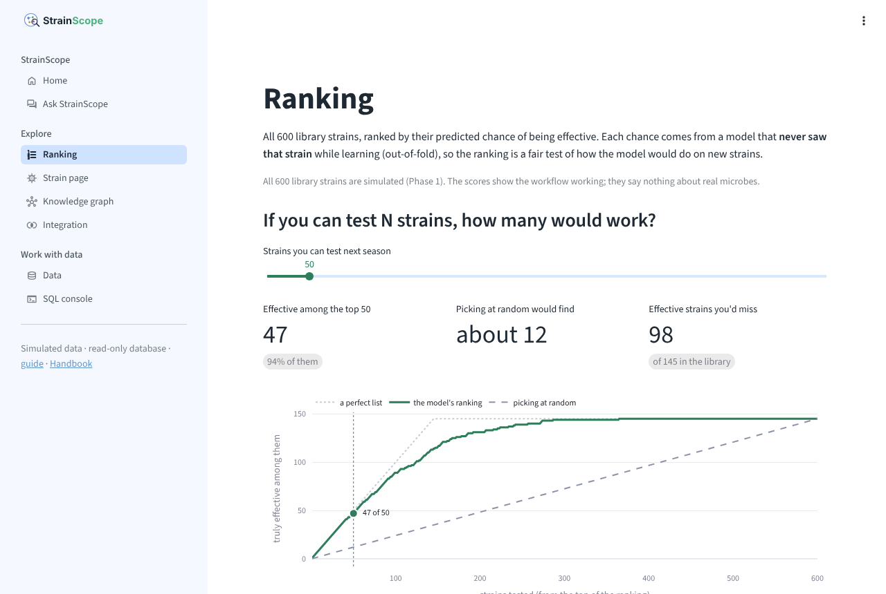

---

## 1. The ideas behind this phase

### What an app adds, and what it shouldn't do

Phases 1 to 5 did the heavy lifting: they made the data, cleaned it, integrated it, trained and checked the models, and built the knowledge graph. Each phase left small result files in `artifacts/` and tables in the database, and what's missing is a way for someone who has never opened a terminal to look at them. An app gives them that way in, without doing any new science of its own. A library is a fair comparison: the books (our results) were written long ago, and the reading room (the app) makes them easy to find, with a desk where you can ask a question.

That gives the app its first rule: **it reads, and it doesn't recompute the analysis.** Training the models takes minutes and the DIABLO step needs R; the app would be slow and fragile if it did those every time someone opened it. The only buttons that write anything (the database build on the Home and Data pages, and the real-data fetch on the Data page) run the same scripts you'd run by hand, and they show them.

### The kitchen, the dining room, and the pass

[`docs/00-architecture.md`](00-architecture.md#2-the-three-words-you-must-know-first) used a restaurant: the backend is the kitchen, the frontend is the dining room, the database is the pantry. A real restaurant has one more spot between the kitchen and the dining room, the **pass**: the counter where finished plates are checked and handed to the waiters. Waiters never walk into the kitchen.

StrainScope's pass is `src/strainscope/service.py`, the **service layer**: a small set of plain Python functions that answer the questions every front door asks. Is the database there? Give me the ranking. Run this SQL safely. Check this uploaded file. Explain this strain. The app (`app/`) only calls the service layer, and the service layer uses the code of Phases 1 to 5. Two things follow from that:

- the same answers can be reached from a terminal (`python src/strainscope/service.py ...`), from the app, and later from the MCP server (Phase 7b), without writing them twice (Ask StrainScope, Phase 6b, adds its own `ask_docs` to it);
- the service layer has no buttons or charts in it, so it can be tested on its own (§13).

### How Streamlit runs a page

**Streamlit** is a Python library that turns a script into a web page. You write `st.slider(...)` and a slider appears in the browser; you write `st.dataframe(table)` and the table appears. There's no HTML or JavaScript to learn.

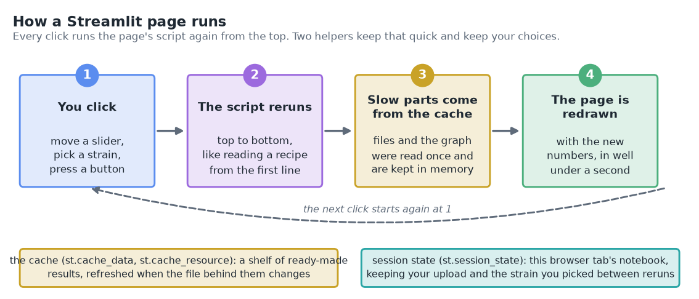

One idea takes getting used to: **every click runs the whole page script again, from the top.** Move the slider from 50 to 60, and Streamlit runs `app/views/ranking.py` from line 1 with the slider now saying 60, and redraws the page. It's like a cook who re-reads the recipe from the first line each time you change your order. That keeps the code simple (no "when this changes, update that" wiring), and two helpers keep it quick:

- **The cache** (`st.cache_data`, `st.cache_resource`) is a shelf of ready-made results. The first time the app reads `artifacts/model/predictions.csv` or loads the knowledge graph, it keeps the answer in memory; later reruns take it off the shelf. Ours are labelled with the file's last-changed time, so when a file changes (say, after you rebuild the database) the old answer is ignored and the file is read again.
- **Session state** (`st.session_state`) is a small notebook Streamlit keeps for each browser tab. It's where your uploaded strains and the strain you picked survive between reruns. Close the tab and the notebook goes with it.

A **widget** is anything you can click or type into: a slider, a dropdown (Streamlit calls it a *selectbox*), a button, a text box, a file uploader.

### Seven pages, and what each one reads

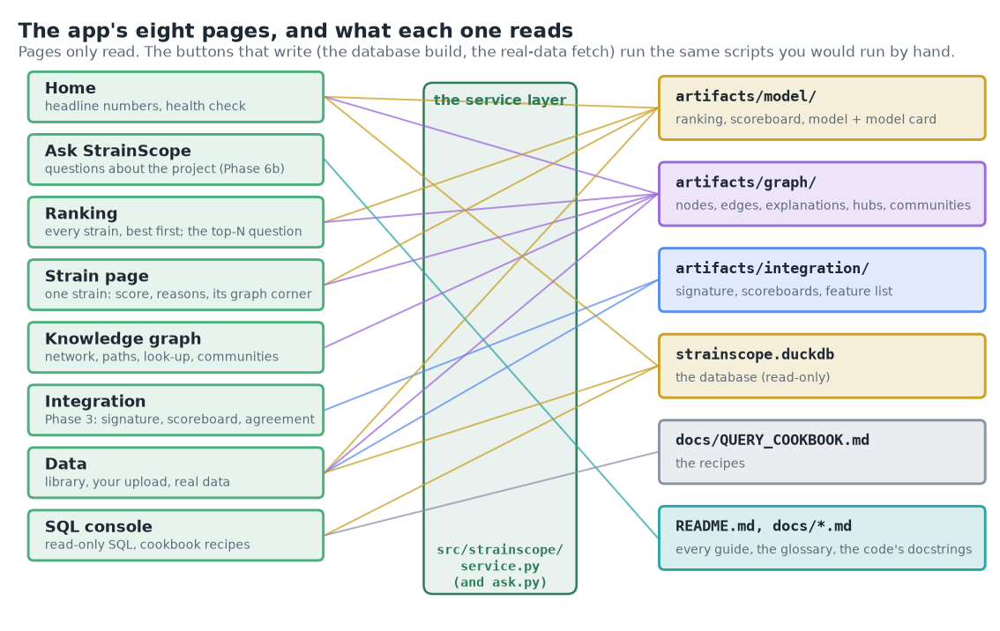

| Page | What you do there | What it reads |
|---|---|---|
| **Home** | the headline numbers, where to start, a health check of everything below | all of them, briefly |
| **Ranking** | every strain best first; "if you can test N strains, how many would work?"; how good the model is | `artifacts/model/`, `artifacts/graph/explanations.csv` |
| **Strain page** | one strain: its score, the reasons behind it, its corner of the knowledge graph | `artifacts/model/`, `artifacts/graph/` |
| **Knowledge graph** | the network; the path between any two things; a look-up for anything; hubs, communities, knowledge vs data | `artifacts/graph/` |
| **Integration** | Phase 3's report card, DIABLO's signature, every method on one scoreboard | `artifacts/integration/` |
| **Data** | the simulated library; **upload your own strains**; real data from public databases | the database, the saved model, the graph |
| **SQL console** | ask the database anything, with the [Query Cookbook](QUERY_COOKBOOK.md)'s recipes one click away | the database, `docs/QUERY_COOKBOOK.md` |

Phase 6b added an eighth page, **Ask StrainScope**, under Home: questions about the project, answered from its own documents with links ([`docs/07b-docs-assistant.md`](07b-docs-assistant.md)). The picture above already shows it.

---

## 2. The data flow of this phase

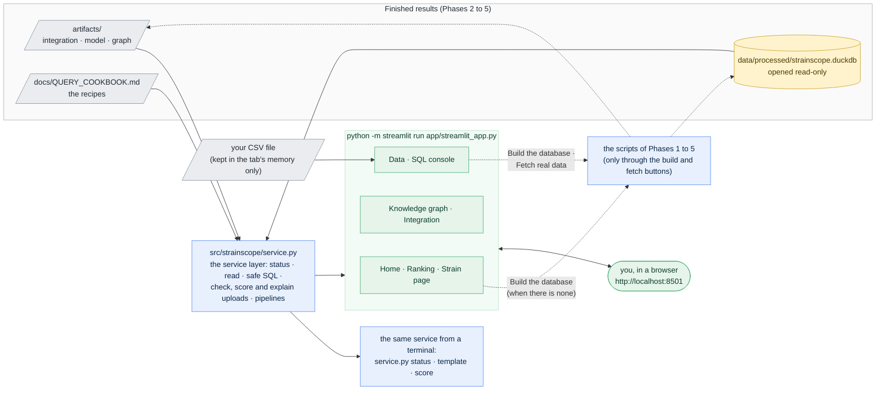

What runs where: everything on your own computer. The app is a small web server that Streamlit starts on your machine; your browser talks to it at `http://localhost:8501` ("localhost" means *this computer*, and 8501 is the door number, called a **port**). Nothing goes to the internet unless you press the real-data button. Phase 7 puts the same app online.

---

## 3. The decisions in English, before any code

1. **The app reads; it doesn't recompute.** Pages read `artifacts/` and the database. The heavy steps stay on the command line, where their output is easy to follow.
2. **One service layer for every front door.** Each question the app asks goes through `src/strainscope/service.py`, which the terminal shares and the MCP server will. The app files hold only layout and wording.
3. **Every click is cheap.** Files and the graph are cached, labelled with the file's last-changed time, so a rebuilt file is picked up by itself and nothing stale is shown.
4. **SQL behind four guards.** The console opens the database read-only, with file access switched off and that setting locked, stops any query after 10 seconds and returns at most 10,000 rows. The terminal console (`src/strainscope/sql.py`) now opens the database the same way, so it gets the first two guards too; in a terminal you stop a long query yourself with Ctrl+C, and every row is printed.

   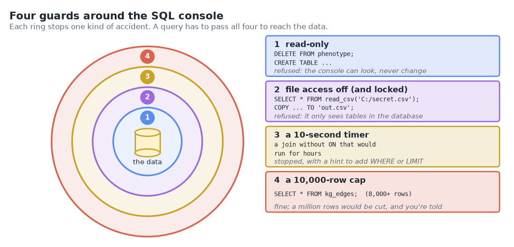

5. **Uploads are checked, scored and explained by the same rules as the library, and never stored.** Your file is read into the browser tab's memory, checked line by line, scored by the saved model of Phase 4 and explained by the knowledge graph of Phase 5 with exactly Phase 5's rules (a test proves it, §13). It is never written to disk.

   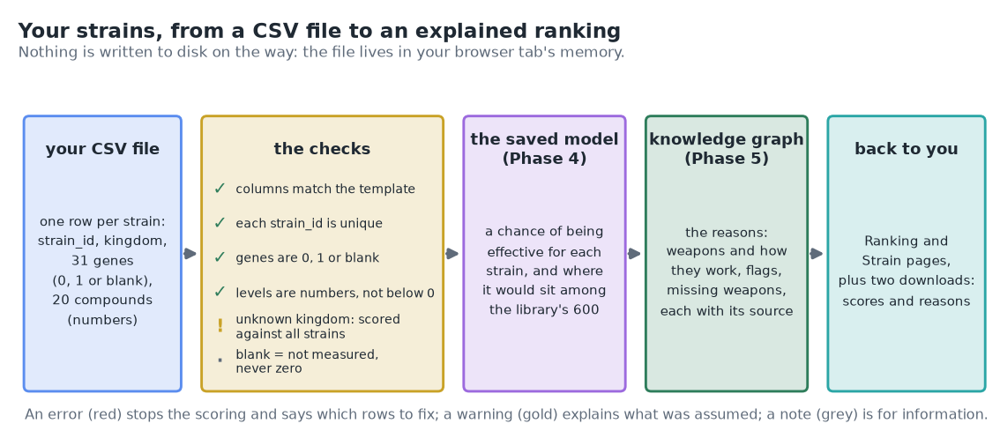

6. **An upload is scored by the final model.** The library's ranking comes from *out-of-fold* predictions: each strain was scored by a model that never saw it while learning (Phase 4). A new strain can only be scored by the final model, which learned from all 600. So a copy of a library strain gets a slightly different number from its library entry, and the app says so (§8).
7. **The same command on every computer.** `python -m streamlit run app/streamlit_app.py` works the same on Windows, macOS and RHEL 8. I chose `python -m streamlit` over the shorter `streamlit` because it always uses the Python of the active virtual environment, even when the `streamlit` command isn't on the system's search path (a common surprise on Windows). The app's settings live in one small, committed file, `.streamlit/config.toml` (§4).
8. **A switch for shared use.** Setting the environment variable `STRAINSCOPE_MODE=public` hides the real-data buttons and allows the database build only while there's no database yet (the first start of a shared copy). Your laptop doesn't need it; the online version in Phase 7 will.
9. **Near the line, say so.** Next to the chance, every strain gets a band: *likely* (above 70 %), *borderline* (30 % to 70 %) or *unlikely* (below 30 %). It's the definition the Query Cookbook already uses, and it keeps the promise of Phase 4's §11 that strains near the line are shown as borderline instead of a confident yes or no. The band lives in the service layer (`confidence_band`), so the terminal and the app agree.

### What we leave out on purpose, and why

- **No logins or user accounts.** One person on a laptop doesn't need them. A multi-user web front end is item A1 of the [product roadmap](PRODUCT_ROADMAP.md#a1-web-front-end-react-with-typescript), with the event that would schedule it.
- **No React or FastAPI.** Streamlit is enough for one person exploring. The split into a back-end API and a separate front end is recorded in the [roadmap](ROADMAP.md#deferred-items-and-their-triggers) as a deferred item with its trigger.
- **No re-training from the app.** The analysis steps take minutes and print a lot that's worth reading; they stay on the command line until Phase 8's one-command pipeline.
- **No language model in this phase.** The plain-language explanations, the data assistant and GraphRAG arrive in Phase 7; the documentation assistant of Phase 6b has its own page ([`docs/07b-docs-assistant.md`](07b-docs-assistant.md)), with optional written answers.
- **No editing of data in the app.** The data flows one way ([architecture §5b](00-architecture.md#5b-the-one-design-rule-that-makes-it-reproducible)); an app that edited results would break that rule.

---

## 4. Get the Phase 6 files into your repo

All paths are relative to the project folder.

| Path | New / changed | Its job |
|---|---|---|
| `src/strainscope/service.py` | new | the service layer: status, safe SQL, cookbook recipes, uploads (template, checks, scores, explanations), a strain's graph neighbourhood, the pipelines; and the commands `status`, `template` and `score` |
| `app/streamlit_app.py` | new | the app's front door: page title and icon, sidebar, the list of pages |
| `app/ui.py` | new | what the pages share: where the data is, caching, which strains are shown, small building blocks |
| `app/charts.py` | new | every chart the app draws, as plain functions (Plotly) |
| `app/views/home.py`, `app/views/ranking.py`, `app/views/strain.py`, `app/views/knowledge_graph.py`, `app/views/integration.py`, `app/views/data.py`, `app/views/sql_console.py` | new | the seven pages, one small script each |
| `.streamlit/config.toml` | new | the app's settings (colours, upload size, no usage statistics, no email question) |
| `src/strainscope/sql.py` | changed | the terminal console uses the same safe connection as the app |
| `tests/test_service.py`, `tests/test_app.py` | new | 23 and 20 offline tests (§13) |
| `figures/make_phase6_figures.py` | new | four concept pictures and one result figure (§11) |
| `figures/take_app_screenshots.py` | new, optional | the screenshots in `docs/img/` and the animated tour |
| `figures/make_illustrations.py` | changed | the journey map shows Stage 10 done, a new wordmark for the app's sidebar, and the interactive journey page |
| `docs/07-app.md` | new | this guide |
| `README.md`, `CHANGELOG.md`, `docs/HANDBOOK.md`, `docs/ROADMAP.md`, `docs/PRODUCT_ROADMAP.md`, `docs/00-architecture.md`, `docs/01-setup.md`, `docs/02-data-generation.md`, `docs/03-harmonization-qc.md`, `docs/04-integration.md`, `docs/05-machine-learning.md`, `docs/06-knowledge-graph.md`, `docs/GLOSSARY.md`, `docs/QUERY_COOKBOOK.md` | changed | Phase 6 everywhere it belongs: status, the app, new terms, the plan to the finished product |
| `figures/*.png` (Phase 6 set), `docs/img/app_*.png`, `docs/img/app_tour.gif`, `docs/img/strainscope_wordmark.svg`, `docs/img/journey_map.svg`, `docs/interactive/journey.html` | new / changed | the pictures |

**Files-landed check:**

```bash
ls src/strainscope/service.py app/streamlit_app.py app/ui.py app/charts.py app/views .streamlit/config.toml tests/test_service.py tests/test_app.py docs/07-app.md
```

**Read before running.** Open `app/streamlit_app.py` first: it's short, and its top docstring says what the app reads and the one command that starts it. Then skim the top docstring of `src/strainscope/service.py`, which lists its main functions and the four SQL guards. (A *docstring* is the block of plain text in triple quotes at the top of a Python file or function, written for the person reading the code.)

No new packages are needed: Streamlit and Plotly have been in `requirements.txt` since the setup phase. (Only the optional screenshot script needs one more, Playwright; §11 says how.)

**The settings file, line by line.** `.streamlit/config.toml` is read by Streamlit when you start the app from the project folder. It holds no secrets, so it's committed (secrets would go in `.streamlit/secrets.toml`, which `.gitignore` keeps out of Git).

| Setting | Why |
|---|---|
| `[theme]` `primaryColor = "#2E7D5B"` and friends | the project's colours, so the app matches the figures and the logo |
| `[server]` `maxUploadSize = 5` | uploads are small CSV tables; 5 megabytes is about 10,000 strains |
| `[server]` `showEmailPrompt = false` | without it, the first run stops in the terminal to ask for an email address for Streamlit's newsletter |
| `[browser]` `gatherUsageStats = false` | Streamlit doesn't send usage statistics anywhere |
| `[client]` `toolbarMode = "minimal"` | keeps the menu in the top-right corner short |

---

## 5. Step 1: check what the app will read

Before starting the app, ask the service layer what it can see:

```bash
python src/strainscope/service.py status
```

**You should see** (this is a database without the real tables; what changes with them is explained right after):

```
  ── StrainScope: what the app can read ──────────────────────────
  ✓ Database                 40 tables, 600 strains
  ✓ Phase 3 results          12 files in artifacts/integration/, 12 int_* tables
  ✓ Phase 4 results          14 files in artifacts/model/, 14 ml_* tables
  ✓ Phase 5 results          11 files in artifacts/graph/, 11 kg_* tables
  ✓ Saved model              Elastic net logistic regression, built with scikit-learn 1.9.0
  · Real tables (optional)   none fetched (the app works without them)
      to add: Data page, Real data tab, or python src/strainscope/fetch_real.py
```

**What it means.** A ✓ is fine, a ✗ is needed and missing (with the fix underneath), and a · is optional. Every phase's results are both in `artifacts/` and in the database, and the saved model was built with the scikit-learn you have.

**With the real tables from Phases 1b and 1c** (if you fetched them), the database line says 47 tables instead of 40 (the seven extra are the real ones), and the last line becomes:

```
  ✓ Real tables (optional)   7 tables: real_compound_pathways, real_compounds, real_genomes, real_kegg_compounds, real_mw_studies, real_refmet, real_strains
```

**If instead** you see `✗ Database  no database file yet`, build it with the five commands below (or start the app and press the button on the Home page, which runs the same five):

```bash
python src/strainscope/generate_data.py
python src/strainscope/harmonize.py
python src/strainscope/integrate.py publish
python src/strainscope/model.py publish
python src/strainscope/graph.py publish
```

If the model line ends with `(you have 1.9.1; scores still work, rebuild to silence the warning)`, your scikit-learn is newer than the one that saved the model; `python src/strainscope/model.py final` rebuilds it ([why](05-machine-learning.md#16-what-could-go-wrong-mini-faq)).

---

## 6. Step 2: start the app

```bash
python -m streamlit run app/streamlit_app.py
```

**You should see**, in the terminal (the first line starts with today's date and time):

```
2026-10-12 10:05:44.544 Uvicorn server started on :::8501

  You can now view your Streamlit app in your browser.

  Local URL: http://localhost:8501
  Network URL: http://192.168.1.23:8501
```

and a browser tab opens on the Home page. (Your *Network URL* will show your own computer's address.) Streamlit may print a tip or two underneath, for example one suggesting you install Watchdog so it notices saved files a little faster. Both are optional; the app works the same without them.

**What it means.** Streamlit has started a small web server on your computer (Uvicorn is the name of that server; `:::8501` or `0.0.0.0:8501` both mean "listening on door 8501") and opened your browser on it. The terminal now belongs to the app: leave it open while you use the app, and press **Ctrl+C** in it to stop the app. Each time you save a change to a file in `app/`, the page offers a **Rerun** button in its top-right corner.

**If instead:**
- No browser tab opened: copy the *Local URL* into your browser yourself.
- The address says **8502** instead of 8501: another copy of the app is still running (look for an old terminal), so Streamlit quietly took the next door. Use the address it prints, or stop the old copy with Ctrl+C in its terminal and start again. (If you asked for a door yourself with `--server.port 8501` and it's taken, Streamlit stops with `Port 8501 is not available`.)
- `No module named streamlit`: the virtual environment isn't active; look for `(.venv)` at the start of your prompt ([`docs/01-setup.md`](01-setup.md) Part F).
- Windows asks whether to allow Python through the firewall: *Private networks* is enough. On your own computer you don't even need that, because `localhost` never leaves the machine.

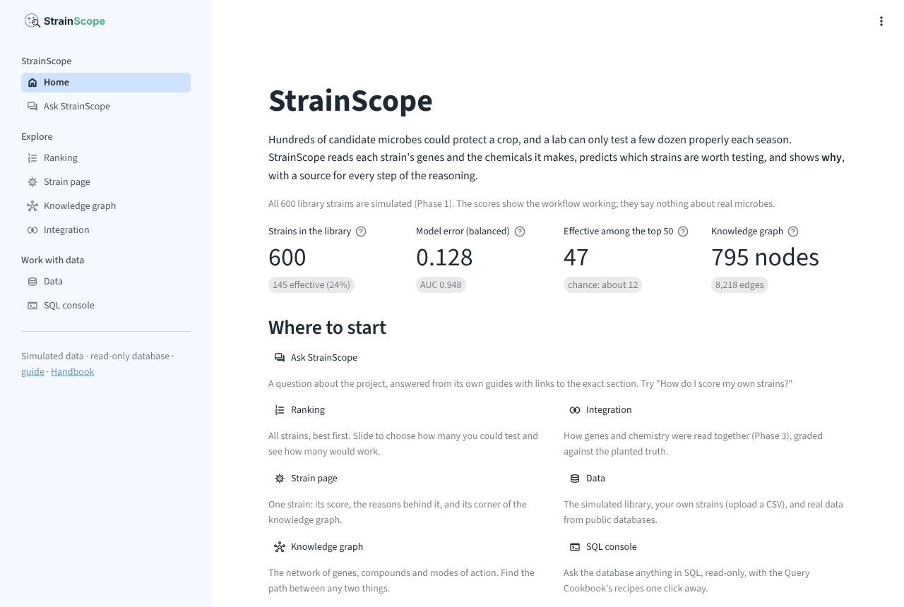

---

## 7. Step 3: a tour of the app

Click through the pages in the sidebar, in this order. Each one is a short visit.

### Home

The four numbers at the top come from the committed results: 600 strains (145 effective, 24 %), a balanced error of 0.128 (AUC 0.948), 47 effective strains among the top 50 (chance: about 12), and the size of the knowledge graph. The committed graph was built with the real tables, so it shows **795 nodes and 8,218 edges**; a graph rebuilt without them (`python src/strainscope/graph.py all` on a fresh clone) has 679 and 8,096 ([`docs/06-knowledge-graph.md` §5](06-knowledge-graph.md#5-step-1-build-the-graph)). Open **What the app is reading (health check)** at the bottom: it's the same check as §5.

### Ranking


The slider asks the question a screening team actually asks: *if we can test N strains next season, how many would work?* At 50: 47 effective, against about 12 if you picked at random, and 98 of the library's 145 effective strains you'd still miss (most of them are further down the list). Slide it and watch the green line pull away from the grey one, which is picking at random. The faint dotted line is a perfect list.

Below the chart, the table lists every strain; filter it by kingdom, type part of a name or a genus, and **click a row** to open that strain's page. The *how sure* column puts each chance in a band: **likely** above 70 %, **borderline** from 30 % to 70 %, **unlikely** below 30 %. Why a middle band? "Effective" means a strain suppressed disease by at least 65 % in the trial, and a strain that suppressed 64 % is, biologically, much like one at 66 %. Phase 4 found the model's mistakes crowding around that line ([`docs/05-machine-learning.md` §11](05-machine-learning.md#11-reading-the-results-like-a-scientist)), so a predicted chance in the middle is called *borderline* instead of a confident yes or no. In the library, 75 strains are likely, 103 borderline and 422 unlikely. The tabs at the bottom are the model's report from Phase 4: the scoreboard, calibration, what it relies on, and the model card.

Every chance on this page comes from a model that didn't see that strain while learning, which is why the ranking is a fair test.

### Strain page


Pick **STRAIN_0485** (the top strain). The four numbers say: rank 1 of 600, a 100 % chance (*likely · flagged*), 10 mechanism paths, and *effective* in the simulated trial. Under **Why it ranks here** you'll find the same lines as `python src/strainscope/graph.py why STRAIN_0485` in Phase 5, each with a coloured label:

- *how it works* **+** carries fenA and produces fengycin (7.6x the usual level): lipopeptide membrane attack
- *how it works* **+** carries hcnA and produces HCN (5.4x the usual level): antibiosis
- *how it works* **+** carries pvdA and produces pyoverdine (22.1x the usual level): iron competition
- *statistics only* **?** carries accE: the model leans on it a little, but no known mechanism links it to disease suppression

Open **the walk and its sources** under any line to see the route through the graph and where each step came from.

**Its corner of the knowledge graph** draws the same facts as five columns, read left to right: the strain, the genes it carries, the compounds it makes, how each one works, and what that leads to. A compound hangs off the gene that makes it. Two kinds of line are worth spotting:

- the red dotted line from **accE** straight to *disease suppression*: a statistic with no mechanism behind it (Phase 4's decoy);
- the gold dash-dot line from the strain straight to **oligandrin**: STRAIN_0485 makes oligandrin without carrying `olpA`, the gene for it. [`docs/06-knowledge-graph.md` §12](06-knowledge-graph.md#12-notes-from-the-build-kept-on-purpose) traced that reading to background noise just over the 4x line.

Now press **Next** a few times, or pick **STRAIN_0220** (the lowest-ranked bacterium). Its picture is small, and hollow circles mark the two weapons common in bacteria that it lacks (`fenA`, `hcnA`). The address bar now ends in `?strain=STRAIN_0220`: you can bookmark or share that link, and it opens on that strain.

### Knowledge graph

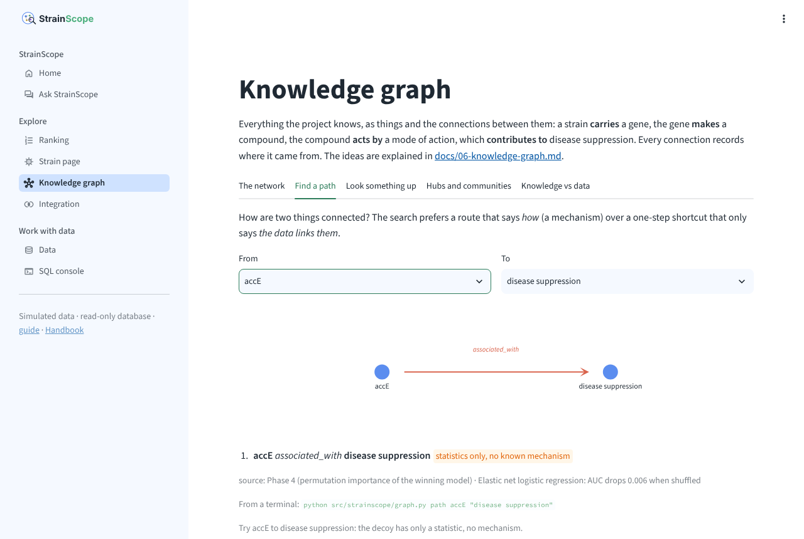

Five tabs. **The network** is the knowledge layer you can drag and zoom; pick something in *Highlight one thing and its neighbours* to light up its corner. **Find a path** answers "how are these two connected?". It starts on `ituA` to `disease suppression` and finds the two-step mechanism; change *From* to `accE` and the answer is a single red step marked *statistics only, no known mechanism* (the screenshot above). **Look something up** is Phase 5's `show` command. **Hubs and communities** and **Knowledge vs data** are Phase 5's results, with purity 0.94 and an adjusted Rand index of 0.93.

### Integration

Phase 3 on one page: the report card (DIABLO's robust list has 29 features and no decoys; every feature the Python lasso picks is on it), DIABLO's signature as bars with the 80 % line, every method on one scoreboard with the two controls near a coin's 0.50, and a heatmap of how each gene goes with each compound (the bright red cells are genes and the compounds they make).

### Data and SQL console

These two get their own steps next.

---

## 8. Step 4: score your own strains

On the **Data** page, open the **Upload your strains** tab.

1. **Download an example (12 strains).** It's twelve library strains, three per kingdom (the best, a middling and the lowest ranked of each), renamed `EXAMPLE_01` to `EXAMPLE_12`, with a last column `copied_from` that names the original. (*Download the empty template* gives the header row only: `strain_id`, `kingdom`, `genus`, the 31 gene columns and the 20 compound columns.)
   Your browser saves it as `strainscope_example.csv`, usually in your Downloads folder.
2. **Upload it**: press **Upload** in the box that says *Drag and drop a file here* and pick the file (or drag it onto the box).

**You should see**, under **3. The checks**, two blue notes:

```
Ignored column(s): copied_from. They're kept in your download.
18 empty cell(s) are read as 'not measured', never as zero.
```

and under **4. The result** a table of the twelve, best first:

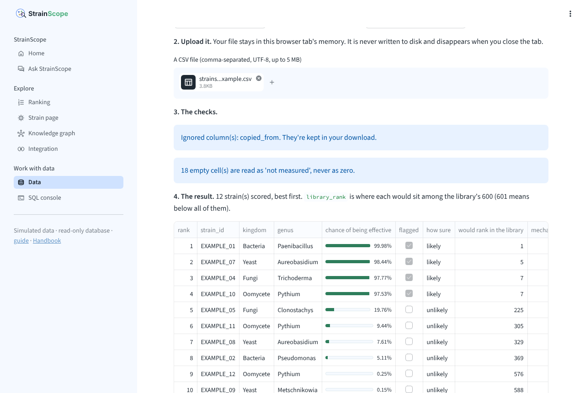

| rank | strain | kingdom | chance | how sure | would rank in the library | strongest reason |
|---|---|---|---|---|---|---|
| 1 | EXAMPLE_01 | Bacteria | 99.98 % | likely | 1 | carries fenA and produces fengycin (7.6x the usual level): lipopeptide membrane attack |
| 2 | EXAMPLE_07 | Yeast | 98.44 % | likely | 5 | carries dtxS and produces destruxin (10.6x the usual level): toxin production |
| ... | | | | | | |
| 12 | EXAMPLE_03 | Bacteria | 0.01 % | unlikely | 601 | carries phlD and produces DAPG (14.8x the usual level): antibiosis |

**What it means.** Each strain was checked, scored by the saved Phase 4 model and explained by the Phase 5 graph. *Would rank in the library* is where each would sit among the library's 600 (601 means below all of them). The reasons are the same lines the library strains get: a test proves that an uploaded copy of a library strain gets exactly the explanation of the original (§13).

3. Press **Show my strains on the Ranking and Strain pages**. A switch appears in the sidebar (*Strains shown: Library (600) / My upload (12)*); the Ranking page becomes *Ranking: your strains*, and the Strain page shows your strains, each marked *from your upload*. Switch back to the library at any time. **Forget my upload** on the Data page clears it.
4. **Download the scores** and **Download the reasons** give you two CSV files to keep.

**Why the copies score slightly differently.** EXAMPLE_05 is a copy of STRAIN_0387, which has an 11 % chance in the library's ranking and 20 % as an upload. The library's number came from a model that never saw STRAIN_0387; the upload is scored by the final model, which learned from all 600, including STRAIN_0387 itself. Across the twelve, the largest difference is 9 percentage points, and the order barely changes (the top four stay the top four, with two of them swapping places, and the bottom four keep theirs):

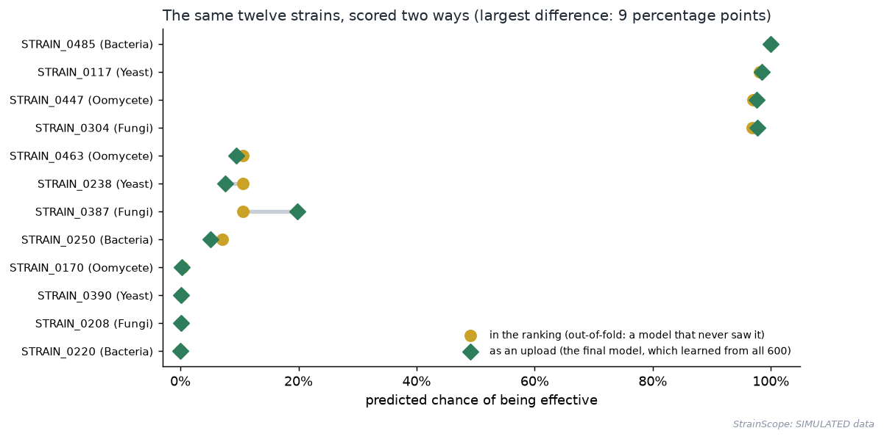

For a strain nobody has seen before, the final model is the right one to use. For judging how good the model is, the out-of-fold numbers are the right ones, which is why the Ranking page uses them.

**Now try to break it** (that's what the checks are for). Open the example in a spreadsheet, change EXAMPLE_01's `ituA` from `1` to `2`, save it as CSV and upload it again. (Excel sometimes saves with semicolons or with commas as decimal marks, depending on your region; choose *CSV UTF-8 (Comma delimited)*, and the checks will tell you if something still went wrong.)

```
Gene column `ituA` must hold 0 or 1 (or yes/no); found 2 on row 2.
```

The message is red, nothing is scored, and it names the row as your spreadsheet numbers it (the header is row 1). Put the `1` back and change EXAMPLE_03's kingdom to `Archaea` instead; this time the file is scored, with a gold warning:

```
1 strain(s) have a kingdom the model has never seen (Archaea). They're scored against all strains instead of their own kingdom, and their 'missing weapon' notes are skipped.
```

The checks, all in `validate_upload` in `src/strainscope/service.py`:

| Check | Kind | Example |
|---|---|---|
| a `strain_id` and a `kingdom` column exist | error | the file was saved without its header |
| at least one gene or compound column matches the template | error | the columns were renamed |
| each `strain_id` is filled and unique | error | two rows called `S1` |
| gene calls are 0, 1, yes, no, true, false or blank | error | `2`, `present` |
| compound levels are numbers, not below zero | error | `-1`; `2,5` (the message suggests a full stop as the decimal mark) |
| at most 5,000 strains per file | error | split bigger files |
| a kingdom the model knows (spelling forgiven: `bacteria`, `Fungus`, `yeasts`) | warning | `Archaea` |
| missing columns are treated as not measured | warning | a file with only the 31 gene columns |
| extra columns are ignored and kept in your download | note | `copied_from`, `notes` |
| blank cells mean "not measured", never zero | note | an empty iturin reading |

**One limit to remember.** The model learned from cleaned, batch-corrected levels (Phase 2). Your levels need to be on the same scale for the scores to mean anything. With the simulated library that's true by construction; with real lab data it would need the same cleaning first. The app says this at the bottom of the upload tab.

**The same thing from a terminal.** The service layer does the same work without the app:

```bash
python src/strainscope/service.py template my_strains.csv --example
python src/strainscope/service.py score my_strains.csv
```

**You should see:**

```
  template → my_strains.csv   (55 columns, 12 example strains)
  - note: Ignored column(s): copied_from. They're kept in your download.
  - note: 18 empty cell(s) are read as 'not measured', never as zero.
  ── 12 strain(s), best first ──────────────────────────────
    1. EXAMPLE_01   Bacteria  100.0%  likely     flag  carries fenA and produces fengycin (7.6x the usual level): lipopeptide membrane attack
    2. EXAMPLE_07   Yeast      98.4%  likely     flag  carries dtxS and produces destruxin (10.6x the usual level): toxin production
    3. EXAMPLE_04   Fungi      97.8%  likely     flag  carries dtxS and produces destruxin (12.3x the usual level): toxin production
    4. EXAMPLE_10   Oomycete   97.5%  likely     flag  carries pvdA and produces pyoverdine (19.2x the usual level): iron competition
    5. EXAMPLE_05   Fungi      19.8%  unlikely         carries kilT: killer-toxin antagonism
    6. EXAMPLE_11   Oomycete    9.4%  unlikely         carries olpA and produces oligandrin (16.6x the usual level): induced plant resistance
    7. EXAMPLE_08   Yeast       7.6%  unlikely         carries kilT and produces killer_toxin (14.9x the usual level): killer-toxin antagonism
    8. EXAMPLE_02   Bacteria    5.1%  unlikely         carries phzE and produces phenazine (5.7x the usual level): antibiosis
    9. EXAMPLE_12   Oomycete    0.2%  unlikely         carries glcA: cell-wall degradation
   10. EXAMPLE_09   Yeast       0.1%  unlikely         no mechanism path
   11. EXAMPLE_06   Fungi       0.1%  unlikely         carries prb1: mycoparasitism
   12. EXAMPLE_03   Bacteria    0.0%  unlikely         carries phlD and produces DAPG (14.8x the usual level): antibiosis
  scores → my_strains_scored.csv
  reasons → my_strains_scored_reasons.csv
  Reminder: the model was trained on SIMULATED data. Treat these scores as a demonstration.
```

(`likely`, `borderline` and `unlikely` are the bands from §7; `flag` marks a chance above the model's decision line, 24 %, the library's share of effective strains.) The three files land in the project folder. Delete them when you're done, so they don't end up in your commit (§17): `rm my_strains*.csv` on macOS and Linux, `Remove-Item my_strains*.csv` in Windows PowerShell.

A look at EXAMPLE_05: a *fungus* (Clonostachys) whose strongest reason is `kilT`, a yeast's killer-toxin gene. In this simulated library that's a rare, borrowed weapon. The model gives it 20 %, which is low but well above the seven strains below it, and the reasons say why.

---

## 9. Step 5: the SQL console

Open **SQL console**. The box at the top is the [Query Cookbook](QUERY_COOKBOOK.md): pick a section and a question, read *What to expect*, and press **Put this recipe in the editor**, then **Run**. The menu is read from `docs/QUERY_COOKBOOK.md` itself, so a recipe added there appears here without touching the app. Recipes that need the real tables say *(needs real data)* if you haven't fetched them.

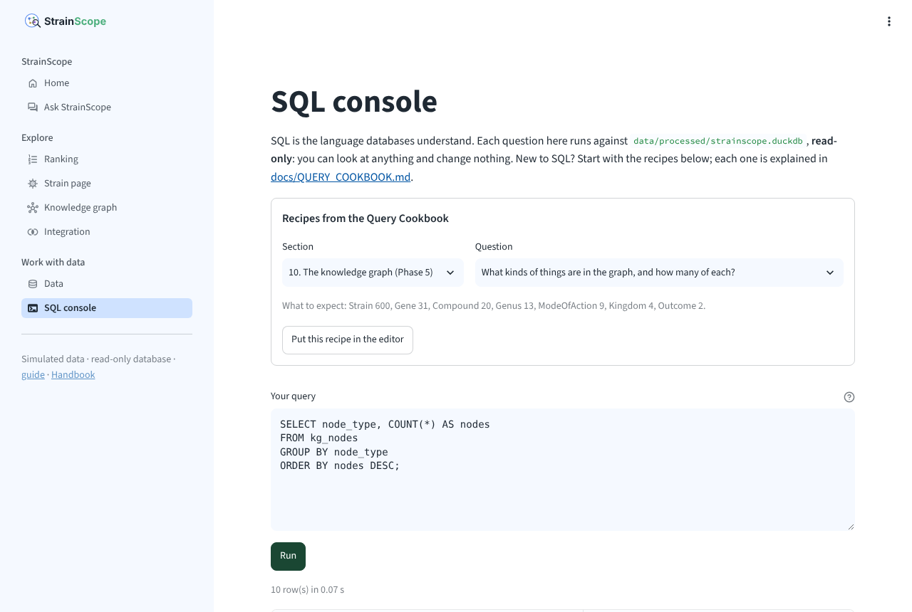

Try section **10. The knowledge graph (Phase 5)**, question *What kinds of things are in the graph, and how many of each?* With the committed graph you'll get ten rows (it was built with the real tables, so `ReferenceStrain`, `Pathway` and `ChemicalClass` appear next to the cookbook's seven). **Download the result (CSV)** saves what you see.

Now try something the console must refuse. Type `DELETE FROM phenotype;` and press **Run**:

```
The console is read-only: it can look at the data but never change it, so CREATE, INSERT, UPDATE and DELETE are refused.

DuckDB says: Invalid Input Error: Cannot execute statement of type "DELETE" on database "strainscope" which is attached in read-only mode!
```

and then `SELECT * FROM read_csv('C:/secret.csv');`:

```
The console can't read or write files on the computer. It only sees the tables in the database.

DuckDB says: Permission Error: Cannot access file "C:/secret.csv" - file system operations are disabled by configuration
```

**What it means.** Those are guards 1 and 2 of the four in §3. The first sentence is the app's plain explanation, the second is DuckDB's own message, kept so you can search for it. Guard 3 stops a query that runs too long (a join without `ON` between two big tables can take hours) after 10 seconds, with a hint. Guard 4 returns at most 10,000 rows and says so when it cuts. The panel **Why you can't break anything here** lists all four, and **Tables in the database** lists every table with its row count, grouped by phase.

Since this phase, the terminal console opens the database the same way, so guards 1 and 2 hold there too (a terminal has no time limit or row cap: Ctrl+C stops a long query, and every row is printed). Try it:

```bash
python src/strainscope/sql.py "SELECT * FROM read_csv('requirements.txt')"
```

**You should see:**

```
  ! Permission Error: Cannot access file "requirements.txt" - file system operations are disabled by configuration

LINE 1: SELECT * FROM read_csv('requirements.txt')
                      ^
```

Everything in the cookbook still works, because it only reads tables.

---

## 10. Step 6: run it on another computer or a virtual machine

On **Windows and macOS** the app runs exactly as in §6. Below, **RHEL 8** means a Red Hat Enterprise Linux 8 machine (or Rocky or Alma Linux 8). Often it's a **virtual machine** (VM): a computer simulated by software on a bigger one, which behaves like a separate computer with its own address, usually without a screen. You reach it with **SSH** (*secure shell*), a program that opens an encrypted terminal on another computer: `ssh your-user@your-vm` from your laptop, and the commands you type then run on the VM.

1. Set up the project once, as in [`docs/01-setup.md`](01-setup.md) (Python 3.12, `.venv`, `pip install -r requirements.txt`), then build the database (§5).
2. Start the app without trying to open a browser on a machine that has no screen:

   ```bash
   python -m streamlit run app/streamlit_app.py --server.headless true
   ```

3. Reach it from your laptop. There are two ways, and the first one is safer:

   - **An SSH tunnel** (nothing changes on the VM). On your laptop, in a new terminal:

     ```bash
     ssh -L 8501:localhost:8501 your-user@your-vm
     ```

     then open `http://localhost:8501` in your laptop's browser. The tunnel carries the page through the SSH connection you already trust, like a private corridor between two rooms. Windows 10 and 11 include `ssh` in PowerShell.
   - **Open the port on the VM** so others on the network can reach it. On the VM:

     ```bash
     sudo firewall-cmd --add-port=8501/tcp
     python -m streamlit run app/streamlit_app.py --server.headless true --server.address 0.0.0.0
     ```

     then open `http://<the VM's address>:8501`. Anyone who can reach the VM can now use the app, so start it with the shared-use switch, which hides the real-data buttons and allows the database build only while there's no database yet: `STRAINSCOPE_MODE=public python -m streamlit run app/streamlit_app.py --server.headless true --server.address 0.0.0.0` (on Windows PowerShell, run `$env:STRAINSCOPE_MODE = "public"` first, then the usual command; the setting lasts until you close that PowerShell window, or until `Remove-Item Env:STRAINSCOPE_MODE`). The firewall rule lasts until the next restart; add `--permanent` and run `sudo firewall-cmd --reload` to keep it. Close it again with `--remove-port=8501/tcp`.

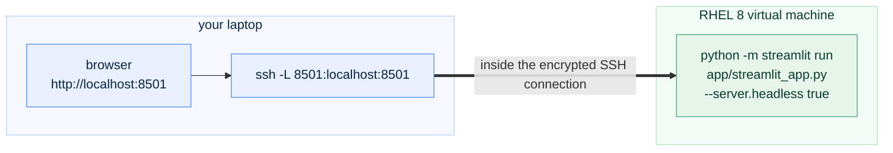

To keep the app running after you log out of the VM, start it inside `tmux`, a terminal that keeps going in the background: install it once with `sudo dnf install tmux`, type `tmux`, start the app, then press Ctrl+B followed by D to leave it running. Later, `tmux attach` brings you back to it, and Ctrl+C there stops the app. Running it as a proper service that starts with the machine belongs to deployment (Phase 7).

---

## 11. See the results (figures)

```bash
python figures/make_phase6_figures.py
```

**You should see:**

```
  drew figures/app_rerun.png
  drew figures/app_map.png
  drew figures/sql_guards.png
  drew figures/upload_journey.png
  drew figures/two_scores.png
```

The first four are the concept pictures in §1 and §3; they're drawn without data. `figures/two_scores.png` (§8) is computed from the database and the saved model, so it needs the database.

**The screenshots (optional).** The pictures of the running app in this guide, the README and the Handbook (`docs/img/app_*.png`, and the animated tour `docs/img/app_tour.gif`) come from `figures/take_app_screenshots.py`. It drives a real browser, so it needs one extra package that nothing else uses. You only need it when the app's look changes:

```bash
pip install playwright
python -m playwright install chromium
python figures/take_app_screenshots.py
```

It starts the app on port 8599, visits each page, takes the pictures and stops the app. Run it on Windows or macOS: Playwright's browser isn't officially supported on RHEL 8 and may need extra system libraries there.

---

## 12. Notes from the build (kept on purpose)

- **A test that passed on one computer and failed on another.** Where the app was built (Streamlit 1.65), all 104 tests passed. On a second computer with an older Streamlit, the two SQL console tests failed with `KeyError: 'sql_text'` and `KeyError: 'recipe'`, as if the page had no editor. The page was fine. The tests ask Streamlit's test runner to open the SQL console, and in older versions (I reproduced it with 1.62 and 1.57) the runner quietly stays on the Home page when a page's web address (it was `/sql`) differs from its file name (`sql_console.py`). The Knowledge graph page (`/graph`, `knowledge_graph.py`) had the same blind spot, unnoticed because no test looked for anything on it. Two changes fixed it: every page now takes its address from its file name (the SQL console is at `/sql_console`), and every test checks the title of the page it lands on, so a silent miss fails with a clear message instead of a puzzling one. The tests now pass on Streamlit 1.57, 1.62 and 1.65.
- **The tangled picture.** The first strain picture drew every connection: strain to gene, strain to compound, gene to mode, compound to mode. For the top strain that was 73 lines criss-crossing in a five-column drawing, which nobody could read. Two changes fixed it without hiding a fact. A compound now hangs off the gene that makes it (when the strain carries that gene), and a gene's own line to a mode is skipped when its compound already shows the same route. A line straight from the strain to a compound now has a meaning of its own: the strain makes that compound without carrying its gene, which is the odd reading Phase 5 asked us to notice. The graph itself is unchanged.
- **A caption that described the wrong controls.** The first version of the Integration page said the two controls were "shuffled labels" and "random features". Phase 3's controls are *the kingdom label on its own* and *shuffled labels*. The chart was right and the sentence under it was wrong. The captions on the other pages were then checked against the guides they summarise.
- **A help text that promised too much.** The SQL page's help said the terminal console had the same guards. It didn't: `src/strainscope/sql.py` opened the database read-only but could still read files. The terminal console now opens the database with the same connection (`safe_connect` in `src/strainscope/service.py`), so the read-only and file guards hold in both places and a test checks it; the help text now says that a terminal has no time limit or row cap.
- **A screenful of warnings for one upload.** Loading the saved model with a newer scikit-learn printed our own one-line note plus a long warning from scikit-learn for every piece inside the model (each calibrated copy has its own scaler, its own logistic regression and its own calibrator). The upload page now shows only the one-line note, which says what to do.
- **The dropdown that would have forgotten your choice.** The first version of the Strain page looked at the address bar (`?strain=...`) before the strain you had just picked. Reading the code again before the first run showed that picking a new strain would have put the old one straight back. The order is now: what you picked in this tab, then the address, then the top strain.
- **Labels hidden under their own error bars.** On both scoreboards, the number printed at the end of each bar sat exactly where the error bar was drawn. The numbers now sit inside the bars.

---

## 13. The tests

```bash
pytest -q
```

**You should see:** `104 passed`. That's the 61 from before plus 43 new ones.

`tests/test_service.py` (23) checks the service layer without a browser:
- the SQL guards hold: reading works; CREATE and DELETE, reading and writing files, changing the locked settings, a query that would run for hours and a result with too many rows are each stopped, with a readable message;
- the terminal console refuses to read files too;
- every recipe in `docs/QUERY_COOKBOOK.md` is found with its question, and every recipe whose tables exist runs;
- the upload template has exactly the columns the saved model expects;
- good uploads are tidied (spaces, `bacteria`, `yes`), bad ones are refused with the right message, odd ones get warnings;
- the saved model scores an upload, and *borderline* means 30 % to 70 %, exactly the Query Cookbook's definition;
- **an uploaded copy of every strain of a small hand-made project gets exactly the explanation Phase 5 gives the original**, and the library graph is left untouched;
- the strain picture only draws real edges, marks missing weapons, and marks a compound made without its gene;
- the pipeline runner stops at a failing step and never runs two builds at once.

`tests/test_app.py` (20) runs the app itself with Streamlit's test runner (`AppTest`), which plays the app the way a browser would, in memory:
- every page opens without an error, with and without the database (and Home offers to build it), and each test checks the title of the page it landed on;
- the Strain page explains the top strain in the graph's own words;
- the SQL console answers a question and refuses `DROP TABLE`; a recipe goes into the editor;
- an upload appears on the Ranking and Strain pages when chosen;
- the shared mode hides the fetching buttons;
- every chart can be drawn from the committed results, and the Ranking page's 47 of 50 matches the model card.

None of them needs the network. The few that need the database say so and are skipped without it.

**If instead** you also see the joblib `DeprecationWarning` from Phase 4's tests, that's the same harmless warning described in [`docs/05-machine-learning.md` §13](05-machine-learning.md#13-the-tests).

---

## 14. Two ways to run everything (running tally)

| Task | Manual (learn) | Automatic (ship) |
|---|---|---|
| Generate synthetic data + build the database | `generate_data.py` → `harmonize.py` → the three `publish` steps | the app: **Data** page, *Build the database* (or Home, when there's no database) |
| Fetch real data | `python src/strainscope/fetch_real.py [--probe] [--source ...]` | the app: **Data** page, *Real data* tab |
| Integrate (Phase 3) | `integrate.py prepare` → `Rscript R/diablo_integration.R` → `integrate.py twin` → `integrate.py publish` | `python src/strainscope/integrate.py all`; the one-command pipeline (Phase 8) |
| Machine learning (Phase 4) | `model.py compare` → `calibrate` → `explain` → `final` → `publish` | `python src/strainscope/model.py all`; the pipeline (Phase 8) |
| Knowledge graph (Phase 5) | `graph.py build` → `analyse` → `explain` → `publish` | `python src/strainscope/graph.py all`; the pipeline (Phase 8) |
| See the ranking | `python src/strainscope/sql.py` + [Cookbook §9](QUERY_COOKBOOK.md#9-machine-learning-results-phase-4) | the app: **Ranking** |
| Ask why / how / what | `graph.py why ...`, `graph.py path ... ...`, `graph.py show ...` | the app: **Strain page** and **Knowledge graph**; GraphRAG (Phase 7) |
| **Score your own strains (this phase)** | `python src/strainscope/service.py template ...` then `score ...` | **the app: Data page, Upload your strains** |
| **Check what's there (this phase)** | `python src/strainscope/service.py status` | **the app: Home, health check** |
| Question the data | `python src/strainscope/sql.py` + the [Cookbook](QUERY_COOKBOOK.md) | **the app: SQL console, cookbook built in** |

---

## 15. Same task, two ways: a printout and a page (optional, 15 min)

The question: **"if we can test N strains, how many would work?"** Here it is as a plain script that prints the answer, and as the smallest Streamlit page that lets you change N.

**A script.** Save this as `top_n.py` in the project folder and run `python top_n.py`:

```python
import pandas as pd

pred = pd.read_csv("artifacts/model/predictions.csv")
n = 50                                         # change this and run again
top = pred.nsmallest(n, "rank")
print(f"Effective among the top {n}: {int(top['is_effective'].sum())}")
print(top[["rank", "strain_id", "kingdom", "probability"]].head(10).to_string(index=False))
```

**A page.** Save this as `top_n_app.py` and run `python -m streamlit run top_n_app.py`:

```python
import pandas as pd
import streamlit as st

pred = pd.read_csv("artifacts/model/predictions.csv")
n = st.slider("Strains you can test", 5, 600, 50, step=5)   # a widget: its value is N
top = pred.nsmallest(n, "rank")
st.metric(f"Effective among the top {n}", int(top["is_effective"].sum()))
st.dataframe(top[["rank", "strain_id", "kingdom", "probability"]])
```

**Both** say 47 at N = 50. The page is the same script with three changes: the number comes from `st.slider` instead of being typed in, and `st.metric` and `st.dataframe` replace `print`. Move the slider and the whole script runs again with the new N, which is the rerun from §1 in action. `app/views/ranking.py` is built the same way, with the chart, filters and tabs added around it. **Delete both files afterwards**, so they don't end up in your commit: `rm top_n.py top_n_app.py` on macOS and Linux, `Remove-Item top_n.py, top_n_app.py` in Windows PowerShell.

---

## 16. What could go wrong (mini-FAQ)

- **`streamlit: command not found` or `'streamlit' is not recognized`:** use `python -m streamlit run app/streamlit_app.py`; it works whenever `(.venv)` is active.
- **`No module named streamlit`:** the virtual environment isn't active (`source .venv/bin/activate`, or on Windows `.\.venv\Scripts\Activate.ps1`), or the packages weren't installed in it (`pip install -r requirements.txt`).
- **The app opened on `http://localhost:8502`, or `Port 8501 is not available`:** an earlier copy is still running. Use the address the terminal prints, or stop the old copy with Ctrl+C in its terminal.
- **The page looks out of date after you changed a file:** press **Rerun** (top right) or R in the page. If a result file changed underneath the app (you re-ran a script in another terminal), the app notices by itself on the next click.
- **Home says there's no database:** press *Build the database now*, or run the five commands in §5.
- **`IO Error: Could not set lock on file ... strainscope.duckdb`** in a script's output: the database is opened by something else that writes to it (a second script, or the Data page's build button still running). The app's own reads take a moment and let go; wait for the other job to finish and run your command again.
- **An upload is refused:** read the red message: it names the column and the spreadsheet row. The table in §8 lists every check. A file saved by Excel with a different separator (`;`) needs to be saved as *CSV UTF-8 (Comma delimited)*.
- **The upload's scores differ a little from the library's for the same strain:** expected; see *Why the copies score slightly differently* in §8.
- **`model built with scikit-learn X, running Y` under the upload:** scores still work; `python src/strainscope/model.py final` rebuilds the model with your version ([why](05-machine-learning.md#16-what-could-go-wrong-mini-faq)).
- **The real-data buttons fail:** they need the internet, and some APIs pause or refuse when busy; the [real-data FAQs](02b-real-data-ingestion.md) cover it. On a machine where you started the app with `STRAINSCOPE_MODE=public`, the buttons are hidden on purpose.
- **From another computer, the page doesn't load:** use the SSH tunnel, or open the port and start with `--server.address 0.0.0.0` (§10). Check the address in the terminal's *Network URL*.
- **The first page takes a second or two:** the knowledge graph loads once per app start and then stays in memory.
- **Your Streamlit is older than the one this guide was written with (1.65):** `python -m pip show streamlit` shows your version. The app and its tests work from 1.57 on; `python -m pip install --upgrade streamlit` brings yours up to date if anything looks different from the screenshots.
- **The Home page shows 795 nodes, the guide in Phase 5 says 679:** the committed graph includes the real tables; see the Home section of §7.

---

## 17. Save your work (safety gate and the commit ritual)

The checks come first:

```bash
pytest -q                     # 104 passed
./check-public-safe.sh        # must end with: SAFE TO PUSH  (Windows: bash check-public-safe.sh in Git Bash)
```

Before committing, update the [Handbook](HANDBOOK.md) Stage 10 checkpoint if anything about your run differed (for example your database's table count with the real tables). It's the first document a newcomer reads, so it must describe what *you* got, and it belongs in the same commit.

`git status` should list the new `app/` folder, `.streamlit/config.toml`, `src/strainscope/service.py`, the changed `src/strainscope/sql.py`, the two new test files, the figure scripts and pictures, this guide and the changed docs. It should list **nothing** under `data/`, no `my_strains*.csv` and no `top_n*.py` (delete them if they're there).

Then, on `develop`:

```bash
git switch develop
git add -A
git commit -m "feat: add the Streamlit app with ranking, strain pages, graph, uploads and a safe SQL console"
git push origin develop develop:beta develop:master

## --tags is optional, only when required (no tag this time: v0.3.0 arrives with Phase 6b)
## then switch back to local master and pull in the remote changes

git switch master
git pull --ff-only origin master
git switch develop
```

**Why no tag now.** Version tags mark the points where the project becomes usable at a new level ([why these tags](ROADMAP.md#version-tags)). v0.3.0 means "usable by anyone", and that includes the documentation assistant of Phase 6b, so the tag waits for it.

---

## 18. What you learned, and what's next

**You learned:** what an app adds to an analysis and why ours only reads; how Streamlit turns a script into a page, why every click reruns it, and how caching and session state keep that quick; why a thin service layer sits between the pages and the scripts, so the terminal, the app and later tools share one set of answers; how to let anyone type SQL behind four guards; how to accept somebody else's file (check it, explain every problem in plain words, score it, explain the result, never store it); the difference between an out-of-fold score and the final model's score; and how to run the same app on Windows, macOS and a RHEL 8 virtual machine, through an SSH tunnel or an open port.

**Try it yourself (extensions):**
- In `app/views/ranking.py`, change the slider's default from 50 to 30, save, and reload the browser tab (the slider remembers its current value until the page is reloaded). How many of the top 30 are effective? (Put it back.)
- Make your own upload with three invented bacteria, starting from the empty template: one with `fenA` and `ituA` set to 1 and EXAMPLE_01's fengycin and iturin levels (13.876 and 28.559, at least 4 times the library's usual level), one with only `accE` set to 1, and one with every gene set to 0. Leave the other cells blank. Before uploading, guess their order and their reasons. Were you right about the `accE` one?
- In `src/strainscope/service.py`, set `SQL_MAX_ROWS = 100`, stop the app with Ctrl+C and start it again (Streamlit reloads files in `app/` by itself, but not the service layer), then run `SELECT * FROM kg_edges` in the console. What does the app say? (Put it back.)
- Add a recipe of your own to section 10 of `docs/QUERY_COOKBOOK.md`: a bold, quoted question on its own line (copy the shape of the ones above it), then a fenced `sql` code block. Restart nothing: rerun the SQL page and find it in the menu.

**Next:** [`docs/07b-docs-assistant.md`](07b-docs-assistant.md) ([Handbook Stage 11](HANDBOOK.md#stage-11-phase-6b-ask-strainscope-the-documentation-assistant)) covers **Phase 6b**, Ask StrainScope: a question box over this repository's own documentation that answers with the matching passages and links, and politely refuses questions that aren't about StrainScope. It's the eighth page of this app, and it completes **v0.3.0**.
