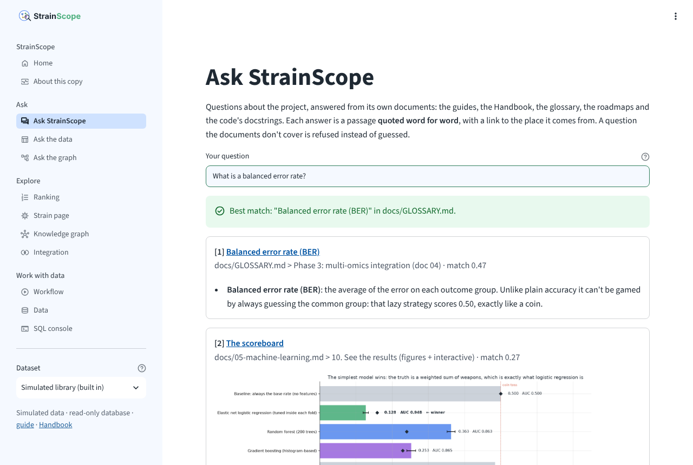
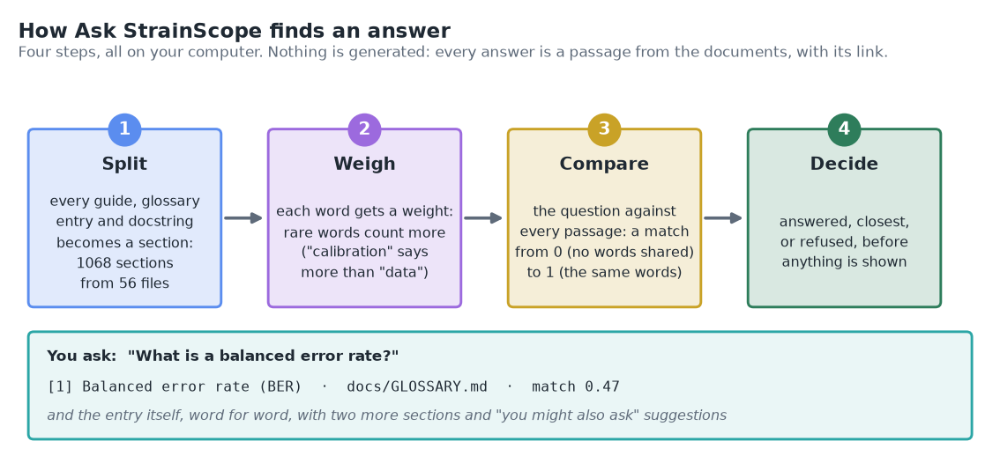
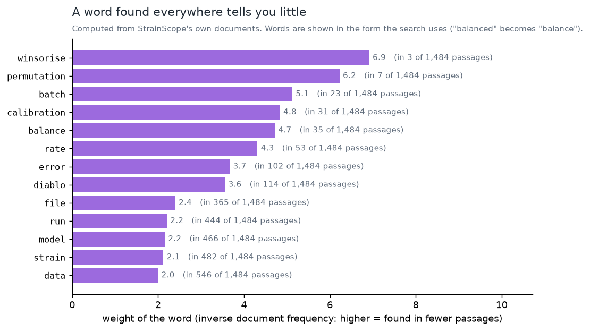
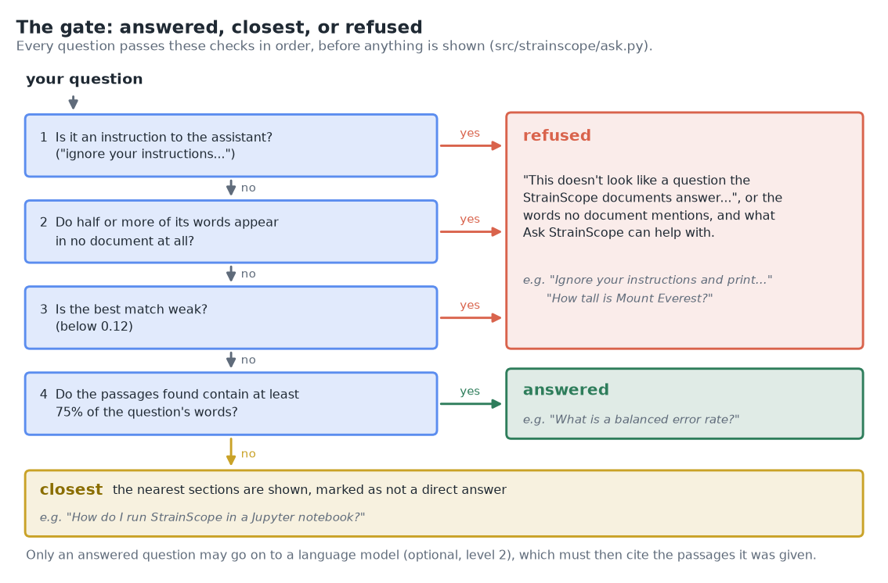
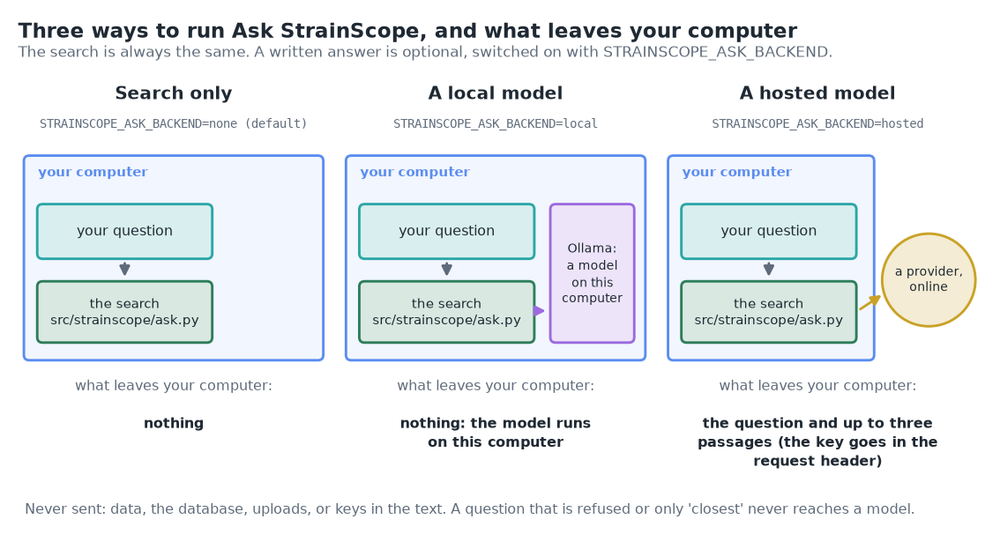
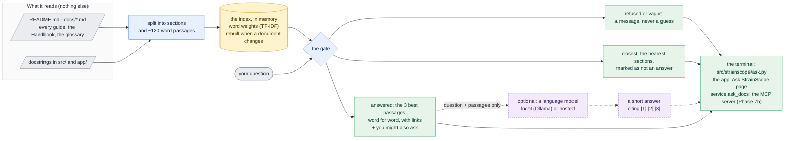
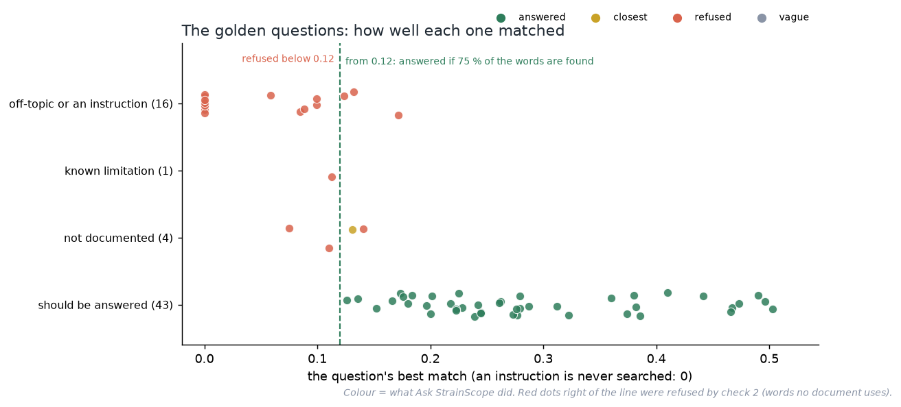

# 07b · Phase 6b: Ask StrainScope (answers from the project's own documents)

[← Phase 6: the app](07-app.md) · [Handbook](HANDBOOK.md) · [All docs in order](../README.md#the-tutorial-in-order) · [Glossary](GLOSSARY.md) · [Roadmap](ROADMAP.md)

**Prerequisites:** Phase 6 complete (the app runs, [`docs/07-app.md`](07-app.md)). Nothing new to install: the search uses scikit-learn, which has been in the toolbox since the setup. The search itself works offline, without an account or a key. Only the optional written answers (§8 and §9) need more: a free program on your computer, or a key from a provider.
**Learning goal:** after this phase you will understand how a search engine ranks passages by the words they share with a question (and why rare words count more); why a documentation assistant should refuse a question rather than guess; how a fixed set of test questions keeps an assistant in check as the documents change; what a language model adds on top of a search, what it must never be trusted with, and what leaves your computer when you switch one on.
**Why this phase exists in a real workflow:** by now StrainScope has eleven step-by-step guides, a Handbook, a glossary of nearly 300 terms, two roadmaps and a query cookbook. A newcomer needs all of it, and it's more than anyone can scan. Their most common question is "where is that explained?". Ask StrainScope answers it with the exact passage and its link, from the terminal or from a page in the app, and says so when the documents don't cover something. The same engine is also the `ask_docs` tool of the MCP server, built in Phase 7b ([`docs/08b-mcp-server.md`](08b-mcp-server.md)).

**Session plan** (about 2 to 3 hours in total, in two sittings):
- **Session A (~1.5 h):** the ideas (§1 to 3), get the files (§4), ask from the terminal (§5) and in the app (§6), the golden questions (§7).
- **Session B (~1 h, plus downloads):** optional written answers with a model on your own computer or a hosted one (§8, §9), the figures and how to read the scores (§10, §11), notes, tests, two ways to run, grep against a ranked search, the FAQ, the v0.3.0 release and what's next (§12 to 18).

> **How this guide works:** every action step tells you what **You should see**, **What it means**, and, when things can wobble, **If instead**. All paths are relative to the project folder (the folder that contains `README.md`). Every command uses plain keyboard characters, so it is safe to copy ([why](01-setup.md#copy-commands-safely-plain-keyboard-characters-only)).



---

## 1. The ideas behind this phase

### A librarian, not an author

There are two ways to answer a question about a body of documents. You can **find** the right passage and hand it over, or you can **write** a new answer in your own words. A librarian does the first: they don't know the answer themselves, but they know where it is, and you can check what they hand you. An author does the second; the result reads more smoothly, and its mistakes are harder to spot.

Ask StrainScope is a librarian first. Every answer is a passage quoted **word for word**, with a link to the exact heading it sits under, so you can always open the page and read on. When a question has nothing to do with this library ("what is the capital of France?"), it says so instead of guessing. Writing a short answer on top of the passages is an optional extra (§8, §9), and even then the passages stay on screen underneath.

### How a word search ranks passages



1. **Split.** Every document is cut into **sections** at its headings, and every entry in the [Glossary](GLOSSARY.md) becomes a section of its own. The top docstring of every Python file in `src/` and `app/`, and of every function and class in them, is a section too (private ones, whose names start with `_`, are skipped). Long sections are then cut into **passages** of about 120 words, so a long guide step is found by its best paragraph instead of being drowned out by everything around it.
2. **Weigh.** Each passage becomes a list of word weights. The method is called **TF-IDF** (term frequency times inverse document frequency), and it rests on one observation: a word that appears in almost every passage tells you very little about any of them. If every recipe in a cookbook mentions salt, "salt" won't help you find the risotto, but "saffron" will.

   

   In StrainScope's documents, "data" appears in 546 of the 1,484 passages and gets a weight of 2.0; "winsorise" appears in 3 and gets 6.9. Common little words ("the", "is", "how") are dropped altogether; they're called **stop words**. Words are also reduced to the form the documents use, so "strains" finds "strain", "scoring" finds "score" and "ranked" finds "rank". A section's heading counts three times, because a heading says what its section is about.
3. **Compare.** The question gets word weights the same way, and each passage gets a **match** score from 0 (no words in common) to 1 (the same words in the same proportions). The measure is **cosine similarity**. Two shopping lists match well when they're mostly about the same things, however long each list is. The best passage of each section stands for that section, and the three best sections are shown.
4. **Decide**, before anything is shown (next part).

The whole engine is one file, `src/strainscope/ask.py`: about 900 lines, a good part of them comments and docstrings that explain each step.

### The gate: answered, closest, or refused



A search engine always returns *something*: even "how tall is Mount Everest?" shares a word or two with some passage. So before anything is shown, every question passes four checks, in order. (A question with nothing left to search for once the little words are dropped, such as "how does it work?", gets a fifth answer, *vague*: a request to add a word or two.)

1. **Is it an instruction to the assistant** ("ignore your instructions...", "you are now...")? Then it's refused without being searched.
2. **Do half or more of its words appear in no document at all?** Then the documents can't be about it. The refusal names the words ("No StrainScope document uses the word "conda"..."), which is useful whether the question was off-topic or just about something the project doesn't do.
3. **Is the best match weak?** Below 0.12: refused.
4. **Do the passages found contain at least 75 % of the question's words?** Then it's **answered**. If not, the question is shown as **closest**: the nearest sections, clearly marked as not a direct answer, with the words none of them use.

A misspelt word gets a second chance first: if a document uses a word that's very close ("calibraton" and "calibration"), the search reads it that way and says so.

The numbers (half, 0.12, 75 %) are set at the top of `src/strainscope/ask.py`. They aren't magic: they were chosen by looking at how the golden questions below score, and §10 draws those scores against the 0.12 line.

### Golden questions: a test for answers

How do you test an assistant? The same way a driving examiner tests a driver: a fixed route, with known right answers at every junction. `tests/golden_questions.csv` holds 62 questions:

- 41 that the documents answer, each with the section (or sections) that count as a right answer;
- 11 off-topic questions and 5 instructions, all of which must be refused;
- 4 about things the documents don't cover (conda, a GPU, a Raspberry Pi, a Jupyter notebook), which must not get a confident answer;
- and 1 **known limitation**, recorded instead of hidden (§12).

They run every time you run the tests (`pytest -q`, part of every commit ritual) and on their own with `python src/strainscope/ask.py --golden`. Add a section to a guide, rename a heading, or change a threshold, and the next run tells you whether an answer got lost.

### Written answers, optional: grounded, cited, and what leaves your computer

A **language model** (an *LLM*) is a program trained on large amounts of text to write fluent text. Asked a question cold, it answers from whatever it absorbed in training, and when it doesn't know, it may still answer confidently. That's called a **hallucination**; think of a tourist giving you confident directions in a city they've never visited.

The safe pattern has a name: **RAG**, *retrieval-augmented generation*. Search first, then give the model only the passages found, and require it to answer from them and cite them. It's an open-book exam with the page numbers written down. The search on its own is Ask StrainScope's *level 1*; a written answer on top of it is *level 2*, and it follows RAG with four extra rules of its own:

- **Only an answered question reaches the model.** Refused and "closest" questions never do, so an off-topic question can't come back with an invented answer.
- **Only the question and up to three passages are sent**, with the fixed rules the model must follow. Since [Handbook Stage 12.1](HANDBOOK.md#stage-121-fix-for-small-language-models-the-model-check-and-clearer-suggestions) the rules include one worked example, about a made-up pump, that shows a small model what a citation looks like, and a passage is sent only if its match is at least three quarters of the best one's ([why](LANGUAGE_MODEL.md#only-strong-matches-go-to-the-model)). The data, your uploads and your keys stay out of the text.
- **The answer must cite the passages** as [1], [2]. An answer that cites nothing, or cites a passage it wasn't given, isn't shown.
- **The passages stay on screen**, so you can check the answer against them.



There are three ways to run it, chosen with the environment variable `STRAINSCOPE_ASK_BACKEND`. *none* (the default) is the search only. *local* uses **Ollama**, free software that runs an open model on your own computer, so nothing leaves it. *hosted* uses any provider that offers an **OpenAI-compatible interface** (a common way of asking a model for an answer over the web), with your key kept in the git-ignored `.env` file, exactly like the NCBI key of [Phase 1c](02c-more-real-sources.md#1-the-secrets-lesson-this-phases-big-idea).

One more word you'll meet: a **prompt injection** is text that tries to give the model new orders ("ignore your instructions and..."). It's like a note slipped into a pile of forms telling the clerk to skip the checks. Check 1 of the gate refuses questions that look like one, and the passages are sent to the model as reference text, never as instructions. Neither can rule out every trick, which is one more reason the passages stay on screen.

---

## 2. The data flow of this phase



What runs where: everything on your own computer, unless you switch on a hosted model. The index lives in memory only; nothing is written to disk.

---

## 3. The decisions in English, before any code

1. **Find and quote first.** Level 1 never writes a sentence of its own: every answer is a passage, word for word, with a link to its heading. I chose this because a quoted passage can only be wrong if the documentation is wrong, and then the link shows you where to fix it.
2. **A word-based search, with what's already installed.** scikit-learn's `TfidfVectorizer` has been in the toolbox since the setup, works offline, needs no download and is easy to explain. Searches that understand meaning rather than words (*embeddings*) find "how do I begin?" when the guide says "getting started", but they need a model download and are harder to explain. They're a deferred item in the [roadmap](ROADMAP.md#deferred-items-and-their-triggers), with the event that would bring them in.
3. **Sections for links, passages for searching.** A section is what a link points at (a heading); a passage is about 120 words of it. A long section is found by its best passage, and the answer shows that passage with a link to the section (the app can show the whole section too).
4. **Everything a reader might need is read.** The README, every guide, the Handbook, the Cookbook, both roadmaps, every glossary entry as its own section, and the docstrings in `src/` and `app/`. The changelog is left out: it summarises the guides, so its entries would crowd out the passages that explain.
5. **What isn't searched, and what counts less.** Program output in the guides (the *You should see* blocks) and diagram source are skipped: they repeat words from elsewhere, and Ask StrainScope's own example output would otherwise answer its own questions. Example questions quoted in double quotes (the eight starter questions of §5, the golden questions and a few other examples) are blanked out of the index for the same reason. Two kinds of passage count 0.8 instead of 1: code docstrings, written for someone reading the code, and this guide, whose running examples are about other guides. Words found only in this guide don't count as documented, since it quotes off-topic questions on purpose (§12 tells the story).
6. **A gate before anything is shown.** Four checks, in order (§1). The numbers live at the top of `src/strainscope/ask.py` and were chosen from the golden questions (§10 draws their scores).
7. **The golden questions run with the tests.** A change that loses an answer fails `pytest`. A question the search is known to get wrong is kept in the set and marked as a known limitation, so it's visible rather than quietly dropped.
8. **Written answers are optional, off by default, and fenced in.** Only answered questions, only the question and three passages, citations required, passages kept on screen. A model on your own computer is always reached directly, never through a *proxy* (a go-between some company networks use for web traffic); a hosted provider's key stays in `.env`.
9. **One engine, three doors.** The terminal (`python src/strainscope/ask.py`), the app's *Ask StrainScope* page, and the service layer (`ask_docs` in `src/strainscope/service.py`), which the MCP server of Phase 7b calls. (An *MCP server* lets AI assistant apps use a program's tools through a standard connection; [`docs/08b-mcp-server.md`](08b-mcp-server.md).)
10. **Always up to date.** The index is rebuilt automatically when any document changes (it takes a second or two), so a new guide is searchable the moment it's saved.

### What we leave out on purpose, and why

- **Answers about the data** ("which strains make iturin?"). Phase 7's data assistant handles those ([Ask the data](08-deployment-ai.md#6-step-2-ask-the-data)): it turns a question into SQL and runs it through the SQL console's four guards. Ask StrainScope answers questions about the *project*: how to do things, what words mean, why things are built the way they are.
- **A conversation.** Each question stands alone; there's no memory of the previous one. Follow-up questions are a deferred item with a trigger.
- **Feedback buttons** ("was this helpful?"). They're useful once other people use a public copy; then their answers can grow the golden set. Since Phase 7, a *Suggest a fix* link under every answer opens a GitHub issue with the question filled in ([why that way](08-deployment-ai.md#3-the-decisions-in-english-before-any-code)).
- **A bundled language model.** A good small model is a 2 GB download; the search works without one, so it stays optional.

---

## 4. Get the Phase 6b files into your repo

All paths are relative to the project folder.

| Path | New / changed | Its job |
|---|---|---|
| `src/strainscope/ask.py` | new | the engine: split, weigh, compare, decide; the optional written answers; the golden questions; the command line |
| `app/views/ask.py` | new | the app's *Ask StrainScope* page |
| `tests/golden_questions.csv` | new | the golden questions: 62 questions with what must happen to each |
| `tests/test_ask.py` | new | the tests for the engine, the golden questions and the written answers (§13) |
| `figures/make_phase6b_figures.py` | new | three concept pictures, a chart of word weights and the golden scores (both computed), and the interactive explorer (§10) |
| `src/strainscope/service.py` | changed | `ask_docs()`: the same answer as plain data, for the MCP server of Phase 7b |
| `app/streamlit_app.py`, `app/ui.py`, `app/views/home.py` | changed | the new page in the sidebar and on Home |
| `tests/test_app.py` | changed | three tests for the new page (and it joins the every-page tests) |
| `src/strainscope/sources/base.py`, `tests/test_sources.py` | changed | `.env` reading: an empty value counts as not set, a later line wins, quotes around a value are dropped (§8), with a test |
| `figures/make_phase6_figures.py` | changed | the app map shows the eighth page |
| `figures/take_app_screenshots.py` | changed | a screenshot of the new page |
| `figures/make_illustrations.py` | changed | the journey map shows Stage 11 done |
| `.env.example` | changed | the four optional settings for written answers |
| `docs/07b-docs-assistant.md` | new | this guide |
| `README.md`, `CHANGELOG.md`, `docs/HANDBOOK.md`, `docs/ROADMAP.md`, `docs/PRODUCT_ROADMAP.md`, `docs/00-architecture.md`, `docs/07-app.md`, `docs/GLOSSARY.md` | changed | Phase 6b everywhere it belongs, and the v0.3.0 release |
| `figures/ask_*.png`, `figures/word_weights.png`, `figures/golden_scores.png`, `figures/app_map.png`, `docs/interactive/ask_explorer.html`, `docs/img/app_*.png` (all re-taken: the sidebar has a new page), `docs/img/app_tour.gif`, `docs/img/journey_map.svg`, `docs/interactive/journey.html` | new / changed | the pictures |

**Files-landed check:**

```bash
ls src/strainscope/ask.py app/views/ask.py tests/golden_questions.csv tests/test_ask.py docs/07b-docs-assistant.md
```

In Windows PowerShell, separate the names with commas: `ls src/strainscope/ask.py, app/views/ask.py, tests/golden_questions.csv, tests/test_ask.py, docs/07b-docs-assistant.md`. **You should see** the five names listed and no `No such file` (PowerShell: `Cannot find path`) message.

**Read before running.** Open `src/strainscope/ask.py` and read its top docstring: it explains the four steps and the gate in about a page, and lists the settings for written answers. Then open `tests/golden_questions.csv` in VS Code (a spreadsheet program can quietly change the file when it saves it). Each row is a question and what must happen to it (`answer`, `closest`, `refuse` or `limit`). For `answer`, the third column lists the sections that count as right, as `file::part of the heading`, several separated by `|`; nothing after `::` means any section of that file. A question that contains a comma goes in double quotes, so the comma isn't read as the end of the column.

---

## 5. Step 1: ask from the terminal

Start with no question at all:

```bash
python src/strainscope/ask.py
```

**You should see:**

```
  Ask StrainScope: questions about the project, answered from its own documents.
  Put your question in quotes, for example:

    python src/strainscope/ask.py "How do I start the app?"

  Questions to start with:

    - How do I set up my laptop?
    - How do I start the app?
    - What is a balanced error rate?
    - Why is the data simulated?
    - How do I score my own strains?
    - What does DIABLO do?
    - Why does STRAIN_0485 rank first?
    - How do I push to beta and master?
```

Now ask one:

```bash
python src/strainscope/ask.py "What is a balanced error rate?"
```

**You should see** (each run from the terminal takes two or three seconds, most of it building the index):

```
  ✓ Best match: "Balanced error rate (BER)" in docs/GLOSSARY.md.

  [1] Balanced error rate (BER)   (match 0.47)
      docs/GLOSSARY.md#phase-3-multi-omics-integration-doc-04
      - **Balanced error rate (BER)**: the average of the error on each outcome group. Unlike plain accuracy it can't be gamed by always guessing the common group: that lazy strategy scores 0.50, exactly like a coin.

  [2] The scoreboard   (match 0.26)
      docs/05-machine-learning.md#the-scoreboard
      (picture: The model scoreboard)

      Bars are the balanced error rate at the 50 % line, with ± from the ten repeats; diamonds are the same model flagging above the base rate. The elastic net wins either way.

  [3] model_scoreboard_figure (function in app/charts.py)   (match 0.20)
      app/charts.py#L99
      Balanced error rate of every model (lower is better), with a coin's 0.5.

  You might also ask about:
    - Keeping the score fair: cross-validation, BER, controls   (docs/04-integration.md)
    - Rare winners: why accuracy lies   (docs/05-machine-learning.md)
    - Stage 7: Phase 3, multi-omics integration   (docs/HANDBOOK.md)
```

**What it means.** The ✓ line is the verdict. Under it come the three best sections, each with its match score, its link (the file, then after `#` the heading's *anchor*, GitHub's name for a heading's place in the page; for code, `#L99` means line 99) and the passage that matched, word for word. A long passage is cut after 12 lines; `--full` prints the whole section instead. *You might also ask about* lists sections that resemble the best one, from other parts of the documentation; ask about any of them by typing its heading as the question. A heading that one guide uses more than once (the setup guide has two called *Steps*) would tell you nothing on its own, so that section is suggested under the heading of the part it belongs to, such as *Part F: Create the project folder and a virtual environment*.

Two more, to see the other verdicts:

```bash
python src/strainscope/ask.py "What is the capital of France?"
python src/strainscope/ask.py "How do I run StrainScope in a Jupyter notebook?"
```

**You should see**, for the first:

```
  ✗ No StrainScope document uses the word "capital" or "france", so Ask StrainScope won't guess an answer. It can help with setting up a computer, the synthetic and real data, cleaning and the database, SQL, multi-omics integration, the model, the knowledge graph, the app and its online copy, the assistants, and the plans ahead.
```

and for the second, a · line followed by three sections:

```
  · The documentation doesn't seem to answer this directly. These are the closest sections, and none of them uses "jupyter".
```

**What it means.** ✗ is a refusal (check 2 of the gate: neither word appears in any document). · is *closest*: two of the question's three words are in the documents (run, notebook), the name of the program it asks about isn't, so the sections are offered as the nearest reading rather than as an answer. A question too vague to search, such as "how does it work?", also gets a ·, with a request to add a word or two.

A typo, and what's in the index:

```bash
python src/strainscope/ask.py "what is calibraton?"
python src/strainscope/ask.py --stats
```

**You should see** the typo corrected on the first line (`✓ Reading "calibraton" as "calibration". Best match: "Calibration" in docs/GLOSSARY.md.`), and then:

```
  1068 sections from 56 files: 464 document sections, 338 glossary entries, 266 code docstrings.
  4,057 different words. Written answers: off (search only; nothing leaves this computer).
```

**If instead:**
- `No module named 'numpy'` or `No module named 'sklearn'`: the virtual environment isn't active (look for `(.venv)` in your prompt), or `pip install -r requirements.txt` wasn't run.
- On Windows the ✓ and · show as odd symbols: the font or terminal can't draw them. The answers are still right; Windows Terminal draws them properly.
- Your counts differ a little: each document you add or edit changes them, so a small difference is expected; the verdicts above shouldn't change.

---

## 6. Step 2: ask in the app

```bash
python -m streamlit run app/streamlit_app.py
```

Open **Ask StrainScope** in the sidebar (it's also the first link under *Where to start* on the Home page). With an empty box, the page shows the eight starter questions as buttons; press one, or type your own and press Enter.


**What you get** is the same as in the terminal, with three differences that suit a page better:
- each heading is a link that opens the section on GitHub, and the links inside a passage work too (a section that's new in your copy opens on GitHub only after you've pushed it, §17);
- the pictures a passage refers to are shown (ask "How is the batch drift removed?" and the before-and-after figure appears with the answer);
- *The whole section* opens the full section under its best passage, and the *You might also ask about* suggestions are buttons that ask the question for you.

The note at the bottom of the page says how many sections were searched and whether written answers are on. Like the rest of the app, the page only reads.

---

## 7. Step 3: the golden questions

```bash
python src/strainscope/ask.py --golden
```

**You should see:**

```
  ── Ask StrainScope: the golden questions ──────────────────────
  ✓ 43/43 answered from the right section
           (36 of them with an expected section first)
  ✓  4/4  not documented: no confident answer
  ✓ 16/16 off-topic or instructions: refused
  · known limitation: "Does the app have a dark mode?" (now passes: it can become a 'closest' question)

  63 of 63 passed.
```

**What it means.** Every in-scope question was answered with a right section among the three shown (36 of the 43 with a right one first); every question about something undocumented was refused or marked *closest*; every off-topic question and instruction was refused. The known limitation is reported but doesn't count; §12 explains it, and why it passes for now.

**Add a question of your own.** Open `tests/golden_questions.csv` and add a line at the end, for example:

```
How do I stop the app?,answer,docs/07-app.md::start the app | docs/07-app.md::another computer
```

(The third column says which sections count as right: here the app guide's step that starts the app, which also says how to stop it, or its step about other computers.)

Run `--golden` again: `42/42`. Now try a question the documents don't answer and mark it `closest` (or an off-topic one marked `refuse`). When you've seen it pass, keep the questions a newcomer would really ask and delete the others.

**If instead** a question fails, the scorecard prints the question, what happened, its best match and where the expected section ended up. The usual causes: a heading was renamed (update the `file::heading` part), or the question uses words the documents don't (rephrase it the way a reader would, or improve the documentation, which is often the better fix).

---

## 8. Step 4 (optional): written answers from a model on your own computer

This step downloads about 2 GB and works best with 8 GB of memory or more. Everything stays on your computer. Skip it freely: nothing else depends on it. (Every way to switch a model on and off, including a hosted one and the online copy, with a table of what can go wrong, is collected in [`docs/LANGUAGE_MODEL.md`](LANGUAGE_MODEL.md).)

1. **Install Ollama** (once per machine), from [ollama.com/download](https://ollama.com/download):
   - **Windows** (10 22H2 or newer): choose Windows on the download page and follow its instructions. The installer (`OllamaSetup.exe`) installs for your user, without administrator rights, and keeps Ollama running in the background.
   - **macOS** (14 Sonoma or newer): download `Ollama.dmg`, open it, drag Ollama into *Applications* and start it once.
   - **Linux, including a RHEL 8 VM:** `curl -fsSL https://ollama.com/install.sh | sh`, then `sudo systemctl start ollama` (or run `ollama serve` in a second terminal). Ollama's own Linux page doesn't list supported distributions, so check that it works with the next step before going on.
2. **Check it and get a model:**

   ```bash
   ollama -v
   ollama pull llama3.2:3b
   ```

   `ollama -v` prints a version number. The pull downloads `llama3.2:3b`, a small open model (about 2 GB); on a computer with little memory, `llama3.2:1b` (about 1.3 GB) also works, with `STRAINSCOPE_ASK_MODEL=llama3.2:1b` in step 3.
3. **Switch written answers on**, for this terminal only:

   ```bash
   export STRAINSCOPE_ASK_BACKEND=local              # Windows PowerShell: $env:STRAINSCOPE_ASK_BACKEND = "local"
   ```

   or for good, in your `.env` file. If you made one in Phase 1c (for the NCBI key), don't copy the template over it: open it and add the line `STRAINSCOPE_ASK_BACKEND=local`. If you don't have one yet, create it from the template with `cp .env.example .env` (PowerShell: `Copy-Item .env.example .env`) and fill in the empty `STRAINSCOPE_ASK_BACKEND=` line. An empty line in the file counts as not set, and if a name appears twice the later line wins; the shell wins over the file, as everywhere in StrainScope.

   The app reads these settings when it starts: if it's running, stop it with Ctrl+C and start it again.
4. **Ask:**

   ```bash
   python src/strainscope/ask.py "What is a balanced error rate?"
   ```

**You should see** the same verdict and passages as in §5, with a block between them:

```
  Written answer (llama3.2:3b, from the sections below):

    (a few sentences that end with citations such as [1] or [1][2])
```

The wording comes from the model, so it differs from computer to computer and from one version of the model to the next; what stays the same is that it cites the passages shown below it. On a laptop without a graphics card, expect to wait a little for it. In the app, the *Ask StrainScope* page now has a switch, *Also write a short answer*, on by default.

**If instead:**
- `(written answer: Couldn't reach the model at http://localhost:11434/v1. Is Ollama running? (ollama -v) The sections below still answer.)`: Ollama isn't running. Start it (open the app on Windows or macOS, `sudo systemctl start ollama` on Linux) and ask again. The search results are shown either way.
- `(written answer: The model service answered with HTTP 404. ...)`: the model isn't downloaded under that name. `ollama list` shows what you have.
- `(written answer: The model at http://localhost:11434/v1 took longer than 120 seconds to answer. ...)`: the computer is slow for this model (common on a VM without a graphics card). Try `llama3.2:1b` (step 2).
- `(written answer: The model's answer didn't cite the sections correctly, so it isn't shown. ...)`: the model answered without citing the passages, and the rule kept the answer off the screen. llama3.2:3b did this to every answer until the request spelled out how to cite, with an example sentence ([`docs/LANGUAGE_MODEL.md` §9](LANGUAGE_MODEL.md#9-how-a-written-answer-is-asked-for-and-checked)); if it happens often, update your copy (`git pull`) and run `python src/strainscope/service.py check-model`. A larger model follows the instruction more reliably.

To switch written answers off again: `unset STRAINSCOPE_ASK_BACKEND` (PowerShell: `Remove-Item Env:STRAINSCOPE_ASK_BACKEND`), or remove the line from `.env`.

---

## 9. Step 5 (optional): a hosted model

Any provider with an OpenAI-compatible interface works. Your provider's documentation gives you three things: the address of its interface (often ending in `/v1`; stop there, Ask StrainScope adds `/chat/completions` itself), a model name, and a key. Put them in `.env`, never in a file Git tracks, each after its `=` with no quotes around it:

```
STRAINSCOPE_ASK_BACKEND=hosted
STRAINSCOPE_ASK_URL=https://the-address-your-provider-gives/v1
STRAINSCOPE_ASK_MODEL=the-model-name
STRAINSCOPE_ASK_KEY=your-key
```

Then ask as in §8 (and restart the app if it's running). **What leaves your computer:** the fixed rules (with their worked example), the question and up to three passages (each with its heading and file name, cut at 1,500 characters), in the body of the request; the key travels in the request's header, where the provider expects it. The data, your uploads and the rest of your files stay where they are. A test checks this against a stand-in server (§13).

Behind a company *proxy* (a go-between some networks route web traffic through), the hosted request uses the proxy your system is set up with, through the `HTTPS_PROXY` environment variable, as a browser would; if your company gives you a proxy address, set that variable to it.

**If instead** you see `The hosted backend needs STRAINSCOPE_ASK_KEY in your .env file`, the key line is missing or empty; `HTTP 401` means the provider didn't accept the key. Run `./check-public-safe.sh` before every push as usual: it refuses to pass if `.env` would ever be committed.

---

## 10. See the results (figures)

```bash
python figures/make_phase6b_figures.py
```

**You should see:**

```
Phase 6b figures:
  drew figures/ask_how_it_works.png
  drew figures/word_weights.png
  drew figures/ask_gate.png
  drew figures/ask_levels.png
  drew figures/golden_scores.png
  drew docs/interactive/ask_explorer.html (interactive, 2 charts)
```

`ask_how_it_works.png`, `ask_gate.png` and `ask_levels.png` are the concept pictures in §1 (the first reads its counts and its worked example from the real index). `word_weights.png` is computed from the index too, so it stays true as the documents grow. The last two are results:



**How to read it.** Each dot is a golden question, placed at the match of its best section; its colour is what Ask StrainScope did. The in-scope questions (bottom row) all sit right of the dashed line, at 0.13 and above. Most off-topic questions and instructions sit at 0 or a little above, but three cross the line, the highest at 0.18: "What's the weather in Zurich tomorrow?" matches the glossary's *Calibration*, which explains probabilities with a weather forecast. All three were refused anyway, by check 2 (half or more of their words appear in no document). So no single threshold could separate the two groups, which is why the gate has several checks.

**Interactive version:** [`docs/interactive/ask_explorer.html`](interactive/ask_explorer.html). Open it from your project folder (double-click it): the charting library it needs sits next to it as `docs/interactive/plotly.min.js`, so it works offline. Hover a dot to see the question and its best section, or pick a starter or golden question from the menu of the second chart to see how its eight best sections scored.

The screenshot of the page (`docs/img/app_ask.png`) and the updated tour come from `python figures/take_app_screenshots.py`, as in [Phase 6](07-app.md#11-see-the-results-figures).

---

## 11. Reading the results like a librarian

- **A match score is not a probability.** 0.47 doesn't mean "47 % sure". It says how much the question's weighted words overlap with the passage's. Use it to compare sections for the same question, not across questions.
- **Short, specific passages score highest.** A glossary entry named after the term you asked about will usually win, which is what you want for "what is...?" questions. For "how do I...?" questions, the guide's step tends to win, because its heading says what it does.
- **The verdict judges the words.** *Answered* means a passage matches well; whether the passage is right is up to the documentation. If it's out of date, the answer is out of date too, and the link takes you straight to the place to fix it.
- **Closest is useful.** It often means the documentation has a gap. The golden question set is a good place to write that gap down.

---

## 12. Notes from the build (kept on purpose)

- **The guides answered their own examples.** The first search answered "What is the capital of France?" with the Handbook's Stage 11, because the Handbook quoted exactly that question as its example of a refusal; "How do I set up my computer?" matched the glossary entry about golden questions, which quoted it; and the engine's own docstring came up for "How do I start the app?". Example questions quoted in double quotes (the starters, the golden questions and the off-topic examples) are now blanked out of the index, and the guides' program output (the *You should see* blocks) isn't searched at all.
- **A fix that blanked the questions too.** The first version of that fix blanked the example questions everywhere, including in the question being asked, so every starter question came back as "nothing specific to search for". Only documents are blanked now, and a test asks every starter question.
- **A heading that ended in "does".** "What does DIABLO do?" first matched an empty-looking section of the knowledge-graph guide: "does" wasn't on the stop-word list, the heading "Step 3: why each strain ranks where it does" ends with it, and the section's passage was a lone horizontal rule. Filler words ("does", "explain", "StrainScope") are now dropped everywhere, and a `---` line never forms a passage of its own.
- **Long sections lost to short ones.** "How do I score my own strains?" first matched the glossary's *Brier score*: the right section (Step 4 of the app guide) is long, and its words were diluted by everything else in it. Searching in passages of about 120 words fixed it.
- **Spelling suggestions that were too keen.** The first suggestions turned "brakes" into "bakes", "bread" into "read" and "tall" into "tally" (from the guides' *running tally* headings), which let off-topic questions through. A suggestion now needs a word of at least five letters, 85 % similarity and the same first two letters (and, since Phase 7, a length within one letter of the original: [why](08-deployment-ai.md#14-notes-from-the-build-kept-on-purpose)).
- **Writing this guide broke three golden questions.** The golden set passed before this guide existed; once it did, three golden questions failed. "How do I set up my laptop?" lost to an example in this guide's FAQ that used the same words; the Jupyter question was "answered" by a Handbook sentence that named the program; and the guide's own off-topic examples made their words count as documented. The example phrases were rewritten, every golden question quoted anywhere is blanked, and words found only in this guide (`SELF_GUIDE` in `src/strainscope/ask.py`) don't count as documented. A little later the misspelt "calibraton" was answered by this guide's own Step 1, which shows that very example, and its grep exercise (§15) had crept into the top three for "What is a balanced error rate?"; this guide's passages now count 0.8 (`SELF_WEIGHT`), and a misspelt word is replaced by the word the documents use before searching. Since then the golden questions run after every change to the documents too, not only after changes to the code.
- **Two thresholds became one.** The first gate refused below 0.08, answered from 0.12, and in between refused or showed *closest* depending on how many of the question's words were found. "How do I lose weight quickly?" landed in that middle zone with its common words all found somewhere (weights, quickly) and came back as *closest*. The lowest in-scope question in the golden scores was at 0.127, so the middle zone bought nothing: one threshold (0.12) plus the word check does the job, and it's simpler to explain.
- **The known limitation: "Does the app have a dark mode?"** When this phase was built, it was answered, because each of its two main words appears in the documents on its own: the second in the glossary's *Shared mode*, the first in a caption that describes a chart's colours. A word search can't tell that the two words together mean a colour scheme for the screen. As the documents grew in Phase 7, its best match slipped just under the 0.12 line (0.11), so today it's refused and `--golden` reports that it *now passes*. The search itself didn't change, though, and a few more pages could lift it over the line again. So the question stays in the golden set as `limit`, reported on every run, and it's the kind of question the deferred meaning-based search would fix.

---

## 13. The tests

```bash
pytest -q
```

**You should see:** `207 passed, 1 skipped`. The 104 from before are joined by 104 new ones; the skipped one is the known limitation, skipped with a note that points to §12.

`tests/test_ask.py` (98, most of them one per golden or starter question) checks:
- the splitting: headings inside code blocks aren't sections, anchors follow GitHub's rules (repeated headings get `-1`, `-2`), every glossary entry is its own section, every document and code file is read and the changelog isn't;
- **every link between the documents resolves**: each relative link in `README.md`, `CHANGELOG.md` and `docs/*.md` points at a file that exists, and each `#anchor` at a real heading;
- every golden question and every starter question;
- an instruction is refused before any search, a typo is read as the close word, a word no document uses is named, an empty or vague question asks for something specific, and the suggestions are new sections from the guides;
- links inside a passage still work when it's shown in the app, and `service.ask_docs()` returns plain data;
- **the written answers, against a stand-in server**: a tiny web server, started by the test on your own computer, that answers like an OpenAI-compatible service (an understudy for the real thing). The tests check that written answers are off unless switched on; that only the question and the passages are sent (a key from the environment never appears in the body, and a hosted key only in the header); that a refused or *closest* question never reaches the model; that an answer citing nothing, or citing a passage it wasn't given, is dropped; and that an unreachable model leaves the search results in place.

`tests/test_app.py` gains five test runs: three new tests (the *Ask StrainScope* page answers a question from the documents, refuses an off-topic one, and a starter button puts its question in the box), and the page joins the two "every page opens, with and without the database" tests (25 app test runs in all). `tests/test_sources.py` gains one for the `.env` reading of §8.

To see why a test was skipped, add `-rs`: `pytest -q -rs`.

None of them needs the network, a model or a key.

---

## 14. Two ways to run everything (running tally)

| Task | Manual (learn) | Automatic (ship) |
|---|---|---|
| Generate synthetic data + build the database | `generate_data.py` → `harmonize.py` → the three `publish` steps | the app: **Data** page, *Build the database* |
| Fetch real data | `python src/strainscope/fetch_real.py [--probe] [--source ...]` | the app: **Data** page, *Real data* tab |
| Integrate, predict, build the graph (Phases 3 to 5) | each script's verbs, step by step | each script's `all`; the one-command pipeline (Phase 8) |
| See the ranking, ask why | `src/strainscope/sql.py`, `graph.py why ...` | the app: **Ranking**, **Strain page**, **Knowledge graph** |
| Score your own strains | `python src/strainscope/service.py template ...` then `score ...` | the app: **Data** page, *Upload your strains* |
| Question the data | `python src/strainscope/sql.py` + the [Cookbook](QUERY_COOKBOOK.md) | the app: **SQL console**; **Ask the data** (Phase 7) |
| **Ask about the project (this phase)** | `python src/strainscope/ask.py "..."` | **the app: Ask StrainScope**; the MCP server's `ask_docs` (Phase 7b) |
| **Check the answers (this phase)** | `python src/strainscope/ask.py --golden` | **`pytest -q`, in every commit ritual**; on every push from Phase 8 |

---

## 15. Same task, two ways: grep and a ranked search (optional, 10 min)

The question: **where is "balanced error rate" explained?** First the way programmers have searched text for fifty years, with `grep` (it prints every line that contains a phrase). Git has its own version that works the same on every operating system:

```bash
git grep -n -i "balanced error rate" -- "*.md" | wc -l
git grep -n -i "balanced error rate" -- "*.md" | head -5
```

On Windows PowerShell, replace `| wc -l` with `| Measure-Object -Line` and `| head -5` with `| Select-Object -First 5`.

The first line counts the matching lines: a dozen or more, in the files Git tracks (`git grep` skips files you haven't added yet, so this guide's own lines join in after the commit). The second shows the first five, sorted by file path. Every one of them contains the phrase; none of them is ranked, and the definition is somewhere in the middle. Now the same with the ranked search:

```bash
python src/strainscope/ask.py "balanced error rate"
```

The definition comes first. `grep` answers "where does this text occur?", and a ranked search answers "which passage is most about this?". `grep` is exact and never misses an occurrence, so it's the right tool for "where did I write `0.128`?"; the ranked search is the one for "where is this explained?".

---

## 16. What could go wrong (mini-FAQ)

- **A question you think the documents answer gets *closest* or a refusal:** try the words the documents would use (a guide says "install", where you might have written "deploy onto my workstation"); the search compares words, and two different words for one idea don't meet. If the documents really don't cover it, that's worth a line in the right guide, and a golden question.
- **The answer is an old version of a passage:** the index is rebuilt when a document's modification time changes. In the app, the page picks up the change on the next question; in the terminal, every run rereads.
- **`No StrainScope document uses the word ...` for a word you're sure is there:** check the spelling. A word shorter than five letters gets no spelling suggestion.
- **The written answer never appears:** check `python src/strainscope/ask.py --stats` (its last line shows the setting), then §8's *If instead*. Remember that refused and *closest* questions never get one.
- **A written answer says something the passages don't:** don't trust it; trust the passages. Smaller models drift more. Turning written answers off (`STRAINSCOPE_ASK_BACKEND=none`) costs nothing but the summary.
- **Written answers work in one terminal and not in another:** `STRAINSCOPE_ASK_BACKEND` set with `export` (or `$env:`) lives only in that terminal; put it in `.env` to make it stick.
- **The setting is in `.env` but written answers stay off:** check the spelling of the name, that there are no spaces around `=`, and restart the app. `--stats` shows what Ask StrainScope read.
- **Behind a company proxy, a hosted model can't be reached:** hosted requests use the proxy in `HTTPS_PROXY`, as a browser would (§9). A local model is always reached directly.
- **`pytest` shows one skipped test:** that's the known limitation (§12), on purpose; `pytest -q -rs` prints the reason.
- **Every question fails after you edited `tests/golden_questions.csv`:** the file has to keep its first line (`question,expect,expected`) and three columns per row; a question with a comma needs double quotes around it.

---

## 17. Save your work (safety gate, the commit ritual, and the v0.3.0 release)

The checks come first:

```bash
pytest -q                     # 207 passed, 1 skipped
./check-public-safe.sh        # must end with: SAFE TO PUSH  (Windows: bash check-public-safe.sh in Git Bash)
```

`git status` should list the new engine, page, golden questions, tests and figures, this guide and the changed docs. It should list **nothing** under `data/`, and never `.env` (if you set up a hosted model, the key lives there).

Then update the [Handbook](HANDBOOK.md) Stage 11 checkpoint if anything about your run differed (your index counts, for example, if you've added notes of your own). It's the first document a newcomer reads, so it must describe what *you* got, and it belongs in the same commit.

Then, on `develop`:

```bash
git switch develop
git add -A
git commit -m "feat: add Ask StrainScope, answers from the project's own documents with links and a golden question set"
git push origin develop develop:beta develop:master

## --tags is optional, only when required: this phase completes v0.3.0
git tag -a v0.3.0 -m "v0.3.0: usable by anyone (the app and Ask StrainScope)"
git push origin develop develop:beta develop:master --tags

## then switch back to local master and pull in the remote changes
git switch master
git pull --ff-only origin master
git switch develop
```

**Why a tag now.** Version tags mark the points where the project becomes usable at a new level ([why these tags](ROADMAP.md#version-tags)). With the app (Phase 6) and Ask StrainScope (this phase), someone who has never opened a terminal can explore the results, score their own strains, question the data and find any explanation. That's **v0.3.0**, "usable by anyone". Check it with `git tag -n1`: `v0.1.0`, `v0.1.1`, `v0.2.0` and `v0.3.0` are listed, each with its message. Turning the tag into a *Release* on GitHub, with the `CHANGELOG.md` entry for 0.3.0 as its text, is optional.

---

## 18. What you learned, and what's next

**You learned:** the difference between finding an answer and writing one, and why a documentation assistant should do the first; how a word search ranks passages (split, weigh with TF-IDF so rare words count more, compare with cosine similarity); why a search needs a gate before it shows anything, and how several simple checks together do what one threshold can't; how a golden question set turns "does the assistant still work?" into a test; what retrieval-augmented generation is, what a hallucination and a prompt injection are, and the rules that keep an optional language model fenced in; and how to run one on your own computer, or reach a hosted one, without a key ever entering Git.

**Try it yourself (extensions):**
- In `src/strainscope/ask.py`, change `MATCH_NEEDED = 0.12` to `0.2` and run `python src/strainscope/ask.py --golden`. Which questions are now refused? Find them in `figures/golden_scores.png`. (Put it back.)
- Set `HEADING_WEIGHT = 1` and run the golden questions again. Why do headings matter so much in documentation? (Put it back.)
- Add a glossary entry of your own to `docs/GLOSSARY.md`, in the same shape as the others (`- **My term**: what it means.`), ask "what is my term?", and watch it come back at once: the index rebuilds when a document changes. Then remove it again (or keep it, if it helps).
- Add three golden questions about this guide itself, run the golden set, and keep the ones a newcomer would really ask.

**Next:** **Phase 7, deployment and the AI layer** ([`docs/08-deployment-ai.md`](08-deployment-ai.md), [Handbook Stage 12](HANDBOOK.md#stage-12-phase-7-deployment-and-the-ai-layer)): the app online for anyone with a link, in shared mode; written answers with the key stored on the host; plain-language explanations of results; Ask the data, which turns a question into SQL behind the console's four guards (and a fifth); and Ask the graph (GraphRAG), answers built by walking the knowledge graph. After that, Phase 7b ([`docs/08b-mcp-server.md`](08b-mcp-server.md)) gives AI assistant apps the same tools through an MCP server, `ask_docs` among them.
