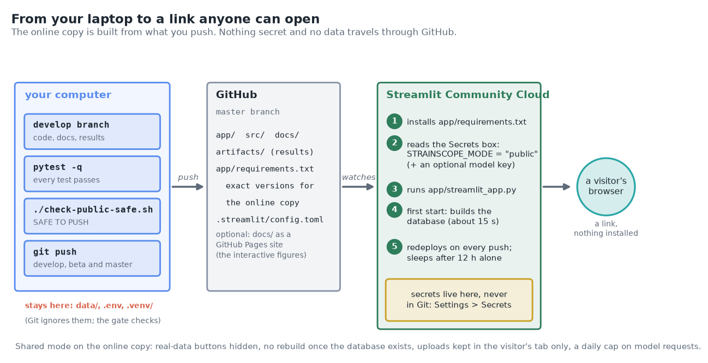
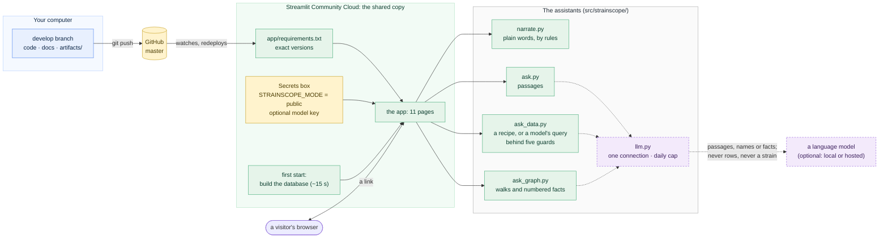
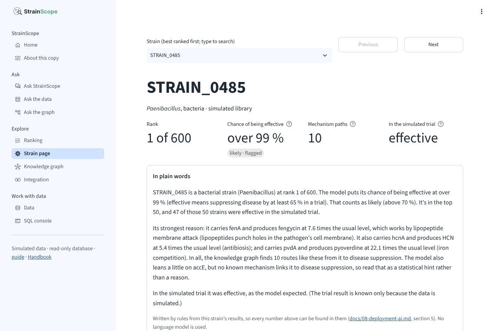
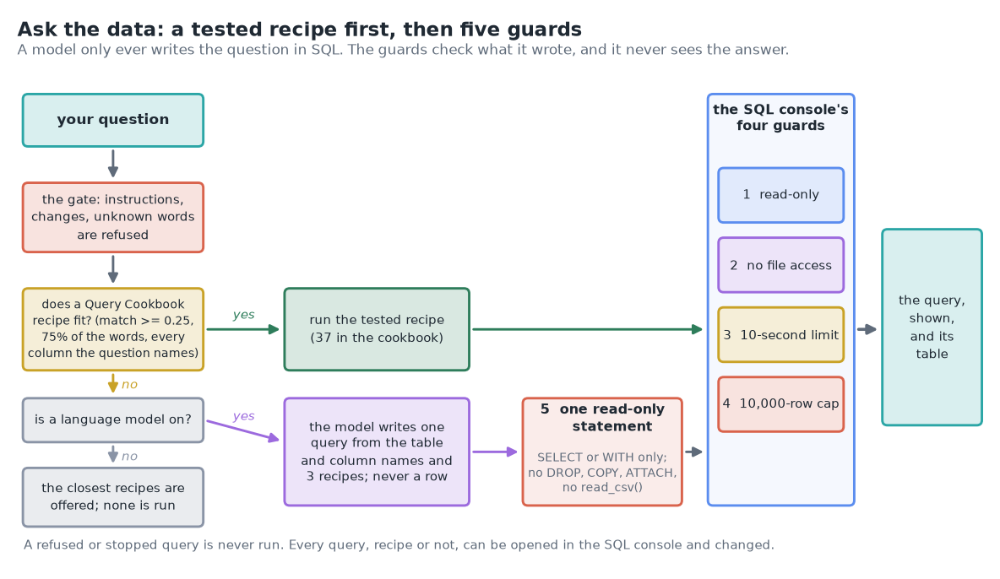
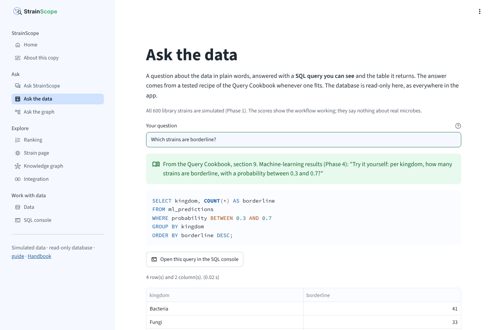
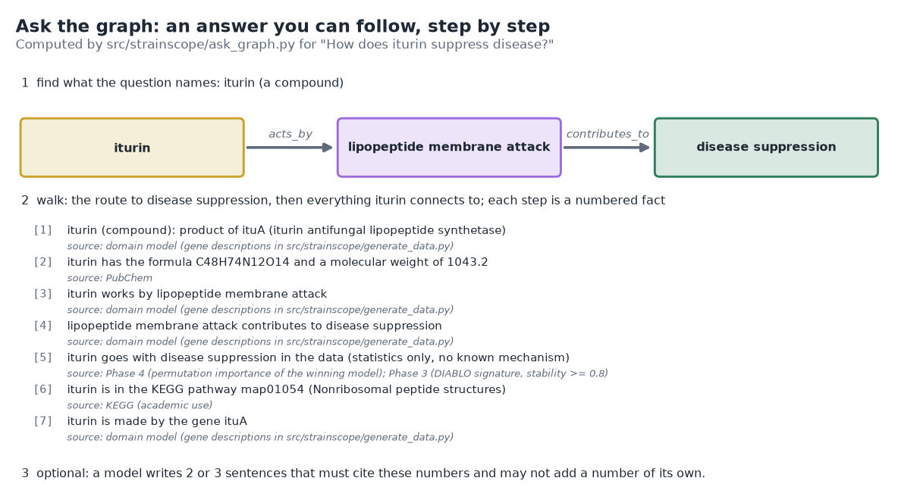
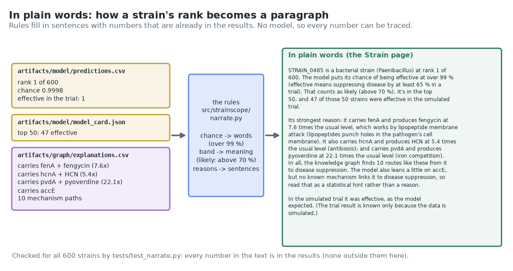

# 08 · Phase 7: deployment and the AI layer (the app online, Ask the data, Ask the graph, plain words)

[← Phase 6b: Ask StrainScope](07b-docs-assistant.md) · [Handbook](HANDBOOK.md) · [All docs in order](../README.md#the-tutorial-in-order) · [Glossary](GLOSSARY.md) · [Roadmap](ROADMAP.md)

**Prerequisites:** Phase 6b complete ([`docs/07b-docs-assistant.md`](07b-docs-assistant.md)): the app runs on your computer and `pytest -q` passes. For the online copy you also need your GitHub account (Stage 1) and the repository pushed to it (Stage 2). Nothing new to install on your computer. The language model of §10 is optional, as in Phase 6b.
**Learning goal:** after this phase you will understand what it means to deploy an app (someone else's computer runs it for anyone with the link), why an online copy runs in a shared mode with exact package versions and secrets kept on the host, how to put StrainScope online for free, and how the three assistants of the app answer questions about the project, the data and the graph without ever making something up. You'll also know exactly what each of them may send to a language model, and what never leaves.
**Why this phase exists in a real workflow:** until now, using StrainScope meant installing it. A screening scientist, a colleague or anyone curious should be able to open a link and use it, and ask "which strains are borderline?" or "how does iturin work?" in their own words instead of in SQL or in graph commands. This phase does both, and keeps every answer traceable to a document, a query or a graph path.

**Session plan** (about 3 to 4 hours in total, in two sittings):
- **Session A (~1.5 h):** the ideas (§1 to 3), get the files (§4), plain words (§5), Ask the data (§6), Ask the graph (§7).
- **Session B (~1.5 to 2 h, plus waiting for the host):** rehearse the shared copy (§8), save and put it online (§19 part A, then §9), the optional model (§10) and GitHub Pages (§11), the figures and how to read them (§12, §13), notes, tests, two ways to run, the FAQ (§14 to 18), the second commit (§19 part B) and what's next (§20).

> **How this guide works:** every action step tells you what **You should see**, **What it means**, and, when things can wobble, **If instead**. All paths are relative to the project folder (the folder that contains `README.md`). Every command uses plain keyboard characters, so it is safe to copy ([why](01-setup.md#copy-commands-safely-plain-keyboard-characters-only)). If you switched on written answers in Phase 6b (`STRAINSCOPE_ASK_BACKEND` in `.env`), add `--no-write` to the `ask_data.py` and `ask_graph.py` commands of §6 and §7 to see the output shown here (`narrate.py` never uses a model). One line will still be missing: the olpA answer of §6 leaves out its line in brackets, which only a copy without a model prints.



---

## 1. The ideas behind this phase

### Deploying: someone else's computer runs your app

So far the app has run on your own computer: `python -m streamlit run app/streamlit_app.py` starts a small web server, and your browser talks to it at `http://localhost:8501`, where "localhost" means *this computer*. Nobody else can reach it. **Deploying** means running the same app on a computer that is switched on all day and reachable from the internet, so that anyone with the link can use it. That computer and the service around it are called **hosting**. It's a bit like moving a lemonade stand from your kitchen table to a stall at the market: the market provides the table, the electricity and the opening hours, and you bring the recipe.

StrainScope uses **Streamlit Community Cloud**, a free host made by the people behind Streamlit. You sign in with GitHub, point it at the repository, the branch (`master`) and the entry file (`app/streamlit_app.py`), and it does the rest: it installs the packages, starts the app and gives it an address such as `https://<a-name-you-choose>.streamlit.app`. Every push to `master` updates the online copy within a minute or so, because the host watches the repository.

Three things about a free host shape the code of this phase:

- **It builds only from what is on GitHub.** `data/` and the database have never been committed (they're rebuilt by the scripts, which is the proof that the scripts work), so the online copy starts without a database. It builds one on its **first start**: the same five steps as the *Build the database* button, about 15 seconds, from the results committed in `artifacts/`.
- **It doesn't keep the app running when nobody uses it.** An app with no visitors for 12 hours goes to sleep; the next visitor sees a button that wakes it. A restart can start from a fresh copy of the repository, so the first start may run again. Think of a hotel room that is tidied after every stay: you unpack again each visit, and the app unpacks its database.
- **It is shared.** Many visitors use the same running copy, so anything one of them could break, everyone would lose.

### What changes when other people use it: shared mode

Phase 6 already has a switch for this, `STRAINSCOPE_MODE=public`. In this phase it does four things:

1. The buttons that download real data are hidden, and *Build the database* is greyed out once there's a database (it works only on the first start).
2. The first visit builds the database by itself, once per running copy, while the page says *Preparing this copy*.
3. Messages that would tell a visitor to type a command say what they can do instead ("reload the page in a minute"), and keep the command for the owner.
4. The AI features get a **daily cap** on requests to a language model (200 unless you set another), so a hosted key can't be spent without limit. Once the day's requests are used, the assistants still answer with what they found, just without a written version, until the count starts again the next day.

Uploads are already kept only in the app's memory for the visitor's browser tab and never written to disk (Phase 6); online, that memory is on the host, and it's emptied when the tab closes or the app restarts. The SQL console's four guards don't care who is typing.

### Exact versions for the online copy

`requirements.txt` lists package names without versions, so your computer gets whatever is current when you install. That's comfortable at home. An online copy should change only when you change it, so it has its own packing list, `app/requirements.txt`, with an **exact version** after every name (`scikit-learn==1.9.0`). Writing down exact versions is called **pinning**. A recipe that says "a 500 g bag of type 550 flour" bakes the same loaf next year; "some flour" might not. Community Cloud looks for a packing list next to the entry file before it looks in the project folder, so the online copy uses `app/requirements.txt` and your computer keeps using `requirements.txt`. A test checks that the two lists name the same packages, and that scikit-learn is pinned to the version the saved model was built with (it's in `artifacts/model/model_card.json`), so the model loads online without a version warning.

### Secrets on a host

Keys never go in Git: they live in `.env` on your computer ([Phase 1c](02c-more-real-sources.md#1-the-secrets-lesson-this-phases-big-idea)). A host has its own place for them, a **Secrets** box in the app's settings, where you paste a few lines in **TOML** (a plain settings format: `NAME = "value"`, one per line). When the app starts, Streamlit puts every line at the top of that box into the app's environment, exactly where StrainScope already looks, so no code reads the box directly. `.streamlit/secrets.toml.example` is the committed template; a real `.streamlit/secrets.toml` is ignored by Git and refused by the safety gate.

### One shape, three assistants


Phase 6b built one assistant, Ask StrainScope, for questions about the project. This phase adds two more, and all three have the same shape: **find first, decide before showing anything, and let a language model do no more than rewrite what was found** (and only if you switch one on).

- **Ask the data** answers questions about the data ("how many strains are there in each kingdom?") with a SQL query you can see and the table it returns. Turning a question in words into SQL is called **text-to-SQL**. It looks first for a tested recipe of the [Query Cookbook](QUERY_COOKBOOK.md); a language model is asked only when no recipe fits, and then it is given the table and column names, never a row of data. Picture an interpreter who translates your question for the archivist but never reads the files: the guards check what the interpreter wrote, and the answer comes straight from the archive.
- **Ask the graph** answers questions about how things connect ("how does iturin suppress disease?") by walking the knowledge graph of Phase 5. Each step of a walk is one fact with its source. This is **GraphRAG**: the retrieval-augmented generation of Phase 6b, with facts read off a graph instead of passages read off pages. On a family tree, "your grandmother's sister's son" tells you how two people are related one step at a time, and you can check every step.
- **In plain words** turns one strain's results into a short paragraph on its page, and says what testing the N best strains would bring on the Ranking page. It's written by rules from the computed numbers, with no model at all.

### What a model may see, and what it never sees

| Feature | Without a model (always) | A model, if switched on, is sent | Never sent |
|---|---|---|---|
| Ask StrainScope | the passages that answer, word for word | the question and up to three documentation passages (only those that match nearly as well as the best one), with the fixed rules and their worked example (a made-up pump) | everything else |
| Ask the data | a tested recipe, run through four guards | the question, the table and column names, a few notes on what the columns hold, three tested recipes | **any row of data** |
| Ask the graph | numbered facts with their sources, and the route | the question and the facts about concepts (from the domain model, public references and the published findings of Phases 3 and 4), with the same rules and worked example | **anything about a strain**: a strain question is answered by rules |
| In plain words | the paragraph, by rules | nothing: no model is used | everything |

Uploads and keys never travel in a request body (a hosted key goes in the request's header, where the provider expects it). The first three rows are checked by tests that run each assistant against a stand-in model server on your computer and read what it would have been sent; the last by a test that every number in the paragraphs comes from the results (§15).

### Plain words, by rules

`src/strainscope/narrate.py` writes these paragraphs the way a bank prints the summary page of a statement: the sentences are fixed, and the numbers are copied in from the account. Here the numbers are a strain's rank, chance, band, mechanism paths and flags, taken from the results, so every number in the paragraph can be found in the files it came from. A test checks that for all 600 strains. A language model could make the wording smoother, but only if it were sent the strain's results, which the table above rules out.

---

## 2. The data flow of this phase



What runs where: on your computer, everything, as before. Online, the same code runs on the host; the only things that can leave it are the requests of the third column of the table in §1 (*A model, if switched on, is sent*), and only when you've put a model's details in the Secrets box.

---

## 3. The decisions in English, before any code

1. **Streamlit Community Cloud for the online copy.** It's free, it runs a Streamlit app without changes, it builds straight from the GitHub repository, and it updates on every push. I chose it over a virtual machine (Phase 6 §10 shows how to run the app on one, but then you look after the machine yourself) and over a container platform (an optional container comes in Phase 8).
2. **One app, two modes.** The online copy is the same code as yours, run with `STRAINSCOPE_MODE=public`. A separate "demo" version would drift away from the real one.
3. **The database is built on the first start, not committed.** It rebuilds in about 15 seconds from the seed and the committed results, so committing it would add a large file and prove nothing. A failed build is tried once per running copy, not on every click.
4. **Exact versions online, current versions at home.** `app/requirements.txt` pins everything; `requirements.txt` stays as it is. A test keeps the two in step and the scikit-learn pin equal to the model card's.
5. **Secrets in the host's box, a template in Git.** `.streamlit/secrets.toml.example` shows what goes in the box, with no value in it that matters.
6. **Find first, a model second, for every assistant.** Each assistant answers on its own without a model; a model can only rewrite what was found, and every written answer is checked before it's shown (it must cite what it was given, and Ask the graph's may not add a number of its own).
7. **One connection to a model, one set of settings.** `src/strainscope/llm.py` holds the request, the checks and the daily cap for all three assistants, and the settings keep their Phase 6b names (`STRAINSCOPE_ASK_*`), since all three are ways of asking.
8. **Ask the data: tested recipes before new queries, and never a row to a model.** A recipe runs when it matches well, uses most of the question's words and names every column the question names. A model's query passes a **fifth guard** (one statement, `SELECT` or `WITH` only, no command that changes anything, no function that reads files) and then the SQL console's four guards. Every query is shown and can be opened in the SQL console.
9. **Ask the graph: rules choose the walks, a model only phrases them.** Finding the names in a question and choosing the walks is done by code that tests can check. Questions about a strain are answered from its own results, by rules.
10. **Plain words by rules only**, for the reason in §1.
11. **A daily cap on model requests in shared mode**, 200 a day unless the owner sets another number.
12. **Feedback through a GitHub issue, not a form.** Under every answer, *Not what you needed? Suggest a fix* opens a new GitHub issue with the question filled in. Nothing is stored in the app, and nothing is sent unless the person presses Submit on GitHub. Missed answers become golden questions or fixes to the documents, which was the trigger written down for this item in the [roadmap](ROADMAP.md#deferred-items-and-their-triggers).
13. **The interactive figures on GitHub Pages, optionally.** `docs/index.html` is a front page for them and `docs/.nojekyll` tells GitHub to publish the folder as it is.
14. **Golden questions for each new assistant**, run with the tests: `tests/golden_data_questions.csv` (37) and `tests/golden_graph_questions.csv` (23).

### What we leave out on purpose, and why

- **A conversation.** Each question still stands alone (the deferred item and its trigger are in the [roadmap](ROADMAP.md#deferred-items-and-their-triggers)).
- **Model-written explanations of a strain.** They would need the strain's results to be sent to a model. Deferred, with a trigger.
- **A model that sees query results.** Ask the data shows the table and one sentence made from it (*The answer: 145*); a model never reads the rows, so it can't summarise them either.
- **Usage statistics and accounts.** The online copy keeps no record of visitors, and Streamlit's own usage statistics stay off (`.streamlit/config.toml`).
- **A custom domain name.** The `streamlit.app` address is enough for now.

---

## 4. Get the Phase 7 files into your repo

All paths are relative to the project folder.

| Path | New / changed | Its job |
|---|---|---|
| `src/strainscope/llm.py` | new | the one connection to a language model: settings, one request, citation and number checks, the daily cap |
| `src/strainscope/narrate.py` | new | results in plain words: one strain, and the "test the best N" shortlist; a command |
| `src/strainscope/ask_data.py` | new | Ask the data: the recipe finder, the model's query behind the fifth guard, the golden questions, the command |
| `src/strainscope/ask_graph.py` | new | Ask the graph (GraphRAG): finding names, walking, numbered facts, the optional written answer, the golden questions, the command |
| `src/strainscope/ask.py` | changed | uses `llm.py` for its written answers; blanks the golden questions of all three assistants |
| `src/strainscope/service.py` | changed | `ask_data()`, `ask_graph()`, `explain_in_words()`, `release_info()`; an *AI features* line in the health check |
| `src/strainscope/graph.py` | changed | `path()` also gives each step in walking order (§14) |
| `src/strainscope/harmonize.py`, `src/strainscope/integrate.py`, `src/strainscope/model.py` | changed | three tidied lines (unused imports, a plain string) |
| `app/views/ask_data.py`, `app/views/ask_graph.py`, `app/views/about.py` | new | the pages *Ask the data*, *Ask the graph* and *About this copy* |
| `app/streamlit_app.py`, `app/ui.py` | changed | the new pages in an *Ask* group; the first start; messages for visitors; the *Suggest a fix* link |
| `app/views/strain.py`, `app/views/ranking.py`, `app/views/home.py`, `app/views/ask.py`, `app/views/sql_console.py`, `app/views/data.py`, `app/charts.py` | changed | *In plain words*; the new pages on Home; the link under answers; a query from Ask the data opens in the console; where an upload is kept, said correctly (§14); the route drawn in walking order |
| `app/requirements.txt` | new | the online copy's packing list, with exact versions |
| `.streamlit/secrets.toml.example` | new | what goes in the host's Secrets box |
| `.env.example` | changed | `STRAINSCOPE_MODE` and `STRAINSCOPE_AI_DAILY_LIMIT` |
| `docs/index.html`, `docs/.nojekyll` | new | the front page of the optional GitHub Pages site |
| `tests/conftest.py` | new | the stand-in model server, shared by four test files |
| `tests/golden_data_questions.csv`, `tests/golden_graph_questions.csv` | new | the golden questions of the two new assistants |
| `tests/test_llm.py`, `tests/test_narrate.py`, `tests/test_ask_data.py`, `tests/test_ask_graph.py`, `tests/test_deploy.py` | new | their tests (§15) |
| `tests/test_app.py`, `tests/test_ask.py`, `tests/test_graph.py`, `tests/test_service.py`, `tests/golden_questions.csv` | changed | the new pages and the shared copy; the stand-in server moved; walking order; the health line; one golden question's expected sections (§14) |
| `figures/make_phase7_figures.py` | new | five concept pictures, the golden scores and the interactive explorer (§12) |
| `figures/make_phase6_figures.py`, `figures/take_app_screenshots.py`, `figures/make_illustrations.py` | changed | the app map with eleven pages and the upload picture's subtitle; screenshots of the new pages; Stage 12 done in the journey |
| `docs/08-deployment-ai.md` | new | this guide |
| `README.md`, `CHANGELOG.md`, `docs/HANDBOOK.md`, `docs/ROADMAP.md`, `docs/PRODUCT_ROADMAP.md`, `docs/00-architecture.md`, `docs/GLOSSARY.md`, `docs/QUERY_COOKBOOK.md`, `docs/07-app.md`, `docs/07b-docs-assistant.md`, `docs/06-knowledge-graph.md`, `docs/05-machine-learning.md`, `docs/02c-more-real-sources.md` | changed | Phase 7 everywhere it belongs |
| `figures/deployment_map.png`, `figures/three_assistants.png`, `figures/five_guards.png`, `figures/graphrag_walk.png`, `figures/plain_words.png`, `figures/assistant_golden_scores.png`, `figures/app_map.png`, `figures/upload_journey.png`, `docs/interactive/assistants_explorer.html`, `docs/img/app_*.png` (four new, the rest re-taken: the sidebar has new pages), `docs/img/app_tour.gif`, `docs/img/journey_map.svg`, `docs/interactive/journey.html` | new / changed | the pictures |
| `figures/ask_how_it_works.png`, `figures/word_weights.png`, `figures/golden_scores.png`, `docs/interactive/ask_explorer.html` | changed | Phase 6b's pictures, redrawn by `figures/make_phase6b_figures.py`: the index is larger now that this guide is in it |

**Files-landed check:**

```bash
ls src/strainscope/llm.py src/strainscope/narrate.py src/strainscope/ask_data.py src/strainscope/ask_graph.py app/requirements.txt docs/08-deployment-ai.md
```

In Windows PowerShell, separate the names with commas: `ls src/strainscope/llm.py, src/strainscope/narrate.py, src/strainscope/ask_data.py, src/strainscope/ask_graph.py, app/requirements.txt, docs/08-deployment-ai.md`. **You should see** the six names and no `No such file` (PowerShell: `Cannot find path`) message.

**Read before running.** Open `src/strainscope/ask_data.py` and `src/strainscope/ask_graph.py` and read their top docstrings: each explains the assistant in about a page, including its gate. Then open `app/requirements.txt` and `.streamlit/secrets.toml.example`; both are short and say why each line is there.

---

## 5. Step 1: results in plain words

```bash
python src/strainscope/narrate.py STRAIN_0485
```

**You should see:**

```
  STRAIN_0485 is a bacterial strain (Paenibacillus) at rank 1 of 600. The model puts its
  chance of being effective at over 99 % (effective means suppressing disease by at
  least 65 % in a trial). That counts as likely (above 70 %). It's in the top 50, and 47
  of those 50 strains were effective in the simulated trial.

  Its strongest reason: it carries fenA and produces fengycin at 7.6 times the usual
  level, which works by lipopeptide membrane attack (lipopeptides punch holes in the
  pathogen's cell membrane). It also carries hcnA and produces HCN at 5.4 times the
  usual level (antibiosis); and carries pvdA and produces pyoverdine at 22.1 times the
  usual level (iron competition). In all, the knowledge graph finds 10 routes like these
  from it to disease suppression. The model also leans a little on accE, but no known
  mechanism links it to disease suppression, so read that as a statistical hint rather
  than a reason.

  In the simulated trial it was effective, as the model expected. (The trial result is
  known only because the data is simulated.)
```

**What it means.** Every number comes from the results: the rank and chance from `artifacts/model/predictions.csv`, "47 of those 50" from the model card, the reasons and "10 routes" from `artifacts/graph/explanations.csv`, and the meaning of each mode of action from `src/strainscope/ontology.py`. A chance of 0.9998 is written "over 99 %", never "100 %": the model is never certain. The last paragraph appears only for the simulated library, where the trial result (the answer key) is known.

Now the last strain of the ranking, and the shortlist question:

```bash
python src/strainscope/narrate.py STRAIN_0220
python src/strainscope/narrate.py --top 50
```

**You should see**, for the first, a paragraph that starts `STRAIN_0220 is a bacterial strain (Bacillus) at rank 600 of 600` and calls its chance `under 1 %`. Read its second paragraph: the strain does have one route to disease suppression (phlD and DAPG), and the text says so as *its strongest route*, not as a reason for a high rank, followed by `A route isn't enough on its own: the model weighs all of a strain's genes and compounds together.` For the second:

```
  If you test the 50 best-ranked strains, the model's chances for them add up to 46.2:
  that's how many it expects to be effective. It rates 50 of them likely, 0 borderline
  and 0 unlikely. In the simulated trial, 47 of the 50 were effective (94 %). Picking 50
  at random would find about 12, because 24 % of the library is effective, and 98 of the
  145 effective strains would be left untested.
```

**What it means.** The model's chances are calibrated ([Phase 4 §6](05-machine-learning.md#6-step-2-calibration-can-the-probabilities-be-taken-at-face-value)), so adding them up gives the number of effective strains it expects among the 50: 46.2. The simulated trial found 47, which is as close as calibrated chances should come.

**In the app.** Open the **Strain page**: an *In plain words* box sits under the four numbers, and the chance now reads `over 99 %` there too. On the **Ranking** page, the box under the slider changes as you move it. An uploaded strain gets the same paragraph, with its place among the library's 600 instead of a trial result.



**If instead** you see `no strain called 'STRAIN_9999'`: check the id (four digits after `STRAIN_`).

---

## 6. Step 2: Ask the data



```bash
python src/strainscope/ask_data.py
```

**You should see:**

```
  Ask the data: questions about the database, answered with a query you can see.
  Put your question in quotes, for example:

    python src/strainscope/ask_data.py "Which strains are borderline?"

  Questions to start with:

    - How many strains are there in each kingdom?
    - Which kingdoms make the top 50?
    - Which strains are borderline?
    - Which models scored best?
    - Which compounds does the top strain produce?
    - Where do the biology and the data agree?
```

Ask the first one:

```bash
python src/strainscope/ask_data.py "How many strains are there in each kingdom?"
```

**You should see:**

```
  ✓ From the Query Cookbook, section 3. Grouping: one row per category: "How many strains per kingdom, and what share are effective?"

      SELECT kingdom,
             COUNT(*)                              AS n,
             ROUND(100.0 * AVG(is_effective), 1)   AS pct_effective
      FROM phenotype
      GROUP BY kingdom
      ORDER BY n DESC;

  4 row(s) and 3 column(s).
     kingdom   n  pct_effective
    Bacteria 267           28.1
       Fungi 183           21.3
       Yeast  95           18.9
    Oomycete  55           23.6

  Other recipes close to it:
    - Try it yourself: per kingdom, how many strains are borderline, with a probability between 0.3 and 0.7?   (section 9. Machine-learning results (Phase 4), match 0.14)
    - Per kingdom, how well do the gene score and the chemistry score agree?   (section 8. Integration results (Phase 3), match 0.10)
```

**What it means.** The question was matched against the cookbook's recipes with the word search of Phase 6b, and one fitted: the first line names it, so you always know which question was really answered. Its query ran through the SQL console's four guards, and the table is the result. The recipe also tells you the share of effective strains per kingdom, which you didn't ask for; a tested recipe answers its own question, and that line lets you judge whether it's yours.

Three more, to see the other verdicts:

```bash
python src/strainscope/ask_data.py "How many oomycete strains carry olpA?"
python src/strainscope/ask_data.py "DROP TABLE phenotype"
python src/strainscope/ask_data.py "What is the capital of France?"
```

**You should see**, for the first:

```
  · No tested recipe answers this directly. These are the closest ones; pick one to run it, or write your own query in the SQL console.
  (with a language model switched on, a new query could be written: docs/08-deployment-ai.md, section 10)

  The closest recipes:
    - For the top effective strains: do they carry the iturin gene, and how much iturin do they make?   (section 4. JOIN: the payoff of a shared key, match 0.21)
    - Which compounds does the top strain produce, and how does each one work?   (section 10. The knowledge graph (Phase 5), match 0.17)
    - The most connected nodes, and what they are.   (section 10. The knowledge graph (Phase 5), match 0.06)
```

for the second:

```
  ✗ Ask the data only reads: nothing in the app can change the database. Ask a question about what's in it instead.
```

and for the third:

```
  ✗ No StrainScope document uses the word "capital" or "france", so this doesn't look like a question the database can answer. It holds the strains, their genes and compounds, the trial results, the rankings, the integration results and the knowledge graph.
```

**What it means.** · is *closest*: no recipe answers the olpA question (no recipe names that gene, and a recipe has to name every column the question names), so nothing runs and the nearest recipes are offered. With a model switched on (§10), this is where a new query would be written. ✗ is a refusal, decided before anything runs: a command that would change the database, or a question whose words no StrainScope document uses (the same check as Ask StrainScope).

What would a model be sent for the olpA question? Look, without sending anything:

```bash
python src/strainscope/ask_data.py "How many oomycete strains carry olpA?" --show-request
```

**You should see** two parts. The `── system ──` part is the fixed rules (one DuckDB query, `SELECT` only, or exactly *The database can't answer this.*). The `── user ──` part starts with `Tables and columns:` and one line per table (`- genomics(strain_id, phlD, prnD, ...)`), then `Notes:` (what the columns hold, such as `kingdom is one of 'Bacteria', 'Fungi', 'Yeast', 'Oomycete'`), then `Examples from the Query Cookbook:` with three recipes, and last `Question: How many oomycete strains carry olpA?`. Names and documentation only: not a single row, and no strain id (a recipe that names a strain is never used as an example).

Then the golden questions:

```bash
python src/strainscope/ask_data.py --golden
```

**You should see:**

```
  ── Ask the data: the golden questions ─────────────────────────
  ✓ 24/24 answered by the right recipe
  ✓  6/6  no recipe fits: none run
  ✓  7/7  off-topic, instructions or changes: refused

  37 of 37 passed.
```

**In the app.** Open **Ask the data** in the sidebar's *Ask* group. The starter questions are buttons; an answer shows the recipe's question, its query, the table (with a download button) and *Open this query in the SQL console*, which puts the query in the console's editor so you can change it. The closest recipes are buttons that run them.



**If instead:**
- `There's no database yet.`: build it (Data page, or the five commands of [`docs/07-app.md` §5](07-app.md#5-step-1-check-what-the-app-will-read)).
- A question you're sure the cookbook answers comes back *closest*: type the recipe's own question (a recipe typed word for word always runs), or pick it from the closest recipes.

---

## 7. Step 3: Ask the graph



```bash
python src/strainscope/ask_graph.py
python src/strainscope/ask_graph.py "How does iturin suppress disease?"
```

**You should see** six starter questions, then:

```
  ✓ From the knowledge graph: 7 facts about iturin, each with its source.

  Route: iturin -acts_by-> lipopeptide membrane attack -contributes_to-> disease suppression

  [1] iturin (compound): product of ituA (iturin antifungal lipopeptide synthetase)
      source: domain model (gene descriptions in src/strainscope/generate_data.py)
  [2] iturin has the formula C48H74N12O14 and a molecular weight of 1043.2
      source: PubChem
  [3] iturin works by lipopeptide membrane attack
      source: domain model (gene descriptions in src/strainscope/generate_data.py)
  [4] lipopeptide membrane attack contributes to disease suppression
      source: domain model (gene descriptions in src/strainscope/generate_data.py)
  [5] iturin goes with disease suppression in the data (statistics only, no known mechanism)
      source: Phase 4 (permutation importance of the winning model); Phase 3 (DIABLO signature, stability >= 0.8)
  [6] iturin is in the KEGG pathway map01054 (Nonribosomal peptide structures)
      source: KEGG (academic use)
  [7] iturin is made by the gene ituA
      source: domain model (gene descriptions in src/strainscope/generate_data.py)
```

**What it means.** Ask the graph found one name in the question (iturin, a compound), walked from it to disease suppression (the route: facts 3 and 4) and collected everything else iturin connects to in the knowledge layer. Every fact is one edge of the graph, read aloud, with the source that edge records. Fact 5 is the data's view (Phases 3 and 4), kept apart from the mechanism, exactly as in Phase 5. Facts 2 and 6 come from PubChem and KEGG, because the committed graph was built with the real tables.

A route that runs against an edge, a question the graph doesn't cover, one that names nothing in it, and a strain:

```bash
python src/strainscope/ask_graph.py "How are ituA and fenA connected?"
python src/strainscope/ask_graph.py "Is iturin safe for bees?"
python src/strainscope/ask_graph.py "What is the capital of France?"
python src/strainscope/ask_graph.py "Why does STRAIN_0485 rank first?"
```

**You should see**, for the first, `✓ From the knowledge graph: 4 facts about ituA and fenA, each with its source, and the route from ituA to fenA.` and the route:

```
  Route: ituA -acts_by-> lipopeptide membrane attack <-acts_by- fenA
```

The arrow pointing left is an edge the walk crosses backwards: both genes work by the same mode of action, so the walk goes up to it from ituA and down to fenA. For the second:

```
  · The graph knows about iturin, but none of these facts mentions "safe" or "bees", so they may not answer the question.
```

followed by the same seven facts. For the third, a ✗ that starts `The question doesn't name anything the knowledge graph holds` and lists examples of names it knows. For the fourth, `✓ STRAIN_0485 is a strain, so the answer is its own explanation from the knowledge graph. Questions about a strain are answered from its results by rules; no model sees them.`, the paragraphs of §5, the route of its strongest reason (`STRAIN_0485 -carries-> fenA -makes-> fengycin -acts_by-> lipopeptide membrane attack -contributes_to-> disease suppression`) and its four reasons as facts.

**What it means.** The gate works like Ask StrainScope's: a question has to name something in the graph, and the facts found have to use most of its other words (75 %); otherwise it's *closest*, shown but not offered as an answer. Names can be written the way people write them: upper or lower case, plurals ("siderophores"), a few everyday names ("hydrogen cyanide" for HCN), and a KEGG pathway's full name.

```bash
python src/strainscope/ask_graph.py --golden
```

**You should see:**

```
  ── Ask the graph: the golden questions ────────────────────────
  ✓ 17/17 answered with the right facts
  ✓  2/2  not covered: no confident answer
  ✓  4/4  nothing from the graph, or instructions: refused

  23 of 23 passed.
```

**In the app.** Open **Ask the graph**: the route is drawn (an arrow pointing left is the same backwards step), the facts follow with their sources, and a strain question adds *In plain words* and a button to open the strain's page. The **Knowledge graph** page's path finder draws routes in walking order too (§14 tells why that changed).


---

## 8. Step 4: rehearse the shared copy on your computer

Before putting the app online, see it the way a visitor will: in shared mode, starting without a database. The database is rebuilt in the process, from the same scripts, so nothing is lost (your real tables in `data/processed/real/` are loaded again by `src/strainscope/harmonize.py`).

1. Stop the app if it's running (Ctrl+C in its terminal; on Windows a running app keeps the file locked), then set the database aside, so the app starts without one:

   ```bash
   mv data/processed/strainscope.duckdb data/processed/strainscope.duckdb.bak
   ```

   In Windows PowerShell: `Rename-Item data/processed/strainscope.duckdb strainscope.duckdb.bak`
2. Start the app in shared mode, for this terminal only:

   ```bash
   export STRAINSCOPE_MODE=public                    # Windows PowerShell: $env:STRAINSCOPE_MODE = "public"
   python -m streamlit run app/streamlit_app.py
   ```

**You should see** a box at the top of the Home page, *Preparing this copy: building the database from the committed results (about 15 seconds, once)...*, which turns into *This copy is ready.* and the usual Home page. The sidebar's last line starts *Shared copy*. Open **About this copy**: it says *This is a **shared copy***, lists what the app can read with ✓, and shows the AI features. On the **Data** page, *Build the database* is greyed out and the real-data buttons are gone.

3. Stop the app (Ctrl+C), switch shared mode off again and delete the set-aside file (the new database is the same):

   ```bash
   unset STRAINSCOPE_MODE                            # Windows PowerShell: Remove-Item Env:STRAINSCOPE_MODE
   rm data/processed/strainscope.duckdb.bak          # Windows PowerShell: Remove-Item data/processed/strainscope.duckdb.bak
   ```

**If instead** the Home page shows the usual *There's no database yet* warning with a button, the switch wasn't set in the terminal that started the app (each terminal has its own environment): set it and start again.

---

## 9. Step 5: put the app online (Streamlit Community Cloud)

The host builds from GitHub, so **first save and push this phase's work: do §19 part A now**, then come back here. Steps 1 and 2 are once per account.

1. **Sign in.** Go to [share.streamlit.io](https://share.streamlit.io), press *Continue to sign-in*, and choose *Continue with GitHub*. Fill in the short form.
2. **Connect GitHub.** A new account can't see your repositories yet; the next page asks you to connect your GitHub account. Allow it. (GitHub shows what it's granting; you can withdraw it later in GitHub's settings under *Applications*.)
3. **Create the app.** Press *Create app* (top right), then choose *Deploy a public app from GitHub* and press *Deploy now*. Fill in:
   - **Repository:** `akannan2987/strainscope` (yours, if you forked it)
   - **Branch:** `master`
   - **Main file path:** `app/streamlit_app.py`
   - **App URL:** a name of your choice, for example `strainscope`. If it's taken, add something (`strainscope-demo`).
4. **Advanced settings.** Press *Advanced settings*:
   - **Python version:** the one your computer uses (`python --version`; 3.12 if you followed Stage 1). If yours isn't in the list, pick the newest one listed. It can't be changed later without deleting and redeploying the app.
   - **Secrets:** paste the one line that matters from `.streamlit/secrets.toml.example`:

     ```
     STRAINSCOPE_MODE = "public"
     ```

     Leave the model lines out for now (§10). Press *Save*.
5. **Deploy.** Press *Deploy*. A log scrolls by while the host installs `app/requirements.txt`; most apps are ready within a few minutes.

**You should see** your app at `https://<your-name>.streamlit.app` (this project's copy is [strainscope.streamlit.app](https://strainscope.streamlit.app)), first with *Preparing this copy*, then the Home page. Check four things, in this order:

1. **About this copy** says *StrainScope v0.3.0 with the changes listed under [Unreleased]* and *This is a **shared copy***, every health line is ✓ apart from the two optional ones, and *Versions of the main packages* lists the exact versions of `app/requirements.txt`.
2. **Ask the data**, *Which strains are borderline?*: the same table as on your computer.
3. **Ask the graph**, *How does iturin suppress disease?*: the same seven facts.
4. **Data**: no real-data buttons, and *Build the database* greyed out.

Write down how long the first start took and your app's address; §19 part B puts the address in the README.

**From now on**, every push to `master` updates the online copy by itself (a change to `app/requirements.txt` takes longer, because the packages are installed again). The app sleeps after 12 hours without visitors; anyone who opens the link can wake it, and the first start may run again.

**If instead:**
- *Error installing requirements* or `ModuleNotFoundError` in the log: check that `app/requirements.txt` is on GitHub's `master` (open it in the browser) and that the main file path is exactly `app/streamlit_app.py`.
- **About this copy** says *local copy*: the `STRAINSCOPE_MODE` line is missing from the Secrets box, misspelt, or below a `[section]` line (only lines at the top of the box reach the environment). Fix it in your app's *Settings*, *Secrets*, then reboot the app (*Manage app* at the bottom right, or the app's menu in your workspace, then *Reboot*).
- *This app has gone over its resource limits*: reboot it the same way. StrainScope needs far less than the free limits, so it shouldn't come back.
- The page stays on *Preparing this copy* and then says *The database couldn't be built*: open *Manage app* to read the log (the last lines show which of the five steps failed), then reboot.

---

## 10. Step 6 (optional): a language model for the three assistants

Everything works without a model. With one, Ask StrainScope and Ask the graph write a short answer that cites what they found, and Ask the data writes a new query when no recipe fits. Try it at home first. This section is the short version; [`docs/LANGUAGE_MODEL.md`](LANGUAGE_MODEL.md) has every setup step by step, how to switch a model off again, a table of what can go wrong, and the model check (`python src/strainscope/service.py check-model`), which tells you whether your model cites its sources.

**At home, with Ollama.** If you set it up in [Phase 6b §8](07b-docs-assistant.md#8-step-4-optional-written-answers-from-a-model-on-your-own-computer), nothing more is needed: `STRAINSCOPE_ASK_BACKEND=local` in `.env` (or `export` it). Then:

```bash
python src/strainscope/ask_data.py "How many oomycete strains carry olpA?"
python src/strainscope/ask_graph.py "How does iturin suppress disease?"
```

**You should see**, for the first, a ✓ line *No recipe fitted, so llama3.2:3b wrote this query. It ran through all five guards; check it before you rely on it.*, the query the model wrote, and its result. For the second, the facts of §7 with a block above them:

```
  Written answer (llama3.2:3b, from the facts below):

    (a few sentences that cite the facts as [3] or [3][4])
```

The wording, and the query, differ from model to model. A small model on a laptop writes weaker SQL than a large hosted one; the guards hold either way, and a query that doesn't run comes back with DuckDB's message. **What it means:** read the query before you trust the table, and check a written answer against the facts under it. If the model's query would change anything, the fifth guard stops it and says why; if the model writes a number the facts don't hold, the answer isn't shown.

**Online, with a hosted model.** A model on your laptop can't serve the online copy, so the online copy needs a provider with an **OpenAI-compatible interface** (Phase 6b §9). One with a free tier at the time of writing (October 2026) is Google's Gemini API:

1. Sign in to Google AI Studio's key page, [aistudio.google.com/apikey](https://aistudio.google.com/apikey), and press *Create API key*. Treat the key like a password.
2. Look up a current model name on the [models page](https://ai.google.dev/gemini-api/docs/models) (a *Flash* or *Flash-Lite* model is plenty; at the time of writing, for example, `gemini-3.5-flash-lite`).
3. Try it at home first. In `.env` (never in a file Git tracks):

   ```
   STRAINSCOPE_ASK_BACKEND=hosted
   STRAINSCOPE_ASK_URL=https://generativelanguage.googleapis.com/v1beta/openai
   STRAINSCOPE_ASK_MODEL=the-model-name
   STRAINSCOPE_ASK_KEY=your-key
   ```

   and ask the two questions above.
4. Put the same four lines in the online copy's *Settings*, *Secrets*, in TOML (with quotes), under the `STRAINSCOPE_MODE` line, and reboot the app:

   ```
   STRAINSCOPE_MODE = "public"
   STRAINSCOPE_ASK_BACKEND = "hosted"
   STRAINSCOPE_ASK_URL = "https://generativelanguage.googleapis.com/v1beta/openai"
   STRAINSCOPE_ASK_MODEL = "the-model-name"
   STRAINSCOPE_ASK_KEY = "your-key"
   ```

**You should see** on **About this copy**: *AI features (optional): on, hosted: the-model-name at https://generativelanguage.googleapis.com/v1beta/openai (hosted); 0 of 200 model requests used today (UTC)*, and the three assistants now offer their *write* switches.

Two things to know about a free tier. Google's pricing page says content sent on the free tier may be used to improve its products. That's acceptable here, because only what the third column of the table in §1 lists is ever sent (documentation, table and column names, facts about concepts); for anything confidential, use a paid tier or a local model. And a free tier has its own limits; the daily cap keeps the online copy well inside them. To change the cap, add `STRAINSCOPE_AI_DAILY_LIMIT = "100"` (any whole number) to the Secrets box and reboot the app: the count and its limit are set once per running copy.

**If instead:** `HTTP 400` with *API key not valid*, `HTTP 401` or `HTTP 403` means the key wasn't accepted (check that it was copied whole, and that the API is enabled for its project); `HTTP 404` usually means the model name is wrong; `This copy has used its 200 model requests for today` means the cap was reached, and the assistants carry on without written answers until midnight (UTC).

---

## 11. Step 7 (optional): the interactive figures on GitHub Pages

The interactive figures in `docs/interactive/` open in a browser, but only after downloading them. **GitHub Pages** publishes a folder of a repository as a small website, for free, so they open with one click.

1. On GitHub, open the repository, then *Settings* (under the repository name).
2. In the sidebar's *Code, planning, and automation* section, press *Pages*.
3. Under *Build and deployment*, *Source*, choose *Deploy from a branch*.
4. Choose the branch `master` and the folder `/docs`, then press *Save*.

**You should see**, after a minute or two, the address `https://<your-github-name>.github.io/strainscope/` (this project's is [akannan2987.github.io/strainscope](https://akannan2987.github.io/strainscope/)) at the top of the same page. On a free GitHub account, Pages works for public repositories only, which this one is. It opens `docs/index.html`: the front page, with a card for every interactive figure. `docs/.nojekyll` tells GitHub to publish the files as they are, without its page builder (called Jekyll), so nothing is changed on the way. §19 part B adds the address to the README.

---

## 12. See the results (figures)

```bash
python figures/make_phase7_figures.py
python figures/make_phase6_figures.py
python figures/make_phase6b_figures.py
python figures/make_illustrations.py
```

**You should see**, from the first:

```
Phase 7 figures:
  drew figures/deployment_map.png
  drew figures/three_assistants.png
  drew figures/five_guards.png
  drew figures/graphrag_walk.png
  drew figures/plain_words.png
  drew figures/written_answer_check.png
  drew figures/assistant_golden_scores.png
  drew docs/interactive/assistants_explorer.html (interactive, 3 charts)
```

One picture in that list came later: `figures/written_answer_check.png`, from the fix of [Handbook Stage 12.1](HANDBOOK.md#stage-121-fix-for-small-language-models-the-model-check-and-clearer-suggestions), shows what a model is sent for a written answer and is explained in [`docs/LANGUAGE_MODEL.md` §9](LANGUAGE_MODEL.md#9-how-a-written-answer-is-asked-for-and-checked). The second command redraws the Phase 6 figures, among them the app map with its eleven pages. The third redraws Phase 6b's, because their numbers come from the documentation, which this guide has made larger (1194 sections now). The last one redraws the journey map with Stage 12 done. Afterwards `git status` may also list a picture or two that looks exactly the same as before (`figures/ask_gate.png`, say): the drawing library can write the same picture with slightly different bytes. Committing them is harmless. The first five pictures are the concept figures of §1, §6, §7 and below; `graphrag_walk.png` and `plain_words.png` are computed by the code itself, so they stay true when the results change.



The results figure:


**How to read it.** Each dot is a golden question; its colour is what the assistant did. Left, Ask the data: the dashed line is the match a recipe needs (0.25). Every question a recipe answers sits right of it, and so does one *no recipe fits* question at 0.34 ("Which strains carry both ituA and fenA?"), which a recipe about ituA matches well but doesn't answer; it isn't run, because that recipe never names fenA. So, as in Phase 6b, a single threshold isn't enough, and the word checks do the rest. Right, Ask the graph: the share of a question's other words that the facts use. Answered questions sit at 1; the two the graph doesn't cover ("Is iturin safe for bees?", "Does pyoverdine cure cancer?") sit at 0. Refused questions sit at 0 on both sides: they're never searched.

**Interactive version:** [`docs/interactive/assistants_explorer.html`](interactive/assistants_explorer.html) has both charts (hover a dot for its question) and a third one: pick a question to see the eight recipes that match it best. It opens offline from the project folder, like the others.

The screenshots (`docs/img/app_ask_data.png`, `app_ask_graph.png`, `app_about.png`, `app_plain_words.png` and the re-taken ones) come from `python figures/take_app_screenshots.py`, as in [Phase 6](07-app.md#11-see-the-results-figures).

---

## 13. Reading the results like a careful user

- **A recipe answers its own question.** The first line of an Ask the data answer names the recipe; if its question differs from yours, the table may contain more, or less, than you wanted. The query is shown so you can open it in the SQL console and adjust it.
- **A model's query is a draft.** It passed five guards, so it can't harm anything, but nothing guarantees it answers what you meant. Read the `WHERE` line before you read the table.
- **Facts beat sentences.** A written answer is a summary of the numbered facts or passages under it, which it had to cite. When the two disagree, the facts win.
- **Statistics only means what it says.** A fact marked *statistics only* records that the data and the model link something to disease suppression, with no known mechanism behind it (accE, Phase 4's decoy, is one).
- **Plain words don't add anything.** The paragraph says what the numbers say; a "borderline" strain is a maybe, and the trial result is shown only for simulated strains.
- **The online copy is the same as yours.** If an answer differs between the two, the cause is a different version of the code or the data. Check that `git log -1` (your computer) and `git log origin/master -1` (what the host builds from) show the same commit; if they don't, push, and if they do, reboot the online copy.

---

## 14. Notes from the build (kept on purpose)

- **The path picture lost a gene.** Building Ask the graph, the route from ituA to fenA came out as *ituA, lipopeptide membrane attack, lipopeptide membrane attack*. The walk crosses the second edge backwards (fenA works by that mode of action), and the code that drew a route assumed every edge points along the walk. The Knowledge graph page's path finder of Phase 6 had drawn routes the same way, so between two genes it showed the mode of action twice and lost the second gene. `graph.path()` now gives each step in walking order as well (`step_from`, `step_to`), the route is drawn in that order with each arrow pointing the way its edge points, and tests check both.
- **The cookbook's own question scored low.** "How many strains do we have?" is the cookbook's second recipe word for word, and it scored 0.23 against itself, because every word in it is common. A recipe whose question is typed word for word now always runs.
- **Three words out of four wasn't enough.** "Which strains carry both ituA and fenA?" first ran the recipe about ituA and iturin: three of its four words matched. A recipe now has to name every table or column the question names (fenA, here), and the question went into the golden set as *no recipe fits*.
- **Facts that didn't say what they were.** "Which genes work by iron competition?" first came back as *closest*: the facts listed pvdA and sidA, but never the word "genes". Facts about a group now say what kind of things are in it (*the genes pvdA and sidA work by iron competition*).
- **A strain id in the documentation.** The first version of the test that checks no row of data reaches the model failed: the notes sent to the model used STRAIN_0485 as an example of a node id. It was documentation, not data, and the note now describes the id's format without naming a strain. A review of this guide against the code found the same thing one level down: one of the cookbook recipes sent as examples names STRAIN_0485 in its query, and the test had been written to let that id through. Recipes that name a strain are now left out of the examples, and the test checks that no strain id at all is in the request.
- **A chance of 100 %.** The Strain page showed STRAIN_0485's chance (0.9998) rounded to 100 %, a certainty the model doesn't have. Both the page and the plain words now say *over 99 %*.
- **The last strain's strongest reason.** The first plain-words text for STRAIN_0220, ranked last, began *Its strongest reason*, which read like a reason for a high rank. For a strain that isn't likely, the sentence now begins *Its strongest route to disease suppression*, and an unlikely one adds that a route isn't enough on its own.
- **Writing this guide moved two golden questions of Ask StrainScope.** "When will the app be online?" now finds Phase 7 material first (the glossary's *Sleeping app* and *Reboot*, then this guide's §2), so this guide joined its expected sections in `tests/golden_questions.csv`. Those sections describe the online copy rather than say when it arrived; a word search answers a "when" question loosely. "How do I fix the brakes on my car?" had been reading one of its words as a misspelt "brackets" (a word from the JSON part of [Phase 1b](02b-real-data-ingestion.md)) all along; with this guide's words in the index, its best match rose to the 0.12 line and it came back *closest* instead of refused. A spelling suggestion now also has to be within one letter of the original's length, and the question is refused again, naming the word no document uses.
- **A build that would have run on every click.** The first version of the first start would have retried a failed database build on every page a visitor opened, 15 seconds each time. It now tries once per running copy; a reboot tries again.
- **Where an upload is kept.** Phase 6's guide and app said an upload stays in the browser tab. The same review pointed out that Streamlit keeps it in the app's memory, on the computer running the app, one copy per browser tab; online, that computer is the host. It was never written to disk, and that hasn't changed, but the app, the guides and the upload picture now say where it really is.

---

## 15. The tests

```bash
pytest -q
```

**You should see:** `353 passed, 1 skipped`. The 208 from before are joined by 146 new ones; the skipped one is still Ask StrainScope's known limitation.

- `tests/test_ask_data.py` (69): every golden and starter question; the fifth guard against eight kinds of query it must stop and three it must let through; with the stand-in model server of `tests/conftest.py`, that a model is asked only when no recipe fits, that it sees table and column names but no strain id (not even one named in a recipe) and no date from any row, that a `DROP TABLE` it writes is stopped and not run, that a query returning 360,000 rows is cut at the row limit, and that an unreachable model leaves the closest recipes.
- `tests/test_ask_graph.py` (43): every golden question; names found the way people write them; the route in walking order (in the text and in the drawing); every fact has a source and no concept fact mentions a strain; a written answer that cites nothing, cites a fact it wasn't given or brings a number of its own is not shown; a strain question never reaches the model.
- `tests/test_narrate.py` (8): every number in the plain words of all 600 strains is in the results; the wording follows the band and the trial, including the model's mistakes; a chance is never rounded to a certainty; uploads; the shortlist; the command.
- `tests/test_llm.py` (7): the settings, the daily cap (and that a used-up cap sends nothing), the citation and number checks, and the key only in the header.
- `tests/test_deploy.py` (6): `app/requirements.txt` against `requirements.txt` and the model card; the secrets template; `.gitignore`; the Pages front page's links; the version read from the changelog.
- `tests/test_app.py` gains 12 test runs: the three new pages join the "every page opens" tests (with and without a database), plain words on the Strain and Ranking pages, Ask the data runs a recipe and hands its query to the SQL console, refuses a change, Ask the graph draws a route, About this copy shows the version and health, and a shared copy builds its database once on the first start and gives a visitor a message they can act on. `tests/test_graph.py` gains one for the walking order.

None of them needs the network, a model or a key.

---

## 16. Two ways to run everything (running tally)

| Task | Manual (learn) | Automatic (ship) |
|---|---|---|
| Generate synthetic data + build the database | `generate_data.py` → `harmonize.py` → the three `publish` steps | the app: **Data** page; **by itself on the first start of a shared copy** |
| Fetch real data | `python src/strainscope/fetch_real.py [--probe] [--source ...]` | the app: **Data** page, *Real data* tab (hidden in shared mode) |
| See the ranking, ask why | `src/strainscope/sql.py`, `graph.py why ...`, **`narrate.py STRAIN_0485`** | the app: **Ranking**, **Strain page** (*In plain words*), **Knowledge graph** |
| Score your own strains | `python src/strainscope/service.py template ...` then `score ...` | the app: **Data** page, *Upload your strains* |
| Question the data | `python src/strainscope/sql.py` + the [Cookbook](QUERY_COOKBOOK.md) | the app: **SQL console**; **Ask the data** (this phase); the MCP server's `ask_data` and `query_database` (Phase 7b) |
| **Ask how things connect (this phase)** | `graph.py path ...`, **`python src/strainscope/ask_graph.py "..."`** | **the app: Ask the graph**; the MCP server's `ask_graph` (Phase 7b) |
| Ask about the project | `python src/strainscope/ask.py "..."` | the app: Ask StrainScope; the MCP server's `ask_docs` (Phase 7b) |
| **Check the answers (this phase)** | `ask.py --golden`, **`ask_data.py --golden`**, **`ask_graph.py --golden`** | `pytest -q`, in every commit ritual; on every push from Phase 8 |
| **Use it without installing anything (this phase)** | `python -m streamlit run app/streamlit_app.py` on your own computer | **the online copy**, redeployed on every push to `master` |

---

## 17. Same task, two ways: SQL by hand, and the question in words (optional, 10 min)

The question: **how many strains of each kingdom are effective?** First the way of Phase 2: write it yourself in the SQL console (`python src/strainscope/sql.py`, or the app's **SQL console**):

```sql
SELECT kingdom, SUM(is_effective) AS effective, COUNT(*) AS strains
FROM phenotype
GROUP BY kingdom
ORDER BY effective DESC;
```

You need to know that the table is called `phenotype`, that `is_effective` holds 0 or 1 (so adding it up counts the effective strains), and what `GROUP BY` does. Now the same in words:

```bash
python src/strainscope/ask_data.py "How many strains per kingdom are effective?"
```

Ask the data finds the cookbook's recipe for that (section 3) and shows its query, which gives the share instead of the count. Typing SQL gives you exactly the question you meant, once you know the tables. Asking in words gets you started without knowing them and shows you the SQL to learn from, which is why every answer has *Open this query in the SQL console*.

---

## 18. What could go wrong (mini-FAQ)

- **The online copy shows an old version after a push:** give it a minute; if it still doesn't change, check that you pushed `master` (`git log origin/master -1`), then reboot the app.
- **The online copy says *local copy* or shows real-data buttons:** shared mode isn't on (§9, *If instead*).
- **A visitor's upload disappeared:** the app keeps an upload in memory for that browser tab only and never stores it, so a reload or a sleeping app starts again without it. That's the privacy promise of Phase 6.
- **Ask the data answers a different question from mine:** the recipe's question is in the first line; type a more specific question, open the query in the SQL console and change it, or switch on a model (§10).
- **A model's query fails with a DuckDB message:** the model guessed a column that isn't there, or wrote DuckDB-incompatible SQL. The message says which; fix the query in the SQL console. Larger models get this right more often.
- **Ask the graph says the question names nothing it knows:** use the graph's names (ituA, iturin, iron competition, disease suppression, STRAIN_0485); the **Knowledge graph** page's *Look something up* tab lists them all.
- **No written answer appears online:** **About this copy** shows whether the model is on and how much of today's cap is used; a refused or *closest* question never gets one, and neither does a strain question.
- **`HTTP 429` from a hosted model:** the provider's own limit for your key was reached; lower `STRAINSCOPE_AI_DAILY_LIMIT` or wait.
- **The test `test_scikit_learn_matches_the_saved_model` fails:** you rebuilt the model with another scikit-learn version (`model.py final`). Pin that version in `app/requirements.txt`, so the online copy loads the model it was built with.
- **GitHub Pages shows a 404:** the first publish takes a few minutes; check that the source is `master` and `/docs`, and that `docs/index.html` is pushed.

---

## 19. Save your work (two commits: before and after deploying)

This phase has two commits, because the online copy is built from what you push: the first one saves the code and the guides, and the second one, after deploying, adds the online copy's address.

### Part A: before deploying

The checks come first:

```bash
pytest -q                     # 353 passed, 1 skipped
./check-public-safe.sh        # must end with: SAFE TO PUSH  (Windows: bash check-public-safe.sh in Git Bash)
```

`git status` should list the new modules, pages, tests, figures, this guide and the changed docs. It should list **nothing** under `data/`, and never `.env` or `.streamlit/secrets.toml` (only the `.example` template).

Then update the [Handbook](HANDBOOK.md) Stage 12 checkpoint if anything about your run differed, in the same commit. Then, on `develop`:

```bash
git switch develop
git add -A
git commit -m "feat: add the online copy, plain-language explanations, Ask the data and Ask the graph"
git push origin develop develop:beta develop:master

## --tags is optional, only when required: no tag for this phase (v1.0.0 comes with Phase 8)
## then switch back to local master and pull in the remote changes
git switch master
git pull --ff-only origin master
git switch develop
```

Now deploy (§9).

### Part B: after deploying

Once the online copy works, put its address where readers look for it: the README's **Live app** line near the top and its *The app* section, and the Handbook's Stage 12, with the first-start time you wrote down (and the GitHub Pages address, if you did §11). Then the same checks and ritual:

```bash
pytest -q
./check-public-safe.sh

git switch develop
git add -A
git commit -m "docs: link the online app and the interactive figures"
git push origin develop develop:beta develop:master

## --tags is optional, only when required: no tag for this commit either
## then switch back to local master and pull in the remote changes
git switch master
git pull --ff-only origin master
git switch develop
```

**Why no tag.** Version tags mark new usable levels ([why these tags](ROADMAP.md#version-tags)), and the plan puts the next one, **v1.0.0**, after Phase 8, when the project is packaged and tested on three operating systems at every push. The online copy shows the latest release and says that changes are listed under *[Unreleased]* in `CHANGELOG.md`.

---

## 20. What you learned, and what's next

**You learned:** what deploying means and what a free host changes (it builds from GitHub, sleeps, starts again, and is shared); how shared mode, a first-start build, pinned versions and secrets in the host's box make an online copy safe and repeatable; text-to-SQL with tested recipes first and a model's query only behind five guards, without the model ever seeing a row; GraphRAG as walks through a graph with numbered, sourced facts; why plain-language explanations can be written by rules, and what a model may and may not be sent; and how to check every assistant with golden questions.

**Try it yourself (extensions):**
- In `src/strainscope/ask_data.py`, change `RECIPE_NEEDED = 0.25` to `0.4` and run `python src/strainscope/ask_data.py --golden`. Which questions lose their recipe? Find them in `figures/assistant_golden_scores.png`. (Put it back.)
- Add a recipe of your own to [`docs/QUERY_COOKBOOK.md`](QUERY_COOKBOOK.md) (a bold question in double quotes, then a ```` ```sql ```` block), ask its question in words, and watch Ask the data find it: the recipes are re-read when the cookbook changes. Add a golden question for it.
- Add an everyday name to `ALIASES` in `src/strainscope/ask_graph.py` (for example a common name for a gene), ask a question that uses it, and add it to `tests/golden_graph_questions.csv`.
- Set `STRAINSCOPE_AI_DAILY_LIMIT=1` in `.env` with a model switched on, restart the app, ask two questions on the Ask StrainScope page, and read the second one's note. (From the terminal it can't work: each command is a new program, with a new count.)

**Next:** **Phase 7b, the MCP server** ([`docs/08b-mcp-server.md`](08b-mcp-server.md), [Handbook Stage 13](HANDBOOK.md#stage-13-phase-7b-the-mcp-server)): the same assistants, offered to AI assistant apps as tools through a standard connection. The service layer already has a door for each (`ask_docs`, `ask_data`, `ask_graph`, `explain_in_words`), and the server calls those. After that, Phase 8 packages everything as **v1.0.0**.
