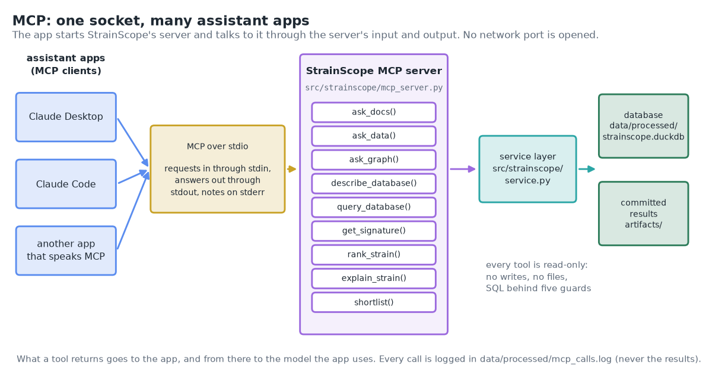
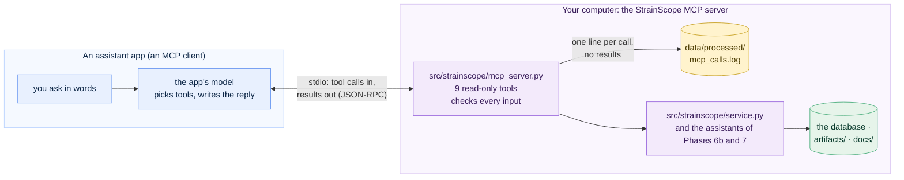

# 08b · Phase 7b: the MCP server (StrainScope's tools for AI assistant apps)

[← Phase 7: deployment and the AI layer](08-deployment-ai.md) · [Handbook](HANDBOOK.md) · [All docs in order](../README.md#the-tutorial-in-order) · [Glossary](GLOSSARY.md) · [Roadmap](ROADMAP.md)

**Prerequisites:** Phase 7 complete ([`docs/08-deployment-ai.md`](08-deployment-ai.md)): the database is built and `pytest -q` passes. One new Python package (installed in §5). To use the server from an assistant app (§9 and §10) you need one such app on your computer, for example Claude Desktop ([claude.ai/download](https://claude.ai/download); macOS and Windows) or Claude Code ([setup page](https://code.claude.com/docs/en/setup); a terminal app, which needs a paid Claude plan or a Console account). Everything before §9 works without one.
**Learning goal:** after this phase you will understand what the Model Context Protocol (MCP) is and why AI assistant apps use it, how an app starts a server on your computer and talks to it through its input and output, what a tool is and how an app learns which inputs it takes, and how to give an assistant safe, read-only access to StrainScope's results. You'll be able to run, test and connect the server on Windows, macOS and RHEL 8, and to read its call log.
**Why this phase exists in a real workflow:** many people now ask an AI assistant first. Without a way into StrainScope, an assistant can only guess what the project found. With the MCP server, someone can ask their own assistant "which five fungal strains look most promising, and why?" and get an answer built from StrainScope's own ranking and knowledge graph, with the routes and sources to check it.

**Session plan** (about 2 hours, in one or two sittings):
- **Session A (~1 h):** the ideas (§1 to 3), get the files (§4), install (§5), the tools (§6), calling them by hand (§7), the check (§8).
- **Session B (~1 h):** connect an assistant app (§9), ask it questions (§10), the call log (§11), the optional Inspector (§12), the figures and how to read the results (§13, §14), notes, tests, two ways to run, the FAQ (§15 to 19), save your work (§20) and what's next (§21).

> **How this guide works:** every action step tells you what **You should see**, **What it means**, and, when things can wobble, **If instead**. All paths are relative to the project folder (the folder that contains `README.md`). Every command uses plain keyboard characters, so it is safe to copy ([why](01-setup.md#copy-commands-safely-plain-keyboard-characters-only)). Open a terminal in the project folder and switch on the toolbox first (`source .venv/bin/activate`; Windows PowerShell: `.\.venv\Scripts\Activate.ps1`).



---

## 1. The ideas behind this phase

### An assistant that can look things up

An AI assistant app (Claude Desktop, Claude Code and many others) answers from what its language model learned in training. Ask it about StrainScope and it knows nothing about your ranking, your graph or your results. It can still be useful, if it can **ask StrainScope**: call a function, get the result, and write its reply from that. A new colleague doesn't know your lab's freezer inventory either, but give them access to the inventory system and they can answer "do we still have strain 485?" in a minute.

Every app could invent its own way of calling outside programs, and every program would then need one adapter per app. The **Model Context Protocol (MCP)** is the shared standard that avoids this: a program offers its functions in one agreed format, and any app that speaks MCP can use them. Mains plugs are a fair comparison: one socket standard per country, and every appliance fits.

Three words come up all the time:

- **Server:** the program that offers the functions. Ours is `src/strainscope/mcp_server.py`.
- **Client:** the part of an assistant app that talks to servers. The app around it (Claude Desktop, say) is sometimes called the **host**.
- **Tool:** one function a server offers, with a name, a description in words, and a list of the inputs it takes (its **input schema**). The app's model reads the descriptions and decides which tool to call, with which inputs. `rank_strain(strain_id)` is one of StrainScope's nine.

### How the app and the server talk: stdio

For a server on your own computer, the app starts it as a separate program and talks to it through that program's **standard input** and **standard output**, the same two channels a terminal command reads from and writes to. That's called the **stdio** transport. The messages are small pieces of JSON in a format called JSON-RPC ("call this function with these inputs", "here is the result"). Think of a hatch between a kitchen and a dining room: orders go in on slips, plates come out, and nobody walks through.

Two consequences matter. First, nothing opens a network port: no other computer can reach the server. Second, **standard output belongs to the protocol**. A stray `print()` in the server would land in the middle of the messages and confuse the app. Notes go to the third channel, **standard error** (stderr), which apps keep in a log. StrainScope's server sends anything a tool prints to stderr, to be safe, and a test checks that nothing reaches stdout (§16).

### One service layer, three doors

Nothing new is computed in this phase. Since Phase 6, every result has been reachable through the **service layer** (`src/strainscope/service.py`), which the terminal commands and the app both call. The MCP server is a third door onto the same rooms, so an assistant gets exactly the answers the app shows.


### Read-only, checked, logged

An assistant decides on its own which tool to call, so the tools have to be safe whatever it asks:

1. **Read-only.** No tool writes anything. SQL goes through the fifth guard of Phase 7 (one `SELECT` or `WITH` statement) and the SQL console's four guards from Phase 6. Each tool also tells the app it's read-only, through MCP's **tool annotations**, so an app can decide not to ask you to approve every call.
2. **Checked input.** A strain id has to look like `STRAIN_0485` and exist; a question has 1 to 300 characters and a query at most 4,000; numbers stay within their limits. A refusal comes back as one sentence saying why, so the assistant can correct itself.
3. **Logged.** Each call adds one line to `data/processed/mcp_calls.log`: the tool, its inputs, the outcome and the time it took. The results aren't written down, and Git never commits the file.


### What the assistant sees

Here this phase differs from Phase 7. In the app, a language model never sees a row of data (Phase 7 §1). With MCP, **the assistant does see what the tools return**, because that's the point: you ask your assistant about your results. What leaves the server goes to the app you connected, and from there to the model that app uses. With Claude Desktop or Claude Code, that model runs at Anthropic; an app that runs a model on your own computer keeps it there.

| Tool | What it can show the assistant |
|---|---|
| `ask_docs` | passages from the project's documents (public in this repository anyway) |
| `ask_data` | a tested recipe's SQL and up to 50 rows of its result |
| `ask_graph` | facts from the knowledge graph with their sources; for a strain, its explanation |
| `describe_database` | table and column names, row counts, notes on what the columns hold |
| `query_database` | up to 200 rows of any table |
| `get_signature` | Phase 3's signature and its report card |
| `rank_strain`, `explain_strain`, `shortlist` | a strain's rank, chance, band, trial result and reasons; the best-ranked strains |

The data is simulated, so nothing here is confidential. Uploaded strains (Phase 6) are out of reach: they live only in the app's memory, and no tool can read a file. If you ever point StrainScope at real data you can't share, connect an assistant whose model runs on your computer, or check your provider's terms first.

---

## 2. The data flow of this phase



The app starts the server when it starts, and stops it when it quits. The server never starts anything itself, writes nothing but its log, and never contacts a language model: the tools return what StrainScope found, and the app's model writes the words.

---

## 3. The decisions in English, before any code

1. **MCP rather than a web API of our own.** An API of our own would need every assistant app to learn it. MCP is supported by many apps already, so one server reaches all of them. (A web API for a larger product is in the [product roadmap](PRODUCT_ROADMAP.md).)
2. **The official Python package, version 2.** `mcp` is the reference implementation of the protocol. Version 2 renamed its main class (`FastMCP` became `MCPServer`, §15), so `requirements.txt` asks for `mcp>=2,<3`: any version 2 release, never a future version 3 that might change the code you write.
3. **stdio only.** A server on your own computer needs no network port, no password and no address. A server other people reach over the internet would need all three; it's a deferred item with its trigger in the [roadmap](ROADMAP.md#deferred-items-and-their-triggers).
4. **Thin doors.** Each tool calls a function the terminal and the app already use. If a tool needed new logic, that logic would go into the service layer first, so all three doors keep giving the same answer.
5. **Nine tools.** The seven planned in the [roadmap](ROADMAP.md) (`ask_docs`, `ask_data`, `ask_graph`, `query_database`, `get_signature`, `rank_strain`, `explain_strain`), plus `describe_database`, because an assistant can't write good SQL without the table and column names, and `shortlist`, because "which strains should we test?" is the question StrainScope exists to answer.
6. **No language model inside the server.** The three assistants run with `write=False`: the app already has a model, and a second one inside the server would only add cost and another place for mistakes.
7. **Refusals as sentences.** A refused input is raised as the package's `ToolError`, so the app's model receives the sentence ("There's no STRAIN_0601 in the library ...") and can try again.
8. **SQL behind five guards, and 200 rows at most.** The SQL console allows 10,000 rows; an assistant has to read every row it gets, so the cap is lower.
9. **A call log without results.** Enough to see what an assistant did and when (times in UTC, §15), and nothing an assistant was shown.
10. **Not on the online copy.** The server runs on your own computer, so `app/requirements.txt` leaves `mcp` out, and a test checks that.
11. **Built-in checks, no extra software.** `tools`, `call`, `check` and `config` (§6 to 9) test everything without an assistant app or Node.js. The official MCP Inspector stays optional (§12).

### What we leave out on purpose, and why

- **A server on the internet.** See decision 3.
- **MCP resources and prompts.** Besides tools, MCP can offer documents to read ("resources") and ready-made requests ("prompts"). The tools cover the same ground for now; both are deferred items.
- **Tools that change something**, such as rebuilding the database. The app's buttons do that, with you watching, and no tool offers it.
- **An agent of our own that plans whole analyses.** Assistant apps already chain a few tool calls by themselves. A StrainScope agent that plans longer analyses is a deferred item of the [roadmap](ROADMAP.md#deferred-items-and-their-triggers), waiting for this server to prove stable in use. The same table lists a server on the internet, resources and prompts, and scoring your own strains through MCP, each with its trigger.
- **Uploads through MCP.** An upload stays in the app's memory, by design.

---

## 4. Get the Phase 7b files into your repo

All paths are relative to the project folder.

| Path | New / changed | Its job |
|---|---|---|
| `src/strainscope/mcp_server.py` | new | the MCP server: nine read-only tools, input checks, the call log, and the commands `tools`, `call`, `check`, `config` |
| `requirements.txt` | changed | adds `mcp>=2,<3` |
| `src/strainscope/service.py` | changed | its notes now name the MCP server as the third door |
| `src/strainscope/model.py` | changed | two notes corrected: the MCP server doesn't load the saved model (§15) |
| `tests/test_mcp.py` | new | 40 tests (§16) |
| `tests/test_deploy.py` | changed | `mcp` belongs in `requirements.txt` and not in `app/requirements.txt` |
| `figures/make_phase7b_figures.py` | new | four pictures and the interactive tool explorer (§13) |
| `figures/mcp_socket.png`, `figures/three_doors.png`, `figures/mcp_tools.png`, `figures/mcp_conversation.png`, `docs/interactive/mcp_explorer.html` | new | the pictures |
| `docs/index.html` | changed | a card for the tool explorer |
| `figures/make_illustrations.py`, `docs/img/journey_map.svg`, `docs/interactive/journey.html` | changed | Stage 13 done in the journey |
| `docs/08b-mcp-server.md` | new | this guide |
| `README.md`, `CHANGELOG.md`, `docs/HANDBOOK.md`, `docs/ROADMAP.md`, `docs/PRODUCT_ROADMAP.md`, `docs/00-architecture.md`, `docs/GLOSSARY.md`, `docs/LANGUAGE_MODEL.md`, `docs/QUERY_COOKBOOK.md`, `docs/01-setup.md`, `docs/05-machine-learning.md`, `docs/07-app.md`, `docs/07b-docs-assistant.md`, `docs/08-deployment-ai.md` | changed | Phase 7b everywhere it belongs (the older guides now speak of the MCP server in the present tense) |
| `figures/ask_how_it_works.png`, `figures/word_weights.png`, `figures/golden_scores.png`, `docs/interactive/ask_explorer.html` | changed | Phase 6b's pictures, redrawn: this guide made the documentation larger |

**Files-landed check:**

```bash
ls src/strainscope/mcp_server.py tests/test_mcp.py figures/make_phase7b_figures.py docs/08b-mcp-server.md
```

In Windows PowerShell, separate the names with commas: `ls src/strainscope/mcp_server.py, tests/test_mcp.py, figures/make_phase7b_figures.py, docs/08b-mcp-server.md`. **You should see** the four names and no `No such file` (PowerShell: `Cannot find path`) message.

**Read before running.** Open `src/strainscope/mcp_server.py` and read its top docstring (about a page): the tools, what keeps them safe, and the commands. Then look at one tool, say `rank_strain`, and its helper `_strain`: you'll see the check, the call to the committed results, and the dictionary that goes back.

---

## 5. Step 1: install the MCP package

```bash
python -m pip install -r requirements.txt
python -c "import importlib.metadata as m; print('mcp', m.version('mcp'))"
```

**You should see** pip finish with `Successfully installed ...` (a list that includes `mcp-2...` and a dozen helpers it needs), then:

```
mcp 2.3.0
```

**What it means:** the package is in your project's toolbox. Any `2.x` number is right; `requirements.txt` accepts every version 2 release.

**If instead:**
- `ERROR: Could not find a version that satisfies the requirement mcp<3,>=2`: the toolbox runs on a Python older than 3.10, which the package needs. Check with `python --version`. On RHEL 8, the system's `python3` is 3.6. Install Python 3.12 as in [`docs/01-setup.md`](01-setup.md) Part B, then rebuild the toolbox as in Part F: switch it off (`deactivate`), delete the `.venv` folder, run `python3.12 -m venv .venv`, switch it on again and run `python -m pip install -r requirements.txt`.
- `No module named pip`, or the package lands somewhere else: make sure `(.venv)` is at the start of your prompt (switch the toolbox on, as at the top of this guide), then run the install again.
- The download stops halfway (a network hiccup): run the same command again. Packages already installed are skipped.

---

## 6. Step 2: meet the tools

```bash
python src/strainscope/mcp_server.py tools
```

**You should see:**

```
  ── StrainScope MCP server 1.0.0: 9 tools, all read-only ──

  ask_docs(question: str)
      Search StrainScope's own documentation (guides, Handbook, glossary, code docstrings) and
      return the best passages word for word, each with a link.

  ask_data(question: str)
      Answer a question about the data with a tested SQL recipe from the project's Query
      Cookbook: the recipe it used, the SQL, and up to 50 rows.

  ask_graph(question: str)
      Answer how things connect (genes, compounds, modes of action, outcomes, pathways,
      strains) by walking StrainScope's knowledge graph.

  describe_database()
      List every table in StrainScope's database with its columns and row count, plus notes on
      what the main tables hold.

  query_database(sql: str, max_rows: int = 50)
      Run one read-only SQL query (DuckDB dialect) on StrainScope's database and return the
      columns and up to max_rows rows (1 to 200).

  get_signature()
      Phase 3's multi-omics signature: the genes and compounds DIABLO picked as telling one
      shared story about disease suppression, with their loading and stability (share of
      re-fits that picked them), and the report card that grades the signature against the
      planted truth of the simulated data.

  rank_strain(strain_id: str)
      One library strain's place in the ranking: rank (1 is best), the model's calibrated
      chance of being effective, its band (likely above 70 %, borderline 30 to 70 %, unlikely
      below 30 %), and what the simulated trial measured.

  explain_strain(strain_id: str)
      Why a library strain ranks where it does: a short explanation in plain words (written by
      rules, every number from the results) and its reasons as routes through the knowledge
      graph, each with its sources.

  shortlist(n: int = 50)
      What testing the n best-ranked strains would bring (n from 1 to 600): the strains, how
      many the model expects to be effective (its calibrated chances added up), and how many
      were effective in the simulated trial.
```

**What it means:** these descriptions are what an assistant app's model reads when it decides which tool to use, which is why they're written as full sentences. The inputs in brackets become the tool's input schema: a `str` is text, an `int` a whole number, and `= 50` a default the assistant may leave out. The version comes from `CHANGELOG.md`: the newest release, followed by `+unreleased` whenever changes made since then are listed under *[Unreleased]* (between v0.3.0 and Phase 8 it read `0.3.0+unreleased`).

---

## 7. Step 3: call a tool by hand

You don't need an assistant to try a tool. `call` runs one here and prints what an app would receive, as JSON (the text format MCP uses):

```bash
python src/strainscope/mcp_server.py call rank_strain strain_id=STRAIN_0485
```

**You should see:**

```
{
  "strain_id": "STRAIN_0485",
  "rank": 1,
  "of": 600,
  "kingdom": "Bacteria",
  "probability": 0.9998,
  "band": "likely",
  "trial": {
    "suppression_score": 100.0,
    "is_effective": true
  },
  "data": "simulated"
}
```

Inputs are written as `name=value`. Two more, one with a number and one with SQL (the double quotes keep the query together, in every terminal):

```bash
python src/strainscope/mcp_server.py call shortlist n=3
python src/strainscope/mcp_server.py call query_database "sql=SELECT kingdom, COUNT(*) AS strains FROM phenotype GROUP BY kingdom ORDER BY strains DESC"
```

**You should see**, from the first, the three best strains and what testing them would bring:

```
{
  "n": 3,
  "expected_effective": 3.0,
  "effective_in_trial": 3,
  "in_plain_words": "If you test the 3 best-ranked strains, the model's chances for them add up to 3.0: that's how many it expects to be effective. It rates 3 of them likely, 0 borderline and 0 unlikely. In the simulated trial, 3 of the 3 were effective (100 %). Picking 3 at random would find about 1, because 24 % of the library is effective, and 142 of the 145 effective strains would be left untested.",
  "strains": [
    {
      "rank": 1,
      "strain_id": "STRAIN_0485",
      "kingdom": "Bacteria",
      "probability": 0.9998
    },
    {
      "rank": 2,
      "strain_id": "STRAIN_0103",
      "kingdom": "Bacteria",
      "probability": 0.997
    },
    {
      "rank": 3,
      "strain_id": "STRAIN_0555",
      "kingdom": "Bacteria",
      "probability": 0.9908
    }
  ],
  "data": "simulated"
}
```

and from the second, the four kingdoms (the `seconds` value will differ a little on your computer):

```
{
  "columns": [
    "kingdom",
    "strains"
  ],
  "rows": [
    {
      "kingdom": "Bacteria",
      "strains": 267
    },
    {
      "kingdom": "Fungi",
      "strains": 183
    },
    {
      "kingdom": "Yeast",
      "strains": 95
    },
    {
      "kingdom": "Oomycete",
      "strains": 55
    }
  ],
  "row_count": 4,
  "truncated": false,
  "seconds": 0.037
}
```

Now two that must be refused:

```bash
python src/strainscope/mcp_server.py call query_database "sql=DELETE FROM phenotype"
python src/strainscope/mcp_server.py call rank_strain strain_id=STRAIN_0601
```

**You should see:**

```
  Refused: The query wasn't run: it starts with 'DELETE', not SELECT or WITH. Only one SELECT (or WITH) statement is allowed.
```

```
  Refused: There's no STRAIN_0601 in the library (STRAIN_0001 to STRAIN_0600).
```

**What it means:** the same checks run whether the call comes from you or from an assistant, and a refusal names the problem instead of failing quietly. The numbers match the rest of the project: STRAIN_0485 first of 600, as on the Strain page, and 267 bacteria, as in the Query Cookbook.

---

## 8. Step 4: talk to the server the way an app does

`call` skips the protocol. `check` doesn't: it starts the server as a separate program, the way an assistant app would, and talks to it over stdio.

```bash
python src/strainscope/mcp_server.py check
```

**You should see** (it takes a few seconds):

```
  ── StrainScope: talking to the MCP server the way an assistant app does ──
  ✓ connected to strainscope 1.0.0 (protocol 2025-11-25)
  ✓ 9 tools, all marked read-only: ask_docs, ask_data, ask_graph, describe_database, query_database, get_signature, rank_strain, explain_strain, shortlist
  ✓ rank_strain STRAIN_0485: rank 1 of 600, band likely
  ✓ query_database refused DELETE FROM phenotype:
      Error executing tool query_database: The query wasn't run: it starts with 'DELETE', not SELECT or WITH. Only one SELECT (or WITH) statement is allowed.

  MCP check passed. Calls are logged in data/processed/mcp_calls.log.
```

**What it means:** the first line is the handshake: client and server agreed on a protocol version, `2025-11-25`, the one most apps use today (the package also speaks the newer `2026-07-28`). The second is the list of tools an app receives, with their read-only marks. The last two are real tool calls over the protocol, the second refused with its sentence, prefixed by the package's own *Error executing tool*.

**If instead** you see `The mcp package isn't installed in this environment.`, go back to §5 with `(.venv)` active.

---

## 9. Step 5: connect an assistant app

Every app needs the same two facts: which program to start (your toolbox's Python) and which file to give it (the server). `config` prints both, with this computer's paths filled in:

```bash
python src/strainscope/mcp_server.py config
```

**You should see** your own paths where these show `/Users/<you>/projects/strainscope` (the Python may be called `python3` instead of `python`; both are the toolbox's own). On Windows they look like `C:\Users\<you>\projects\strainscope\.venv\Scripts\python.exe`, and in the JSON block every backslash is doubled (`\\`), as JSON requires:

```
  ── Connect an assistant app to StrainScope (docs/08b-mcp-server.md, section 9) ──

  Claude Desktop and most other apps: add this to the app's MCP settings file
  (inside an existing "mcpServers" block, add only the "strainscope" part):

  {
    "mcpServers": {
      "strainscope": {
        "command": "/Users/<you>/projects/strainscope/.venv/bin/python",
        "args": [
          "/Users/<you>/projects/strainscope/src/strainscope/mcp_server.py"
        ]
      }
    }
  }

  For Claude Desktop, this command can add it for you (it keeps a backup of the file):

  python src/strainscope/mcp_server.py config --write

  Claude Code: run this once in a terminal:

  claude mcp add --transport stdio --scope user strainscope -- /Users/<you>/projects/strainscope/.venv/bin/python /Users/<you>/projects/strainscope/src/strainscope/mcp_server.py
```

Full paths matter: an app starts the server from its own folder, not from your project folder, and without your toolbox switched on. Pointing it at `.venv`'s Python is what makes the project's packages available. Pick the part below for your app.

### A. Claude Desktop (macOS and Windows)

The MCP project's own walk-through, with screenshots, is [Connect to local MCP servers](https://modelcontextprotocol.io/docs/develop/connect-local-servers); the steps below follow it. (A Linux version of Claude Desktop is in beta for Ubuntu 22.04 or later and Debian 12 or later only; on RHEL 8, use Claude Code, part B.)

**The quick way** (added in [Phase 8](09-packaging.md)): let `config` change the settings file for you, then go on with step 4 below.

```bash
python src/strainscope/mcp_server.py config --write
```

**You should see** the file's place on your computer, then (with your own date and time in the backup's name):

```
  ── Claude Desktop's settings file: add the strainscope entry ──
  /Users/<you>/Library/Application Support/Claude/claude_desktop_config.json

  backup → claude_desktop_config.backup-20261012-203331.json (next to it)
  ✓ strainscope entry added; other settings kept: preferences

  Quit Claude Desktop completely and start it again: it reads the file only when it starts.
```

**What it means:** the `strainscope` entry is in the file, with this computer's paths, and every setting that was already there is untouched (here a `preferences` section). The old file is kept as a dated backup in the same folder, so a mistake can always be undone. If the file isn't valid JSON, it changes nothing and names the line of the mistake. `config --remove` takes the entry out again the same way ([`docs/UNINSTALL.md`](UNINSTALL.md)). On Linux it looks in `~/.config/Claude/`; if your app keeps the file somewhere else, add `--file` and the file's path.

**The manual way**, if you'd rather see the file yourself:

1. On macOS, open the **Claude** menu in the menu bar at the top of the screen and choose **Settings...**. On Windows, click the menu button (three lines) at the top left of the Claude window, then **File**, then **Settings**. These are the app's settings, not the account settings you find inside a chat.
2. In the left column choose **Developer**, then **Edit Config**. This creates the file `claude_desktop_config.json` if it doesn't exist yet. On macOS it lives in `~/Library/Application Support/Claude/`; on Windows in `%APPDATA%\Claude\`. **On macOS, Edit Config doesn't open the file:** Finder opens with the file selected. Right-click it (or Control-click), choose **Open With**, then **TextEdit**. On Windows, if File Explorer opens with the file selected, right-click it, choose **Open with**, then **Notepad**.
3. Paste the block `config` printed, in one of three ways, depending on what the file holds:
   - **Empty, or only `{}`:** replace everything with the whole block.
   - **Other settings (often a `"preferences"` section) but no `"mcpServers"`:** keep them. Copy the block without its first and last braces (from `"mcpServers"` to the brace that closes it), paste it right after the file's first `{`, and put a comma after it, before the settings that follow.
   - **An `"mcpServers"` section already:** add only the `"strainscope": { ... }` part inside it, with a comma between it and the server before it.

   Save the file (in TextEdit: **File**, then **Save**; keep the name and the `.json` ending).
4. **Quit Claude Desktop completely** (macOS: **Claude**, then **Quit Claude**; Windows: right-click its icon by the clock, then **Quit**) and start it again. Closing the window isn't enough: the app reads the file only when it starts.
5. In a new chat, click the **+** button ("Add files, connectors, and more") at the bottom left of the message box, point to **Connectors** and choose **Manage connectors**. **strainscope** should be listed, with its nine tools.

**If instead** strainscope is missing or marked as failed: check the file for a missing comma or quote (on macOS, `python -m json.tool ~/Library/Application\ Support/Claude/claude_desktop_config.json` prints the file if it's valid JSON, or the line of the first mistake; Windows PowerShell: `python -m json.tool "$env:APPDATA\Claude\claude_desktop_config.json"`), check that both paths exist, and read the server's notes in Claude Desktop's log folder: `~/Library/Logs/Claude/` on macOS or `%APPDATA%\Claude\logs\` on Windows, in the file `mcp-server-strainscope.log` (its end: `tail -n 20 ~/Library/Logs/Claude/mcp-server-strainscope.log` on macOS, `Get-Content "$env:APPDATA\Claude\logs\mcp-server-strainscope.log" -Tail 20` in Windows PowerShell). Among the app's own lines there, you should find the server's note, *StrainScope MCP server 1.0.0: 9 read-only tools on stdio ...*; an error message after it usually names the problem.

**On Windows, if strainscope still doesn't appear** although the file checks out: some versions of Claude Desktop read a second copy of the settings file, `%LOCALAPPDATA%\Packages\Claude_pzs8sxrjxfjjc\LocalCache\Roaming\Claude\claude_desktop_config.json` (the letters after `Claude_` may differ on your computer). If that file exists, add the `strainscope` part to it as in step 3 (it usually holds the app's own settings already), or run `config --write --file` with that path; `config --write` names this second file when it finds one. Then quit and restart the app. Its logs are then in the `logs` folder next to it.

### B. Claude Code (a terminal app; macOS, Windows, Linux)

Install it with the command for your system on its [setup page](https://code.claude.com/docs/en/setup), which also lists a `dnf` package for Fedora and RHEL; check its system requirements for your RHEL version. `claude --version` then prints a version number.

1. Copy the `claude mcp add ...` line that `config` printed and run it in a terminal. `--scope user` makes the server available in every folder you open Claude Code in; leave it out to add it for the current folder only.
2. Check it:

   ```bash
   claude mcp list
   ```

   **You should see** a line for `strainscope` with your two paths and `✔ Connected`. Inside Claude Code, the `/mcp` command shows the same, with the tools.

To ask questions (§10), start Claude Code with `claude` in a terminal and type them at its prompt; a session that was already open picks up the new server after you restart it. To remove the server again: `claude mcp remove strainscope`.

### C. Any other app

Look for the app's "MCP" or "tools" settings. They always ask for the same three things: a name (`strainscope`), a command (the Python path) and its arguments (the server's path). Some apps call the list `mcpServers`, as above; others use a different word, so follow your app's own page.

### D. A Linux server without a desktop

Claude Desktop doesn't run on RHEL 8 (with or without a desktop), but a terminal app such as Claude Code can run on a server or VM (part B). Or keep the assistant on your laptop and point it at a copy of StrainScope on the laptop: the server has to run on the same computer as the app, because stdio is a local connection.

---

## 10. Step 6: ask StrainScope questions from the app

Start a new chat in the app (in Claude Code: run `claude` and type at its prompt). Some questions to try, and which tools you can expect it to use (if the app answers without reaching for StrainScope, add "Use the strainscope tools." to the question):

| Ask | Tools it will probably call |
|---|---|
| "Why does STRAIN_0485 rank first?" and then "How sure is the model?" | `rank_strain`, `explain_strain` |
| "Which genes and compounds are in StrainScope's DIABLO signature?" | `get_signature` |
| "With StrainScope, how many effective strains are there in each kingdom?" | `ask_data` |
| "Using StrainScope's database, which five fungal strains have the highest chance?" | `describe_database`, `query_database` |
| "How do I install mixOmics on Windows? Check StrainScope's guides." | `ask_docs` |
| "If we can test 50 strains, what would StrainScope expect?" | `shortlist` |

**You should see** the app announce each tool call, usually as a small block with the tool's name that opens to show its input and result. The first time, many apps ask whether the tool may run; StrainScope's tools are read-only, so allowing them is safe. Then comes the reply, written by the app's model from the results. The wording is the model's, so it changes from run to run and app to app; the numbers should be the ones the tools returned (rank 1 of 600 for STRAIN_0485, 46.2 expected among the best 50, and so on).


**What it means:** the app's model did the planning (which tool, which input) and the writing, and the facts in the reply came from StrainScope's tools. If the reply and the tool result disagree, the tool result is right: open the call block and compare (§14).

**If instead** the app answers without calling a tool, it either didn't connect the server (go back to §9) or thought it knew the answer. Ask again and say "use the strainscope tools".

---

## 11. Step 7: read the call log

Every call above, from you or from the app, left one line in the log. The last two:

```bash
tail -n 2 data/processed/mcp_calls.log            # Windows PowerShell: Get-Content data/processed/mcp_calls.log -Tail 2
```

**You should see** lines like these, with your own times (in UTC, so they may be a few hours off from your clock) and calls:

```
{"time": "2026-10-12T16:26:57+00:00", "tool": "rank_strain", "arguments": {"strain_id": "STRAIN_0485"}, "outcome": "ok", "seconds": 0.011}
{"time": "2026-10-12T16:26:57+00:00", "tool": "query_database", "arguments": {"sql": "DELETE FROM phenotype", "max_rows": 50}, "outcome": "refused", "seconds": 0.012, "note": "The query wasn't run: it starts with 'DELETE', not SELECT or WITH. Only one SELECT (or WITH) statement is allowed."}
```

**What it means:** each line is one JSON object: when, which tool, with which inputs (a long input is cut at 300 characters), whether it ran (`ok`), was refused (`refused`, with the reason) or failed (`error`), and how long it took. A query that ran also records how many rows came back (`"rows": 4`). What the tool returned is never written, so the log tells you what an assistant asked without keeping a copy of what it saw. The file is in `data/`, which Git never commits; delete it whenever you like (`rm data/processed/mcp_calls.log`; PowerShell: `Remove-Item data/processed/mcp_calls.log`), and the next call starts a new one.

---

## 12. Step 8 (optional): the MCP Inspector

The MCP project publishes a small web page for trying any server by hand, the **MCP Inspector**. It needs Node.js ([nodejs.org](https://nodejs.org), the LTS version), which StrainScope doesn't otherwise use. Put the two paths from `config` after the Inspector's name:

```bash
npx -y @modelcontextprotocol/inspector /Users/<you>/projects/strainscope/.venv/bin/python /Users/<you>/projects/strainscope/src/strainscope/mcp_server.py
```

It downloads itself the first time (`-y` answers yes to npx's question about that), starts the server, and prints an address to open in your browser. There you can list the tools, fill in their inputs and see the raw results, the way an app sees them. Ctrl+C in the terminal stops it. `check` (§8) and the tests cover the same ground without Node.js, which is why this step is optional.

---

## 13. See the results (figures)

```bash
python figures/make_phase7b_figures.py
python figures/make_phase6b_figures.py
python figures/make_illustrations.py
```

**You should see**, from the first:

```
Phase 7b figures:
  drew figures/mcp_socket.png
  drew figures/three_doors.png
  drew figures/mcp_tools.png
  drew figures/mcp_conversation.png
  drew docs/interactive/mcp_explorer.html (interactive, 9 tools)
```

The second redraws Phase 6b's pictures, because their numbers come from the documentation, which this guide has made larger. The third redraws the journey map with Stage 13 done. As in Phase 7, `git status` may also list a picture that looks the same as before; the drawing library sometimes writes identical pictures with different bytes, and committing them is harmless.

The four pictures are in this guide: at the top, in §1 and in §10. `figures/mcp_conversation.png` is computed: the script calls `rank_strain` and `explain_strain` and draws what they returned, so it stays true when the results change. (Its calls go to a temporary log, not to yours.)

**The interactive explorer.** Open `docs/interactive/mcp_explorer.html` in a browser. Pick a tool on the left to see its full description, the input schema an app receives (taken from the running server), a real example call and its result, then two refused calls and what the log keeps. With GitHub Pages switched on ([Phase 7 §11](08-deployment-ai.md#11-step-7-optional-the-interactive-figures-on-github-pages)), it's also linked from the front page.

---

## 14. Reading the results like a careful user

- **The reply is the app's; the results are StrainScope's.** Open the tool-call blocks and compare. A model can round, mix up two strains, or blend a tool's result with what it learned in training.
- **The data is simulated.** Every result says so (`"data": "simulated"`), and the server's instructions ask the app to mention it. A reply that sounds like field trial results has dropped that; ask for it back.
- **`ask_data` versus `query_database`.** A tested recipe (`ask_data`) has been checked against the cookbook; a query the app's model wrote (`query_database`) hasn't. Both are read-only, and the SQL is shown in the call block, so you can paste it into the SQL console and check it.
- **A refusal is information.** When a tool refuses, the reason comes back to the app's model, which often corrects itself (a lower-case strain id, a second statement left in). Repeated refusals usually mean the question needs rephrasing.
- **The log tells you what happened.** If you wonder whether a number came from StrainScope, look for the call in `data/processed/mcp_calls.log` (§11).

---

## 15. Notes from the build (kept on purpose)

- **The package had moved on.** Installing `mcp` brought version 2.3.0, and the first test server failed at its first line: version 2 renamed `FastMCP` to `MCPServer` and moved it to `mcp.server.mcpserver`. The migration guide listed every change; the server uses the version 2 names, and `requirements.txt` asks for `mcp>=2,<3`, so a future version 3 can't break it unnoticed.
- **A refusal lost its reason.** The first version raised an ordinary Python error for a bad input. Over the protocol, the app received only *Error executing tool query_database*, and the server printed a long traceback to stderr. The package wants `ToolError` for failures the model should read, so each tool is now registered through a small wrapper that turns a refusal into a `ToolError` with its sentence, and `check` prints the sentence it got back.
- **Two clocks in one log.** Calls made with `call` were logged at local time; calls made through `check` came out two hours earlier. An app starts a server with only a few of your settings (your folders and search path, for example), and the time zone isn't among them. The log now writes every time in UTC, marked `+00:00`.
- **A check full of server notes.** The first `check` printed the server's own start-up line and a warning for the refused query in the middle of its results, because the server it starts shares the terminal's stderr. `check` now starts it with `STRAINSCOPE_MCP_QUIET=1`, which keeps those notes for apps' logs only.
- **The online copy didn't need it.** The test that keeps `app/requirements.txt` in step with `requirements.txt` failed once `mcp` was added. Installing the package online would add a dozen helper packages to a copy that never runs the server, so the test now names the packages that stay off the online copy (`pytest` and `mcp`) and checks that `mcp` is really absent there.
- **A missing package, said in a sentence.** Without `mcp` installed, `check` and the server crashed with a traceback. They now say what to install; `tools`, `call` and `config` don't need the package at all.
- **A note promised too much.** Two notes in `src/strainscope/model.py` said the MCP server would load the saved model. It doesn't: no tool scores new strains (uploads stay in the app), so the notes now say the app does.

---

## 16. The tests

```bash
pytest -q
```

**You should see:** `408 passed, 1 skipped`. The 369 from before (Phase 7 and the fix of [Handbook Stage 12.1](HANDBOOK.md#stage-121-fix-for-small-language-models-the-model-check-and-clearer-suggestions)) are joined by 40 new ones in `tests/test_mcp.py`; the skipped one is still Ask StrainScope's known limitation.

- **The tools, called directly (33):** the list of tools; the rank, band and trial result of STRAIN_0485; five kinds of bad strain id refused (including one with SQL tacked on); empty and over-long questions refused by all three assistant tools; the assistants' answers as in the app (the glossary's *Balanced error rate (BER)*, the kingdoms recipe, iturin's seven facts); with a model switched on and reachable, no tool contacts it; `describe_database`'s tables and notes; a query, its row cap and eight kinds of query that must be refused; a query DuckDB can't run comes back as a sentence; `max_rows` and `n` kept within limits; DIABLO's 52 picks with fenA and ituA; STRAIN_0485's explanation and the shortlist's 46.2 expected and 47 effective among the best 50; every result plain JSON (no NaN).
- **The log and stdout (3):** every call logged with its outcome in UTC and no result written; a log that can't be written never stops a tool; whatever a tool prints goes to stderr, never stdout.
- **The command line (2):** `call` (a result, a refusal, an unknown tool, a misspelt input) and `tools` and `config` (the config is valid JSON with absolute paths, and the `claude mcp add` line is right).
- **Real MCP (2):** in-process, the server lists the nine tools, all read-only, with the right input schemas and instructions, answers a call and refuses a `DROP TABLE` with its sentence; and `check`, which starts the server as a separate program over stdio, passes.

`tests/test_deploy.py` now also checks that `mcp` stays off the online copy. None of the tests needs the network, an assistant app or a key.

---

## 17. Two ways to run everything (running tally)

| Task | Manual (learn) | Automatic (ship) |
|---|---|---|
| Generate synthetic data + build the database | `generate_data.py` → `harmonize.py` → the three `publish` steps | the app: **Data** page; by itself on the first start of a shared copy |
| Fetch real data | `python src/strainscope/fetch_real.py [--probe] [--source ...]` | the app: **Data** page, *Real data* tab (hidden in shared mode) |
| See the ranking, ask why | `src/strainscope/sql.py`, `graph.py why ...`, `narrate.py STRAIN_0485`, **`mcp_server.py call explain_strain strain_id=STRAIN_0485`** | the app: **Ranking**, **Strain page**, **Knowledge graph**; **an assistant app through the MCP server (this phase)** |
| Score your own strains | `python src/strainscope/service.py template ...` then `score ...` | the app: **Data** page, *Upload your strains* (never through MCP) |
| Question the data | `python src/strainscope/sql.py` + the [Cookbook](QUERY_COOKBOOK.md), **`mcp_server.py call query_database "sql=..."`** | the app: **SQL console**, **Ask the data**; **an assistant app: `ask_data`, `query_database`** |
| Ask how things connect | `graph.py path ...`, `python src/strainscope/ask_graph.py "..."` | the app: **Ask the graph**; **an assistant app: `ask_graph`** |
| Ask about the project | `python src/strainscope/ask.py "..."` | the app: **Ask StrainScope**; **an assistant app: `ask_docs`** |
| **Check the MCP server (this phase)** | **`mcp_server.py tools`, `call ...`, `check`** | `pytest -q` (`tests/test_mcp.py`), in every commit ritual; on every push from Phase 8 |
| Use it without installing anything | `python -m streamlit run app/streamlit_app.py` on your own computer | the online copy, redeployed on every push to `master` (the MCP server runs only on your own computer) |

---

## 18. Same task, two ways: the SQL console, and asking your assistant (optional, 10 min)

The question: **which five fungal strains have the highest chance?** In the SQL console of Phase 2, you write it yourself:

```bash
python src/strainscope/sql.py "SELECT strain_id, kingdom, probability FROM ml_predictions WHERE kingdom = 'Fungi' ORDER BY rank LIMIT 5"
```

**You should see:**

```
  strain_id kingdom  probability
STRAIN_0304   Fungi       0.9689
STRAIN_0532   Fungi       0.9601
STRAIN_0121   Fungi       0.9115
STRAIN_0598   Fungi       0.8983
STRAIN_0493   Fungi       0.8959
```

Now ask your assistant app the question in words (the fourth row of the table in §10). Open its tool calls: it will usually call `describe_database` to learn the table names, then `query_database` with a query much like the one above, and reply with the same five strains.

Writing SQL yourself, you know what was asked, but you have to know the tables. Asking in words, the app finds the tables for you and shows the SQL it wrote, which you can check here. (The same query also runs as `python src/strainscope/mcp_server.py call query_database "sql=..."`, if you want to see the JSON the app received.)

---

## 19. What could go wrong (mini-FAQ)

- **`python src/strainscope/mcp_server.py` on its own seems to hang:** it's waiting for an app to talk to it over stdio, which is its job. Press Ctrl+C. To try it from the terminal, use `tools`, `call` or `check`.
- **Claude Desktop doesn't list strainscope:** quit it completely and start it again (§9 A, step 4); check the file for a missing comma, and both paths for typing mistakes, or let `python src/strainscope/mcp_server.py config --write` write the entry (§9 A, the quick way). The app's log for the server, `mcp-server-strainscope.log`, usually names the problem.
- **Claude Desktop's `mcp-server-strainscope.log` says `ModuleNotFoundError: No module named 'pandas'` (or another package):** the `command` points at a Python outside your toolbox. Use the exact path `config` prints, which ends in `.venv/bin/python` or `.venv/bin/python3` (Windows: `.venv\Scripts\python.exe`).
- **A tool replies that there's no database** (in the chat, or as `refused` in `data/processed/mcp_calls.log`): build it (the five commands in [`docs/07-app.md` §5](07-app.md#5-step-1-check-what-the-app-will-read), or the app's button). The server reads the same database as the app.
- **`claude mcp list` shows `✘ Failed to connect`:** run the two paths from the list together in a terminal (`<python path> <server path> check` with your paths); the check names what's wrong.
- **The app asks permission for every call:** that's the app's choice; most let you allow a server's tools once. The tools are read-only, so it's safe.
- **A path has spaces in it (`My Projects`, say):** `config` puts quotes around such paths in the `claude mcp add` line; in the JSON block the quotes are already there.
- **The app's reply has a number the tool didn't return:** trust the tool result in the call block, and say so in the chat (§14).
- **You changed code in `src/` and the app still behaves as before:** the app keeps the server running; quit the app and start it again, so it starts the new server.

---

## 20. Save your work (safety gate, then the commit ritual)

The checks come first:

```bash
pytest -q                     # 408 passed, 1 skipped
./check-public-safe.sh        # must end with: SAFE TO PUSH  (Windows: bash check-public-safe.sh in Git Bash)
```

`git status` should list the new server, its tests, the figure script, the pictures, this guide and the changed docs. It should list **nothing** under `data/` (the call log stays home), and never `.env`. Then update the [Handbook](HANDBOOK.md) Stage 13 checkpoint if anything about your run differed, in the same commit. Then, on `develop`:

```bash
git switch develop
git add -A
git commit -m "feat: add the MCP server: nine read-only tools for AI assistant apps"
git push origin develop develop:beta develop:master

## --tags is optional, only when required: no tag for this phase (v1.0.0 comes with Phase 8)
## then switch back to local master and pull in the remote changes
git switch master
git pull --ff-only origin master
git switch develop
```

**Why no tag.** Version tags mark new usable levels ([why these tags](ROADMAP.md#version-tags)), and the next one, **v1.0.0**, comes with Phase 8, when the project is packaged and tested on three operating systems at every push. The push also updates the online copy, which doesn't change in this phase apart from its documents.

---

## 21. What you learned, and what's next

**You learned:** what the Model Context Protocol is and why assistant apps use one standard instead of one adapter per program; the server, client, host and tool roles; how an app starts a local server and talks to it over stdio, and why standard output belongs to the protocol; how a tool's description and input schema guide the app's model; how to keep tools read-only, check their inputs and turn refusals into sentences the model can act on; how to log calls without logging results; and how to connect Claude Desktop, Claude Code or another app, on Windows, macOS or RHEL 8. You also saw where MCP differs from the app's own assistants: what a tool returns, the assistant sees.

**Try it yourself (extensions):**
- Add a tool. In `src/strainscope/mcp_server.py`, write `count_effective(kingdom: str) -> dict` that checks the kingdom against `sv.KINGDOMS` and runs one query through `sv.query_database`, wrap its work in `_run` like the others, add it to `TOOLS`, and run `tools` and `check`. Then add its name to `TOOL_NAMES` in `tests/test_mcp.py` (two tests compare the list) with a test of its own, and give it an entry in `READS` and `colours` in `figures/make_phase7b_figures.py` (without them the figures stop with a `KeyError`) and an example call in `EXAMPLES` there, so the explorer shows it. (Then decide whether it earns its place: `ask_data` may already answer it.)
- See a cut-off result: `python src/strainscope/mcp_server.py call query_database "sql=SELECT strain_id FROM phenotype WHERE kingdom = 'Bacteria'" max_rows=20` returns 20 of the 267 bacteria with `"truncated": true`. Then ask your app for "every bacterial strain in StrainScope" and watch how it copes with the same limit (50 rows unless it asks for more, 200 at most).
- Ask your app something StrainScope can't answer ("What's the weather in Basel?") and check the log: no tool was called. Then ask "Is iturin safe for bees?" and see `ask_graph` come back with *closest* or *refused*, and what the app makes of that.

**What's next: Phase 8, packaging and release 1.0** ([`docs/09-packaging.md`](09-packaging.md), Handbook [Stage 14](HANDBOOK.md#stage-14-phase-8-packaging-and-release-10)): the one-command pipeline, tests on Windows, macOS, Linux and RHEL 8 at every push, the licence and citation file, an uninstall guide (which also takes the server out of Claude Desktop again), an optional container, and the **v1.0.0** tag. The MCP server's tests, the real MCP session over stdio included, run on every system at every push.
