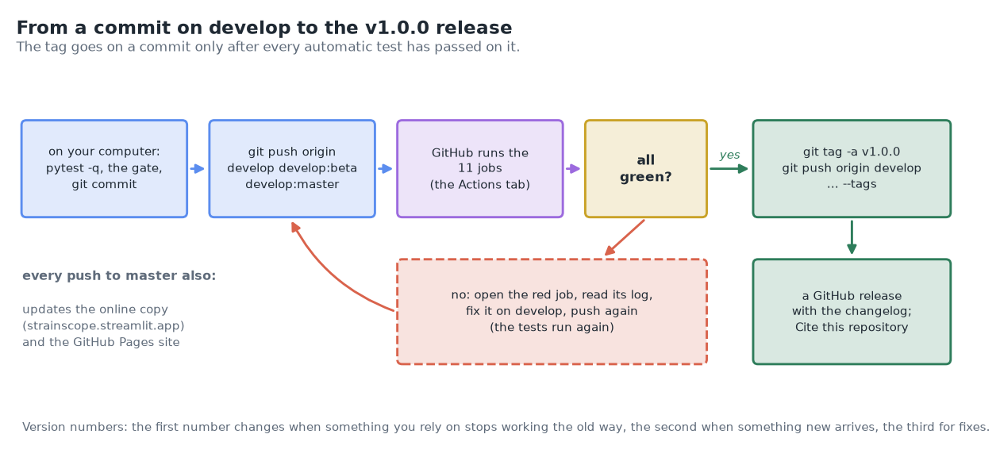
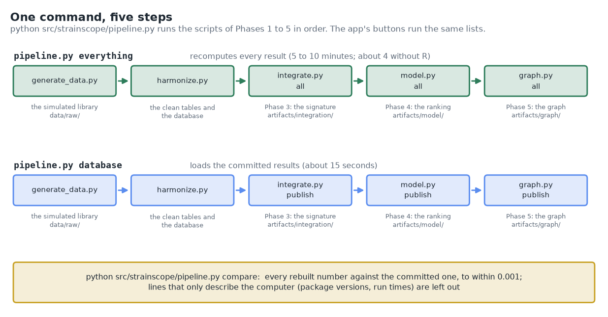
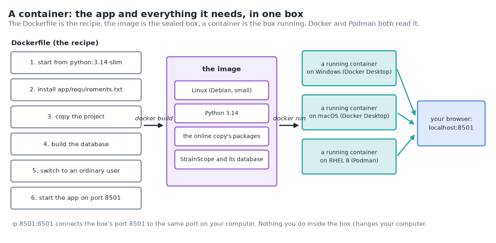
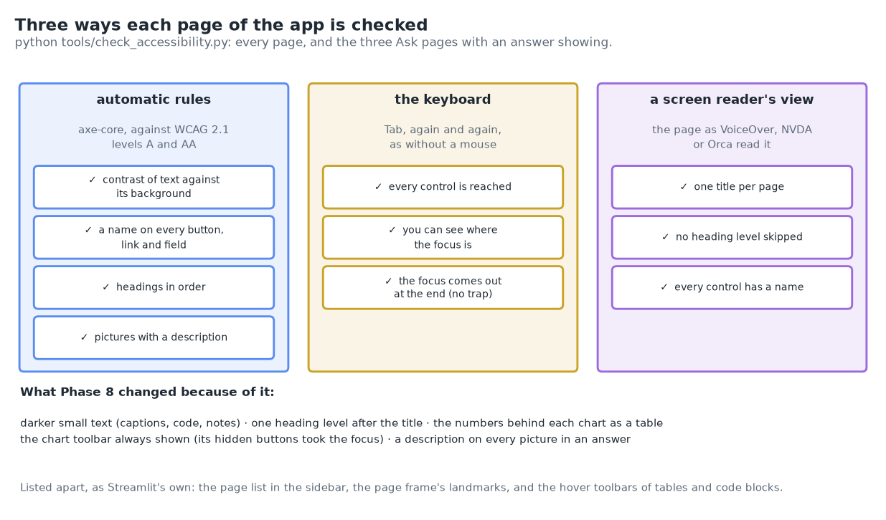
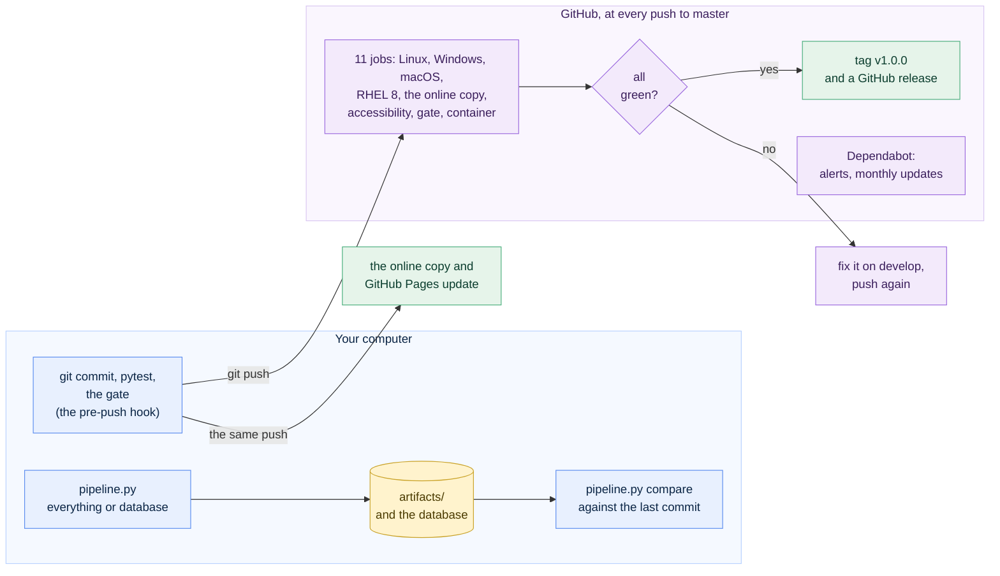
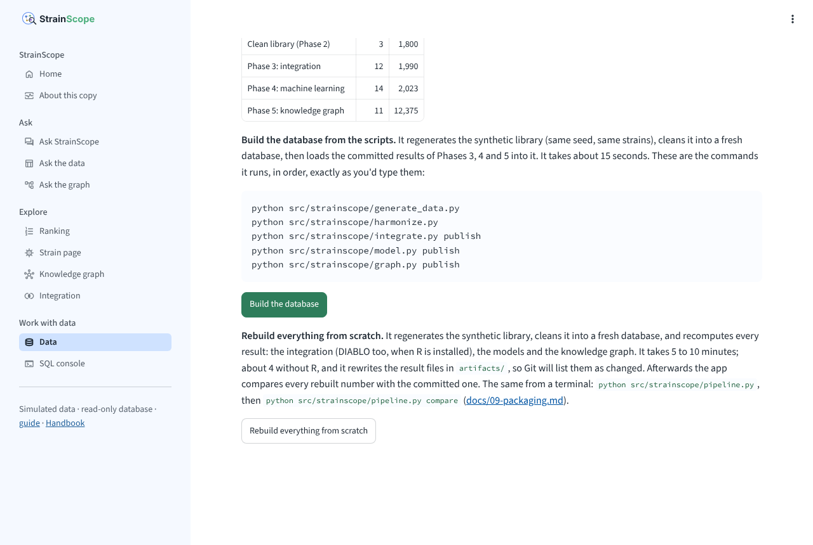
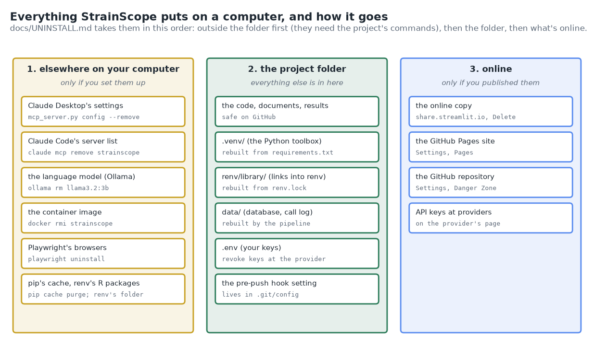

# 09 · Phase 8: packaging and release 1.0 (one command, tests on every system, ready to reuse)

[← Phase 7b: the MCP server](08b-mcp-server.md) · [Handbook](HANDBOOK.md) · [All docs in order](../README.md#the-tutorial-in-order) · [Glossary](GLOSSARY.md) · [Roadmap](ROADMAP.md)

**Prerequisites:** Phase 7b complete ([`docs/08b-mcp-server.md`](08b-mcp-server.md)): the database is built and `pytest -q` passes. A GitHub account with the repository on it (since [`docs/01-setup.md`](01-setup.md) Part H). Two steps are optional and need extra software, which the steps explain: the container (§11) needs Docker Desktop or Podman, and the keyboard and screen-reader check (§10) needs a browser for Python, Playwright.
**Learning goal:** after this phase you will understand what turns a working project into a product other people can rely on: one command that rebuilds every result, and a check that the rebuilt numbers match; automatic tests on Windows, macOS, Linux and RHEL 8 at every push (continuous integration); a container; a licence, a citation file, a contribution guide and a security policy; alerts for outdated or unsafe packages; an app that works with a keyboard and a screen reader; and a release with a version number. You'll release StrainScope **v1.0.0**.
**Why this phase exists in a real workflow:** as long as only its author can run a project, it's a prototype. Someone downloading StrainScope next year needs to know that it still builds, on their system, with the results the documents promise, that they may reuse it and how to cite it, and where to report a problem. This phase writes all of that down and has GitHub check it at every push.

**Session plan** (about 3 hours, in three sittings):
- **Session A (~1 h):** the ideas (§1 to 3), get the files and commit them on your computer (§4), the one command and the comparison (§5, §6), the same in the app (§7).
- **Session B (~1 h):** the files for reuse and contributions (§8), the pre-push hook (§9), the keyboard and screen-reader check (§10), the optional container (§11).
- **Session C (~1 h, part of it waiting for GitHub):** push and watch the tests (§12), switch on the alerts (§13), tag v1.0.0 and publish the release (§14), installing, updating and uninstalling (§15), then the figures, notes, tests and FAQ (§16 to 22), the ritual in one block (§23) and what's next (§24).

> **How this guide works:** every action step tells you what **You should see**, **What it means**, and, when things can wobble, **If instead**. All paths are relative to the project folder (the folder that contains `README.md`). Every command uses plain keyboard characters, so it is safe to copy ([why](01-setup.md#copy-commands-safely-plain-keyboard-characters-only)). Open a terminal in the project folder and switch on the toolbox first (`source .venv/bin/activate`; Windows PowerShell: `.\.venv\Scripts\Activate.ps1`).



---

## 1. The ideas behind this phase

### What "1.0" means here

A version number starting with 1 is a promise: this works, it's documented, and from now on a change that breaks what people rely on gets a new first number. [`docs/ROADMAP.md`](ROADMAP.md#what-finished-means-the-product-checklist) has kept a list of what "finished" means since Phase 3, one row per thing a user can do. Before this phase, four rows were open (rebuilding with one command, trust that every change was tested on three operating systems, reuse and citation, installing and uninstalling cleanly) and two were half done (the dependency alerts in the safety row, and using the app with a keyboard or a screen reader). This phase finishes all six.

### One command, and the same results on any computer

So far, rebuilding StrainScope meant five commands in the right order (the Handbook's [whole build](HANDBOOK.md#the-whole-build-command-by-command)). A **pipeline** is the name for steps that always run in the same order, each one reading what the one before it wrote. `src/strainscope/pipeline.py` runs them for you, in a fresh Python process each, stops at the first one that fails, and tells you how to carry on after fixing it.

It knows several **plans**, the same lists the app's buttons run (`database`, `probe` and `real` since Phase 6; `everything` is new):

| Plan | What it does | Time |
|---|---|---|
| `everything` (the default) | regenerates the library, cleans it, and recomputes every result: integration (DIABLO too, when R is installed), the models, the graph | 5 to 10 minutes; about 4 without R |
| `database` | regenerates and cleans, then loads the committed results into the database | about 15 seconds |
| `real` | fetches the five public databases, then rebuilds with their tables | a few minutes; needs the internet |
| `probe` | asks the public databases what a fetch would bring | under a minute |

A cake recipe that only works in its author's kitchen isn't much of a recipe. The test of a good one is that a stranger, in another kitchen, gets the same cake. That's what **reproducible** means here: the same inputs and the same code give the same results on any computer. `python src/strainscope/pipeline.py compare` checks it. It compares every number in the result files (`artifacts/`) with the version in Git's last commit, and calls two numbers the same when they're within 0.001 of each other, because a different processor or package version can move the fourth decimal (§18 has the real case). A few lines describe the computer rather than the result (package versions, how long DIABLO ran), and `compare` leaves those out and says so.



### Tests on every push: continuous integration

You've run `pytest -q` before every commit since Phase 1, on your own computer. **Continuous integration** (CI) runs the tests again on fresh computers every time a change reaches GitHub, so a problem that only shows up on Windows, or with a newer package, is found the day it appears.

The words you'll meet on GitHub's **Actions** tab:

- A **workflow** is a list of jobs written in a file in `.github/workflows/`. Ours is `.github/workflows/ci.yml`, named *tests*.
- A **job** is one computer doing one list of steps, from "get the code" to "run the tests". GitHub lends the computers (called **runners**) for free to public repositories, and wipes each one afterwards.
- A **matrix** runs one job several times with different settings: here every combination of three systems and two Python versions.
- A **green tick** next to a commit means every job passed; a **red cross** means at least one failed, and its log says which step and why.

Ours has eleven jobs. Six run the full check (install, build the database, run every test, rebuild everything, `compare`) on Linux, Windows and macOS with Python 3.12 (what RHEL 8 offers) and 3.14 (what my Mac and the online copy use). One does the same on RHEL 8 itself, inside Red Hat's free **UBI 8** image (Universal Base Image: RHEL 8's own system in a container), because GitHub has no RHEL machines. One installs exactly the online copy's package versions (`app/requirements.txt`). One runs the keyboard and screen-reader check, one the safety gate and a check for code mistakes, and one builds the container.


### A box that runs anywhere: containers

Shipping companies stopped loading loose sacks and barrels when the standard container arrived: whatever is inside, every crane, ship and lorry handles the box the same way. A software **container** does that for a program. It's a sealed box holding a small Linux system, the right Python, the exact packages and the program itself, and it runs the same on Windows, macOS and Linux.

Three words: the **Dockerfile** is the recipe (the file `Dockerfile` in the project folder), the **image** is the sealed box built from it (`docker build`), and a **container** is that box running (`docker run`). **Docker** and **Podman** are two programs that build and run them; RHEL 8 comes with Podman, and both read the same Dockerfile. StrainScope's container is the online copy in a box: the same Python and the same exact package versions, with the database built inside.



### Reuse, cite, contribute

Four small files tell other people what they may do and how:

- **`LICENSE`:** the **MIT licence**, the same as my other projects. In plain words: anyone may use, copy, change and share the code, also commercially, as long as the licence text travels with it, and there's no warranty. It covers the code and the documents. The few facts from public databases inside `artifacts/graph/` (BacDive strains, KEGG pathway links, RefMet classes) keep their sources' own terms, and every one of those rows names its source.
- **`CITATION.cff`:** how to cite StrainScope, in the Citation File Format. GitHub reads it and shows a **Cite this repository** button with the reference ready to copy.
- **`CONTRIBUTING.md`:** how a change travels from an idea to a release, and what it must pass. GitHub links it whenever someone opens an issue or a pull request.
- **`SECURITY.md`:** what to do on finding a way around one of the app's safety promises: report it privately first.

And in `.github/`: two **issue forms** (`.github/ISSUE_TEMPLATE/`), short forms GitHub shows when someone clicks *New issue* (*Something doesn't work*, *An idea or a wish*), and a checklist for pull requests (`.github/pull_request_template.md`).

### Alerts for outdated or unsafe packages

StrainScope stands on about seventy packages written by other people. Now and then one of them gets a fix for a security problem. **Dependabot** is GitHub's helper that watches for that. It does two separate jobs: **alerts**, a message when a package version you use has a known security problem (switched on in the repository's settings, §13), and **version updates**, pull requests once a month with newer versions of the online copy's packages (all in one) and of the actions CI uses (one each), configured by the file `.github/dependabot.yml`. CI then tests each suggestion on every system before you decide.

### Usable with a keyboard or a screen reader

Some people can't use a mouse, and some can't see the screen; a **screen reader** (VoiceOver on a Mac, NVDA or Narrator on Windows, Orca on Linux) reads a page aloud and moves through it with keys. The international guidelines for accessible web pages are called **WCAG** (Web Content Accessibility Guidelines); level **AA** is the usual target. A few of its rules matter most for an app like ours: small text needs a contrast of at least 4.5 to 1 against its background; every control must be reachable with the Tab key, and you must be able to see which one has the focus; headings must come in order; and pictures need a text description.

`tools/check_accessibility.py` checks all of that on every page of the app, three ways: **axe-core** (an open-source rule engine used by many accessibility checkers), a walk through the page with the Tab key, and a reading of the **accessibility tree**, the browser's list of headings, paragraphs, buttons and fields with their names, which is what a screen reader reads. It found real problems, and §10 shows what changed.



### A hook that runs the safety gate for you

The safety gate (`check-public-safe.sh`, since [`docs/01-setup.md` Part H](01-setup.md#the-pre-push-safety-gate-check-public-safesh)) only protects you when you remember to run it. A **Git hook** is a small script Git runs by itself at a certain moment. `.githooks/pre-push` runs the gate just before every `git push`, and stops the push when the gate says NOT SAFE. It's optional, and switched on once per copy of the project (§9).

### Version numbers and releases

StrainScope's versions follow **semantic versioning**, `MAJOR.MINOR.PATCH`: the first number changes when something you rely on stops working the old way, the second when something new arrives, the third for fixes. A **tag** (since v0.1.0) marks the exact commit of a version. A **GitHub release** is a page built on a tag: the version's notes, its date and a download of the code as it was. This phase adds one rule: **the tag goes on a commit only after every automatic test has passed on it.**

---

## 2. The data flow of this phase



Nothing new is computed in this phase. The pipeline runs the scripts of Phases 1 to 5; CI runs the tests you already have; the container and the release package what exists.

---

## 3. The decisions in English, before any code

1. **One list of steps for the terminal and the app.** The plans live in `PIPELINES` in `src/strainscope/service.py`, which the app's buttons have used since Phase 6. `src/strainscope/pipeline.py` reads the same list, so the two can't drift apart.
2. **`everything` is the default.** One command should rebuild every result; the quick `database` plan is one word away.
3. **Compare with a tolerance, and say what's left out.** Numbers within 0.001 count as the same; files that describe the computer (package versions, run times) or that hold data fetched on another computer are listed as not compared, with the reason. A check that hides what it skipped would be worse than none.
4. **Ties in the ranking go in strain-id order.** Strains with the same chance used to come out in whatever order the sorting happened to leave them, which differed between my Mac and Linux (§18). Now the ranking is the same everywhere.
5. **CI on master only, plus pull requests.** The three branches always point at the same commit after a push, so testing master tests all three, and testing each would triple the work for nothing.
6. **The newest packages in the main jobs, the online copy's exact versions in one.** A new user installs `requirements.txt` and gets today's versions, so that's what most jobs test; a package release that breaks something shows up the day it appears. The online copy's pinned versions get a job of their own, because that's what visitors use.
7. **RHEL 8 inside Red Hat's UBI 8 image.** GitHub has no RHEL machines; the UBI image is RHEL 8's own system, free to use, and the job runs inside it.
8. **The container is the online copy in a box.** Python 3.14 and `app/requirements.txt`, the database built while the image is made, run as an ordinary user rather than the administrator, and nothing else. The full base name (`docker.io/library/python:3.14-slim`) spares Podman a question about where to get it.
9. **The tag comes after the tests.** Push, wait for every job to pass, then tag. A tag on a commit that fails on Windows would promise something that isn't true.
10. **Dependabot suggests into develop, monthly, the online copy's packages in one pull request, and never moves scikit-learn on its own.** Its pull requests then follow the usual path (develop, then the three-branch push). scikit-learn stays at the version the saved model was built with until the model is rebuilt (§13).
11. **Keyboard and screen-reader problems are fixed in the app where they're ours, and listed where they're Streamlit's.** The check fails only on the app's own parts, so it can run at every push without failing on things this project can't change.
12. **The hook is optional.** It changes how your Git behaves, so it's your choice, and one command switches it off again.
13. **A helper for Claude Desktop's settings.** On a Mac, Claude Desktop's *Edit Config* button shows the settings file in Finder instead of opening it, which made Phase 7b's step 3 harder than it needed to be. `python src/strainscope/mcp_server.py config --write` now adds the entry itself, with a backup, and `--remove` takes it out again ([Phase 7b §9](08b-mcp-server.md#a-claude-desktop-macos-and-windows)).

### What we leave out on purpose, and why

- **A Python package on PyPI** (`pip install strainscope`). StrainScope is a project you build and learn from, with data and documents, more than a library other code imports. The trigger for a package is in the [roadmap](ROADMAP.md#deferred-items-and-their-triggers).
- **A lock file of every package version for development.** Deferred since Phase 7, until an upgrade breaks a test; CI with the newest packages now notices that the day it happens.
- **R and DIABLO in CI.** Installing R and mixOmics on three systems at every push would take longer than everything else together. The committed DIABLO results are checked by the tests and `compare`, and DIABLO itself is rebuilt by hand, as in Phase 3.
- **Publishing the container image to a registry.** Building it takes a few minutes and is tested at every push; a registry would add an account and something else to keep up to date.
- **A permanent identifier (DOI) for each release**, through a service such as Zenodo. Useful once someone cites a fixed version in a paper; a deferred item in the roadmap.

---

## 4. Get the Phase 8 files into your repo

All paths are relative to the project folder.

| Path | New / changed | Its job |
|---|---|---|
| `src/strainscope/pipeline.py` | new | the one-command pipeline: the plans, `--list`, `--from`, `--quiet`, the summary, and `compare` |
| `src/strainscope/service.py` | changed | the `everything` plan; `pipeline_events()`, which reports each step as it runs |
| `src/strainscope/model.py` | changed | ties in the ranking in strain-id order |
| `artifacts/model/predictions.csv`, `artifacts/graph/nodes.csv`, `artifacts/graph/explanations.csv` | changed | the ranking with that order: 67 strains from rank 98 down moved by one place or more; nothing above rank 98 changed |
| `src/strainscope/mcp_server.py` | changed | `config --write` and `config --remove` for Claude Desktop's settings file |
| `src/strainscope/ask.py` | changed | also reads `CONTRIBUTING.md` and `SECURITY.md`; a picture in an answer keeps its description |
| `app/views/data.py`, `app/ui.py`, `app/streamlit_app.py` | changed | the *Rebuild everything from scratch* button and the comparison after it; readable colours, chart toolbars and picture descriptions (§10) |
| `app/views/*.py`, `app/charts.py`, `.streamlit/config.toml` | changed | the accessibility fixes: one heading level after each page's title, the numbers behind each chart, darker small text, room above each chart for its toolbar |
| `.github/workflows/ci.yml` | new | the automatic tests: eleven jobs at every push to master |
| `.github/dependabot.yml` | new | monthly update suggestions for the online copy's packages and for the actions |
| `.github/ISSUE_TEMPLATE/bug_report.yml`, `.github/ISSUE_TEMPLATE/idea.yml`, `.github/ISSUE_TEMPLATE/config.yml`, `.github/pull_request_template.md` | new | the forms behind *New issue*, and the pull-request checklist |
| `LICENSE`, `CITATION.cff`, `CONTRIBUTING.md`, `SECURITY.md` | new | reuse, citation, contributions, private security reports |
| `Dockerfile`, `.dockerignore` | new | the container recipe, and what stays out of the image |
| `.githooks/pre-push` | new | the optional hook that runs the safety gate before every push |
| `tools/check_accessibility.py` | new | the keyboard and screen-reader check |
| `tests/test_pipeline.py` | new | 17 tests of the pipeline, `compare` and the button (§19) |
| `tests/test_mcp.py`, `tests/test_deploy.py`, `tests/test_safety_gate.py`, `tests/test_ask.py`, `tests/golden_questions.csv` | changed | `config --write`; the release files agree with each other; the hook; links in the new files; golden questions about this phase |
| `figures/make_phase8_figures.py` and its six pictures, `docs/interactive/release_explorer.html` | new | the figures (§16) |
| `figures/take_app_screenshots.py`, `docs/img/app_*.png`, `docs/img/app_tour.gif`, `docs/img/app_rebuild.png` | changed / new | the screenshots, retaken with the new colours and toolbars, and the rebuild button |
| `figures/top_n_ranking.png` | changed | redrawn: the ranking's new order of ties moves the curve at two ranks |
| `docs/09-packaging.md`, `docs/UNINSTALL.md` | new | this guide, and how to remove StrainScope |
| `README.md`, `CHANGELOG.md`, `docs/HANDBOOK.md`, `docs/ROADMAP.md`, `docs/PRODUCT_ROADMAP.md`, `docs/GLOSSARY.md`, `docs/00-architecture.md`, `docs/01-setup.md`, `docs/07-app.md`, `docs/08b-mcp-server.md`, `docs/index.html`, the journey (`figures/make_illustrations.py`, `docs/img/journey_map.svg`, `docs/interactive/journey.html`) | changed | Phase 8 everywhere it belongs, and v1.0.0 |

**Files-landed check:**

```bash
ls src/strainscope/pipeline.py .github/workflows/ci.yml Dockerfile LICENSE CITATION.cff tools/check_accessibility.py
```

In Windows PowerShell, separate the names with commas: `ls src/strainscope/pipeline.py, .github/workflows/ci.yml, Dockerfile, LICENSE, CITATION.cff, tools/check_accessibility.py`. **You should see** the six names and no `No such file` (PowerShell: `Cannot find path`) message.

**On macOS and Linux, mark the hook runnable** (Git runs a hook only when it is; Windows doesn't need this):

```bash
chmod +x .githooks/pre-push
```

**Read before running.** Open `src/strainscope/pipeline.py` and read its top docstring (the plans, the commands, the exit codes). Then `.github/workflows/ci.yml`: its first lines say what each job does in words, before the jobs themselves.

**Commit the files now, on your computer only.** `compare` (§6) checks rebuilt results against Git's last commit, so that commit has to hold this phase's result files first (with the new order of tied strains, decision 4). Load them into the database with the quick plan, run the tests, and commit. Nothing leaves your computer until §12:

```bash
python src/strainscope/pipeline.py database --quiet
pytest -q                     # 443 passed, 1 skipped
git switch develop
git add -A
git commit -m "feat: release 1.0: one-command pipeline, tests on every system, container, licence and citation"
```

**You should see** the pipeline's summary and health check, the test count, and Git's line `[develop` followed by a short commit id and the message, then how many files changed. `git status --short` now prints nothing.

---

## 5. Step 1: rebuild everything with one command

First, see what each plan would run, without running anything:

```bash
python src/strainscope/pipeline.py --list
```

**You should see:**

```
  ── StrainScope pipeline: the plans ─────────────────────────────

  everything (the default): Rebuild everything from scratch, 5 to 10 minutes; about 4 without R
      1. python src/strainscope/generate_data.py
      2. python src/strainscope/harmonize.py
      3. python src/strainscope/integrate.py all
      4. python src/strainscope/model.py all
      5. python src/strainscope/graph.py all

  database: Build the database from the scripts, about 15 seconds
      1. python src/strainscope/generate_data.py
      2. python src/strainscope/harmonize.py
      3. python src/strainscope/integrate.py publish
      4. python src/strainscope/model.py publish
      5. python src/strainscope/graph.py publish

  probe: Ask the public databases what a fetch would bring, under a minute, needs the internet
      1. python src/strainscope/fetch_real.py --probe

  real: Fetch real data and rebuild, a few minutes, needs the internet
      1. python src/strainscope/fetch_real.py
      2. python src/strainscope/harmonize.py
      3. python src/strainscope/integrate.py publish
      4. python src/strainscope/model.py publish
      5. python src/strainscope/graph.py all

  compare: the results in artifacts/ against the committed ones (builds nothing)

  Run one with: python src/strainscope/pipeline.py <plan>
```

Now the real thing. The scripts print a lot; `--quiet` keeps only the steps and the summary, which is easier to follow the first time:

```bash
python src/strainscope/pipeline.py --quiet
```

**You should see**, after a few minutes (on a Linux computer without R, as here; with R, step 3 also runs DIABLO and takes a few minutes longer, and your times will differ):

```
  ── StrainScope pipeline: everything (5 steps, 5 to 10 minutes; about 4 without R) ──
  It regenerates the synthetic library, cleans it into a fresh database, and recomputes every result: the integration (DIABLO too, when R is installed), the models and the knowledge graph.

  [1/5] python src/strainscope/generate_data.py
  ✓ step 1 done in 1 s

  [2/5] python src/strainscope/harmonize.py
  ✓ step 2 done in 1 s

  [3/5] python src/strainscope/integrate.py all
  ✓ step 3 done in 4 s

  [4/5] python src/strainscope/model.py all
  ✓ step 4 done in 3 min 4 s

  [5/5] python src/strainscope/graph.py all
  ✓ step 5 done in 3 s

  ── Summary ─────────────────────────────────────────────────────
  ✓ 1. python src/strainscope/generate_data.py                       1 s
  ✓ 2. python src/strainscope/harmonize.py                           1 s
  ✓ 3. python src/strainscope/integrate.py all                       4 s
  ✓ 4. python src/strainscope/model.py all                     3 min 4 s
  ✓ 5. python src/strainscope/graph.py all                           3 s
  All 5 steps finished in 3 min 13 s.

  ── StrainScope: what the app can read ──────────────────────────
  ✓ Database                 40 tables, 600 strains
  ✓ Phase 3 results          12 files in artifacts/integration/, 12 int_* tables
  ✓ Phase 4 results          14 files in artifacts/model/, 14 ml_* tables
  ✓ Phase 5 results          11 files in artifacts/graph/, 11 kg_* tables
  ✓ Saved model              Elastic net logistic regression, built with scikit-learn 1.9.0
  · Real tables (optional)   none fetched (the app works without them)
      to add: Data page, Real data tab, or python src/strainscope/fetch_real.py
  · AI features (optional)   off: the assistants answer by search and rules alone, and nothing is sent anywhere
      to add: STRAINSCOPE_ASK_BACKEND in .env (docs/LANGUAGE_MODEL.md)

  Compare the rebuilt results with the committed ones: python src/strainscope/pipeline.py compare
```

**What it means:** five scripts ran in order, each in its own process, and the health check at the end says the app has everything it needs. Without `--quiet` you'd see each script's own report between the steps, exactly as in its phase guide.

Now look at what changed:

```bash
git status --short
```

**You should see** a few result files marked `M` (modified). On a computer without the real data of Phases 1b and 1c, these eight:

```
 M artifacts/graph/edges.csv
 M artifacts/graph/graph_summary.csv
 M artifacts/graph/hubs.csv
 M artifacts/graph/knowledge_layer.graphml
 M artifacts/graph/nodes.csv
 M artifacts/model/model_card.json
 M artifacts/model/model_summary.csv
 M artifacts/model/strainscope_model.joblib
```

**What it means:** the committed graph includes real reference data (100 BacDive strains, KEGG pathways, RefMet classes) fetched on my computer; without those tables, the rebuilt graph is smaller. The model card records the package versions of whoever built it, and the saved model's bytes change with them. All the numbers, as the next step shows, are the same. Leave the rebuilt files where they are for now; §7 ends by putting the committed ones back.

**If instead:**
- a step stops with an error: the summary names the step and says how to carry on, for example `python src/strainscope/pipeline.py everything --from 4`. The step's own guide has a *What could go wrong* section.
- you pressed Ctrl+C: the running step is stopped, and the message says which step to start from next time.
- `Could not set lock on file ... strainscope.duckdb`: the app (or another terminal) is using the database. Stop it, then run the command again.

---

## 6. Step 2: compare the rebuilt results with the committed ones

```bash
python src/strainscope/pipeline.py compare
```

**You should see:**

```
  ── StrainScope: the results in artifacts/ against the committed ones ──
  Committed means Git's last commit. Numbers count as the same within 0.001.
  ✓ artifacts/graph/: 7 file(s) match
  ✓ artifacts/integration/: 12 file(s) match
  ✓ artifacts/model/: 15 file(s) match
  · not compared: artifacts/graph/edges.csv, artifacts/graph/graph_summary.csv, artifacts/graph/hubs.csv, artifacts/graph/nodes.csv
      (they also hold the real reference data, and this database has no real tables; python src/strainscope/pipeline.py real fetches them)
  · not compared: artifacts/graph/knowledge_layer.graphml
      (the same nodes and edges as nodes.csv and edges.csv, in another format)
  · not compared: artifacts/model/strainscope_model.joblib
      (the saved model, whose bytes depend on the package versions; its results are in the tables)
  · lines about the computer, left out: model_summary.csv (model_file_kb, scikit_learn_version), diablo_summary.csv (mixomics_version, r_version, runtime_seconds); and the package versions in model_card.json

  All 34 compared files match the committed results.
```

**What it means:** every number of Phases 3, 4 and 5 that you just rebuilt from the seed matches the committed one, on your computer. That is the promise of the first row of the [product checklist](ROADMAP.md#what-finished-means-the-product-checklist), checked. The *not compared* lines say where the check stops: the four graph tables can only match when your database has the same real tables as mine (`python src/strainscope/pipeline.py real` fetches them, but the public databases change over time, so a later fetch may differ a little), the GraphML file repeats `nodes.csv` and `edges.csv`, and the model file's bytes depend on package versions. One more limit, which no line names: without R, step 3 doesn't rerun DIABLO, so the DIABLO files match because nothing rewrote them. CI has no R either (§3, *What we leave out*), which is why DIABLO is rebuilt by hand on a computer with R.

**If instead** a file is marked `✗`, the lines under it name the row, the column and both numbers. A difference in the fourth decimal is already forgiven; a bigger one means the computation itself changed (a new package version that behaves differently, or a change you made). CI runs the same comparison on every system at every push, so it shows whether the difference is yours or everyone's.

---

## 7. Step 3: the same from the app

Start the app (`python -m streamlit run app/streamlit_app.py`) and open the **Data** page. Under *Build the database* there's a second button, **Rebuild everything from scratch**: it runs the same `everything` plan, shows each step's output as it goes, and then compares the results the same way as `compare`. Press it if you'd like to watch it work (another few minutes).



On the shared online copy the button is greyed out: a visitor shouldn't be able to spend minutes of the host's time recomputing what's committed.

**Now put the committed files back**, so the rebuilt ones don't end up in a commit (on a computer without the real tables, they hold a smaller graph). Stop the app first (Ctrl+C in its terminal), because the database plan needs the database to itself:

```bash
git restore artifacts/
python src/strainscope/pipeline.py database --quiet
git status --short
```

**You should see** the database plan's summary, and then nothing from `git status --short`: the folder is exactly the commit of §4 again.

---

## 8. Step 4: the files for reuse, citation and contributions

Open each new file once; they're short. What GitHub does with each, once they're pushed:

| File | Where it shows on GitHub |
|---|---|
| `LICENSE` | *MIT license* in the repository's sidebar, and a *License* tab next to the README |
| `CITATION.cff` | **Cite this repository** in the sidebar, with the reference in APA and BibTeX ready to copy |
| `CONTRIBUTING.md` | a link whenever someone opens an issue or a pull request |
| `SECURITY.md` | a *Security policy* entry in the repository's *Security* tab |
| `.github/ISSUE_TEMPLATE/*.yml` | the choice offered by **New issue**: *Something doesn't work*, *An idea or a wish*, a blank issue, and links to the Handbook and the online app |
| `.github/pull_request_template.md` | the checklist filled into every new pull request |

Blank issues stay switched on, because the app's *Not what you needed? Suggest a fix* link opens one with the question already filled in ([Phase 7](08-deployment-ai.md#3-the-decisions-in-english-before-any-code), decision 12).

`CITATION.cff` carries the version and the release date, and so does `CHANGELOG.md`. A test (`tests/test_deploy.py`) checks that the two agree, so a release can't update one and forget the other.

---

## 9. Step 5 (optional): let Git run the safety gate before every push

Switch the hook on for your copy of the project, once:

```bash
git config core.hooksPath .githooks
```

This tells Git to look for hooks in the project's `.githooks/` folder instead of its hidden default. From now on, every `git push` starts with the safety gate. **You should see**, at your next push, the hook's first line, then the gate's whole report as in [`docs/01-setup.md` Part H](01-setup.md#the-pre-push-safety-gate-check-public-safesh), then the push itself:

```
pre-push hook: running the safety gate (check-public-safe.sh) first...
Checking whether this checkout is safe to publish...
```

and at the end of the report, either `✓ SAFE TO PUSH to the public repository` followed by Git's usual push lines, or, when the gate finds something:

```
✗ NOT SAFE TO PUSH: fix the items marked ✗ above
error: failed to push some refs to 'https://github.com/akannan2987/strainscope.git'
```

**What it means:** nothing left your computer. Fix what the gate marked, and push again. (`git push --no-verify` skips the hook for one push; there's hardly ever a good reason to.)

To switch the hook off again: `git config --unset core.hooksPath`. The hook needs `bash`, which macOS and Linux have and Git for Windows brings with it.

---

## 10. Step 6: the keyboard and screen-reader check

The check drives a real browser, so it needs two packages and a copy of Chromium, which nothing else in StrainScope uses (about 150 MB, once per computer):

```bash
python -m pip install playwright axe-playwright-python
python -m playwright install chromium
python tools/check_accessibility.py
```

On RHEL 8, Chromium may also need a few system libraries that Playwright can't install there (its error message lists the missing ones). If that gets in the way, rely on the same check, which runs on Ubuntu at every push (§12).

It starts the app by itself on port 8599 and stops it at the end; a run takes a minute or two. **You should see** (with Streamlit 1.65, the online copy's version):

```
  ── StrainScope: keyboard and screen-reader check (14 page views) ──
  axe-core 4.12.1 in Chromium; rules: WCAG 2.1 A and AA, and axe's best practices

  page                          axe  Tab stops   reached  focus seen headings       unnamed
  ✓ Home                          0         32     15/15         all h1 h2                0
  ✓ About this copy               0         22       4/4         all h1 h2                0
  ✓ Ask StrainScope               0         28     12/12         all h1                   0
  ✓ Ask the data                  0         55     11/11         all h1                   0
  ✓ Ask the graph                 0         26     10/10         all h1                   0
  ✓ Ranking                       0         60     28/28         all h1 h2                0
  ✓ Strain page                   0         95     28/28         all h1 h2                0
  ✓ Knowledge graph               0         30     14/14         all h1                   0
  ✓ Integration                   0         60     29/29         all h1 h2                0
  ✓ Data                          0         59       7/7         all h1 h2                0
  ✓ SQL console                   0         25       9/9         all h1                   0
  ✓ Ask StrainScope, answered     0         27     11/11         all h1                   0
  ✓ Ask the data, answered        0         66     12/12         all h1                   0
  ✓ Ask the graph, answered       0         29     13/13         all h1                   0

  Streamlit's own parts of the page (not something this project can change):
    · aria-allowed-attr  on 14 of 14 page views: the sidebar element carries an attribute its role doesn't allow
    · list               on 14 of 14 page views: the page list in the sidebar puts group titles inside a list
    · listitem           on 14 of 14 page views: the same page list: its items sit in a list that also holds titles
    · region             on 14 of 14 page views: content outside landmarks: Streamlit's main area isn't marked as the page's main part
    · hover toolbars     on 4 of 14 page views: the toolbar of a table or code block appears only when the mouse is near, yet its buttons take the Tab focus

  Charts are pictures to a screen reader. Each chart's numbers are also on its page, as text or in a table
  underneath; the picture of the whole knowledge graph is explored in words on its other tabs.
  Details, including each page's accessibility tree: data/processed/accessibility_report.json

  The app's own parts pass on every page.
```

**What it means:** on every page, axe-core found nothing of the app's own, every control was reached with the Tab key and showed where the focus was, each page has one title and headings in order, and every control has a name. *Tab stops* counts every stop, the sidebar's included; *reached* counts the controls in the page itself. The Streamlit lines are the same on every page and come from the frame Streamlit draws around every app: its page list in the sidebar, the page's landmarks (the regions a screen reader can jump between), and the toolbars of tables and code blocks, which appear only when the mouse is near.

The first run of the check, before this phase's fixes, failed on most pages. What changed because of it:

- **Small text was too faint.** Streamlit draws captions see-through, and the links and `code` in them too; their contrast was 4.0, below the 4.5 that small text needs. SQL keywords in code blocks were drawn in a blue with a contrast of 3.7. The theme in `.streamlit/config.toml` now sets darker shades where Streamlit allows it, and `app/ui.py` sets the rest (captions solid, code colours of their own), each colour at 5 to 1 or more.
- **Headings skipped a level.** Each page went from its title straight to third-level headings. They're second-level now, with the theme's heading sizes set so they look as before.
- **Charts are pictures.** A screen reader can't read a chart, so every chart whose numbers weren't already on its page has them in a table underneath (*The numbers behind this chart*, folded away).
- **Hidden buttons took the focus.** A chart's toolbar (download, zoom, full screen) appeared only when the mouse came near, yet its eight buttons were Tab stops, so a keyboard user landed on buttons they couldn't see. The toolbar is now always shown, with room above each chart so it covers nothing.
- **A picture without a description.** Ask StrainScope shows the pictures a passage refers to, and they had no text alternative (`st.image` writes none). They now carry the description the guide gives them.

**If instead** a few pages fail with problems in dropdowns and tabs (`focus not visible` on items such as *Selected Bacteria, Fungi, ...* or a tab's name, `not reached with Tab: Clear all`, or `axe color-contrast` on the Knowledge graph page), check your Streamlit version with `python -m pip show streamlit`. Streamlit draws those widgets, and version 1.57 draws them differently: with it, 5 of the 14 page views fail; with 1.65, none do. `python -m pip install --upgrade streamlit` updates just Streamlit. The automatic tests run this check with the online copy's versions at every push.

**Try a screen reader yourself** (10 minutes). An automatic check finds many problems but not all of them. On a Mac, press **Command+F5** to switch VoiceOver on (and again to switch it off; on a laptop keyboard you may need **Fn+Command+F5**); on Windows, **Ctrl+Windows+Enter** starts Narrator, or install the free NVDA from [nvaccess.org](https://www.nvaccess.org); on Linux, Orca is usually started with **Super+Alt+S**. Open the app, press Tab a few times and listen: each page's title, the page list, then the page's own controls, each with its name. On the Ranking page, open *The numbers behind this chart* under the scoreboard and listen to the table being read.

---

## 11. Step 7 (optional): run the app in a container

You need Docker or Podman:

- **Windows or macOS:** Docker Desktop, from [docker.com](https://www.docker.com/products/docker-desktop/) (free for personal use, education and small businesses; check its terms for a larger company). Start it once after installing; it runs in the background. On Windows it uses WSL 2 (a small Linux built into Windows); the installer switches it on if needed and may ask you to restart the computer.
- **RHEL 8:** Podman is part of RHEL 8; install it once with `sudo dnf install -y podman`. Wherever this section says `docker`, type `podman`.

From the project folder, build the image (the first time takes a few minutes: it downloads Python and installs the packages; later builds reuse what hasn't changed):

```bash
docker build -t strainscope .
```

**You should see** Docker work through the Dockerfile's steps (`FROM`, `COPY`, `RUN`, ...), with the pipeline's `database` plan among them, and finish without an error. `-t strainscope` gives the image a name; the `.` at the end means "the recipe and the files are in this folder".

Then start it:

```bash
docker run --rm -it -p 8501:8501 strainscope
```

**You should see** Streamlit's start-up lines, ending with these (the addresses after the first differ from computer to computer):

```
  You can now view your Streamlit app in your browser.

  Local URL: http://localhost:8501
  Network URL: http://172.17.0.2:8501
  External URL: http://<your public address>:8501
```

The second address is the box's own, inside Docker; the third, your internet connection's public address, appears when the box can reach the internet. You need neither: open **http://localhost:8501** in your browser: it's the app, with the database built. `-p 8501:8501` connects the box's port 8501 to the same port on your computer; `--rm` deletes the stopped container afterwards (the image stays); `-it` connects your terminal to it, so Ctrl+C stops it.

To check it's alive from a second terminal: `curl http://localhost:8501/_stcore/health` (Windows PowerShell: `curl.exe http://localhost:8501/_stcore/health`) answers `ok`. To run the box as a shared copy, the way the online one runs: `docker run --rm -it -p 8501:8501 -e STRAINSCOPE_MODE=public strainscope`.

**What it means:** this is the online copy's setup on your own computer, with nothing installed but Docker (and the project folder; without Git, GitHub's green **Code** button, then **Download ZIP**, gives you one to build from). Anything you do inside (a database rebuild, a real-data fetch) stays inside the box and disappears with it. The CI job *container* builds the same image and asks it for its health at every push.

**If instead:**
- `Cannot connect to the Docker daemon` (or `docker: command not found`): Docker Desktop isn't running, or isn't installed. Start it and try again.
- `port is already allocated`: something else uses port 8501, probably the app itself. Stop it, or use `-p 8502:8501` and open `localhost:8502`.
- Podman on RHEL 8 asks which registry to use: the Dockerfile names the full address (`docker.io/library/python:3.14-slim`), so it shouldn't; if your Podman is configured to refuse docker.io, ask whoever manages the machine.

---

## 12. Step 8: push, and watch the automatic tests

The commit is already made (§4). The checks come first, as always:

```bash
git status --short            # prints nothing
pytest -q                     # 443 passed, 1 skipped
./check-public-safe.sh        # must end with: SAFE TO PUSH  (Windows: bash check-public-safe.sh in Git Bash)
```

If `git status --short` lists files under `artifacts/`, they come from a rebuild: `git restore artifacts/`, then `python src/strainscope/pipeline.py database --quiet`. If it lists files you changed on purpose since §4 (a fix of your own), commit them: `git add -A`, then `git commit -m "fix: ..."` with a few words on what you fixed.

Then push, **without a tag yet**:

```bash
git push origin develop develop:beta develop:master
```

Now open the repository on GitHub and click the **Actions** tab. **You should see** a run of the workflow *tests* for your commit, with a yellow dot while it runs. Click it: the eleven jobs are listed on the left, each with its own dot (*Linux, Python 3.12*, ..., *RHEL 8 (UBI 8), Python 3.12*, *online copy (app/requirements.txt), Python 3.14*, *keyboard and screen-reader check*, *safety gate and pyflakes*, *container (Dockerfile)*). They run side by side; the first run takes longest, because every computer downloads its packages. When every dot is a **green tick**, the repository's front page shows a green tick next to your commit too.

**If instead** the Actions tab shows *Workflows aren't being run on this forked repository* (your repository started as a fork of someone else's), click **I understand my workflows, go ahead and enable them**, then push again or use **Run workflow**.

**If a job is red,** click it: the log opens at the failing step, and the last lines usually name the problem. Fix it on develop, run the checks again, commit (`fix: ...`) and push the same way; the tests run again on the new commit. Only tag when everything is green.

---

## 13. Step 9: switch on the alerts and private reports

Two switches in the repository's settings, once. On the repository's page: **Settings**, then **Advanced Security** in the sidebar (in its *Security and quality* part). There:

1. **Dependabot alerts:** click **Enable**. From now on GitHub tells you on the *Security* tab (and by email, depending on your notification settings) when a package version the repository uses has a known security problem.
2. **Private vulnerability reporting:** click **Enable**. People can then report a security problem privately, as `SECURITY.md` asks, with the **Report a vulnerability** button on the *Security* tab's *Advisories* page.

The same page offers a third switch, **Dependabot security updates**. Leave it off: those pull requests always go to master and would skip develop (§18).

The monthly update suggestions need no switch: `.github/dependabot.yml` asks for them, and they arrive as pull requests into develop, each tested by CI. To take one: merge it on GitHub if its tests are green, then bring develop up to date on your computer (`git switch develop`, then `git pull --ff-only origin develop`) and push the usual way, so beta and master follow. scikit-learn is left out on purpose: the saved model was built with an exact version (`artifacts/model/model_card.json`), and it moves only together with a rebuild of the model (`python src/strainscope/model.py all`, then the new version in `app/requirements.txt`; `tests/test_deploy.py` checks that the two agree).

---

## 14. Step 10: tag v1.0.0 and publish the release

With every job green, tag the commit and push the tag:

```bash
git tag -a v1.0.0 -m "v1.0.0: the first complete release"
git push origin develop develop:beta develop:master --tags

git switch master
git pull --ff-only origin master
git switch develop
```

`git tag -n1` now lists all five tags, v0.1.0 to v1.0.0, each with its message.

Then turn the tag into a GitHub release. On the repository's page:

1. Click **Releases** (to the right of the file list), then **Draft a new release**.
2. In **Choose a tag**, pick `v1.0.0`.
3. **Release title:** `v1.0.0: the first complete release`.
4. **Describe this release:** paste the `## [1.0.0]` section of `CHANGELOG.md` (everything under its heading, down to the next `## [`).
5. Leave **Set as latest release** ticked, and click **Publish release**.

**You should see** the release page with your notes and two downloads of the code as it was at v1.0.0 (*Source code (zip)* and *(tar.gz)*), and the repository's sidebar shows *Releases* with v1.0.0 marked *Latest*. The sidebar also shows **Cite this repository**; click it to see the reference GitHub built from `CITATION.cff`. The online copy already changed with the push of §12: its *About this copy* page says *StrainScope v1.0.0*, without "the changes listed under [Unreleased]".

---

## 15. Install, update, uninstall

**Install** (once per computer): the Handbook's [*Only want to use the app?*](HANDBOOK.md#only-want-to-use-the-app) for the app alone, or [`docs/01-setup.md`](01-setup.md) for everything. Or the container (§11), with Docker and the project folder.

**Update** to a newer version, from the project folder with the toolbox switched on. If `git status --short` lists rebuilt result files, put them back first (`git restore artifacts/`), or `git pull` refuses to overwrite them:

```bash
git pull
python -m pip install -r requirements.txt
python src/strainscope/pipeline.py database
pytest -q
```

That brings the new code, any new packages, and a database built from the new results. If `renv.lock` changed (the CHANGELOG says so), also run `Rscript -e "renv::restore()"`; if you use the container, build the image again (`docker build -t strainscope .`). Each release's notes are in `CHANGELOG.md`.

**Uninstall:** [`docs/UNINSTALL.md`](UNINSTALL.md) goes through every place StrainScope can leave something, in the right order: the connections of assistant apps (`python src/strainscope/mcp_server.py config --remove` for Claude Desktop), a language model, the container image, the project folder, and what you published online.



---

## 16. See the results (figures)

```bash
python figures/make_phase8_figures.py
python figures/make_phase6b_figures.py
python figures/make_illustrations.py
```

**You should see**, from the first:

```
Phase 8 figures:
  drew figures/one_command.png
  drew figures/ci_matrix.png
  drew figures/release_path.png
  drew figures/container_box.png
  drew figures/accessibility_check.png
  drew figures/footprint.png
  drew docs/interactive/release_explorer.html (interactive, 4 plans, 6 CI jobs (GitHub runs them as 11), 17 checklist rows)
```

The second redraws Phase 6b's pictures, whose numbers grow with the documentation, and the third redraws the journey map with every stage done. The six pictures are in this guide and in [`docs/UNINSTALL.md`](UNINSTALL.md); each one is drawn from the project's own files (the plans in `src/strainscope/service.py`, the jobs in `.github/workflows/ci.yml`, the `Dockerfile`), so it stays true when they change.

**The interactive explorer.** Open `docs/interactive/release_explorer.html` in a browser: the pipeline's plans with their steps, every CI job with its steps, and the product checklist of `docs/ROADMAP.md`. With GitHub Pages switched on ([Phase 7 §11](08-deployment-ai.md#11-step-7-optional-the-interactive-figures-on-github-pages)), it's linked from the front page.

---

## 17. Reading the results like a careful user

- **A green tick means the tests passed, not that the science is right.** The tests check that the code does what the documents say. The data is simulated, and no test makes the results say anything about real microbes.
- **"The same results" has a tolerance.** `compare` forgives differences below 0.001. A table that matters to you at more decimals than that deserves its own check.
- **What wasn't compared is listed.** Read the *not compared* lines, not only the last one.
- **An automatic accessibility check finds a part of the problems.** It can't tell whether a description is helpful, or whether a page makes sense when heard. Ten minutes with a real screen reader (§10) is worth more than a perfect score.
- **The container runs the online copy's versions.** If something behaves differently there than at home, compare the package versions on *About this copy* in both.

---

## 18. Notes from the build (kept on purpose)

- **Two computers, two orders of ties.** The first full rebuild on a Linux computer gave every strain exactly the committed chance (to four decimals) but put 54 strains in a different order than the ranking committed from my Mac. All of them shared their chance with another strain, and the sorting step left such ties in whatever order it happened to produce. None was in the top 50, so no headline number moved. Ties are now put in strain-id order (`src/strainscope/model.py`, `final`); 67 ranks from rank 98 down changed once, in the committed files, and the ranking is now the same on every computer.
- **A fourth decimal that moves.** Rebuilding with a newer scikit-learn (1.9.1 instead of 1.9.0, on Python 3.12) moved one AUC in Phase 3's Python scoreboard from 0.9211 to 0.9212. A lasso model is fitted step by step until the changes become tiny, and tiny is where versions and computers differ. That's why `compare` uses a tolerance.
- **The graph remembers my real data.** The committed graph was built with the real tables fetched in Phases 1b and 1c, which aren't in Git. A rebuild without them gives a smaller graph, so `compare` skips the four tables that hold reference data unless the database has real tables, and says so.
- **A darker colour that came out lighter.** The first fix for the faint captions gave them a darker grey, and the check then measured them even fainter: Streamlit draws the whole caption see-through, so any colour came out at 60 %. Making the caption solid fixed it.
- **The check checked itself first.** Its first run reported tabs and dropdown arrows as unreachable. Streamlit leaves them out of the Tab order on purpose (other tabs are reached with the arrow keys, a chosen item is removed with Backspace), so the check now skips what's marked that way. On the answered Ask pages it also started its walk halfway down the page, where the question box had left the focus; every walk now starts at the top.
- **Streamlit's version matters.** With Streamlit 1.57, 5 of the 14 page views fail: dropdowns and tabs without a visible focus, a dropdown's *Clear all* button the Tab key never reaches, and one empty dropdown whose placeholder is too faint. With 1.65, all pass. The online copy and CI use 1.65.
- **Edit Config opened Finder.** On my Mac, Claude Desktop's *Edit Config* showed the settings file in Finder instead of opening it, so step 3 of Phase 7b meant finding an editor for it first. That's where `config --write` comes from; it keeps a dated backup every time.
- **A new README line pushed out an old question.** After this phase's golden questions were added, an old one, "What mess is added to the data on purpose?", was refused. Besides single words, the search weighs pairs of neighbouring words once the small ones are dropped (`ngram_range=(1, 2)` in `src/strainscope/ask.py`). A line new in the README's contents ended with one of the question's words, and the next line starts with another, so the search found a pair there that the question has and the section answering it doesn't. The best match fell from 0.126 to 0.102, under the 0.12 line. Rewording the README line brought the match back over 0.12, about as close to it as before; the meaning-based search deferred in Phase 7 ([`docs/07b-docs-assistant.md`](07b-docs-assistant.md)) wouldn't be thrown by two neighbouring words like this.
- **Security updates ignore the target branch.** Caught in Dependabot's documentation while setting it up, before anything ran: its monthly suggestions can be sent to develop, but its separate security-update pull requests always go to the default branch, master, which would skip develop. So only the alerts are switched on (§13), and a security fix is made on develop like any other change.

---

## 19. The tests

```bash
pytest -q
```

**You should see:** `443 passed, 1 skipped`. The 409 tests from before (408 passed and the skipped one, Phase 7b, [`docs/08b-mcp-server.md`](08b-mcp-server.md)) are joined by 35 new ones; the skipped one is still Ask StrainScope's known limitation.

- **`tests/test_pipeline.py` (17):** every plan names scripts that exist, and `everything` runs Phases 1 to 5 in order; `--list`; a run with its summary and health check; `--from`, and a start outside the plan, refused; a failing step that stops the rest and says how to carry on; `--quiet`, which still shows the end of a failed step; Ctrl+C, which stops the running step and frees the lock; `compare`, which forgives the fourth decimal, names the row and column of a real difference, leaves out the computer's lines and the package versions, says why it skipped a file, and needs the Git history; and the app's button, which is there on your own computer, greyed out on a shared copy, and compares after a rebuild.
- **`tests/test_mcp.py` (4 new):** `config --write` adds the entry and keeps every other setting, with one backup and nothing changed a second time; `config --remove` takes only the entry out; a broken file is left alone and a missing folder refused; the settings file's place on macOS and Windows.
- **`tests/test_deploy.py` (5 new):** the citation file has the newest release's version and date; the licence is MIT; the container runs the online copy's packages on Python 3.14 and keeps secrets out; CI covers three systems, RHEL 8, the online copy and the accessibility check; Dependabot leaves scikit-learn alone and targets develop.
- **`tests/test_safety_gate.py` (3 new):** the hook lets a clean push through, stops one with a key in a new file, and is marked runnable.
- **`tests/golden_questions.csv` (6 new):** questions this guide and `docs/UNINSTALL.md` answer.

None of the tests needs the network, Docker or a browser. The container and the accessibility check are tested by their own CI jobs.

---

## 20. Two ways to run everything (running tally)

| Task | Manual (learn) | Automatic (ship) |
|---|---|---|
| **Rebuild everything (this phase)** | the five commands of the Handbook's [whole build](HANDBOOK.md#the-whole-build-command-by-command) | **`python src/strainscope/pipeline.py`**; the app: **Data** page, *Rebuild everything from scratch* |
| **Check the rebuild (this phase)** | open two copies of a result file and compare | **`python src/strainscope/pipeline.py compare`**; on every system at every push (CI) |
| Generate synthetic data + build the database | `generate_data.py` → `harmonize.py` → the three `publish` steps | `python src/strainscope/pipeline.py database`; the app: **Data** page; by itself on the first start of a shared copy |
| Fetch real data | `python src/strainscope/fetch_real.py [--probe] [--source ...]` | `python src/strainscope/pipeline.py real`; the app: **Data** page, *Real data* tab (hidden in shared mode) |
| See the ranking, ask why | `src/strainscope/sql.py`, `graph.py why ...`, `narrate.py STRAIN_0485`, `mcp_server.py call explain_strain strain_id=STRAIN_0485` | the app: **Ranking**, **Strain page**, **Knowledge graph**; an assistant app through the MCP server |
| Score your own strains | `python src/strainscope/service.py template ...` then `score ...` | the app: **Data** page, *Upload your strains* |
| Question the data | `python src/strainscope/sql.py` + the [Cookbook](QUERY_COOKBOOK.md) | the app: **SQL console**, **Ask the data**; an assistant app: `ask_data`, `query_database` |
| Ask about the project | `python src/strainscope/ask.py "..."` | the app: **Ask StrainScope**; an assistant app: `ask_docs` |
| **Test (this phase)** | `pytest -q`, the gate, `tools/check_accessibility.py` | CI: eleven jobs at every push to master; the gate also by the pre-push hook |
| **Run the app (this phase: without installing Python)** | `python -m streamlit run app/streamlit_app.py` on your own computer | the online copy; or **`docker run --rm -it -p 8501:8501 strainscope`**, which needs only Docker |

---

## 21. Same task, two ways: five commands, or one (optional, 10 min)

The task: **rebuild the database from the committed results.** By hand, as in [Phase 6 §5](07-app.md#5-step-1-check-what-the-app-will-read):

```bash
python src/strainscope/generate_data.py
python src/strainscope/harmonize.py
python src/strainscope/integrate.py publish
python src/strainscope/model.py publish
python src/strainscope/graph.py publish
```

and with the pipeline:

```bash
python src/strainscope/pipeline.py database
```

Both run the same five scripts in the same order. By hand you see each one's report and can stop anywhere, and you have to remember the order and notice when one fails (the next one would happily run on stale files). The pipeline remembers the order, stops at the first failure, times each step, and ends with the health check; and if the order ever changes, it changes in one place, for the terminal and the app at once.

---

## 22. What could go wrong (mini-FAQ)

- **`pipeline.py` stops at step 3 or 4 with a long error:** the summary names the step; run that step's script on its own to see its full message (for example `python src/strainscope/model.py all`), fix it with its guide's FAQ, then carry on with `--from`.
- **`compare` says `compare needs Git and the project's Git history`:** you downloaded the project as a zip file. Clone it with Git instead ([Handbook, Stage 2](HANDBOOK.md#stage-2-version-control-and-the-safety-gate)).
- **`compare` marks `predictions.csv` or `explanations.csv` as different, from row 98 down:** the commit of §4 is missing. `compare` compares with the last commit, which then still has the old order of ties; commit as in §4 and run it again.
- **`git status` lists result files after a rebuild:** expected (§5). `git restore artifacts/` brings back the committed ones (end of §7); don't commit rebuilt graph files from a computer without the real tables.
- **A CI job fails but everything passes at home:** read the job's log; the system or Python version in its name is the clue. A package that has just released a new version is a common cause (§18, *A fourth decimal that moves*, and decision 6); `pip install` the same version at home to reproduce it.
- **Only the *RHEL 8 (UBI 8), Python 3.12* job fails, at *Install Git*:** the image couldn't reach Red Hat's package servers that day. Re-run the job from its page (**Re-run jobs**).
- **The *keyboard and screen-reader check* job fails after a Dependabot update of Streamlit:** a new Streamlit version changed how it draws a widget. Its log names the page and the problem; that's what the job is for.
- **`git push` is refused although nothing was wrong:** with the hook switched on, the gate stops a push when it finds a key-shaped string, even a harmless one. Read its ✗ lines; `docs/01-setup.md` Part H explains each check.
- **The hook doesn't run on macOS or Linux:** it isn't marked runnable. `chmod +x .githooks/pre-push`, then `git add .githooks/pre-push` (Git also records the mark).
- **`docker build` fails at `pip install`:** usually a network hiccup; run the same command again, and Docker reuses the steps that finished.
- **Cite this repository doesn't appear:** GitHub reads `CITATION.cff` from the default branch (master); push it there, and check that the file is valid YAML (a missing quote is the usual cause; GitHub shows an error at the top of the file when it can't read it).

---

## 23. Save your work: the whole ritual in one block

§4 to §7, §12 and §14 did this in parts, because `compare` needs the commit and the tag waits for the tests. Together:

```bash
python src/strainscope/pipeline.py database --quiet
pytest -q                     # 443 passed, 1 skipped
git switch develop
git add -A
git commit -m "feat: release 1.0: one-command pipeline, tests on every system, container, licence and citation"

python src/strainscope/pipeline.py --quiet          # rebuild everything (section 5)
python src/strainscope/pipeline.py compare          # All 34 compared files match (section 6)
git restore artifacts/
python src/strainscope/pipeline.py database --quiet

./check-public-safe.sh        # must end with: SAFE TO PUSH
git push origin develop develop:beta develop:master

## wait until every job on the Actions tab is green, then:
## --tags is optional, only when required: this phase completes v1.0.0
git tag -a v1.0.0 -m "v1.0.0: the first complete release"
git push origin develop develop:beta develop:master --tags

## then switch back to local master and pull in the remote changes
git switch master
git pull --ff-only origin master
git switch develop
```

**Why a tag now.** Version tags mark new usable levels ([why these tags](ROADMAP.md#version-tags)). With the pipeline, the tests on every system and the files for reuse, every row of the product checklist is done, so this is the first complete release. The push also updates the online copy and GitHub Pages.

---

## 24. What you learned, and what's next

**You learned:** what turns a project into a product: one command that rebuilds every result, and a comparison that proves the rebuild gives the same numbers, with a tolerance and a list of what it didn't compare; continuous integration, its workflows, jobs, runners and matrices, and how to test on RHEL 8 inside Red Hat's own image; what a container, an image and a Dockerfile are, and how to run the app in one with Docker or Podman; what a licence, a citation file, a contribution guide and a security policy are for; how Dependabot's alerts and update suggestions work, and why scikit-learn stays put; what WCAG asks of an app, how to check it with axe-core, the Tab key and the accessibility tree, and how to tell the app's problems from Streamlit's; Git hooks; semantic versioning, and why the tag waits for the tests.

**Try it yourself (extensions):**
- Break something on purpose on a new branch (`git switch -c ci-test`), change one expected number in a test, push the branch (`git push origin ci-test`), open a pull request into develop, and watch CI turn red on it. Then close the pull request and delete the branch (`git push origin --delete ci-test`, then `git switch develop` and `git branch -D ci-test`).
- Run `python src/strainscope/pipeline.py real` on a computer with internet, then `compare`: the four graph tables are compared too, against the real data fetched on my computer. How much has the outside world changed?
- With VoiceOver or NVDA on, try to answer "which strain ranks first, and why?" using only the keyboard.

**What's next.** The repository is complete: every row of the [product checklist](ROADMAP.md#what-finished-means-the-product-checklist) is done. What a larger, multi-user StrainScope would add (real matched data, logins, a web API, a cloud database, scheduled pipelines, monitoring) is in the [product roadmap](PRODUCT_ROADMAP.md), Handbook [Stage 15](HANDBOOK.md#stage-15-beyond-the-repository-the-product). Fixes found through use become patch releases (v1.0.1, ...), tagged the same way, after the tests.
