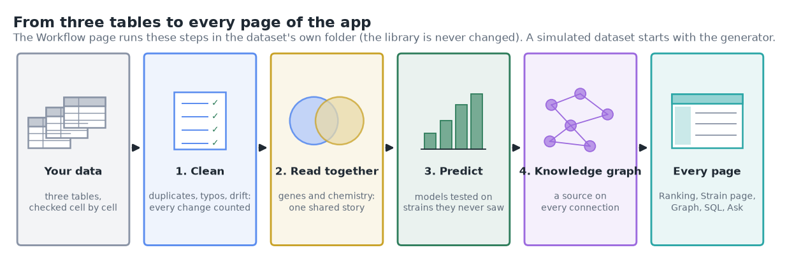
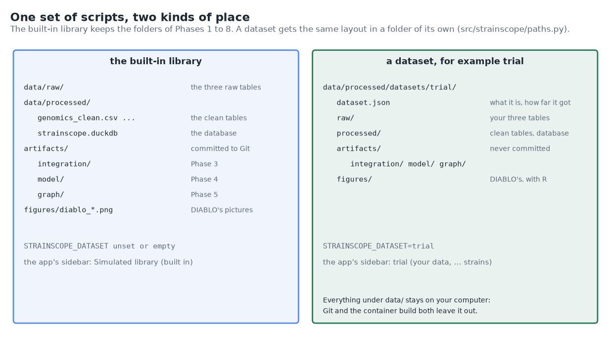
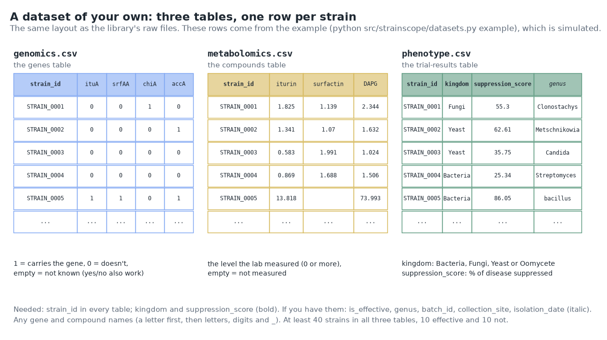
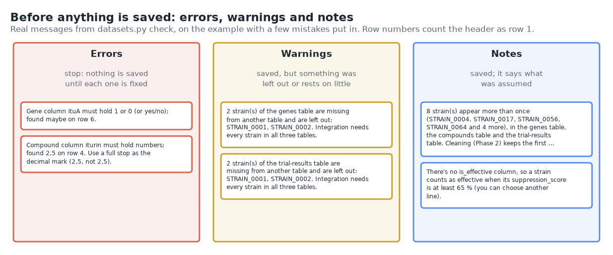
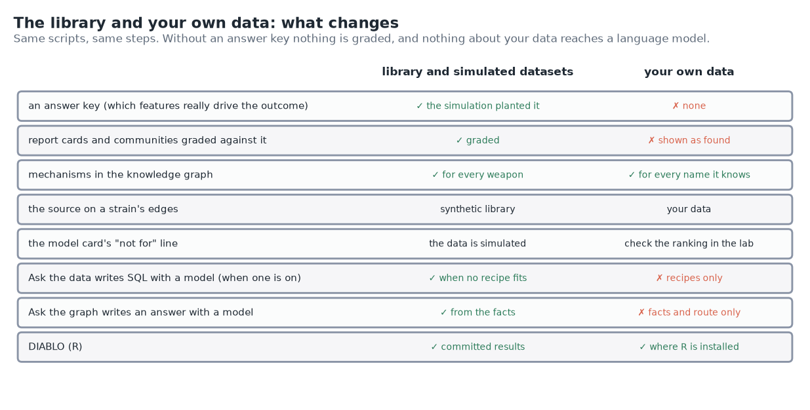
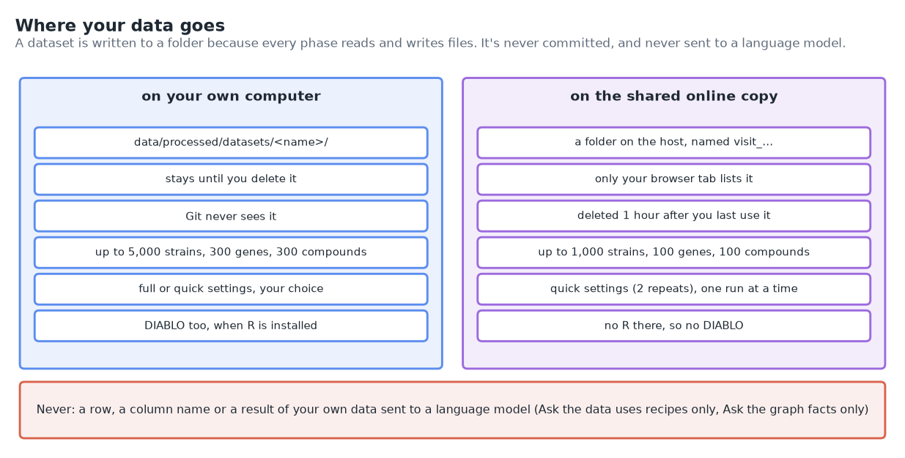
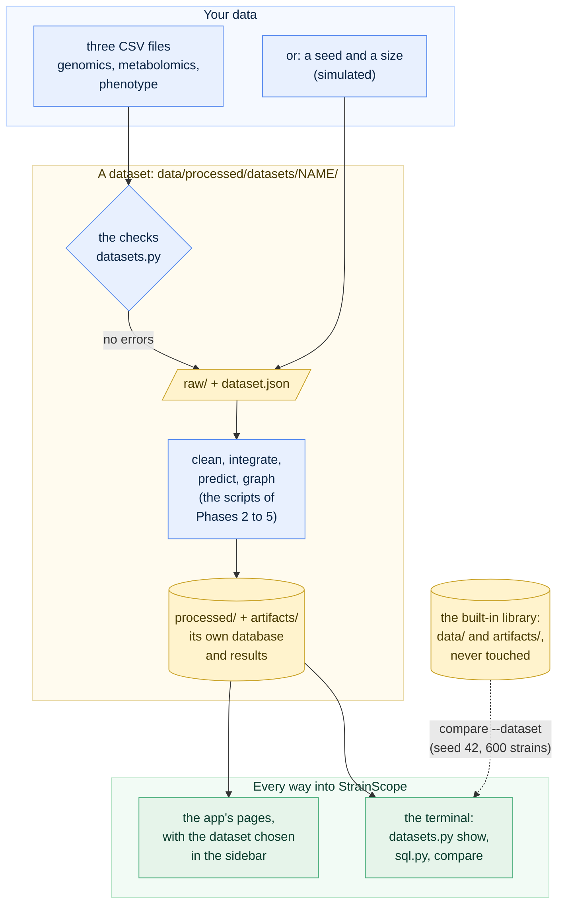
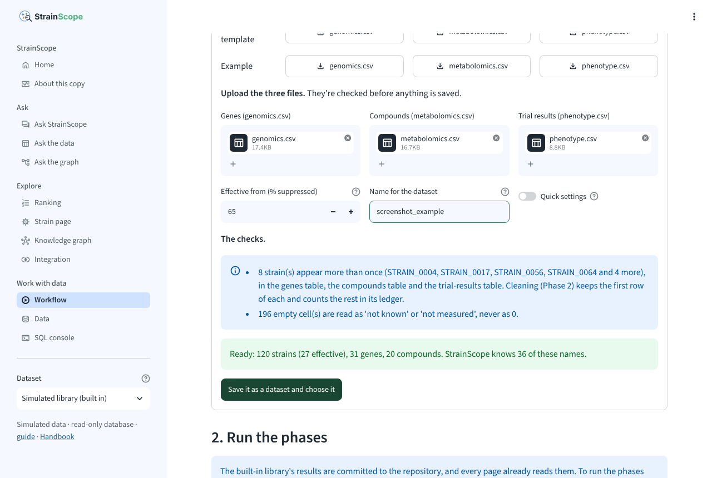
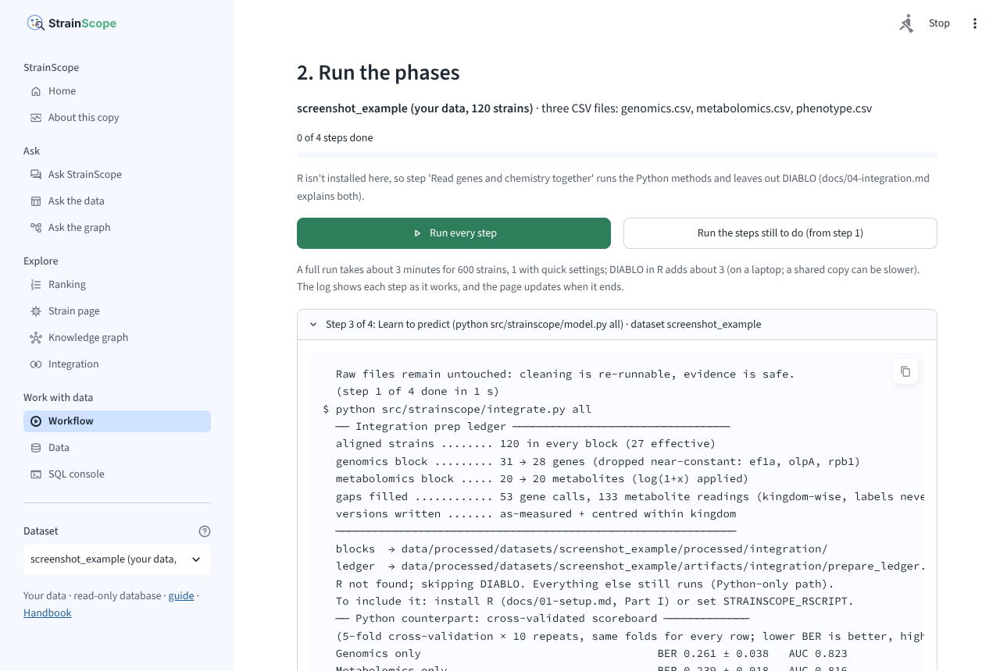
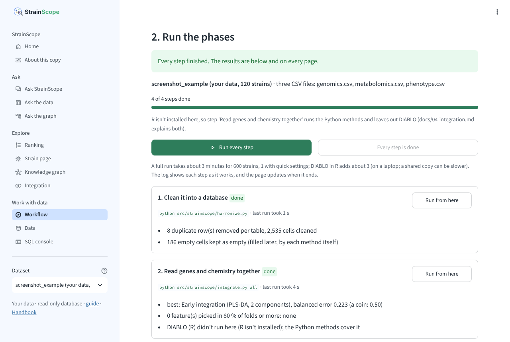

# 10 · Phase 9: the whole workflow in the app, on your own data

[← Phase 8: packaging and release 1.0](09-packaging.md) · [Handbook](HANDBOOK.md) · [All docs in order](../README.md#the-tutorial-in-order) · [Glossary](GLOSSARY.md) · [Roadmap](ROADMAP.md)

**Prerequisites:** Phase 8 complete ([`docs/09-packaging.md`](09-packaging.md)): the database is built, `pytest -q` passes and v1.0.0 is tagged. Nothing new to install. R is optional, as before: with it, the integration step also runs DIABLO on your data ([`docs/01-setup.md`](01-setup.md) Part I).
**Learning goal:** after this phase you will understand how one set of scripts can work on many sets of data without mixing them up (a folder per dataset, chosen with one setting); how to prepare your own strains as three tables and what the checks say about them before anything is saved; what changes when there's no answer key; and how to run every phase, from cleaning to the knowledge graph, from the app or from a terminal. You'll release StrainScope **v1.1.0**.
**Why this phase exists in a real workflow:** until now the app showed results computed once, for one simulated library. A screening team has its own strains and its own trial results, and the question they bring is "what does this say about *our* strains?". The workflow of Phases 2 to 5 already answers it for the library; this phase lets it answer for any data in the same layout, without touching the library's committed results, and lets the app run it with a button.

**Session plan** (about 2½ hours, in three sittings):
- **Session A (~1 h):** the ideas (§1 to 3), get the files (§4), then the whole workflow from a terminal on an example: the tables, the checks, a dataset, every phase, its steps (§5 to 9).
- **Session B (~45 min):** the same in the app's new **Workflow** page (§10), a fresh simulated library and the check that seed 42 rebuilds the library (§11), your own tables (§12).
- **Session C (~45 min, part of it waiting for GitHub):** the online copy (§13), removing datasets (§14), the figures, notes, tests and FAQ (§15 to 21), then push, wait for the tests, and tag v1.1.0 (§22).

> **How this guide works:** every action step tells you what **You should see**, **What it means**, and, when things can wobble, **If instead**. All paths are relative to the project folder (the folder that contains `README.md`). Every command uses plain keyboard characters, so it is safe to copy ([why](01-setup.md#copy-commands-safely-plain-keyboard-characters-only)). Open a terminal in the project folder and switch on the toolbox first (`source .venv/bin/activate`; Windows PowerShell: `.\.venv\Scripts\Activate.ps1`).



---

## 1. The ideas behind this phase

### From showing results to making them

Phases 1 to 5 made the results of the library: 600 simulated strains, cleaned into a database, read together, ranked by a model and linked in a knowledge graph. Phase 6 put them in an app, and since Phase 8 one button there rebuilds them. All of that worked on one set of data. The upload on the **Data** page (Phase 6) scores new strains with the library's saved model, which is useful, but it doesn't learn anything from them: a model trained on someone else's strains, scoring yours.

This phase makes the whole chain run on any data in the library's layout. The cleaning, the integration, the models and their tests, the graph and its explanations all run on your strains and learn from them alone.

### A dataset: a labelled box

Picture a kitchen with one recipe book and several labelled boxes of ingredients. The recipes don't change from box to box; you choose a box, and what you cook goes back into the same box. Nobody mixes up two families' dinners that way.

In StrainScope the recipes are the scripts of Phases 1 to 5, and each box is a **dataset**: a folder of its own under `data/processed/datasets/`, laid out like the library's folders (`raw/`, `processed/`, `artifacts/`), with a small file, `dataset.json`, that says what it is. One setting, the environment variable `STRAINSCOPE_DATASET`, tells every script which box to work on. An **environment variable** is a named value a program can read when it starts, set in the terminal or by the program that starts it; you rarely set this one yourself, because `pipeline.py --dataset NAME` and the app set it for the scripts they start. Without it, everything works on the built-in library, exactly as in Phases 1 to 8.



There are two kinds of dataset:

- **your own data**: three tables you give it (next section);
- **a simulated library** from the generator of Phase 1, with a seed and a size you choose. Seed 42 with 600 strains is the library's own data, so a dataset made that way has to reproduce the library's results (§11).

Everything under `data/` stays on your computer. Git ignores it ([`.gitignore`](../.gitignore)), and so does the container build ([`.dockerignore`](../.dockerignore)).

### Three tables, in the library's layout

The library's raw files have been three tables since Phase 1, and a dataset of your own uses the same three:

| File | One row per strain, with | Needed columns |
|---|---|---|
| `genomics.csv` (the genes table) | a column per gene: 1 = carries it, 0 = doesn't, empty = not known (yes/no and true/false work too) | `strain_id` |
| `metabolomics.csv` (the compounds table) | a column per compound: the level the lab measured, 0 or more; empty = not measured | `strain_id` |
| `phenotype.csv` (the trial-results table) | what the trial said, and where the strain came from | `strain_id`, `kingdom`, `suppression_score` |

The trial-results table may also have `is_effective` (1 or 0), `genus`, `batch_id`, `collection_site`, `isolation_date` and `growth_promotion`. Without `is_effective`, a strain counts as effective when its `suppression_score` reaches a line you choose (65 %, the library's, unless you say otherwise). Without `batch_id`, cleaning has no lab drift to correct; without `genus`, the knowledge graph has no genus nodes. Everything else works the same.

Any gene and compound names work, as long as each starts with a letter and holds only letters, digits and `_` (so that it works everywhere, in SQL too). A name StrainScope knows, such as `ituA` or `iturin`, brings its mechanism into the knowledge graph (Phase 5's domain model, `src/strainscope/ontology.py`); a name it doesn't know is linked to the outcome only by what the data says.



### Checks before anything is saved

A spreadsheet can hold almost anything: a "maybe" where a 1 belongs, a decimal comma, a kingdom spelled three ways. The checks (`src/strainscope/datasets.py`, `check_tables()`) read every cell before anything is saved and sort what they find into three levels:

- an **error** stops: nothing is saved until it's fixed (a gene call that isn't 1, 0 or empty; a decimal comma; a negative level; an unknown kingdom; too few strains);
- a **warning** means something was left out or rests on very little (a strain missing from one of the tables, which integration can't use; a column that's mostly empty; a kingdom with fewer than 5 strains);
- a **note** says what was assumed (no `is_effective` column, no batch numbers, how many empty cells).

A message about a cell gives its spreadsheet row number (the header is row 1), so you can find it. The checks don't clean anything: duplicates, odd spellings of a genus, impossible scores and lab drift are Phase 2's job, and Phase 2 counts every change in its ledger, as it does for the library.



### No answer key for your own data

The library is simulated, so we know which features really drive the outcome: the generator wrote them into the formula. That **answer key** let Phases 3 to 5 grade their findings ("of the 9 features DIABLO picked, all are real drivers"). Real data has no answer key, and neither does yours. So with your own data the report cards list what was picked without grading it, the graph's communities aren't graded, and nothing is coloured as a driver or a decoy. What still works without one: the cross-validated error of every model, the calibration, the error analysis, and the comparison of what the model leans on with what the domain model knows ("confirmed", "mechanism only", "data only"). That last one matters most on real data: a feature the model leans on that nothing explains is either a discovery or a problem, and the knowledge graph flags it as *statistics only* on every strain page.



### Quick settings

Every model is scored on 5 folds, repeated 10 times with different shuffles (Phase 3's cross-validation), and that repetition takes most of a run's time. **Quick settings** repeat it twice instead of 10 times. The model step then takes about a third to a half of its usual time (65 s instead of 170 s for 600 strains in the measurements of §15), and the error bars are rougher (the ± values move more). Use them to try things; use the full settings for results you'll keep.

### Where your data goes

A dataset is written to a folder, because every phase reads and writes files. On your own computer it stays there until you delete it. On the shared online copy it's written to a folder on the host, listed only in the browser tab that made it, and deleted an hour after the tab last used it, by choosing it, running a step or opening one of its pages (Streamlit can't tell when a tab is closed, so the clock decides). Either way, **nothing about your own data is sent to a language model**: with a model switched on, Ask the data answers your dataset with the Query Cookbook's tested recipes only, and Ask the graph with its facts and routes only, so not even a column name leaves the copy.



### A new minor version: 1.1.0

Version numbers have three parts ([Phase 8 §1](09-packaging.md#version-numbers-and-releases)): the first changes when something you rely on stops working the old way, the second when something new arrives, the third for fixes. Nothing that worked before changes here (every command of Phases 1 to 8 works as it did, and the library's results stay the same to the last digit), and a lot is new. So this is 1.1.0.

---

## 2. The data flow of this phase



The scripts of Phases 2 to 5 run unchanged in spirit: they read and write the same files, only in the dataset's folder. The app reads whichever folder is chosen in its sidebar.

---

## 3. The decisions in English, before any code

1. **One small module says where everything lives.** `src/strainscope/paths.py` holds the library's folders and a dataset's, and every script asks it instead of building paths itself. It reads `STRAINSCOPE_DATASET` once, when a script starts. Unset or empty means the library, so nothing of Phases 1 to 8 changes.
2. **A dataset is a folder with the library's layout.** The scripts already took their folders as arguments for the tests; now their defaults come from `paths.py`. The R script reads the same variable and writes DIABLO's results and pictures into the dataset's folder.
3. **Datasets live under `data/processed/`.** That folder is already left out of Git, the container and the safety gate's data check, so a dataset can't be committed or built into an image by accident, and no ignore file had to change.
4. **The checks read text, not numbers.** Each table is read with every cell as text, so a "maybe" or a "2,5" can be named with its row, instead of turning silently into "not a number".
5. **Check, don't clean.** The checks make values readable (yes becomes 1, "bacterial" becomes Bacteria) and refuse what can't be read; cleaning stays in Phase 2, with its ledger. A strain missing from one of the tables is left out with a warning, because integration needs every strain in all three.
6. **Enough to learn from, or nothing.** At least 40 strains in all three tables, at least 10 effective and 10 not, and at least two columns in each layer that tell strains apart. Below that, five-fold cross-validation has too little in each fold to mean anything, so the checks stop before a run that would.
7. **The four kingdoms only.** Each strain is compared with others of its kingdom (Phase 3's centring, Phase 5's "lacks" reasons), and the domain model's weapons are written for Bacteria, Fungi, Yeast and Oomycete. Another group is an error, with that reason, rather than a quiet guess.
8. **No answer key, no grade.** A dataset of your own gets "not graded" where the library has a grade, and the knowledge graph's "weapons common in a kingdom" come from the domain model's mechanisms rather than the simulation's planted roles (in the library, the two lists are the same, which the comparison of §11 confirms).
9. **A step is done when its receipt is newer than everything it reads.** Each step writes one file at the end of its work (its receipt: the cleaning ledger, the report card, the model card, the explanations). The Workflow page and `datasets.py show` compare the times of the receipts, and for your own data the times of the raw tables too, so a step whose input changed since it ran says "run again".
10. **The plans live where the others do.** `simulate` and `workflow` join `PIPELINES` in `src/strainscope/service.py`; `pipeline.py --dataset NAME` picks the right one, and the app's buttons run the same lists.
11. **Nothing about your own data goes to a model.** Phase 7's rule was that a model sees documentation, table and column names, and facts about concepts, never rows. Your column names and your strains' facts aren't public, so for a dataset of your own the assistants don't ask a model at all.
12. **A shared copy keeps datasets apart and short-lived.** Each browser tab gets a random token; a dataset it makes carries the token and only that tab lists it. Datasets not used for an hour are deleted, at most 20 are kept, quick settings are always on, the limits are lower (1,000 strains, 100 genes, 100 compounds, 5 MB a file), and one run goes at a time.
13. **The library stays read-only on the Workflow page.** Its results are committed; rebuilding it is the Data page's job on your own computer (Phase 8). A simulated dataset with seed 42 and 600 strains is the way to rebuild it without touching it.
14. **Measured, not promised.** The run times quoted here were measured (§15's explorer); `compare --dataset` checks the claim that a simulated dataset rebuilds the library.

### What we leave out on purpose, and why

- **One combined file instead of three.** One table with every column needs a way to tell a gene from a compound (a prefix on every name), and the three tables are what Phases 1 and 2 already read. Three files it is.
- **Excel workbooks.** Every spreadsheet program saves CSV, and CSV is what the rest of the project reads. A workbook would add a package and a second set of reading rules; it's a deferred item in the [roadmap](ROADMAP.md#deferred-items-and-their-triggers).
- **Other groups of microbes** (viruses, protozoa). They don't share the molecular basis (a virus has no metabolome; Phase 1 explains why they're left out), and the domain model has no weapons for them.
- **Real public data inside a dataset.** The real tables of Phases 1b and 1c are reference facts about genes, compounds and genera, shared by the library and every dataset (each dataset's database loads them, and its graph uses them, exactly as the library's does). Fetching stays a library action.
- **The MCP server on a dataset.** It reads whatever `STRAINSCOPE_DATASET` names, and labels its answers accordingly, but its `config` helper doesn't offer a dataset yet. A deferred item, with its trigger in the [roadmap](ROADMAP.md#deferred-items-and-their-triggers).
- **Running one part of a step** (only the calibration, say). A step is a whole script, the same unit as in the Handbook's [whole build](HANDBOOK.md#the-whole-build-command-by-command); running from a step on is enough to repair a run.
- **A queue for many visitors at once.** A shared copy runs one dataset at a time; a second visitor is told to wait. A real queue belongs to a hosted product with logins (the [product roadmap](PRODUCT_ROADMAP.md), B5 and D7).

---

## 4. Get the Phase 9 files into your repo

All paths are relative to the project folder.

| Path | New / changed | Its job |
|---|---|---|
| `src/strainscope/paths.py` | new | where every script reads and writes: the library, or a dataset's folder (`STRAINSCOPE_DATASET`) |
| `src/strainscope/datasets.py` | new | the checks, saving, listing and removing datasets, the templates and the example, each step's state and what it found; its commands (`template`, `example`, `check`, `new`, `list`, `show`, `remove`) |
| `src/strainscope/generate_data.py` | changed | writes to the chosen place; `--seed` and `--strains` inside a dataset (the library stays at 42 and 600) |
| `src/strainscope/harmonize.py` | changed | the chosen place; optional columns kept as empty columns; no batch correction without batch numbers; the ledger saved as `cleaning_ledger.csv` |
| `src/strainscope/integrate.py` | changed | the chosen place; any columns, with what's known about each (or "your column"); nothing graded without an answer key; a fold that can't be scored is skipped; the R step told the dataset's folder; `STRAINSCOPE_RSCRIPT=none` leaves R out |
| `R/diablo_integration.R` | changed | reads and writes a dataset's folder when told; its list lengths stop at a block's width |
| `src/strainscope/model.py` | changed | the chosen place, the dataset's line for "effective" and its number of repeats; a dataset with fewer than 50 strains checks its top N; the model card's "not for" line for your own data |
| `src/strainscope/graph.py` | changed | the chosen place; strains without a genus; "your data" as the source of a dataset's edges; weapons from the domain model's mechanisms |
| `src/strainscope/service.py` | changed | the `simulate` and `workflow` plans, `plan_for()`, each step's name, runs on a dataset (with its times remembered), the health check's fixes for a dataset |
| `src/strainscope/pipeline.py` | changed | `--dataset NAME`, and `compare --dataset NAME` against the library's committed results |
| `src/strainscope/narrate.py`, `src/strainscope/sql.py`, `src/strainscope/mcp_server.py` | changed | the dataset's own words in plain-language text; the SQL console and the MCP server read the chosen place |
| `app/views/workflow.py` | new | the **Workflow** page |
| `app/ui.py`, `app/streamlit_app.py` | changed | the dataset chosen in the sidebar, read by every page; a shared copy's tidy-up; the live log stays open while a run goes |
| `app/views/*.py` (every page but Ask StrainScope) | changed | each page reads the chosen dataset and speaks of it ("strains of dataset trial", not "library strains") |
| `tools/check_accessibility.py` | changed | checks the Workflow page too (15 page views) |
| `tests/test_datasets.py` | new | 21 tests of datasets and the workflow (§18) |
| `tests/test_app.py`, `tests/test_pipeline.py`, `tests/conftest.py`, `tests/golden_questions.csv` | changed | the Workflow page and every page on a dataset; a run's stand-in takes a dataset; one real run shared by the tests; questions this guide answers |
| `figures/make_phase9_figures.py` and its pictures, `docs/img/workflow_steps.png`, `docs/interactive/workflow_explorer.html` | new | the figures (§15) |
| `figures/take_app_screenshots.py`, `docs/img/app_*.png`, `docs/img/app_tour.gif` | changed / new | the screenshots, retaken (the sidebar has a Dataset box), and three of the Workflow page |
| `docs/10-workflow-and-your-data.md` | new | this guide |
| `README.md`, `CHANGELOG.md`, `CITATION.cff`, `docs/HANDBOOK.md`, `docs/ROADMAP.md`, `docs/PRODUCT_ROADMAP.md`, `docs/GLOSSARY.md`, `docs/00-architecture.md`, `docs/07-app.md`, `docs/08-deployment-ai.md`, `docs/08b-mcp-server.md`, `docs/07b-docs-assistant.md` (numbers that depend on the documents), `docs/09-packaging.md`, `docs/QUERY_COOKBOOK.md`, `docs/LANGUAGE_MODEL.md`, `docs/UNINSTALL.md`, `docs/index.html`, the journey (`figures/make_illustrations.py`, `docs/img/journey_map.svg`, `docs/interactive/journey.html`), `figures/make_phase8_figures.py` with `figures/footprint.png` and `docs/interactive/release_explorer.html`, Phase 6b's pictures (`figures/ask_how_it_works.png`, `figures/word_weights.png`, `figures/golden_scores.png`, `docs/interactive/ask_explorer.html`) | changed | Phase 9 everywhere it belongs, and v1.1.0 |

**Files-landed check:**

```bash
ls src/strainscope/paths.py src/strainscope/datasets.py app/views/workflow.py tests/test_datasets.py docs/10-workflow-and-your-data.md
```

In Windows PowerShell, separate the names with commas: `ls src/strainscope/paths.py, src/strainscope/datasets.py, app/views/workflow.py, tests/test_datasets.py, docs/10-workflow-and-your-data.md`. **You should see** the five names and no `No such file` (PowerShell: `Cannot find path`) message.

**Read before running.** Open `src/strainscope/paths.py`: its docstring draws both layouts. Then the top of `src/strainscope/datasets.py`, which describes the three tables and every command of this guide.

**Check that nothing old changed.** The library's results must be exactly what they were:

```bash
python src/strainscope/pipeline.py database --quiet
pytest -q
```

**You should see** the pipeline's summary and health check, then the test count of §18. The run of every phase on a small example inside the tests takes about a minute of that.

---

## 5. Step 1: an example to practise on

Before your own tables, practise on tables you know are right. The example is a small simulated library (seed 7, 120 strains) saved in the three-table layout, with the same kinds of mess as the library (duplicates, gaps, odd spellings). Write it into `data/raw/my_tables/`, which Git ignores:

```bash
python src/strainscope/datasets.py example data/raw/my_tables
```

**You should see:**

```
  wrote data/raw/my_tables/genomics.csv
  wrote data/raw/my_tables/metabolomics.csv
  wrote data/raw/my_tables/phenotype.csv
  These 120 strains are simulated (seed 7), messy on purpose. Try: python src/strainscope/datasets.py check data/raw/my_tables
```

**What it means:** three CSV files, the layout of §1. Open `data/raw/my_tables/phenotype.csv` in a spreadsheet program or in VS Code and look: one row per strain, a kingdom, a genus (some in lower case, one misspelled), a batch number and a trial score.

> The example is simulated, but it's saved as "your data", so StrainScope gives it no answer key. It behaves exactly like tables you'd bring yourself, which is the point of practising on it.

---

## 6. Step 2: check the three tables

```bash
python src/strainscope/datasets.py check data/raw/my_tables
```

**You should see:**

```
  · 8 strain(s) appear more than once (STRAIN_0004, STRAIN_0017, STRAIN_0056, STRAIN_0064 and 4 more), in the genes table, the compounds table and the trial-results table. Cleaning (Phase 2) keeps the first row of each and counts the rest in its ledger.
  · 196 empty cell(s) are read as 'not known' or 'not measured', never as 0.
  ✓ 120 strains (27 effective) · 31 genes · 20 compounds · Bacteria 53, Fungi 35, Yeast 21, Oomycete 11
    StrainScope knows 36 of these names (their mechanisms join the knowledge graph): phlD, prnD, phzE, hcnA, srfAA, ituA, fenA, pvdA and 28 more
  Save them as a dataset: python src/strainscope/datasets.py new <name> --from data/raw/my_tables
```

**What it means:** two notes (`·`), no warnings (`!`), no errors (`✗`), and a summary. The duplicates are left for cleaning, which removes them and counts them; the empty cells stay empty until each method fills them its own way (Phase 3's rules). 36 of the 51 names are genes and compounds the domain model knows; the other 15 (housekeeping and accessory genes, background compounds) have no mechanism to bring.

**Now make a mistake on purpose.** Open `data/raw/my_tables/genomics.csv` in VS Code (a spreadsheet program can change number formats when it saves, so for this test an editor is safer), find the `ituA` column of the first strain (row 2, `STRAIN_0001`, the seventh value), change its `0.0` to `maybe`, save, and check again:

```bash
python src/strainscope/datasets.py check data/raw/my_tables
```

**You should see:**

```
  · 8 strain(s) appear more than once (STRAIN_0004, STRAIN_0017, STRAIN_0056, STRAIN_0064 and 4 more), in the genes table, the compounds table and the trial-results table. Cleaning (Phase 2) keeps the first row of each and counts the rest in its ledger.
  ✗ Gene column `ituA` must hold 1 or 0 (or yes/no); found maybe on row 2.
  ✗ 1 problem(s) to fix before the tables can be used.
```

The command ends with exit code 1, so a script could tell. Put the `0.0` back (or run step 1 again to rewrite the files) and check once more until it says `✓`.

**If instead** you see `data/raw/my_tables/genomics.csv is missing`: the three files must be called `genomics.csv`, `metabolomics.csv` and `phenotype.csv` and sit in the folder you name.

---

## 7. Step 3: save them as a dataset

```bash
python src/strainscope/datasets.py new trial --from data/raw/my_tables
```

**You should see** the same notes and summary as in step 2, then:

```
  saved → data/processed/datasets/trial/
  Next: python src/strainscope/pipeline.py --dataset trial
```

**What it means:** the checked tables are now in `data/processed/datasets/trial/raw/`, and `data/processed/datasets/trial/dataset.json` records what the dataset is. Open it: its name, `"kind": "yours"`, `"answer_key": false`, where it came from, the line for "effective" (`65.0`), the number of repeats (`10`), the notes of the check, and `"steps": {}` (nothing has run yet). A name starts with a letter and holds letters, digits and `_`, at most 40 of them; `library` is taken.

**Quick settings** for this dataset: add `--quick` to the command (2 repeats instead of 10). **Another line for "effective"**, when your trial results have no `is_effective` column: `--effective-at 70`.

---

## 8. Step 4: run every phase on it

```bash
python src/strainscope/pipeline.py --dataset trial --quiet
```

**You should see** (the times are from a Linux computer without R; yours will differ):

```
  ── StrainScope pipeline: workflow (4 steps, about 3 minutes for 600 strains, 1 with quick settings; DIABLO in R adds about 3) ──
  It cleans your three tables into the dataset's own database, and computes every result on them: the integration (DIABLO too, when R is installed), the models and the knowledge graph.
  Dataset: trial, in data/processed/datasets/trial/ (the library isn't touched).

  [1/4] python src/strainscope/harmonize.py
  ✓ step 1 done in 1 s

  [2/4] python src/strainscope/integrate.py all
  ✓ step 2 done in 4 s

  [3/4] python src/strainscope/model.py all
  ✓ step 3 done in 1 min 16 s

  [4/4] python src/strainscope/graph.py all
  ✓ step 4 done in 2 s

  ── Summary ─────────────────────────────────────────────────────
  ✓ 1. python src/strainscope/harmonize.py                           1 s
  ✓ 2. python src/strainscope/integrate.py all                       4 s
  ✓ 3. python src/strainscope/model.py all                    1 min 16 s
  ✓ 4. python src/strainscope/graph.py all                           2 s
  All 4 steps finished in 1 min 23 s.

  ── StrainScope: what the app can read ──────────────────────────
  ✓ Database                 33 tables, 120 strains
  ✓ Phase 3 results          6 files in data/processed/datasets/trial/artifacts/integration/, 6 int_* tables
  ✓ Phase 4 results          13 files in data/processed/datasets/trial/artifacts/model/, 13 ml_* tables
  ✓ Phase 5 results          11 files in data/processed/datasets/trial/artifacts/graph/, 11 kg_* tables
  ✓ Saved model              Elastic net logistic regression, built with scikit-learn 1.9.0
  · Real tables (optional)   none fetched (the app works without them)
      to add: Data page, Real data tab, or python src/strainscope/fetch_real.py
  · AI features (optional)   off: the assistants answer by search and rules alone, and nothing is sent anywhere
      to add: STRAINSCOPE_ASK_BACKEND in .env (docs/LANGUAGE_MODEL.md)

  See it in the app: choose trial under Dataset in the sidebar. Step by step: python src/strainscope/datasets.py show trial
```

**What it means:** the dataset's plan is `workflow`, the four steps of Phases 2 to 5 (a dataset of your own has its data already, so the generator's step is left out). Each step ran with `STRAINSCOPE_DATASET` set to the dataset's folder, so every file went there. The health check at the end is the dataset's own: its database has 33 tables (the three clean ones and the results of Phases 3 to 5), all 120 strains.

**With R installed** the second step also runs DIABLO on the dataset (about 3 minutes more), Phase 3 has 12 files instead of 6, and DIABLO's pictures land in `data/processed/datasets/trial/figures/`. **With the real tables** of Phases 1b and 1c on your computer, the dataset's database loads them too and its graph uses them, exactly as the library's does.

Without `--quiet` you see everything each script prints, the same reports as in Phases 2 to 5, only about your strains: the cleaning ledger, the integration scoreboard, the model scoreboard and the leak check, the calibration, the graph's hubs and communities, and the explanations of the best- and worst-ranked strains.

**If instead** a step stops: the summary names it and says how to carry on after fixing it, for example `python src/strainscope/pipeline.py --dataset trial --from 3`.

---

## 9. Step 5: follow the steps

```bash
python src/strainscope/datasets.py show trial
```

**You should see:**

```
  ── trial: three CSV files from data/raw/my_tables ──
  ✓ 1. Clean it into a database             done  (1 s)
       8 duplicate row(s) removed per table, 2,535 cells cleaned
       186 empty cells kept as empty (filled later, by each method itself)
  ✓ 2. Read genes and chemistry together    done  (4 s)
       best: Early integration (PLS-DA, 2 components), balanced error 0.223 (a coin: 0.50)
       0 feature(s) picked in 80 % of folds or more: none
       DIABLO (R) didn't run here (R isn't installed); the Python methods cover it
  ✓ 3. Learn to predict                     done  (76 s)
       winner: Elastic net logistic regression, balanced error 0.252, AUC 0.835
       of the top 50 strains, 23 are effective (chance: about 11)
  ✓ 4. Build the knowledge graph            done  (2 s)
       199 nodes and 1,686 edges, each edge with its source
       116 strain(s) with at least one mechanism path to disease suppression
  Run every step: python src/strainscope/pipeline.py --dataset trial
```

**What it means:** each step, its state (`✓` done, `!` run again, `·` to do), how long it last took, and a few lines read from what it wrote. (Cleaning counts 186 empty cells where the check counted 196: the other 10 were in the duplicate rows it removed.) With 120 strains the results are rougher than the library's 600 (balanced error 0.252 against the library's 0.128), and no feature was picked steadily enough by the Python lasso: the less data, the less a method can be sure of. The ranking still finds 23 effective strains among its top 50, against about 11 by chance.

A step is **done** when its receipt, a file it writes at the end of its work (the cleaning ledger, the report card, the model card, the explanations), is newer than the receipts of every step before it, and for your own data newer than the three raw tables too. If an earlier step runs again later (say cleaning, by hand as in §20), `show` marks every step after it `!` and *run again* until they've run: their input changed since they ran. The same happens to every step when a file in the dataset's `raw/` folder changes. (Editing those files by hand skips the checks, though. To change your tables, fix them in your own folder, check them again and save them as a new dataset.)

**All your datasets at once:**

```bash
python src/strainscope/datasets.py list
```

**You should see** one line per dataset, with its kind, its size, how many steps are done and the day it was made (in UTC):

```
  trial                    yours         120 strains   4 of 4 steps done   2026-10-13
```

**And the SQL console on a dataset:** `sql.py` reads the place `STRAINSCOPE_DATASET` names. In macOS or Linux, put the setting in front of the command; it holds for that one command:

```bash
STRAINSCOPE_DATASET=trial python src/strainscope/sql.py "SELECT kingdom, COUNT(*) AS n FROM phenotype GROUP BY kingdom"
```

In Windows PowerShell the setting holds until you remove it, so remove it straight after:

```powershell
$env:STRAINSCOPE_DATASET = "trial"
python src/strainscope/sql.py "SELECT kingdom, COUNT(*) AS n FROM phenotype GROUP BY kingdom"
Remove-Item Env:STRAINSCOPE_DATASET
```

The same works for every script of Phases 2 to 5 (§20 cleans `trial` that way) and for the commands that read results (`graph.py why STRAIN_0001`, `narrate.py STRAIN_0001`). If you forget to remove it, `pipeline.py` without `--dataset` notices and stops before running anything, and the generator refuses to write over a dataset of your own tables.

---

## 10. Step 6: the same in the app, the Workflow page

Start the app as always:

```bash
python -m streamlit run app/streamlit_app.py
```

**The Dataset box.** The sidebar has a new box, **Dataset**, below the list of pages. It offers *Simulated library (built in)* and every dataset in `data/processed/datasets/`, here *trial (your data, 120 strains)*. Choose `trial`, and every page switches to it: the Home page says *Showing trial (your data, 120 strains)* and counts *Strains in this dataset*; the Ranking lists *All 120 strains of dataset trial*; a Strain page shows *In your trial results* where the library says *In the simulated trial*; the Integration page shows *The signatures found* instead of a report card; the SQL console, Ask the data and Ask the graph read the dataset's database and graph. Choose the library again and everything is as before. The choice belongs to the browser tab: another tab can show another dataset.

**The Workflow page** (under *Work with data*) does steps 1 to 5 of this guide with buttons, in three parts.

**1. Choose the data.** The same choice as the sidebar's. *Start a new dataset* opens two ways in:

- **Your own data (three CSV files).** The layout, two rows of download buttons (*Empty template* and *Example*, three files each: the example is the same 120 strains as step 1), three upload boxes (*Genes*, *Compounds*, *Trial results*), the line for "effective", a name and *Quick settings*. As soon as all three files are in, the checks run and show their errors, warnings and notes; with no errors, *Ready* sums it up and *Save it as a dataset and choose it* saves it.

  

- **A fresh simulated library.** A seed, a number of strains (100 to 5,000) and a name. Its first step will be the generator.

**2. Run the phases.** The dataset's steps, each in a box: its name, a badge (*done*, *run again: what it reads has changed*, *to do*), the command it runs, how long it last took and what it found, with a *Run from here* button. Above them, *Run every step* and *Run the steps still to do*. A run shows its live log right under the buttons, the same lines the terminal shows, and the page updates when it ends.





**3. Explore the results.** Links to every page that now shows the dataset, *Download every table* (a zip of the raw and clean tables, the cleaning ledger and every result table; the saved model is left out, because a model file can run code when it's loaded), *Delete this dataset* (with a tick box first), and *The same from a terminal*, the commands of this guide for that dataset.

**Try it:** on the Workflow page, open *Start a new dataset*, download the three *Example* files (or use the ones in `data/raw/my_tables/`), upload them (each into the box of its table; the file names don't matter), name the dataset `trial_app`, save it, and press *Run every step*. Then choose it in the sidebar and open the Ranking page.

**The Data page's upload is still there,** with a new meaning: *Score and explain your own strains* scores new strains with the saved model **of the dataset chosen in the sidebar**, without learning from them, and explains them with its graph. To learn from your strains, use the Workflow page.

**The built-in library on the Workflow page** is shown, not run: its results are committed and every page already reads them. Rebuilding it is the Data page's job, on your own computer (Phase 8, [§7](09-packaging.md#7-step-3-the-same-from-the-app)). To rebuild it without touching it, make a simulated dataset with seed 42 and 600 strains (next step).

---

## 11. Step 7: a fresh simulated library, and the library rebuilt

Phase 1's generator can also fill a dataset: a new library, with a seed and a size you choose. A different seed draws different strains, with the same biology and the same kinds of mess. It brings its answer key, so every result is graded as in the library. Seed 42 with 600 strains draws the library itself, and that tests everything this phase changed: with the library's own data, a dataset has to come out with the library's committed results.

```bash
python src/strainscope/datasets.py new seed42 --simulate --seed 42 --strains 600
python src/strainscope/pipeline.py --dataset seed42 --quiet
```

**You should see** first `saved → data/processed/datasets/seed42/ (seed 42, 600 strains)`, then a run like step 4's, with five steps this time (the plan is `simulate`, which starts with the generator; the times are again from a Linux computer without R):

```
  ── StrainScope pipeline: simulate (5 steps, about 3 minutes for 600 strains, 1 with quick settings; DIABLO in R adds about 3) ──
  It simulates a library with the dataset's seed and size, cleans it into the dataset's own database, and computes every result: the integration (DIABLO too, when R is installed), the models and the knowledge graph.
  Dataset: seed42, in data/processed/datasets/seed42/ (the library isn't touched).

  [1/5] python src/strainscope/generate_data.py
  ✓ step 1 done in 1 s

  [2/5] python src/strainscope/harmonize.py
  ✓ step 2 done in 1 s

  [3/5] python src/strainscope/integrate.py all
  ✓ step 3 done in 4 s

  [4/5] python src/strainscope/model.py all
  ✓ step 4 done in 2 min 50 s

  [5/5] python src/strainscope/graph.py all
  ✓ step 5 done in 3 s

  ── Summary ─────────────────────────────────────────────────────
  ✓ 1. python src/strainscope/generate_data.py                       1 s
  ✓ 2. python src/strainscope/harmonize.py                           1 s
  ✓ 3. python src/strainscope/integrate.py all                       4 s
  ✓ 4. python src/strainscope/model.py all                    2 min 50 s
  ✓ 5. python src/strainscope/graph.py all                           3 s
  All 5 steps finished in 2 min 59 s.

  ── StrainScope: what the app can read ──────────────────────────
  ✓ Database                 33 tables, 600 strains
  ✓ Phase 3 results          6 files in data/processed/datasets/seed42/artifacts/integration/, 6 int_* tables
  ✓ Phase 4 results          13 files in data/processed/datasets/seed42/artifacts/model/, 13 ml_* tables
  ✓ Phase 5 results          11 files in data/processed/datasets/seed42/artifacts/graph/, 11 kg_* tables
  ✓ Saved model              Elastic net logistic regression, built with scikit-learn 1.9.0
  · Real tables (optional)   none fetched (the app works without them)
      to add: Data page, Real data tab, or python src/strainscope/fetch_real.py
  · AI features (optional)   off: the assistants answer by search and rules alone, and nothing is sent anywhere
      to add: STRAINSCOPE_ASK_BACKEND in .env (docs/LANGUAGE_MODEL.md)

  See it in the app: choose seed42 under Dataset in the sidebar. Step by step: python src/strainscope/datasets.py show seed42
```

Now compare its results with the library's committed ones:

```bash
python src/strainscope/pipeline.py compare --dataset seed42
```

**You should see**, on a computer without R:

```
  ── StrainScope: dataset seed42's results against the library's committed ones ──
  Committed means Git's last commit. Numbers count as the same within 0.001.
  ✓ artifacts/graph/: 6 file(s) match
  ✓ artifacts/integration/: 5 file(s) match
  ✓ artifacts/model/: 13 file(s) match
  · not compared: artifacts/graph/edges.csv, artifacts/graph/graph_summary.csv, artifacts/graph/hubs.csv, artifacts/graph/knowledge_vs_data.csv, artifacts/graph/nodes.csv, artifacts/integration/signature_report_card.csv, artifacts/model/feature_importance.csv
      (they hold some of DIABLO's results too, and DIABLO didn't run for this dataset: R isn't installed here)
  · not compared: artifacts/graph/knowledge_layer.graphml
      (the same nodes and edges as nodes.csv and edges.csv, in another format)
  · not compared: artifacts/integration/diablo_error_by_component.csv, artifacts/integration/diablo_sample_scores.csv, artifacts/integration/diablo_signature.csv, artifacts/integration/diablo_summary.csv, artifacts/integration/diablo_tuning.csv, artifacts/integration/language_agreement.csv, artifacts/model/phase3_agreement.csv
      (not made for this dataset: DIABLO runs only where R is installed)
  · not compared: artifacts/model/strainscope_model.joblib
      (the saved model, whose bytes depend on the package versions; its results are in the tables)
  · lines about the computer, left out: model_summary.csv (model_file_kb, scikit_learn_version), diablo_summary.csv (mixomics_version, r_version, runtime_seconds); and the package versions in model_card.json

  All 24 compared files match the committed results.
```

**What it means:** every file that doesn't depend on DIABLO matches the library's committed one, to within 0.001: the clean data's integration tables, Phase 4's results apart from the two that need DIABLO (the scoreboard, the out-of-fold predictions, the calibration, the ranking, the model card apart from the line that names its database file, and more) and the graph's communities and explanations. The files that hold some of DIABLO's results (the report card, the feature importance's column about Phase 3's signature, and the graph's tables, which carry DIABLO's edges) can't match where R didn't run, and `compare` lists them apart with that reason, as it lists the graph's four reference-data tables when the database has no real tables. **On a computer with R**, DIABLO runs inside the dataset too and those files are compared as well; **with the real tables**, so are the graph's.

Seed 7 with 300 strains, or any other seed, is a new library to explore on every page; `--quick` makes the model step two to three times faster.

---

## 12. Step 8: your own tables

**Start from the templates.** `python src/strainscope/datasets.py template data/raw/my_strains` writes three files with only a header, the columns of §1 with a few of the library's gene and compound names as examples (`ituA`, `srfAA`, `iturin`, ...) and `my_gene_1`, `my_compound_1` where your own go. On the Workflow page, the *Empty template* buttons download the same files.

**Fill them in, one row per strain:**

1. Use the same `strain_id` for a strain in all three tables. A strain missing from one table is left out (a warning says which).
2. Name the columns as your lab does, as long as each name starts with a letter and holds only letters, digits and `_`, at most 40 characters: `srfAA_2` works, `srfAA-2` doesn't; `x16S` works, `16S` doesn't. A gene and a compound can't share a name, and the column names of the trial-results table (`kingdom`, `genus` and the rest) are kept for it.
3. Genes: 1, 0 or empty (yes/no works too). An empty cell means "not known", never "doesn't carry it".
4. Compounds: a number, 0 or more, with a full stop as the decimal mark (2.5, not 2,5). Use the same unit for a compound in every row; StrainScope compares levels within a compound, never across compounds.
5. Trial results: `kingdom` (Bacteria, Fungi, Yeast or Oomycete; "bacterial" or "fungus" are understood) and `suppression_score`, the percentage of disease the strain suppressed in the trial. Add `is_effective` (1 or 0) if your team decides it some other way; otherwise choose the line for "effective" with `--effective-at` (terminal) or *Effective from* (app).
6. If you have them: `genus`, `batch_id` (which lab batch measured the strain, so cleaning can remove the drift between batches), `collection_site`, `isolation_date`, `growth_promotion`.
7. Save each table as **CSV UTF-8 with commas between the values** (in Excel: *File*, *Save As*, *CSV UTF-8 (Comma delimited)*; in Google Sheets: *File*, *Download*, *Comma-separated values*; in LibreOffice: *File*, *Save As*, *Text CSV*, with *UTF-8* and a comma as separator). A spreadsheet program set up for decimal commas often puts semicolons between the values instead; the checks say so, and the fix is the same: save again with commas.

**Then the same three commands as for the example:**

```bash
python src/strainscope/datasets.py check data/raw/my_strains
python src/strainscope/datasets.py new my_strains --from data/raw/my_strains
python src/strainscope/pipeline.py --dataset my_strains
```

(`data/raw/` is a good place for your files because Git ignores it, but any folder works: `--from /Users/<you>/Desktop/my_strains` on macOS, `--from C:\Users\<you>\Desktop\my_strains` on Windows.)

**What the checks ask for, and why:**

| Check | Why |
|---|---|
| at least 40 strains in all three tables with a result | five-fold cross-validation tests each model on a fifth of the strains at a time; with fewer, each fifth is too small to say anything |
| at least 10 effective and 10 not | a model learns the difference from both sides; with fewer, some test folds hold almost none |
| at least two columns in each layer that tell strains apart | integration reads two layers; a column with one value in 95 % of strains is dropped by Phase 3's rule anyway |
| up to 5,000 strains, 300 genes and 300 compounds (a shared copy: 1,000, 100 and 100) | on your own computer a guard against a mistake; on a shared copy, a run short enough for the next visitor |

**What happens to names StrainScope knows.** The domain model (`src/strainscope/ontology.py`) knows 36 genes and compounds: the library's weapons (`ituA` and iturin, `phlD` and DAPG, ...) and its plant-growth genes. A column with one of those names gets its mode of action in the knowledge graph, so a strain that carries it gets a mechanism path, as in the library. Every other column is linked to disease suppression only when the model leans on it, and is then flagged as *statistics only*. To give your own genes their mechanisms, they'd go into the domain model; that's item C5 of the [product roadmap](PRODUCT_ROADMAP.md).

---

## 13. Step 9: on the online copy

After this phase is pushed (§22), the online copy at [strainscope.streamlit.app](https://strainscope.streamlit.app) has the Workflow page too, with the limits of decision 12:

- a dataset holds up to 1,000 strains, 100 genes and 100 compounds, and each file up to 5 MB;
- quick settings are always on, there's no R (so no DIABLO), and one run goes at a time (a second visitor is told to wait);
- a dataset gets a random name (`visit_` and eight letters and digits), only your browser tab lists it, and it's deleted an hour after your tab last chose it, ran a step or showed one of its pages. Reloading the page starts a new visit, which no longer lists it.

Try the *A fresh simulated library* tab there with 300 strains: the run takes a minute or two, depending on how busy the host is.

---

## 14. Removing a dataset

```bash
python src/strainscope/datasets.py remove trial
```

**You should see** a question, `Delete data/processed/datasets/trial/ and everything in it? Type yes:`. Type `yes` and Enter, and it answers `deleted data/processed/datasets/trial/`. Anything else keeps it (`Nothing deleted.`). `--yes` skips the question. It deletes only a folder in `data/processed/datasets/` that holds a `dataset.json`, nothing else. On the Workflow page, *Delete this dataset* does the same, after a tick box.

Deleting the project folder deletes every dataset with it ([`docs/UNINSTALL.md`](UNINSTALL.md)).

---

## 15. See the results (figures)

```bash
python figures/make_phase9_figures.py
python figures/make_phase8_figures.py
python figures/make_illustrations.py
```

**You should see**, from the first:

```
Phase 9 figures:
  drew docs/img/workflow_steps.png
  drew figures/three_tables.png
  drew figures/dataset_folders.png
  drew figures/check_levels.png
  drew figures/library_vs_yours.png
  drew figures/your_data_where.png
  drew docs/interactive/workflow_explorer.html (interactive, 5 steps, 5 timed runs)
```

The second redraws Phase 8's interactive explorer, which lists every plan (now with `simulate` and `workflow`), and its picture of everything StrainScope puts on a computer (now with your datasets); the third redraws the journey map with Stage 15 done. Phase 6b's pictures change too, because this guide makes the documentation bigger: `python figures/make_phase6b_figures.py` redraws them. The six pictures are in this guide; `docs/img/workflow_steps.png` is also at the top of the Workflow page. Each is drawn from the project's own code (the example tables, the checks' real messages, the limits and the plans), so it stays true when they change.

**The interactive explorer.** Open `docs/interactive/workflow_explorer.html` in a browser: the steps with what each reads and its receipt, the run times measured for five datasets (120 to 1,000 strains, quick and full settings), the checks' real messages, and the limits. With GitHub Pages switched on ([Phase 7 §11](08-deployment-ai.md#11-step-7-optional-the-interactive-figures-on-github-pages)), it's linked from the front page.

**The screenshots** of §10 come from `python figures/take_app_screenshots.py` (Phase 6, [§11](07-app.md#11-see-the-results-figures)), which now also saves the example as a dataset called `screenshot_example`, runs it, takes the three Workflow pictures and deletes it again.

---

## 16. Reading the results like a careful user

- **Your strains, your model.** Every number on every page of a dataset was learned from that dataset alone. With 120 strains the error bars are wider than the library's, and a feature that looks important may not be. More strains, and the full settings, tighten them.
- **No answer key, no grades.** Nothing on a dataset of your own tells you which features really matter; the knowledge graph tells you which ones a known mechanism explains. A feature the model leans on with no mechanism (*statistics only*) is a lead to check in the lab, not a finding.
- **Quick settings are for trying.** Two repeats move the ± values; keep the full settings for anything you'll report.
- **The line for "effective" decides a lot.** The ranking is about *your* line. Move it (and run again) and the ranking moves too; a strain just either side of it is borderline, whatever the model says.
- **The example is simulated.** StrainScope treats it as your data, but its results say nothing about real microbes, like the library's.
- **What isn't compared is listed.** As in Phase 8: read the *not compared* lines of `compare --dataset`, not only the last one.

---

## 17. Notes from the build (kept on purpose)

- **A dropdown can't offer "nothing".** The first Workflow page offered the library as an empty choice (Python's `None`) in its Dataset box, and Streamlit drew that as *Choose an option*, as if nothing were chosen. The library now has its own entry, `library`, which is why no dataset may have that name.
- **The live log folded itself away.** In Streamlit 1.65 a status box whose update leaves out whether it's open draws itself closed, so a run showed only its title, not its log. Every update now says "open". The Data page's rebuild of Phase 8 draws its log with the same code, so the same line keeps it open there too.
- **A control with nothing to score.** On a test dataset of 48 strains with 10 effective, the shuffled-label control (Phases 3 and 4) sometimes drew a test fold with no effective strains at all, which can't be scored, and the run printed screens of warnings. Such folds are now skipped, and each summary counts only the folds it scored. On the library and on any dataset that passes the checks the real folds always hold both classes, because they're drawn from the real labels.
- **The library, rebuilt as a dataset, matched.** On a Linux computer without R, a simulated dataset with seed 42 and 600 strains matched every library file that doesn't depend on DIABLO (§11). A first version had put the graph's nodes in another order (each strain before its genus, after the change for strains without a genus); comparing with the unchanged code found it before anything was committed, and the order is back.
- **Two runs at once are slow.** While a test run used the same computer, the model step of the seed 42 dataset took 12 min 44 s instead of about 3 minutes: the random forest uses every processor core, and two runs fight for them. That's one more reason a shared copy runs one dataset at a time.
- **Which steps need to run again.** The first version of the step tracking compared each step only with the one before it, so after cleaning ran again it marked one step "run again" and the two after it "done", although their input had changed too. A step now has to be newer than every step before it.
- **Going through this guide command by command found three more problems** before anything was committed. A setting left over in a terminal (`STRAINSCOPE_DATASET`, kept by PowerShell until the window closes) made `pipeline.py database` run the library's plan inside a dataset of your own, and its first step, the generator, wrote simulated strains over the dataset's tables; `pipeline.py` now stops when the setting is there without `--dataset`, and the generator refuses a dataset of your own tables. A message about a cell named the wrong row once a strain had been left out, because the tables were renumbered after it; they keep their file's row numbers now. And the plain words for a strain of your own still said "in the simulated trial"; they now say "in your trial results".

---

## 18. The tests

```bash
pytest -q
```

**You should see:** `494 passed, 1 skipped`. The 447 tests of Phase 8 (446 passed and the skipped one) are joined by 48 new ones; the skipped one is still Ask StrainScope's known limitation. One real run of every phase on the example (120 strains, quick settings, R left out with `STRAINSCOPE_RSCRIPT=none`) is shared by the new tests and takes about a minute.

- **`tests/test_datasets.py` (21):** the library keeps the paths of Phases 1 to 8 and a dataset has the same layout in its own folder (by name, by path, and through the environment variable); the generator refuses another seed for the library and makes the same data either way; good tables pass and come back in the library's layout; each kind of mistake gets its own message with its row, which stays the file's row when strains are left out; a file with semicolons between its values is named as such; spellings of a kingdom and yes/no are understood; too little to learn from is refused; strains missing from a table are left out with a warning; missing optional columns are notes; a shared copy has lower limits; datasets are saved, listed, removed only when they really are one, and on a shared copy listed only for their own tab and swept after an hour; every phase runs on your data inside its folder, with nothing graded, "your data" on the graph's edges and no "simulated" in the model card; the library's results stay untouched; the steps are followed, and a later step needs to run again when an earlier one did or a raw table changed; a setting left over in a terminal never sends a library plan into a dataset or lets the generator write over your tables; the plain words speak of your trial results; the pipeline chooses a dataset's plan; and `compare --dataset` sets DIABLO's files apart when R didn't run.
- **`tests/test_app.py` (21 new, 12 of them one per page):** the Workflow page explains the library and follows a dataset's steps; every page opens on a dataset of your own; the pages speak of the dataset, not the library; the sidebar switches every page; a shared copy shows a tab only its own datasets, and makes temporary ones with quick settings; and a dataset of your own never reaches a language model (a stand-in model receives not one request, while the library's Ask the graph does call it).
- **`tests/golden_questions.csv` (6 new):** questions this guide answers: running every phase on your own strains, checking the tables, quick settings, whether your data goes to a language model, datasets on the online copy, and deleting one.

None of the tests needs the network, R or a browser. The Workflow page is also in the keyboard and screen-reader check (`tools/check_accessibility.py`, 15 page views, all passing with Streamlit 1.65).

---

## 19. Two ways to run everything (running tally)

| Task | Manual (learn) | Automatic (ship) |
|---|---|---|
| **Check three tables (this phase)** | `python src/strainscope/datasets.py check FOLDER` | the app: **Workflow** page, *Start a new dataset* |
| **Save a dataset (this phase)** | `datasets.py new NAME --from FOLDER`, or `--simulate --seed S --strains N` | the app: **Workflow** page, *Save it as a dataset and choose it* |
| **Every phase on a dataset (this phase)** | each script with `STRAINSCOPE_DATASET` set (§20) | **`python src/strainscope/pipeline.py --dataset NAME`**; the app: **Workflow** page, *Run every step* |
| **Follow a dataset's steps (this phase)** | `python src/strainscope/datasets.py show NAME` and `list` | the app: **Workflow** page, part 2 |
| **Compare a dataset with the library (this phase)** | open two copies of a result file and compare | `python src/strainscope/pipeline.py compare --dataset NAME` |
| **See any page for a dataset (this phase)** | `sql.py`, `graph.py why ...`, `narrate.py ...` with `STRAINSCOPE_DATASET` set | the app: the sidebar's **Dataset** box |
| Rebuild the library | the five commands of the Handbook's [whole build](HANDBOOK.md#the-whole-build-command-by-command) | `python src/strainscope/pipeline.py`; the app: **Data** page, *Rebuild everything from scratch* |
| Check the rebuild | open two copies of a result file and compare | `python src/strainscope/pipeline.py compare`; on every system at every push (CI) |
| Generate synthetic data + build the database | `generate_data.py` → `harmonize.py` → the three `publish` steps | `python src/strainscope/pipeline.py database`; the app: **Data** page; by itself on the first start of a shared copy |
| Fetch real data | `python src/strainscope/fetch_real.py [--probe] [--source ...]` | `python src/strainscope/pipeline.py real`; the app: **Data** page, *Real data* tab (hidden in shared mode) |
| Score new strains with a saved model | `python src/strainscope/service.py template ...` then `score ...` | the app: **Data** page, *Upload your strains* (the chosen dataset's model) |
| Question the data | `python src/strainscope/sql.py` + the [Cookbook](QUERY_COOKBOOK.md) | the app: **SQL console**, **Ask the data**; an assistant app: `ask_data`, `query_database` |
| Ask about the project | `python src/strainscope/ask.py "..."` | the app: **Ask StrainScope**; an assistant app: `ask_docs` |
| Test | `pytest -q`, the gate, `tools/check_accessibility.py` | CI: eleven jobs at every push to master; the gate also by the pre-push hook |
| Run the app | `python -m streamlit run app/streamlit_app.py` on your own computer | the online copy; or `docker run --rm -it -p 8501:8501 strainscope` |

---

## 20. Same task, two ways: one step by hand, or the pipeline (optional, 10 min)

The task: **clean the dataset `trial` again.** What `pipeline.py --dataset` does for you is set one environment variable for every script it starts. By hand, set it yourself for one script, then take it away again.

macOS and Linux (the variable holds only for this one command):

```bash
STRAINSCOPE_DATASET=trial python src/strainscope/harmonize.py
```

Windows PowerShell (the variable holds until you remove it or close the window):

```powershell
$env:STRAINSCOPE_DATASET = "trial"
python src/strainscope/harmonize.py
Remove-Item Env:STRAINSCOPE_DATASET
```

**You should see** Phase 2's ledger and the line `Database: data/processed/datasets/trial/processed/strainscope.duckdb`: the same script, in the dataset's folder. `python src/strainscope/datasets.py show trial` now marks steps 2 to 4 `!` (cleaning ran after them), and `python src/strainscope/pipeline.py --dataset trial --from 2` brings them up to date.

By hand you choose the scripts and see each one's report, and you must not forget to remove the variable in PowerShell, or the next script you start works on the dataset too. (`pipeline.py` without `--dataset` notices a forgotten setting and stops before it runs anything, so the library's plans can't end up in the dataset's folder.) The pipeline sets it for each step, runs them in order, stops at the first failure, times them and remembers the times for the Workflow page.

---

## 21. What could go wrong (mini-FAQ)

- **`There's no dataset called ...`:** the name is the folder's name in `data/processed/datasets/`; `python src/strainscope/datasets.py list` shows them all.
- **`There's already a dataset called ...`:** choose another name, or remove the old one first (§14).
- **`... isn't UTF-8 text`:** the file was saved in another encoding. Save it again as *CSV UTF-8* (§12, item 7).
- **`... needs a strain_id column`:** the header must be `strain_id` (upper or lower case doesn't matter, nor do spaces before or after it, but a space inside it does). Rename it in the first row. If *every* table gets this message, the files probably have semicolons between their values; see the next entry.
- **`... has semicolons between its values`** or **`... couldn't be read as CSV`:** the file wasn't saved with commas between the values (spreadsheet programs set up for decimal commas often use semicolons). Save it again as *CSV UTF-8 (Comma delimited)* (§12, item 7).
- **`Use a full stop as the decimal mark`:** your spreadsheet program writes decimal commas. Change its language setting for numbers, or replace `,` by `.` in those columns before saving.
- **`` `kingdom` must be Bacteria, Fungi, Yeast or Oomycete ``:** check the spelling in the rows it names; plurals and adjectives ("bacterial", "fungi") are understood, other groups aren't (decision 7).
- **`Each group needs at least 10`:** too few effective strains, or too few others, for the line you chose. Move the line (`--effective-at`, or *Effective from*), or add strains.
- **`fewer than two gene columns tell strains apart`:** almost every strain has the same value in almost every column of that table. Integration needs some variety in each layer.
- **The model step takes much longer than §8 says:** something else is using the computer's cores (another run, a test run, a video call). Close what you can, or use `--quick` while trying things out.
- **The Workflow page says `Another run is going on in this copy`:** one run at a time per copy of the app; wait for the other to finish (on a shared copy it may be another visitor's).
- **On the online copy, my dataset is gone:** it's deleted an hour after its last use, and a reload starts a new visit that no longer lists it (§13). Make it again; it takes a minute.
- **DIABLO fails on a dataset, but worked on the library:** the run carries on (the step prints *the R step failed* and the Python methods cover integration), so read R's message in the log. A small dataset can give mixOmics too little to tune on. `STRAINSCOPE_RSCRIPT=none` leaves R out for one run (macOS and Linux: put it in front of the command; PowerShell: `$env:STRAINSCOPE_RSCRIPT = "none"` first, `Remove-Item Env:STRAINSCOPE_RSCRIPT` afterwards), and the Python methods cover the step.
- **`compare --dataset` lists differences:** only a simulated dataset with seed 42 and 600 strains is the library; any other dataset has other strains, so its results are meant to differ.
- **`STRAINSCOPE_DATASET is set (to ...), so this would run in that dataset's folder`:** the setting from §9 or §20 is still there (PowerShell keeps it until you remove it or close the window). `pipeline.py` stopped before running anything; the message shows both ways on, for the dataset or (after `Remove-Item Env:STRAINSCOPE_DATASET`, or `unset STRAINSCOPE_DATASET` on macOS and Linux) for the library. The generator, for its part, refuses to write over a dataset of your own tables.
- **A page shows the library although I chose a dataset:** the choice belongs to the browser tab. A new tab starts with the library; choose the dataset in its sidebar.
- **`git status` lists files under `data/`:** it shouldn't; `data/processed/` is ignored by `.gitignore`. Don't commit them; check that `.gitignore` still has its `data/processed/*` line.

---

## 22. Save your work: the whole ritual in one block

```bash
python src/strainscope/pipeline.py database --quiet
pytest -q                     # 494 passed, 1 skipped
./check-public-safe.sh        # must end with: SAFE TO PUSH  (Windows: bash check-public-safe.sh in Git Bash)
git switch develop
git add -A
git commit -m "feat: the whole workflow in the app, on your own data: datasets, checks, the Workflow page"
git push origin develop develop:beta develop:master

## wait until every job on the Actions tab is green, then:
## --tags is optional, only when required: this phase completes v1.1.0
git tag -a v1.1.0 -m "v1.1.0: every phase on your own data, from the app or a terminal"
git push origin develop develop:beta develop:master --tags

## then switch back to local master and pull in the remote changes
git switch master
git pull --ff-only origin master
git switch develop
```

Then publish the release on GitHub as in Phase 8 ([§14](09-packaging.md#14-step-10-tag-v100-and-publish-the-release)): *Releases*, *Draft a new release*, the tag `v1.1.0`, the title `v1.1.0: every phase on your own data`, and the `## [1.1.0]` section of `CHANGELOG.md` as the text.

**Why a tag now.** Something new and usable arrived, and nothing that worked before changed: a new minor version ([why these tags](ROADMAP.md#version-tags)). The push also updates the online copy (with its Workflow page) and GitHub Pages.

---

## 23. What you learned, and what's next

**You learned:** how one set of scripts can serve many sets of data without mixing them up, with a folder per dataset and one environment variable to choose it; how to prepare strains as three tables, and how the checks sort what they find into errors, warnings and notes, with row numbers; why the checks don't clean, and what "enough to learn from" means for cross-validation; what changes without an answer key, and what still tells you something (the cross-validated errors, the calibration, and the comparison of the model with known mechanisms); quick settings and what they cost; how a step knows it needs to run again; how a shared copy keeps visitors' data apart and short-lived; and how comparing a seed-42 dataset with the library tests a change to the whole chain.

**Try it yourself (extensions):**
- Make three simulated datasets with seeds 1, 2 and 3 (300 strains, `--quick`) and compare their model cards: how much does the balanced error move from one library to the next? That spread is what a single number on one dataset hides.
- Take the example, delete the `batch_id` column, save it as a new dataset, and compare the cleaning ledgers of the two: what does the missing batch correction change further down?
- Delete the `is_effective` column from the example's `phenotype.csv` (the line for "effective" counts only for strains without an `is_effective` value), save it as a new dataset with `--effective-at 75` and run it: 18 of the 120 strains count as effective instead of 27. How do the ranking and the error change?

**What's next.** Every row of the [product checklist](ROADMAP.md#what-finished-means-the-product-checklist) is done, including running every phase on your own data. What a larger, multi-user StrainScope would add (real matched data, logins, a web API, a cloud database, scheduled pipelines, monitoring) is in the [product roadmap](PRODUCT_ROADMAP.md), Handbook [Stage 16](HANDBOOK.md#stage-16-beyond-the-repository-the-product). Fixes found through use become patch releases (v1.1.1, ...), tagged the same way, after the tests.
