[← README](../README.md) · [Glossary](GLOSSARY.md) · [Architecture](00-architecture.md) · [Roadmap](ROADMAP.md) · [Product roadmap](PRODUCT_ROADMAP.md) · [Query Cookbook](QUERY_COOKBOOK.md)

# The StrainScope Handbook: from day 0 to the finished product

**Handbook version:** 1.11 · **Last updated:** 2026-10-12 · **Repository state it describes:** version **v0.3.0** and Phases 7 and 7b (not yet tagged: v1.0.0 comes with Phase 8). Phases 0 → 7b are built and tested (data, real sources, cleaning, database, multi-omics integration, machine learning, the knowledge graph, the app, Ask StrainScope, the online copy with the AI layer: plain-language explanations, Ask the data and Ask the graph, and the MCP server, nine read-only tools for AI assistant apps), along with the v0.1.1 fix release and the Stage 12.1 fix (small language models cite their sources; the model check). The app is online at [strainscope.streamlit.app](https://strainscope.streamlit.app). Phase 8 (packaging and release 1.0) is next. 409 automated tests.

**This is the one document to read first, and the one to come back to.** It walks the whole journey in order (understanding the project, preparing a blank computer, building every phase, releasing, and what lies beyond), explaining *why* at every step and linking to the specialised guide that holds the detail. You should never have to hunt through the repository to find out what to do next; if you ever do, that's a defect in this Handbook.

**Who it's for.** Someone with no background in microbiology, chemistry, statistics, programming, Git or the command line, who wants to end up able to build, run, explain and extend StrainScope, going from zero to confident. Every term used anywhere is defined in plain language in the [Glossary](GLOSSARY.md); keep it open in a second tab.

**How to use it.** Stages are numbered and sequential. Each one tells you what you'll do, why it exists, which guide to open, roughly how long it takes, the checkpoint that proves you're done, and the commit message that saves it. **Do the checkpoint before moving on.** Every stage ends at a natural stopping point with your work safely on GitHub.

**Paths.** Every file is named by its path from the project folder (the folder that contains `README.md`), for example `src/strainscope/integrate.py` or `docs/04-integration.md`. Files in the project folder itself (`README.md`, `CHANGELOG.md`, `renv.lock`, `check-public-safe.sh`) have no folder in front.

**Every stage has the same parts:** *What* (what you do, with the commands), *Why* (the reason it exists, in plain words), a *Checkpoint* (how you know it worked, with the real numbers) and the *commit message* that saves it. The specialised guide linked in each stage holds every step with its expected output; this Handbook holds the thread that ties them together. At the end, [The whole build, command by command](#the-whole-build-command-by-command) lists every command in order on one page.

### Only want to use the app?

The quickest way needs nothing installed: open the online copy at [strainscope.streamlit.app](https://strainscope.streamlit.app) (Stage 12 put it online). It's the same app, in shared mode. After a quiet spell it goes to sleep, and the button on the page wakes it.

To run it on your own computer instead, you need Python and Git (and nothing else: no R, no GitHub account). Install them with [`docs/01-setup.md`](01-setup.md) Parts B and D, then, in a terminal, from the folder where you keep projects:

```bash
git clone https://github.com/akannan2987/strainscope.git
cd strainscope
python -m venv .venv                      # RHEL 8: python3.12 -m venv .venv
source .venv/bin/activate                 # Windows PowerShell: .\.venv\Scripts\Activate.ps1
python -m pip install -r requirements.txt
python -m streamlit run app/streamlit_app.py
```

The app opens in your browser. If it says there's no database yet, press *Build the database now* on its Home page (about 15 seconds). Stage 10 explains every page, Stage 11 the *Ask StrainScope* page, where you can ask any question about the project and get the passage that answers it, and Stage 12 *Ask the data*, *Ask the graph* and the plain-language explanations. Next time, only the last command is needed (after `cd strainscope` and the `activate` line). If you use an AI assistant app such as Claude Desktop, Stage 13 connects it to StrainScope, so you can ask it about the results in words.

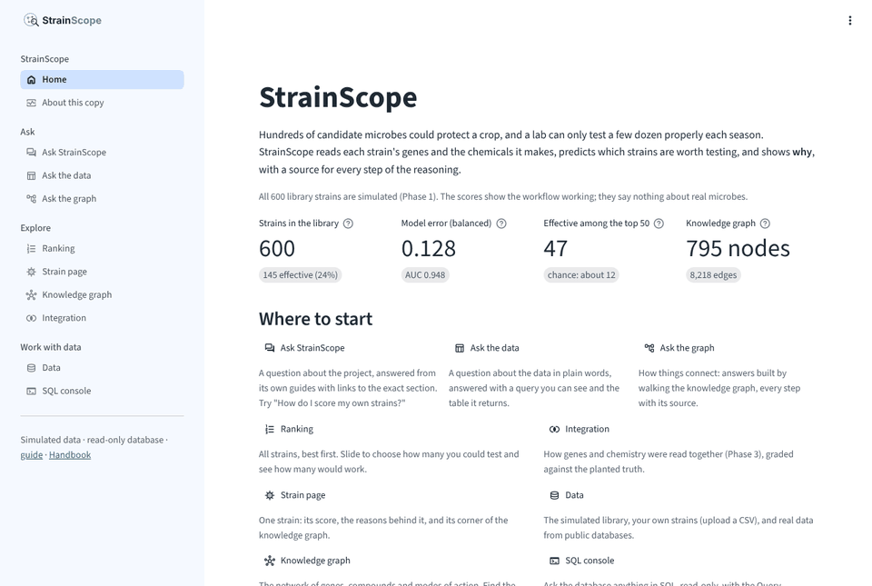

---

## The journey at a glance

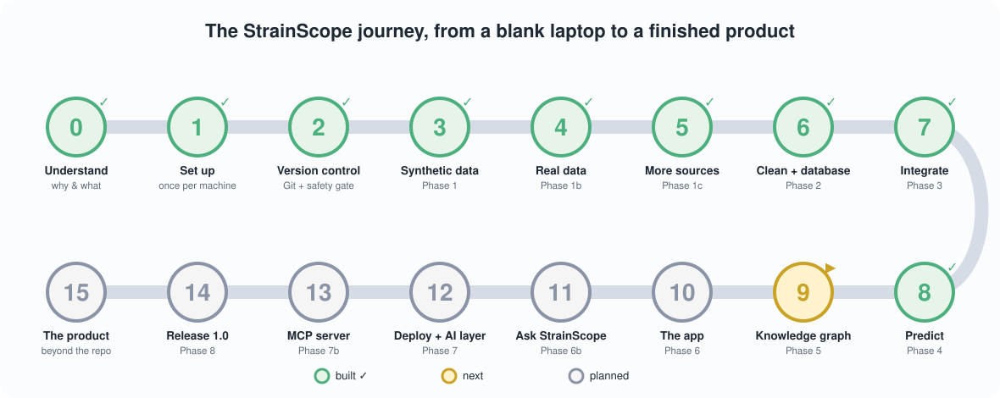

*Prefer to click? [`docs/interactive/journey.html`](interactive/journey.html) is the same journey as an interactive page: pick any stage to see what you do, why, and how you know you're done, with links to the guide. It's built from this Handbook by `figures/make_illustrations.py`, so the two always agree. Download it and open it in a browser; it works offline.*

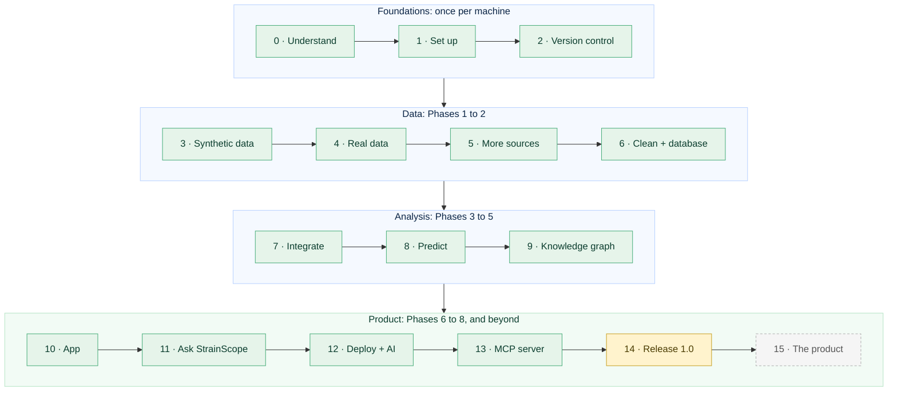

*Green = built and tested · gold = next · dashed grey = planned.*

| Stage | Area | What you do | Guide | Hands-on time | Status |
|---|---|---|---|---|---|
| 0 | Orientation | Understand what you are building and why | [README](../README.md), [Architecture](00-architecture.md), [Roadmap](ROADMAP.md) | 1 h reading | ✅ |
| 1 | Setup | Set up your workshop (once per machine) | [`docs/01-setup.md`](01-setup.md) Parts A-G, I | 60-90 min | ✅ |
| 2 | Git | Version control and the safety gate | [`docs/01-setup.md`](01-setup.md) Part H | 30 min | ✅ |
| 3 | Data | Phase 1: synthetic multi-kingdom data | [`docs/02-data-generation.md`](02-data-generation.md) | 2-3 h | ✅ |
| 4 | Real data | Phase 1b: real data from public databases | [`docs/02b-real-data-ingestion.md`](02b-real-data-ingestion.md) | 2-3 h | ✅ |
| 5 | Secrets | Phase 1c: more sources, and secrets done right | [`docs/02c-more-real-sources.md`](02c-more-real-sources.md) | 2 h | ✅ |
| 6 | Cleaning | Phase 2: cleaning, the database, SQL | [`docs/03-harmonization-qc.md`](03-harmonization-qc.md), [Cookbook](QUERY_COOKBOOK.md) | 2-3 h | ✅ |
| 7 | Integration | Phase 3: multi-omics integration | [`docs/04-integration.md`](04-integration.md) | ~4 h (3 sittings) | ✅ |
| 7.1 | Fix | Fix release v0.1.1: a safer safety gate, copy-safe commands | [`docs/01-setup.md` Part H](01-setup.md#the-pre-push-safety-gate-check-public-safesh), [`CHANGELOG.md`](../CHANGELOG.md) | ~20 min | ✅ |
| 8 | Prediction | Phase 4: machine learning, measured carefully | [`docs/05-machine-learning.md`](05-machine-learning.md) | ~3½ h (3 sittings) | ✅ |
| 9 | Graph | Phase 5: the knowledge graph | [`docs/06-knowledge-graph.md`](06-knowledge-graph.md) | ~3 h (2 sittings) | ✅ |
| 10 | App | Phase 6: the app | [`docs/07-app.md`](07-app.md) | 3-4 h (2 sittings) | ✅ |
| 11 | Assistant | Phase 6b: Ask StrainScope, the documentation assistant | [`docs/07b-docs-assistant.md`](07b-docs-assistant.md) | 2-3 h (2 sittings) | ✅ |
| 12 | Cloud + AI | Phase 7: deployment and the AI layer | [`docs/08-deployment-ai.md`](08-deployment-ai.md) | 3-4 h (2 sittings) | ✅ |
| 12.1 | Fix | Small models cite their sources, the model check, clearer suggestions | [`docs/LANGUAGE_MODEL.md` §9](LANGUAGE_MODEL.md#9-how-a-written-answer-is-asked-for-and-checked), [`CHANGELOG.md`](../CHANGELOG.md) | ~30 min | ✅ |
| 13 | MCP | Phase 7b: the MCP server | [`docs/08b-mcp-server.md`](08b-mcp-server.md) | ~2 h (2 sittings) | ✅ |
| 14 | Release | Phase 8: packaging and release 1.0 | `docs/09-packaging.md` | 2-3 h | ⏳ next |
| 15 | Product | Beyond the repository: the product | [`docs/PRODUCT_ROADMAP.md`](PRODUCT_ROADMAP.md) | reading | ✅ plan exists |

Times are hands-on estimates for a beginner following the guides; they don't count time the computer spends running. At roughly 4 to 5 hours a week, the whole journey is a season's work.

---

## Stage 0: Understand what you are building and why

**What.** Read, in this order:

1. [README](../README.md): the sections *"What is a beneficial microbe?"* and *"The problem this project tackles"*, about farmers protecting crops with living helpers instead of synthetic chemicals, and why choosing *which* helper is a data problem.
2. [`docs/00-architecture.md`](00-architecture.md): every box of the system, what it does and why it exists. It also covers the three words all software leans on (backend = kitchen, frontend = dining room, database = pantry) and the one rule that makes the project reproducible (*data flows one way, and no step edits its own input*).
3. [`docs/ROADMAP.md`](ROADMAP.md): the phase plan you're about to follow, and why it's ordered that way.

**Why.** Everything you type later makes sense only if you can say, in one sentence, what StrainScope is for: *reading several molecular fingerprints of beneficial microbes at once to predict which ones are worth developing, and explaining why.* Without that sentence you'd mostly be copying commands. With it, each step has a reason you can follow.

**Checkpoint.** Without notes, you can explain to a friend: what a strain is; what genes, metabolites and a phenotype are (blueprint, exhaust, track time); why the data is simulated and why that is stated everywhere; what each box in the architecture diagram does.

---

## Stage 1: Set up your workshop (once per machine)

**What.** Follow [`docs/01-setup.md`](01-setup.md) Parts A to G and Part I. Each step shows the exact command for Windows, macOS or RHEL 8 / Linux. **Do the one for your machine.**

**Why.** You install Python (the engine), an editor, Git (the save-game system), a GitHub account, R (for one specialist step), and two *sealed toolboxes* (`.venv` for Python, `renv` for R) that record exact package versions so a stranger can rebuild your setup identically. I put all the setup at the front on purpose: after this stage, daily work is the same handful of short commands on every operating system.

**Platform promise.** The code uses `pathlib` for every file path and plain cross-platform tools, so the same commands run on all three systems, the app included (`python -m streamlit run app/streamlit_app.py` is one command everywhere). Where an operating system really does differ (installing Python, activating the environment, PowerShell quoting, opening a firewall port on a RHEL 8 virtual machine), the guides show each variant side by side.

**Checkpoint.** Your prompt shows `(.venv)`; `python -c "import pandas, sklearn, duckdb, networkx, streamlit; print('env OK')"` prints `env OK`; `Rscript -e 'renv::status()'` reports no issues; `ls renv.lock` shows the file.

---

## Stage 2: Version control and the safety gate

**What.** [`docs/01-setup.md`](01-setup.md) Part H: create the repository, the three branches, and the pre-push safety gate `check-public-safe.sh`.

**Why.** Git snapshots every meaningful change so nothing is ever lost and every step is visible. The three branches give the work a calm rhythm:

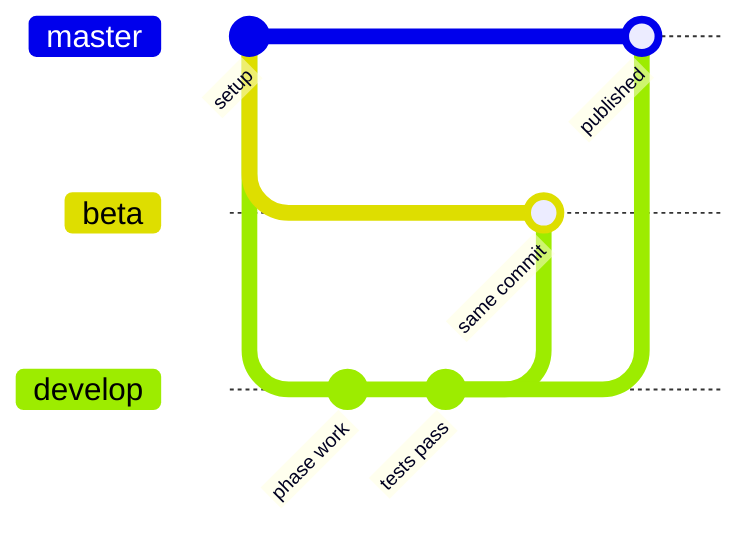

(The picture draws the updates as merges. In practice the push just moves `beta` and `master` forward to the very same commit, which Git calls a *fast-forward*.) You work only on **`develop`**; one push line moves `beta` and `master` forward to the same commit, and then local `master` is brought in step. The safety gate runs first, every time. It refuses to give the all-clear if a secret, a database file or a machine-specific path is about to become public. It reads both the files Git already tracks **and** the new files `git add -A` is about to add, so running it before staging is safe (since v0.1.1; see Stage 7.1).

> **Copy commands safely.** Every command, commit message and tag message in this repository uses plain keyboard characters only. Look-alike characters from documents and chat (a long dash &mdash;, curly quotes &ldquo; &rdquo;, an ellipsis `…`) can be mangled when pasted into a terminal. Type your own messages with plain characters; the look-alike table is in [`docs/01-setup.md` Part H](01-setup.md#copy-commands-safely-plain-keyboard-characters-only).

**The end-of-phase ritual**, used at the end of every stage from here on (each stage names its own commit message):

```bash
pytest -q                     # all tests pass
./check-public-safe.sh        # must print: SAFE TO PUSH   (Windows: bash check-public-safe.sh in Git Bash)

git switch develop
git add -A
git commit -m "<the stage's commit message>"
git push origin develop develop:beta develop:master

## --tags is optional, only when a release tag was created in this phase
## then switch back to local master and pull in the remote changes

git switch master
git pull --ff-only origin master
git switch develop
```

**Checkpoint.** `git branch -a` lists `master`, `beta`, `develop` locally and as `remotes/origin/…`; the safety gate prints `✓ SAFE TO PUSH`.
**Commit messages used:** `chore: initialise project structure, docs, and toolbox` · `docs: add architecture, setup runbook, README, and public-safety gate`.

---

## Stage 3: Phase 1, synthetic multi-kingdom data

**What.** Follow [`docs/02-data-generation.md`](02-data-generation.md): run `python src/strainscope/generate_data.py`, read its ledger, draw the figures.

**Why.** No public source offers genes *and* chemistry *and* a performance score for the same microbes, so the project *builds* the data in the open: 600 strains across four kingdoms (bacteria, fungi, yeasts, oomycetes), each fighting with its own real weapons. Realistic mess is injected on purpose (missing values, duplicates, outliers, batch drift, impossible scores) so the cleaning phase has real work to do. A fixed random seed makes it identical on every machine. A rule that holds for the whole project starts here: **the data is simulated, and every document says so.**

**Checkpoint.** The generator's ledger shows 600 strains, 145 effective (24.2 %), Bacteria 267 · Fungi 183 · Yeast 95 · Oomycete 55; the figures in `figures/` regenerate.
**Commit messages used:** `feat: add Phase 1 synthetic multi-omics data generator, figures, and glossary` · `feat: broaden dataset to multi-kingdom microbial strains (bacteria, fungi, yeasts, oomycetes)`.

---

## Stage 4: Phase 1b, real data from public databases

**What.** Follow [`docs/02b-real-data-ingestion.md`](02b-real-data-ingestion.md): `python src/strainscope/fetch_real.py --probe`, then a full fetch.

**Why.** Real strains (BacDive), real chemistry (PubChem) and real pathway links (KEGG, academic-use, attributed) tie the project to real records and teach the craft of ingestion. That means learning what an API is, being polite about rate limits, keeping every raw response untouched in an evidence locker, and logging every request in a provenance log. The framework is "one socket, many plugs": a new source is one new file.

**Checkpoint.** The probe reaches all three sources; `data/processed/real/` holds the tidy real tables; `data/raw/real/fetch_log.csv` records every request.
**Commit message used:** `feat: add real-data ingestion framework with BacDive, PubChem, and KEGG adapters`.

---

## Stage 5: Phase 1c, more sources and secrets done right

**What.** Follow [`docs/02c-more-real-sources.md`](02c-more-real-sources.md): NCBI Datasets (real genome records for all four kingdoms) and Metabolomics Workbench (RefMet names and classes).

**Why.** Two new plugs show that the framework takes in new sources without changes elsewhere. The optional NCBI key is a good place to practise handling secrets, because a mistake with it costs nothing. Keys live in the environment (`.env` or the shell), **never in the repository**; `.env.example` is the committed template; and two independent guards (`.gitignore` and the safety gate) stop leaks. Five real API surprises from this stage are written up in the guides.

**Checkpoint.** `data/processed/real/real_genomes.csv` reports four kingdoms; the SQL console's `avg_Mb` query shows genome sizes rising from bacteria (a few million letters) to fungi and oomycetes (tens of millions); `git status` never shows `.env`.
**Commit message used:** `feat: add NCBI Datasets and Metabolomics Workbench adapters with API-key handling`.

---

## Stage 6: Phase 2, cleaning, the database and SQL

**What.** Follow [`docs/03-harmonization-qc.md`](03-harmonization-qc.md), then work through the [Query Cookbook](QUERY_COOKBOOK.md).

**Why.** A model trained on dirty data learns the dirt. Six documented cleaning rules run in a planned order, and a ledger counts every change. That ledger caught a textbook outlier rule quietly flattening real biology, which turned out to be the main lesson of the phase. The clean tables and every real table land in one DuckDB file, which you question with SQL through a read-only console.

**Checkpoint.** The ledger reconciles with the mess Phase 1 planted (8 duplicates per table, 657 text cells, 3 clipped scores, 41 capped outliers, 1,052 gaps left as NULLs instead of being guessed); `python src/strainscope/sql.py ".tables"` lists the synthetic and real tables.
**Commit message used:** `feat: add cleaning pipeline with ledger, DuckDB database, SQL console, and cookbook`.

---

## Stage 7: Phase 3, multi-omics integration

**What.** Follow [`docs/04-integration.md`](04-integration.md). In three sittings: prepare the blocks (`python src/strainscope/integrate.py prepare`); install mixOmics into the project's R library and run DIABLO (`Rscript R/diablo_integration.R`); run the Python twin, publish the results, draw the figures, query them. Once mixOmics is installed, one command runs prepare → DIABLO → twin → publish: `python src/strainscope/integrate.py all` (without R it runs everything except DIABLO and says so).

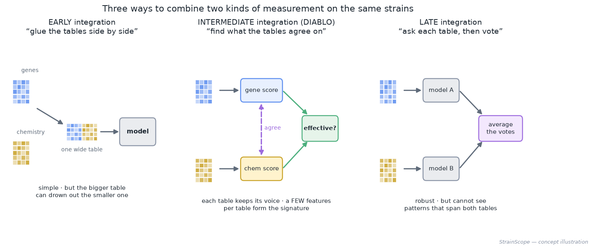

**Why.** This is the specialised core of the project: reading genes and chemistry *together* and keeping what they agree on. You'll learn the three ways to integrate, how DIABLO chooses a short list of features per block that tell one shared story, and how to score any method fairly (repeated cross-validation, a balanced error rate, negative controls that must behave like coins). You'll also see how stability separates findings from quota-filling, and how R and Python check each other through plain hand-off files and a contract test. Ten real surprises from the build are written up as lessons. The most important one is to *make the data's yardstick match the outcome's* (centring within kingdom cut the error by a third).

**Checkpoint.** `Rscript -e 'renv::status()'` reports *No issues found* after mixOmics is installed (a BiocManager notice above it is harmless; here's [why](04-integration.md#6-step-2-install-mixomics-into-the-projects-r-library-once-per-machine)); DIABLO reports a cross-validated balanced error rate of 0.155 ± 0.011 (a coin scores 0.50), reproduced to the last printed digit on macOS with R 4.6.1 + mixOmics 6.36.0 and on Linux with R 4.3 + mixOmics 6.37.0; the twin's controls sit near 0.50; the report card shows DIABLO's robust signature and the Python lasso picking *only* true drivers, with every lasso pick also in DIABLO's list; `pytest -q` → 32 passed; the [integration explorer](interactive/integration_explorer.html) opens in a browser.
**Commit message:** `feat: add multi-omics integration (DIABLO in R + Python twin), handbook and roadmaps`, then tagged **v0.1.0**, the project's first version (the ritual is in [`docs/04-integration.md` §17](04-integration.md#17-save-your-work-safety-gate-then-the-commit-ritual)).

---

## Stage 7.1: Fix release v0.1.1, a safer safety gate and copy-safe commands

**What.** A small release between phases, made of two fixes that real use uncovered. It's also practice in shipping a fix properly, which means tested, documented and versioned.
1. **The safety gate now checks new files too.** Save the updated `check-public-safe.sh` (project folder) and the new `tests/test_safety_gate.py`; run `chmod +x check-public-safe.sh` (macOS/Linux) because a downloaded file loses its "runnable" mark.
2. **Every command, commit message and tag message in the documentation uses plain keyboard characters.**

**Why.** *Fix 1:* the routine runs the gate *before* `git add -A`. The old gate read only files Git already tracked, so a brand-new file (say, a script with a key pasted in) was never checked on its first commit. Nothing leaked, but the gate had a blind spot that needed closing. *Fix 2:* a tag message containing a long dash was pasted into a terminal and arrived garbled (`v0.1. data foundation…0`). Look-alike characters are hard for people to spot, and terminals often mangle them.

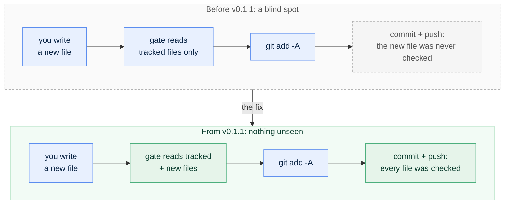

Think of a guard who inspects the parcel but not the pile of items about to go into it. From v0.1.1 the guard inspects both. The full picture is in [`docs/01-setup.md` Part H](01-setup.md#the-pre-push-safety-gate-check-public-safesh), with the three kinds of files (tracked, new, ignored) drawn out.

**How it was tested.** Five automated tests in `tests/test_safety_gate.py` build throw-away Git repositories and check the gate's verdict: a clean repository passes; a new, not-yet-added file holding a key is caught; a key in the ignored `.env` passes (Git never publishes it); a key in a *force-added* ignored file is caught; a link anchor containing `sk-` raises no false alarm. One test fails on the old gate, which shows that it guards the fix. Writing the tests also exposed a second hole (`git grep --untracked` skips force-added ignored files), and that was fixed before release. The story is under *Notes from the build* in [`docs/01-setup.md` Part H](01-setup.md#the-pre-push-safety-gate-check-public-safesh).

**Checkpoint.** `pytest -q` → **37 passed** (32 + 5; the gate tests are skipped on Windows, where the gate runs from Git Bash); `./check-public-safe.sh` prints a new line `Scanning N tracked file(s) + M new file(s) that 'git add -A' would add.` and ends with `✓ SAFE TO PUSH`.
**Save it**: tests and gate first, then the commit ritual, then the tag:

```bash
pytest -q                     # 37 passed
./check-public-safe.sh        # must end with: SAFE TO PUSH

git switch develop
git add -A
git commit -m "fix: safety gate also checks new files; copy-safe commands in docs"
git push origin develop develop:beta develop:master

## --tags is optional, only when required: this release earns v0.1.1
git tag -a v0.1.1 -m "v0.1.1: safety gate checks new files; copy-safe commands"
git push origin develop develop:beta develop:master --tags

## then switch back to local master and pull in the remote changes
git switch master
git pull --ff-only origin master
git switch develop
```

Check the result with `git tag -n1`: both `v0.1.0` and `v0.1.1` are listed, each with a readable message.

---

## Stage 8: Phase 4, machine learning measured carefully

**What.** Follow [`docs/05-machine-learning.md`](05-machine-learning.md). Five steps of `python src/strainscope/model.py`, in three sittings: `compare` (a baseline, an elastic net, a random forest and gradient boosting on the same 50 folds, plus a leak check), `calibrate` (do the winner's probabilities mean what they say?), `explain` (what the models rely on, graded against the planted truth; where they go wrong), `final` (the winner on all strains, saved with a model card) and `publish` (the results as `ml_*` tables). One command runs all five: `python src/strainscope/model.py all` (two to four minutes). Then `python figures/make_phase4_figures.py`.

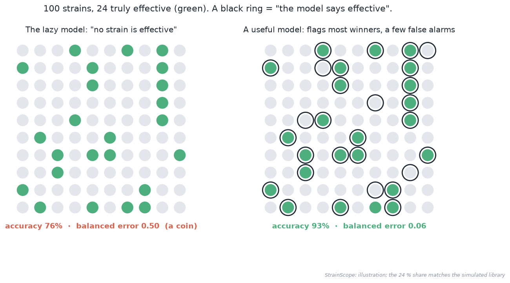

**Why.** Integration told us *which* features matter. This phase answers the question a screening team actually asks (*"we can test 50 strains next season: which 50?"*) with a model that predicts, probabilities that can be trusted, and a clear account of where it fails. You'll learn what a prediction model is and how four kinds decide, and why preparation must be learned *inside* each fold. (The Phase 3 leak is closed and measured, and it turns out to be harmless; next to it sits a real, label-using leak that manufactures signal from noise.) After that come why accuracy lies when winners are rare, tuning without peeking (nested cross-validation), calibration, permutation importance, error analysis, and handing a model over responsibly with a model card. Eight real lessons from the build are kept in the guide's §12.

**Checkpoint.** `compare` names the elastic net the winner: balanced error **0.128 ± 0.007**, AUC 0.948 (the lazy baseline: 0.500, with 76 % accuracy); the shuffled-label control sits at 0.48. The leak check: Phase 3's recipe 0.948 vs leak-proof 0.947 AUC; a real leak on noise labels 0.594 vs 0.527. Calibration error falls from 0.081 to 0.033. Of the elastic net's 23 reliably important features, 22 are true drivers. Mistakes crowd within 5 points of the 65 % line. `final`: of the top 50 ranked strains, **47** are truly effective (chance: 12); the model file is under 20 KB. `pytest -q` → **49 passed**. The [model explorer](interactive/model_explorer.html) opens in a browser.
**Commit message:** `feat: add leak-proof machine learning with calibration, importance and error analysis`. There's no tag this time (v0.2.0 arrives with Phase 5; the ritual is in [`docs/05-machine-learning.md` §17](05-machine-learning.md#17-save-your-work-safety-gate-then-the-commit-ritual)).

---

## Stage 9: Phase 5, the knowledge graph

**What.** Follow [`docs/06-knowledge-graph.md`](06-knowledge-graph.md). First read the domain model, `src/strainscope/ontology.py`: an **ontology**, which you can picture as a family tree for concepts (what is a strain, a gene, a compound, a mode of action, a pathway, and how may they connect?). Then four steps of `python src/strainscope/graph.py`: `build` (the graph from the clean tables, the domain model, the real KEGG / RefMet / BacDive / NCBI tables if you fetched them, and the results of Phases 3 and 4, with every edge checked against the ontology and carrying its source), `analyse` (hubs, communities graded against the planted arsenals, and where the biology and the statistics agree), `explain` (why each strain ranks where it does, as walks through the graph) and `publish` (the results as `kg_*` tables). One command runs all four in well under a minute: `python src/strainscope/graph.py all`. Then ask it questions (`graph.py why STRAIN_0042`, `graph.py path ituA "disease suppression"`, `graph.py show iturin`) and draw the figures with `python figures/make_phase5_figures.py`.

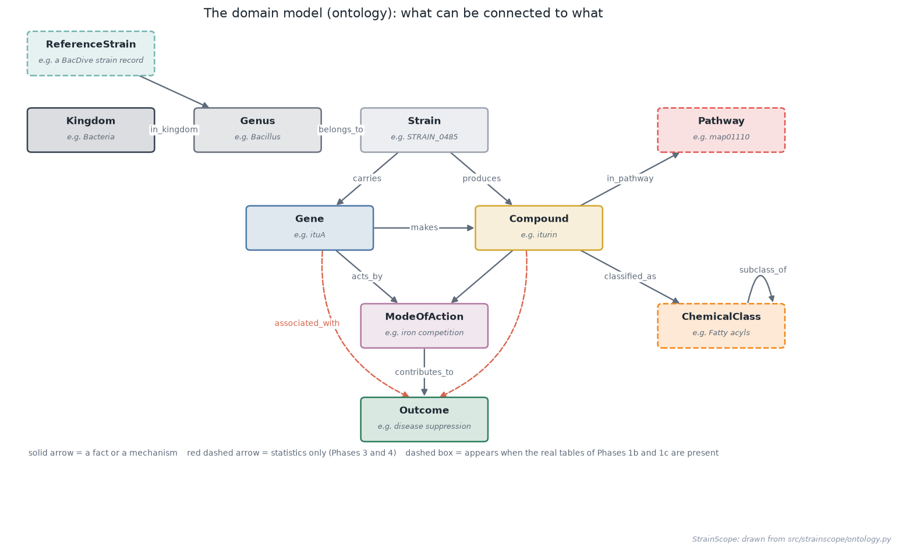

**Why.** Phase 4 ranks the strains; this phase says *why*. In a table, relationships are scattered across rows and columns, while a graph lets you walk along them: STRAIN_0485 carries fenA, which makes fengycin, which attacks the pathogen's membrane, which suppresses disease. You'll learn the words that describe any network (node, edge, degree, hub, path, community, betweenness), why the ontology comes before the data, why every edge carries its source, and the difference between a *mechanism* ("this is how it works") and a *statistical association* ("these go together in the data"). The graph keeps the two apart, so it can flag a feature the model leans on that nothing explains. The walks built here are what the app's strain page (Stage 10), GraphRAG (Stage 12) and the MCP server (Stage 13) will use. Four real lessons from the build are kept in the guide's §12.

**Checkpoint.** `build` reports 679 nodes and 8,096 edges without the real tables (more with them: pathway, chemical-class and reference-strain nodes, with KEGG, RefMet and BacDive as sources), every edge allowed by the ontology and with a source. `analyse` finds four communities that match the planted arsenals (purity 0.94, adjusted Rand index 0.93); the most connected genes are the housekeeping genes, which carry no information; 30 features are confirmed by both the mechanism and the data, and one (`accE`, Phase 4's decoy) has statistical support and no mechanism. `explain`: all of the top 50 strains have at least one mechanism path; `graph.py path ituA "disease suppression"` answers with the two-step mechanism and `path accE "disease suppression"` with the statistic alone. `pytest -q` → **61 passed**. The [graph explorer](interactive/graph_explorer.html) opens in a browser.

**With the real tables** (a full fetch of Phases 1b and 1c, as committed in `artifacts/graph/`), `build` reported **795 nodes and 8,218 edges**. The 116 extra nodes are 100 BacDive reference strains, 8 RefMet chemical classes, 5 KEGG pathway maps and 3 more genera; the 122 extra edges are 100 `belongs_to` and 3 `in_kingdom` (BacDive), 9 `in_pathway` (KEGG), and 6 `classified_as` and 4 `subclass_of` (RefMet). In `analyse`, two real compounds join the bridges: disease suppression stays the biggest (betweenness 0.28), followed by **pyrrolnitrin and HCN (0.05 each)**, which sit in several KEGG pathways. The communities, the knowledge-vs-data verdicts and the explanations don't change, because they're computed from the strains, not from the reference data.
**Commit message:** `feat: add the knowledge graph with ontology, sourced edges, communities and explanations`, then tagged **v0.2.0** ("the analysis is complete"; the ritual is in [`docs/06-knowledge-graph.md` §17](06-knowledge-graph.md#17-save-your-work-safety-gate-the-commit-ritual-and-the-v020-release)).

---

## Stage 10: Phase 6, the app

**What.** Follow [`docs/07-app.md`](07-app.md). In two sittings:

1. **Check what the app will read:** `python src/strainscope/service.py status`. Every phase's results should show a ✓; if the database is missing, the output points to the five commands that build it (or let the app do it with one button).
2. **Start the app:** `python -m streamlit run app/streamlit_app.py`. A browser tab opens at `http://localhost:8501`; Ctrl+C in the terminal stops it. The same command works on Windows, macOS and RHEL 8.
3. **Take the tour:** *Home* (the headline numbers and a health check), *Ranking* (every strain best first, and the slider that asks "if we can test N strains, how many would work?"), *Strain page* (one strain's score, the reasons behind it and its corner of the knowledge graph), *Knowledge graph* (the network, a path finder, a look-up), *Integration* (Phase 3 on one page).
4. **Score your own strains** on the *Data* page: download the example (twelve library strains, renamed), upload it, read the checks, see the ranked result, switch the Ranking and Strain pages to your upload. Then break the file on purpose and read the messages. The same from a terminal: `python src/strainscope/service.py template my_strains.csv --example`, then `python src/strainscope/service.py score my_strains.csv` (delete the three `my_strains*.csv` files afterwards, so they stay out of your commit).
5. **Ask the database** in the *SQL console*: pick a recipe from the Query Cookbook, run it, then try `DELETE FROM phenotype;` and watch it refused.
6. **Optional:** run the app on a RHEL 8 virtual machine and reach it through an SSH tunnel (`ssh -L 8501:localhost:8501 your-user@your-vm`); draw the figures with `python figures/make_phase6_figures.py`; build the smallest possible Streamlit page yourself (the guide's §15).

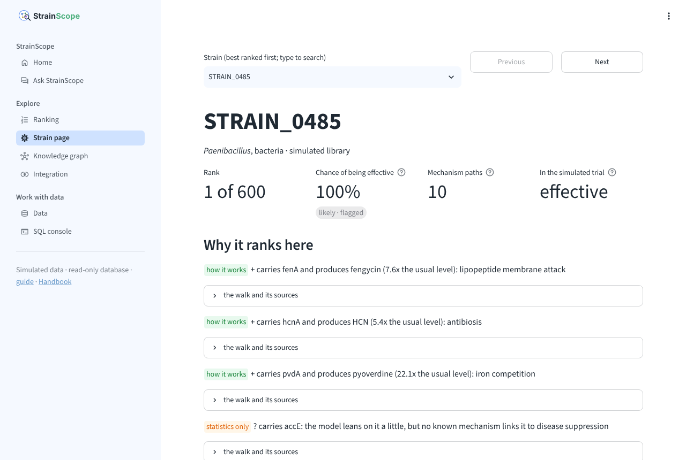

**Why.** Until now, using StrainScope meant opening a terminal and knowing which script to run. A screening scientist wants to ask "which 50 strains, and why?" without learning Python. The app puts every result a click away, and the upload lets anyone bring their own strains and get them checked, scored by the saved model and explained by the knowledge graph. You'll learn how Streamlit turns a script into a web page and why every click runs the script again (caching and session state keep that quick); why the app sits on a thin **service layer** (`src/strainscope/service.py`) that the terminal, the app and later the MCP server all share; how to let anyone type SQL behind four guards (read-only, no file access, a 10-second limit, a 10,000-row cap; the terminal console now shares the first two); how to accept somebody else's file safely; and why an uploaded copy of a library strain scores slightly differently (the ranking uses out-of-fold scores, an upload the final model). Seven real lessons from the build are kept in the guide's §12.

**Checkpoint.** `service.py status` shows ✓ for the database, the three phases' results and the saved model. The app opens on all three operating systems; the Ranking page labels 75 strains likely, 103 borderline and 422 unlikely; the Home page shows 600 strains (145 effective), a balanced error of 0.128 (AUC 0.948), 47 effective among the top 50 (chance: about 12) and, with the committed graph, 795 nodes and 8,218 edges. STRAIN_0485's page lists the fenA, hcnA and pvdA mechanism paths and the `accE` statistics-only flag. The example upload scores twelve strains with two notes and no errors, EXAMPLE_01 first at 99.98 %; changing a gene call to `2` gives ``Gene column `ituA` must hold 0 or 1 (or yes/no); found 2 on row 2.`` The SQL console refuses `DELETE` and file reads. `pytest -q` → **104 passed** (43 new: 23 for the service layer, 20 that click through the app).
**Commit message:** `feat: add the Streamlit app with ranking, strain pages, graph, uploads and a safe SQL console`. There's no tag this time (v0.3.0 arrives with Stage 11; the ritual is in [`docs/07-app.md` §17](07-app.md#17-save-your-work-safety-gate-and-the-commit-ritual)).

---

## Stage 11: Phase 6b, Ask StrainScope (the documentation assistant)

**What.** Follow [`docs/07b-docs-assistant.md`](07b-docs-assistant.md). In two sittings:

1. **Ask from the terminal:** `python src/strainscope/ask.py` lists starter questions; `python src/strainscope/ask.py "What is a balanced error rate?"` answers with the glossary entry, word for word, its link, two more sections and "you might also ask" suggestions. Then ask something off-topic and something the documents don't cover, and read the two other verdicts (*refused*, *closest*).
2. **Ask in the app:** the *Ask StrainScope* page, in the sidebar's *Ask* group. Same answers, with working links, the pictures a passage refers to, and buttons for the starter and follow-up questions.
3. **Run the golden questions:** `python src/strainscope/ask.py --golden` scores every question in `tests/golden_questions.csv`. Add one of your own.
4. **Optional, written answers:** install Ollama, `ollama pull llama3.2:3b`, set `STRAINSCOPE_ASK_BACKEND=local`, and a short answer that cites the passages appears above them. A hosted provider works the same way, with its key in `.env`.
5. **Optional:** draw the figures with `python figures/make_phase6b_figures.py` and open `docs/interactive/ask_explorer.html`; compare `git grep` with the ranked search (the guide's §15).


**Why.** By this stage the documentation is large; a newcomer's most frequent question is "where is that explained?". Ask StrainScope answers it with the passage itself and its link, and refuses rather than guesses when the documents don't cover something. You'll learn how a word search ranks passages (TF-IDF weighs rare words more; cosine similarity compares a question with a passage), why a search needs a gate before it shows anything, how a golden question set turns "does it still work?" into a test, and what retrieval-augmented generation, hallucinations and prompt injection are, with the rules that keep an optional language model fenced in: only answered questions reach it, it sees only its rules, the question and the passages, and it must cite them. Eight real lessons from the build are kept in the guide's §12.

**Checkpoint.** `python src/strainscope/ask.py --stats` reports 1068 sections from 56 files (464 document sections, 338 glossary entries, 266 code docstrings). "What is a balanced error rate?" is answered with the glossary's *Balanced error rate (BER)* (match 0.47); "What is the capital of France?" is refused because no document uses either word; "How do I run StrainScope in a Jupyter notebook?" gets the *closest* sections, marked as not a direct answer. `--golden` passes 63 of 63 (43 answered from a right section, 4 undocumented ones not answered, 16 off-topic questions and instructions refused) and reports the one known limitation. `pytest -q` → **207 passed, 1 skipped** (104 new: 98 in `tests/test_ask.py`, including a check that every link between the documents resolves, 5 for the new page in `tests/test_app.py`, and 1 for the `.env` reading in `tests/test_sources.py`; the skipped one is the known limitation).
**Commit message:** `feat: add Ask StrainScope, answers from the project's own documents with links and a golden question set`. **Tag:** `v0.3.0` ("usable by anyone"), with the ritual in [`docs/07b-docs-assistant.md` §17](07b-docs-assistant.md#17-save-your-work-safety-gate-the-commit-ritual-and-the-v030-release).

---

## Stage 12: Phase 7, deployment and the AI layer

**What.** Follow [`docs/08-deployment-ai.md`](08-deployment-ai.md). In two sittings:

1. **Results in plain words:** `python src/strainscope/narrate.py STRAIN_0485` writes one strain's rank and reasons as a short paragraph, and `python src/strainscope/narrate.py --top 50` says what testing the 50 best strains would bring. In the app: the *In plain words* boxes on the Strain and Ranking pages.
2. **Ask the data:** `python src/strainscope/ask_data.py "How many strains are there in each kingdom?"` finds the Query Cookbook recipe that answers it, shows its SQL and runs it read-only. Ask a question no recipe answers, a command that would change the database, and an off-topic one, and read the three other verdicts. `--show-request` prints what a language model would be sent (table and column names, never a row); `--golden` scores the 37 golden questions. In the app: the *Ask the data* page, which can hand any query to the SQL console.
3. **Ask the graph:** `python src/strainscope/ask_graph.py "How does iturin suppress disease?"` answers with a route through the knowledge graph and numbered facts, each with its source; a question about a strain gets that strain's explanation; `--golden` scores 23 golden questions. In the app: the *Ask the graph* page, with the route drawn.
4. **Rehearse the shared copy:** set the database aside, start the app with `STRAINSCOPE_MODE=public`, and watch it build the database on its first start; *About this copy* shows the version, the health check and the AI features.
5. **Save and push** (the first commit below), because the online copy builds from GitHub.
6. **Put it online:** sign in to Streamlit Community Cloud with GitHub, create an app from `akannan2987/strainscope`, branch `master`, file `app/streamlit_app.py`, choose its address and Python version, and paste `STRAINSCOPE_MODE = "public"` into its Secrets box. It installs `app/requirements.txt` (exact versions) and builds its database on the first visit.
7. **Optional:** a language model for all three assistants (Ollama at home; a hosted provider online, with its key in the host's Secrets box and a daily cap of 200 requests); the interactive figures published with GitHub Pages; the figures with `python figures/make_phase7_figures.py`.
8. **Second commit:** the online copy's address in the README and in this stage.

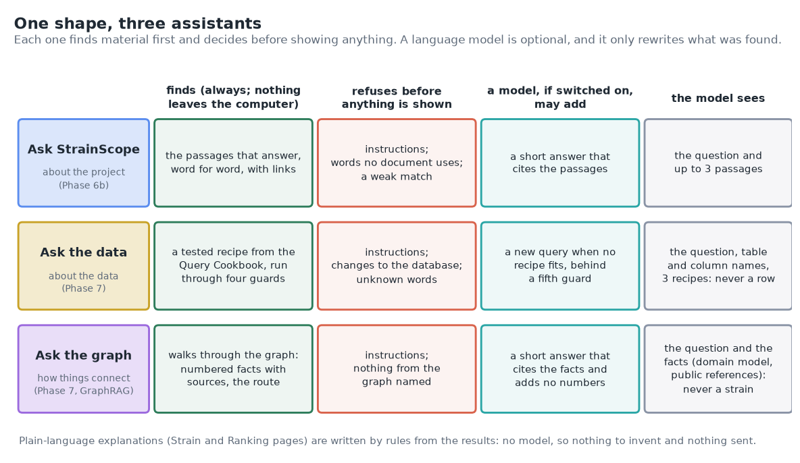

**Why.** Until now, using StrainScope meant installing it, and asking it anything meant SQL or graph commands. A link anyone can open, and questions in plain words, make it usable by the people it's for. The phase also draws a clear line around the language model: every assistant answers on its own first (a passage, a tested recipe, a walk through the graph), a model may only rewrite what was found, and it is never sent a row of data or anything about a strain. You'll learn what deploying means and what a free host changes (it builds from GitHub, sleeps, starts again, and is shared); shared mode, a first-start build, pinned versions and secrets on a host; text-to-SQL with tested recipes first and a model's query only behind five guards; GraphRAG as walks with numbered, sourced facts; and why the plain-language explanations are written by rules. Ten real lessons from the build are kept in the guide's §14.

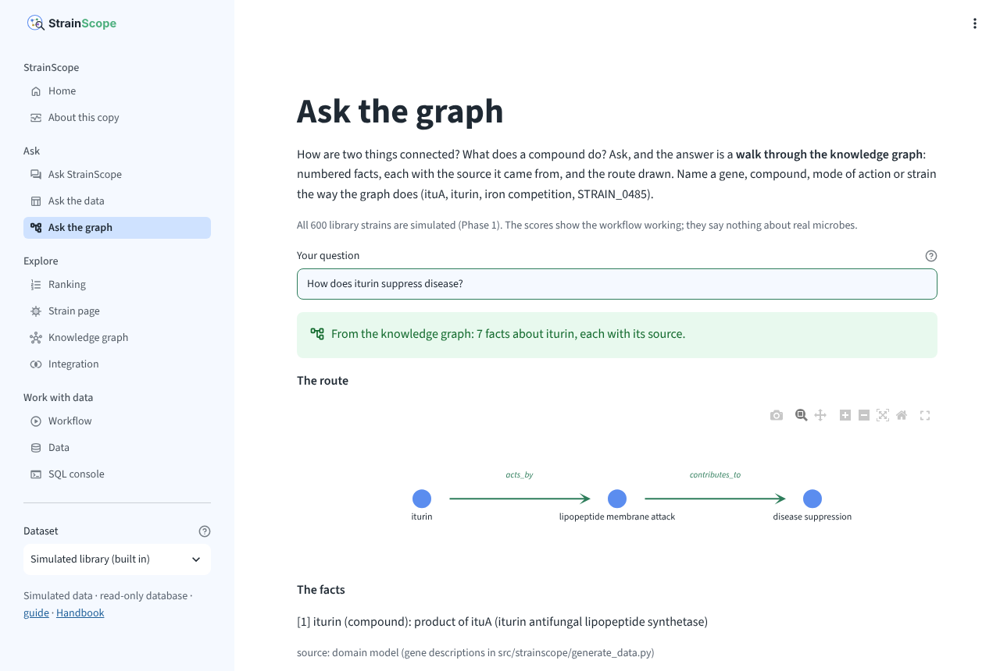

**Checkpoint.** `narrate.py STRAIN_0485` says *at rank 1 of 600*, *over 99 %*, *47 of those 50 strains were effective* and *10 routes like these*; `narrate.py --top 50` adds the chances up to **46.2**, against 47 effective in the simulated trial. `ask_data.py --golden` passes **37 of 37** (24 answered by the right recipe, 6 with no recipe that fits, 7 refused) and `ask_graph.py --golden` **23 of 23** (17 answered, 2 not covered, 4 refused); Ask StrainScope's golden set still passes in full. "How many strains are there in each kingdom?" runs the cookbook's section 3 recipe (Bacteria 267, Fungi 183, Yeast 95, Oomycete 55); "How are ituA and fenA connected?" walks `ituA -acts_by-> lipopeptide membrane attack <-acts_by- fenA`. The rehearsal builds the database on the first start and *About this copy* says *shared copy*. `pytest -q` → **353 passed, 1 skipped** (146 new: 69 in `tests/test_ask_data.py`, 43 in `tests/test_ask_graph.py`, 8 in `tests/test_narrate.py`, 7 in `tests/test_llm.py`, 6 in `tests/test_deploy.py`, 12 app test runs and 1 graph test). The online copy runs at [strainscope.streamlit.app](https://strainscope.streamlit.app) (deployed on 2026-10-12 with Python 3.14; 2 to 5 minutes from pressing *Deploy* to the Home page, installing the packages and the first start included): *About this copy* says *StrainScope v0.3.0 with the changes listed under [Unreleased]* and *shared copy*, with every required line ✓; *Which strains are borderline?* gives the same table as at home (Bacteria 41, Fungi 33, Yeast 20, Oomycete 9); *How does iturin suppress disease?* gives the same 7 facts; and *Build the database* is greyed out. The interactive figures are published with GitHub Pages at [akannan2987.github.io/strainscope](https://akannan2987.github.io/strainscope/).
**Commit messages:** `feat: add the online copy, plain-language explanations, Ask the data and Ask the graph`, then, after deploying, `docs: link the online app and the interactive figures`. No tag (v1.0.0 arrives with Phase 8; the ritual is in [`docs/08-deployment-ai.md` §19](08-deployment-ai.md#19-save-your-work-two-commits-before-and-after-deploying)).

---

## Stage 12.1: Fix for small language models, the model check and clearer suggestions

**What.** A small fix between phases, found by using the project: switching on a language model on an Intel Mac with Ollama ([`docs/LANGUAGE_MODEL.md`](LANGUAGE_MODEL.md) setup A) showed no written answers at all. One commit, no tag, with four changes:

1. **The request for a written answer says how to cite three ways.** First the rule with an example sentence, then one worked example (a question about a made-up pump and an answer that cites it), and last a reminder after the question and its material. It lives in `cited_messages()` in `src/strainscope/llm.py`, and both `src/strainscope/ask.py` (Ask StrainScope) and `src/strainscope/ask_graph.py` (Ask the graph) build their requests with it.
2. **A model check.** `python src/strainscope/service.py check-model` asks the switched-on model four questions through the real assistants, with exactly the requests the app sends, and says how many written answers would be shown. Without a model it sends nothing.
3. **Clearer suggestions.** Under an answer, Ask StrainScope's *You might also ask about* used to offer a button that read only *Steps*, a heading that `docs/01-setup.md` uses twice. Clicking it asked the question "Steps", which helps nobody. A heading a guide uses more than once is now suggested as the part of the guide it belongs to, for example *Part F: Create the project folder and a virtual environment*, with that part's link.
4. **Only strong matches go to the model.** Once written answers showed up, the starter question "How do I set up my laptop?" got one about choosing a language model. The search had put the right guide first (match 0.22), but the next two matches (0.15 each) only shared two of the question's words, and the model summarised all three. Ask StrainScope now gives the model the best passage and, of the next two, only those whose match is at least three quarters of the best one's (`model_hits()` in `src/strainscope/ask.py`). The screen still shows all three.

Two golden questions came with it, about switching a model on and about checking it, so Ask StrainScope keeps finding the how-to ([`docs/LANGUAGE_MODEL.md`](LANGUAGE_MODEL.md)).

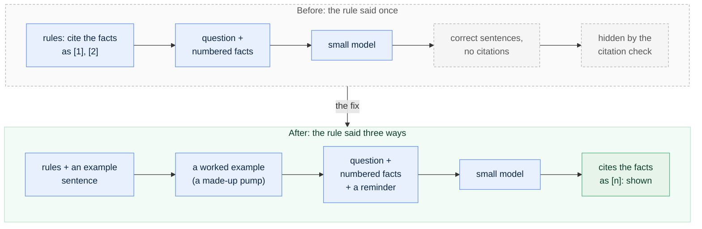

**Why.** The citation check of Stages 11 and 12 did its job: llama3.2:3b wrote correct sentences but cited nothing, so every answer was hidden and the passages and facts were shown alone. The tests couldn't notice: the stand-in model they use replies with whatever each test sets. A new colleague told only to "cite your sources" may still forget; shown one sentence with its footnote, they know what's wanted. The small model behaved the same way: once the rule came with an example sentence, it cited. The request also gained one finished example of the whole task (a technique called *few-shot prompting*), which gave the shortest answers. To choose the request, the same four questions were asked with four versions of it, on the same Mac: the old one got **0 of 4** answers shown, and each of the three stricter ones **4 of 4**. The full test, and why the version with the worked example won, is in [`docs/LANGUAGE_MODEL.md` §9](LANGUAGE_MODEL.md#9-how-a-written-answer-is-asked-for-and-checked). The model check turns that one-off test into a command anyone can rerun after switching models. Visible answers then showed a second weakness, one the citation check can't see: a correctly cited summary of a passage that doesn't answer the question. Sending only strong matches keeps such passages away from the model ([`docs/LANGUAGE_MODEL.md` §9](LANGUAGE_MODEL.md#only-strong-matches-go-to-the-model)).

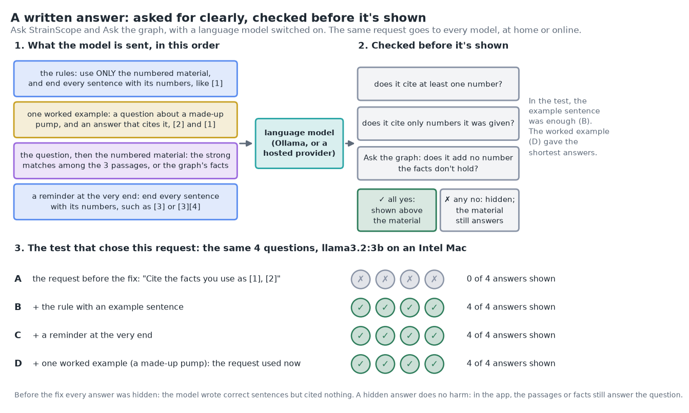

**Checkpoint.** With Ollama and llama3.2:3b switched on: `python src/strainscope/ask_graph.py "How does iturin suppress disease?"` shows a block `Written answer (llama3.2:3b, from the facts below):` that cites the facts by number, such as `[3][4]`, and `python src/strainscope/service.py check-model` ends with `4 of 4 written answers would be shown.` (on an Intel MacBook Pro, 5 to 15 seconds per answer). Without a model, `check-model` says that none is switched on and sends nothing. `python src/strainscope/ask.py "How do I set up my laptop?"` suggests *Part F: Create the project folder and a virtual environment* and no *Steps*; with the model on, its written answer (when shown) can only cite [1], the setup guide. `python src/strainscope/ask.py --golden` passes 63 of 63. `pytest -q` → **368 passed, 1 skipped** (14 new: 6 in `tests/test_ask.py` for the suggestions, the request and the strong matches, 2 in `tests/test_llm.py` for the request and its worked example, 4 in `tests/test_service.py` for the model check, and 2 golden questions).
**Save it**: tests and gate first, then the commit ritual (no tag: this fix arrives with v1.0.0):

```bash
pytest -q                     # 368 passed, 1 skipped
./check-public-safe.sh        # must end with: SAFE TO PUSH

git switch develop
git add -A
git commit -m "fix: small models cite their sources, strong matches only, the model check, clearer suggestions"
git push origin develop develop:beta develop:master

## --tags is optional, only when required: none for this fix

## then switch back to local master and pull in the remote changes
git switch master
git pull --ff-only origin master
git switch develop
```

---

## Stage 13: Phase 7b, the MCP server

**What.** Follow [`docs/08b-mcp-server.md`](08b-mcp-server.md). In two sittings:

1. **Install and meet the tools:** `python -m pip install -r requirements.txt` adds the `mcp` package. `python src/strainscope/mcp_server.py tools` lists the nine tools with the descriptions an assistant app's model reads: `ask_docs` (Stage 11's engine), `ask_data` and `ask_graph` (Stage 12's assistants), `describe_database`, `query_database` (one read-only `SELECT`, at most 200 rows), `get_signature` (Stage 7's DIABLO signature), `rank_strain` and `explain_strain` (Stages 8, 9 and 12) and `shortlist` (what testing the best N would bring).
2. **Call them by hand:** `python src/strainscope/mcp_server.py call rank_strain strain_id=STRAIN_0485` prints the JSON an app would receive. A `DELETE`, and a strain that doesn't exist, are refused with a sentence saying why.
3. **Check it the way an app does:** `python src/strainscope/mcp_server.py check` starts the server as a separate program and talks to it over standard input and output (stdio), the way assistant apps do.
4. **Connect an assistant app:** `python src/strainscope/mcp_server.py config` prints the settings with this computer's paths: a block for Claude Desktop's settings file (most other apps use the same shape) and a `claude mcp add` line for Claude Code. Then ask the app questions in words and watch which tools it calls.
5. **Read the call log:** every call adds one line to `data/processed/mcp_calls.log` (the tool, its inputs, the outcome and the time it took; never the result).
6. **Optional:** the MCP Inspector (needs Node.js); the figures and the interactive tool explorer with `python figures/make_phase7b_figures.py`.

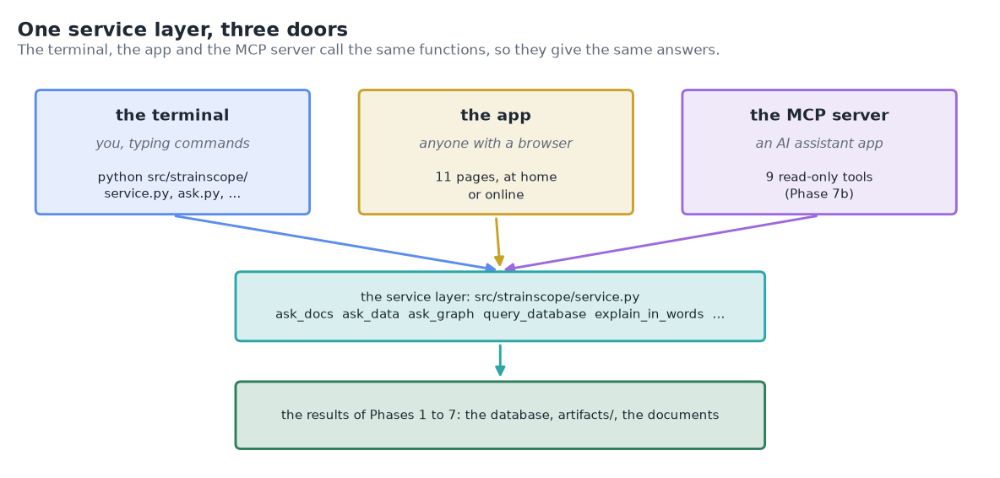

**Why.** Many people now ask an AI assistant first, and without a way in, an assistant can only guess what StrainScope found. The **Model Context Protocol (MCP)** is the shared standard through which assistant apps use other programs' tools, so one small server lets any app that speaks it answer from StrainScope's own results, with the routes and sources to check them. Nothing new is computed: each tool is a thin door onto the service layer of Stages 10 to 12, so an assistant gets the answers the terminal and the app give. You'll learn the roles (server, client, tool), how an app starts a server on your computer and talks to it through its input and output (and why a stray `print` would break that), how a tool's description and input schema guide the app's model, and how to keep tools read-only, check their input, turn a refusal into a sentence the model can act on, and log calls without logging results. One difference from Stage 12 is worth knowing: the app's model sees what the tools return. The data is simulated, and the guide's §1 lists what each tool can show. Seven real lessons from the build are kept in the guide's §15.

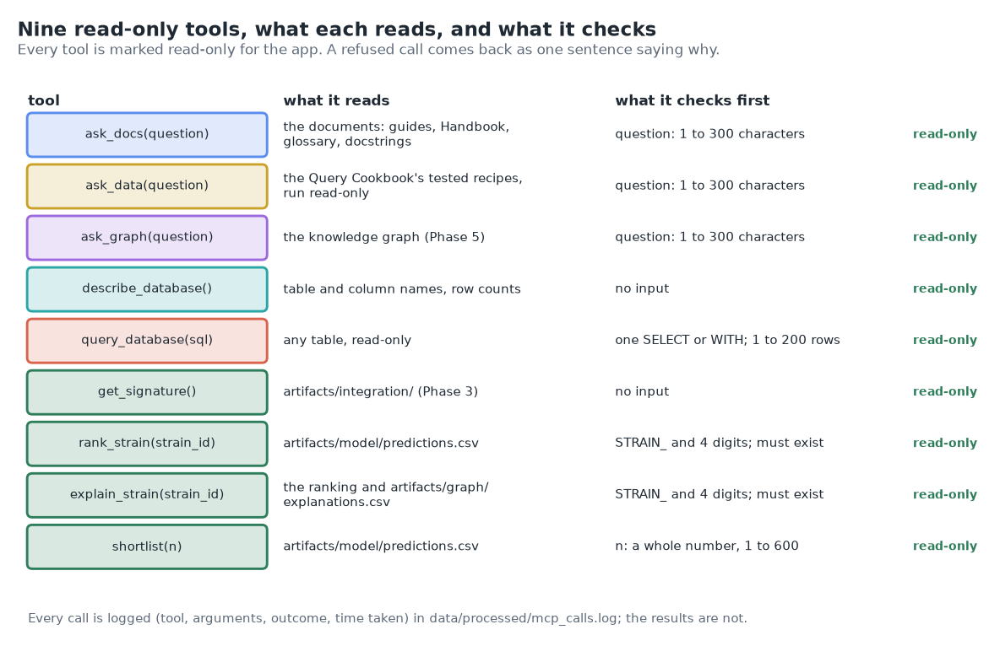

**Checkpoint.** `tools` lists **9 tools, all read-only**. `call rank_strain strain_id=STRAIN_0485` returns rank **1 of 600**, probability 0.9998, band *likely*, effective in the simulated trial; `call shortlist n=3` expects 3.0 effective strains, and the trial found 3; the kingdoms query through `call query_database` gives Bacteria 267, Fungi 183, Yeast 95, Oomycete 55, as in the Query Cookbook; `DELETE FROM phenotype` and `STRAIN_0601` are refused with a sentence. `check` connects with protocol `2025-11-25` and ends with *MCP check passed.* Connected to an assistant app, a question such as "Why does STRAIN_0485 rank first?" shows calls to `rank_strain` and `explain_strain`, and the reply quotes their numbers. `pytest -q` → **408 passed, 1 skipped** (40 new in `tests/test_mcp.py`; `tests/test_deploy.py` now also checks that `mcp` stays off the online copy).
**Save it**: tests and gate first, then the commit ritual (no tag: v1.0.0 comes with Phase 8; the ritual is also in [`docs/08b-mcp-server.md` §20](08b-mcp-server.md#20-save-your-work-safety-gate-then-the-commit-ritual)):

```bash
pytest -q                     # 408 passed, 1 skipped
./check-public-safe.sh        # must end with: SAFE TO PUSH

git switch develop
git add -A
git commit -m "feat: add the MCP server: nine read-only tools for AI assistant apps"
git push origin develop develop:beta develop:master

## --tags is optional, only when required: none for this phase

## then switch back to local master and pull in the remote changes
git switch master
git pull --ff-only origin master
git switch develop
```

---

## Stage 14: Phase 8, packaging and release 1.0

**What.** `docs/09-packaging.md`: the one-command pipeline (`python src/strainscope/pipeline.py`, which runs generate → clean → integrate → model → graph); automated tests on Windows, macOS and Linux at every push (continuous integration on GitHub); the MIT LICENSE; the CHANGELOG brought to 1.0; an uninstall guide; an optional container; the **v1.0.0** tag.

**Why.** As long as only its author can run it, a project is still a prototype. This stage turns "it works on my laptop" into "it works anywhere, and here's the proof at every push".

---

## Stage 15: Beyond the repository, the product

**What.** Read [`docs/PRODUCT_ROADMAP.md`](PRODUCT_ROADMAP.md).

**Why.** It describes what an industrial StrainScope would add (real matched multi-omics data, a multi-user web front end and API, a cloud database, scheduled pipelines, monitoring, ontologies, regulation), and for every technology it gives a verdict (*required now · recommended later · optional · not needed*) and the event that would change it. Thanks to the design choices you made in Stages 3 to 14, that list can be added on top of what exists; nothing has to be rewritten.

---

## The whole build, command by command

Every command from a set-up computer to today, in order, on one page. Each block says which stage it belongs to and where every step is explained with its expected output. Run them from the project folder with `(.venv)` active. (Stage 1, the setup itself, differs by operating system, so it stays in [`docs/01-setup.md`](01-setup.md).) After every stage: `pytest -q`, `./check-public-safe.sh`, then the commit ritual of Stage 2.

```bash
# Stage 3, Phase 1: the synthetic library            (docs/02-data-generation.md)
python src/strainscope/generate_data.py
python figures/make_phase1_figures.py

# Stage 4, Phase 1b: real data (optional, needs the internet)     (docs/02b-real-data-ingestion.md)
python src/strainscope/fetch_real.py --probe
python src/strainscope/fetch_real.py
python figures/make_phase2b_figures.py

# Stage 5, Phase 1c: two more sources; an optional NCBI key goes in .env     (docs/02c-more-real-sources.md)
cp .env.example .env                                   # Windows PowerShell: Copy-Item .env.example .env
python src/strainscope/fetch_real.py --source ncbi_datasets
python src/strainscope/fetch_real.py --source metabolomics_wb
python figures/make_phase2c_figures.py

# Stage 6, Phase 2: cleaning and the database        (docs/03-harmonization-qc.md)
python src/strainscope/harmonize.py
python figures/make_phase2_figures.py
python src/strainscope/sql.py ".tables"

# Stage 7, Phase 3: integration                       (docs/04-integration.md)
python src/strainscope/integrate.py prepare
Rscript -e 'renv::restore()'      # once per machine: mixOmics and its helpers from renv.lock (Windows: swap the quotes)
Rscript R/diablo_integration.R
python src/strainscope/integrate.py twin
python src/strainscope/integrate.py publish
python figures/make_phase3_figures.py

# Stage 8, Phase 4: machine learning                  (docs/05-machine-learning.md)
python src/strainscope/model.py all                    # compare, calibrate, explain, final, publish
python figures/make_phase4_figures.py

# Stage 9, Phase 5: the knowledge graph               (docs/06-knowledge-graph.md)
python src/strainscope/graph.py all                    # build, analyse, explain, publish
python src/strainscope/graph.py why STRAIN_0485
python src/strainscope/graph.py path ituA "disease suppression"
python src/strainscope/graph.py show iturin
python figures/make_phase5_figures.py

# Stage 10, Phase 6: the app                          (docs/07-app.md)
python src/strainscope/service.py status
python -m streamlit run app/streamlit_app.py           # Ctrl+C stops it
python src/strainscope/service.py template my_strains.csv --example
python src/strainscope/service.py score my_strains.csv
rm my_strains*.csv                                     # Windows PowerShell: Remove-Item my_strains*.csv
python figures/make_phase6_figures.py

# Stage 11, Phase 6b: Ask StrainScope                 (docs/07b-docs-assistant.md)
python src/strainscope/ask.py                          # starter questions
python src/strainscope/ask.py "What is a balanced error rate?"
python src/strainscope/ask.py --golden                 # the golden questions, scored
python figures/make_phase6b_figures.py
# optional, written answers from a model on this computer (needs Ollama: docs/07b section 8)
ollama pull llama3.2:3b
export STRAINSCOPE_ASK_BACKEND=local                   # Windows PowerShell: $env:STRAINSCOPE_ASK_BACKEND = "local"

# Stage 12, Phase 7: plain words, Ask the data, Ask the graph, the online copy     (docs/08-deployment-ai.md)
python src/strainscope/narrate.py STRAIN_0485
python src/strainscope/narrate.py --top 50
python src/strainscope/ask_data.py "How many strains are there in each kingdom?"
python src/strainscope/ask_data.py "How many oomycete strains carry olpA?" --show-request
python src/strainscope/ask_data.py --golden
python src/strainscope/ask_graph.py "How does iturin suppress disease?"
python src/strainscope/ask_graph.py --golden
export STRAINSCOPE_MODE=public                         # rehearse the shared copy; Windows PowerShell: $env:STRAINSCOPE_MODE = "public"
python -m streamlit run app/streamlit_app.py           # Ctrl+C stops it; then: unset STRAINSCOPE_MODE (PowerShell: Remove-Item Env:STRAINSCOPE_MODE)
python figures/make_phase7_figures.py
python figures/make_phase6b_figures.py                 # again: its numbers grow with the documentation
# then: commit and push (docs/08 section 19, part A), deploy on share.streamlit.io (section 9), second commit (part B)

# Stage 12.1, the fix: small models cite their sources, the model check, clearer suggestions     (docs/LANGUAGE_MODEL.md section 9)
python src/strainscope/ask.py "How do I set up my laptop?"      # Part F, not Steps, under "You might also ask about"
python src/strainscope/service.py check-model                  # only with a language model switched on (docs/LANGUAGE_MODEL.md section 3)
python figures/make_phase7_figures.py                          # adds figures/written_answer_check.png

# Stage 13, Phase 7b: the MCP server                  (docs/08b-mcp-server.md)
python -m pip install -r requirements.txt              # adds the mcp package
python src/strainscope/mcp_server.py tools
python src/strainscope/mcp_server.py call rank_strain strain_id=STRAIN_0485
python src/strainscope/mcp_server.py call query_database "sql=SELECT kingdom, COUNT(*) AS strains FROM phenotype GROUP BY kingdom ORDER BY strains DESC"
python src/strainscope/mcp_server.py check             # talks to the server the way an assistant app does
python src/strainscope/mcp_server.py config            # the settings for an assistant app (docs/08b section 9)
python figures/make_phase7b_figures.py
python figures/make_phase6b_figures.py                 # again: its numbers grow with the documentation

# Every stage ends with
pytest -q
./check-public-safe.sh                                 # Windows: bash check-public-safe.sh in Git Bash
```

Two rules keep this list working. The order matters, because each stage reads what the stage before it wrote. And `src/strainscope/harmonize.py` rebuilds the database from scratch, so whenever you re-run it, re-run the three `publish` steps (`integrate.py publish`, `model.py publish`, `graph.py publish`) or press *Build the database* in the app, which does all of that.

## Every session, after setup

```bash
cd ~/projects/strainscope                 # Windows PowerShell: cd $HOME\projects\strainscope
source .venv/bin/activate                 # Windows PowerShell: .\.venv\Scripts\Activate.ps1
git switch develop && git pull --ff-only origin develop
pytest -q                                 # everything still green?
python -m streamlit run app/streamlit_app.py   # optional: the app, to look at the results (Ctrl+C stops it)
# ... work on the current stage ...
```

Then the end-of-phase ritual (Stage 2) when the stage is complete. Since Stage 12, every push to `master` also updates the online copy within a minute or so.

## Switching on a language model (optional)

**What.** Nothing needs one: the three assistants answer by search and by rules. With a model switched on, Ask StrainScope and Ask the graph also write a short answer that cites what they found, and Ask the data writes a new query when no tested recipe fits. There are three ways, all in [`docs/LANGUAGE_MODEL.md`](LANGUAGE_MODEL.md):

1. **Ollama on your own computer** (free; nothing leaves the computer): install Ollama, `ollama pull llama3.2:3b`, add `STRAINSCOPE_ASK_BACKEND=local` to `.env`, restart the app.
2. **A hosted provider at home** (for a computer too small for a local model): `STRAINSCOPE_ASK_BACKEND=hosted` and the provider's address, model name and key in `.env`.
3. **A hosted provider for the online copy**: the same settings in the host's Secrets box, then reboot the app. From then on, the questions visitors ask (those the assistants judge in scope) go to the provider on your key, within a daily cap of 200 requests.

**Why.** A written answer is easier to read than three passages, and a model can write a query no recipe covers. It stays optional because a model can be wrong and, unless it runs on your computer, it means sending text to someone else; the rules around it (what may be sent, citations, five guards for SQL) are explained in [Phase 7 §1](08-deployment-ai.md#what-a-model-may-see-and-what-it-never-sees).

The MCP server of Stage 13 never uses one: an assistant app that calls its tools brings its own model.

**Checkpoint.** *About this copy* says *AI features (optional): on, ...* with your model's name, and each Ask page shows a switch such as *Also write a short answer*. `python src/strainscope/service.py check-model` asks the model four questions and says how many of its written answers would be shown (4 of 4 with llama3.2:3b on an Intel MacBook Pro since Stage 12.1). Switching off: `STRAINSCOPE_ASK_BACKEND=none` and a restart.

## When something goes wrong

| Symptom | Look in |
|---|---|
| a command "is not recognized" / "not found" | your setup guide: is `(.venv)` in your prompt? On Windows, is R on your PATH? ([`docs/01-setup.md`](01-setup.md) Part F and Part I) |
| `R -e ...` does nothing sensible on Windows | PowerShell treats `r` as "repeat last command", so use `Rscript -e ...` instead ([`docs/04-integration.md` §16](04-integration.md#16-what-could-go-wrong-mini-faq)) |
| a test fails | the *What could go wrong* section of the phase guide you are on |
| the database is missing or a table is gone | rebuild: `python src/strainscope/generate_data.py`, then `python src/strainscope/harmonize.py`, then `python src/strainscope/integrate.py publish`, `python src/strainscope/model.py publish` and `python src/strainscope/graph.py publish` ([`docs/03-harmonization-qc.md` §11](03-harmonization-qc.md#11-what-could-go-wrong-mini-faq)) |
| `mixOmics is not installed in this project's R library` | [`docs/04-integration.md` §6](04-integration.md#6-step-2-install-mixomics-into-the-projects-r-library-once-per-machine): the package is installed, but invisible to the project |
| an API call fails or returns odd numbers | the real-data guides' FAQs ([`02b`](02b-real-data-ingestion.md), [`02c`](02c-more-real-sources.md)) and their *Notes from the build* |
| the safety gate says NOT SAFE | read the flagged line; never weaken the check ([`docs/01-setup.md`](01-setup.md) Part H) |
| the gate flags a file you have not added yet | that's the gate working: `git add -A` would add it, so it's checked now (since v0.1.1, see Stage 7.1) |
| a pasted command prints strange characters, or a commit/tag message arrives garbled | a look-alike character (long dash, curly quote, ellipsis); retype it with plain keyboard characters ([`docs/01-setup.md` Part H](01-setup.md#copy-commands-safely-plain-keyboard-characters-only)); a wrong tag message is replaced as in [`docs/04-integration.md` §17](04-integration.md#17-save-your-work-safety-gate-then-the-commit-ritual) |
| `./check-public-safe.sh: Permission denied` | the file lost its runnable mark when downloaded: `chmod +x check-public-safe.sh` (macOS/Linux) |
| a push fails with `HTTP 400` / `RPC failed` | [`docs/01-setup.md`](01-setup.md) Part H, "If a push fails partway" |
| a word you don't know, or "where is that explained?" | the [Glossary](GLOSSARY.md), or ask: `python src/strainscope/ask.py "what is ...?"` (also a page in the app) |
| Ask StrainScope refuses a question you think the documents answer | use the words the documents would use; the search matches words, not meaning ([`docs/07b-docs-assistant.md` §16](07b-docs-assistant.md#16-what-could-go-wrong-mini-faq)) |
| `ollama: command not found` | Ollama isn't installed, or (on macOS) it was never started, which is when it adds the command: [`docs/LANGUAGE_MODEL.md` §8](LANGUAGE_MODEL.md#8-when-something-goes-wrong) |
| no written answer appears, or `Couldn't reach the model` | Ollama isn't running, or `STRAINSCOPE_ASK_BACKEND` isn't set in this terminal or in `.env` (restart the app after setting it); refused and *closest* questions never get one ([`docs/07b-docs-assistant.md` §8](07b-docs-assistant.md#8-step-4-optional-written-answers-from-a-model-on-your-own-computer)) |
| a note says the model's answer *cites nothing* or *didn't cite the sections correctly* | the model broke the citation rule, so its answer is hidden and the passages or facts still answer; if most answers are hidden, `git pull` (Stage 12.1 made small models cite) and run `python src/strainscope/service.py check-model` ([`docs/LANGUAGE_MODEL.md` §8](LANGUAGE_MODEL.md#8-when-something-goes-wrong) and [§9](LANGUAGE_MODEL.md#9-how-a-written-answer-is-asked-for-and-checked)) |
| `check-model` says `No language model is switched on`, or marks a question with · | no model is set up (`STRAINSCOPE_ASK_BACKEND` in `.env` or this terminal), or that question never reached the model; the line under it says why, for example Ollama not running ([`docs/LANGUAGE_MODEL.md` §3 step 5](LANGUAGE_MODEL.md#3-setup-a-ollama-on-your-computer)) |
| a golden question fails after you edited a guide | a heading was renamed or a passage moved; the scorecard says which question and where its section ended up ([`docs/07b-docs-assistant.md` §7](07b-docs-assistant.md#7-step-3-the-golden-questions)) |
| `streamlit` is "not recognized" / "command not found" | start the app with `python -m streamlit run app/streamlit_app.py` ([`docs/07-app.md` §16](07-app.md#16-what-could-go-wrong-mini-faq)) |
| `Port 8501 is already in use` | another copy of the app is running: Ctrl+C in its terminal, or add `--server.port 8502` |
| the app says there's no database yet | press *Build the database now* on its Home page, or run the five commands in [`docs/07-app.md` §5](07-app.md#5-step-1-check-what-the-app-will-read) |
| an upload is refused | the red message names the column and the spreadsheet row; every check is listed in [`docs/07-app.md` §8](07-app.md#8-step-4-score-your-own-strains) |
| the app on a VM doesn't open from your laptop | use an SSH tunnel, or open port 8501 ([`docs/07-app.md` §10](07-app.md#10-step-6-run-it-on-another-computer-or-a-virtual-machine)) |
| `Could not set lock on file ... strainscope.duckdb` | something else is writing to the database (a script, or the app's build button); wait for it and retry |
| a ready-made SQL question | the [Query Cookbook](QUERY_COOKBOOK.md) |
| a figure looks wrong or is missing | re-run the phase's figure script in `figures/` (each guide names it) |
| `model built with scikit-learn X, running Y`, or `Can't get attribute 'KingdomPrep'` | rebuild the model: `python src/strainscope/model.py final` ([`docs/05-machine-learning.md` §16](05-machine-learning.md#16-what-could-go-wrong-mini-faq)) |
| `python src/strainscope/model.py compare` takes many minutes | normal on a laptop with few processor cores (about 250 model fits); for a quick trial add `--repeats 2` ([`docs/05-machine-learning.md` §16](05-machine-learning.md#16-what-could-go-wrong-mini-faq)) |
| the graph has no pathway or chemical-class nodes although you fetched real data | the real tables reach the database only through `harmonize.py`: run it, then the three `publish` steps, then `python src/strainscope/graph.py all` ([`docs/06-knowledge-graph.md` §16](06-knowledge-graph.md#16-what-could-go-wrong-mini-faq)) |
| `graph.py path` or `show` says `nothing in the graph is called ...` | check the spelling, and put names with spaces in quotes (`"disease suppression"`); the message suggests close matches |
| Ask the data answers a different question from yours | its first line names the recipe it ran; ask more precisely, or open the query in the SQL console and change it ([`docs/08-deployment-ai.md` §13](08-deployment-ai.md#13-reading-the-results-like-a-careful-user)) |
| Ask the data says *closest* for a question you're sure the cookbook answers | type the recipe's own question (it always runs), or pick it from the closest recipes ([`docs/08-deployment-ai.md` §6](08-deployment-ai.md#6-step-2-ask-the-data)) |
| Ask the graph says the question names nothing it knows | use the graph's names (ituA, iturin, iron competition, disease suppression, STRAIN_0485); the Knowledge graph page's *Look something up* tab lists them |
| the online copy says *local copy*, or shows real-data buttons | the `STRAINSCOPE_MODE = "public"` line is missing from its Secrets box, or sits below a `[section]` line; fix it and reboot the app ([`docs/08-deployment-ai.md` §9](08-deployment-ai.md#9-step-5-put-the-app-online-streamlit-community-cloud)) |
| the online copy fails to install, or shows `ModuleNotFoundError` | `app/requirements.txt` must be on GitHub's `master`, and the main file path exactly `app/streamlit_app.py` (§9 of the same guide) |
| the online copy shows an old version after a push | wait a minute; check that `master` was pushed (`git log origin/master -1`); reboot the app |
| no written answers online, or `This copy has used its 200 model requests for today` | *About this copy* shows whether a model is set up and how much of today's cap is used; the cap starts again at midnight (UTC) ([`docs/08-deployment-ai.md` §10](08-deployment-ai.md#10-step-6-optional-a-language-model-for-the-three-assistants)) |
| `test_scikit_learn_matches_the_saved_model` fails | you rebuilt the model with another scikit-learn; pin that version in `app/requirements.txt` |
| `The mcp package isn't installed in this environment` | `python -m pip install -r requirements.txt` with `(.venv)` active; the package needs Python 3.10 or newer ([`docs/08b-mcp-server.md` §5](08b-mcp-server.md#5-step-1-install-the-mcp-package)) |
| `python src/strainscope/mcp_server.py` seems to hang | it's waiting for an assistant app to talk to it; Ctrl+C, and use `tools`, `call` or `check` to try it from a terminal ([`docs/08b-mcp-server.md` §19](08b-mcp-server.md#19-what-could-go-wrong-mini-faq)) |
| an assistant app doesn't list strainscope, or marks it as failed | use the exact paths from `python src/strainscope/mcp_server.py config`, check the settings file is valid JSON, and quit and restart the app; its log `mcp-server-strainscope.log` usually names the problem ([`docs/08b-mcp-server.md` §9](08b-mcp-server.md#9-step-5-connect-an-assistant-app)) |
| an assistant's reply quotes a number no tool returned | trust the tool result in the app's call block; `data/processed/mcp_calls.log` lists every call ([`docs/08b-mcp-server.md` §14](08b-mcp-server.md#14-reading-the-results-like-a-careful-user)) |

## Every file in the repository, and where it is explained

Nothing in this repository is undocumented magic. Paths are relative to the project folder.

| Path | What it is | Explained in |
|---|---|---|
| `README.md` | the front page | n/a |
| `CHANGELOG.md` | what changed, phase by phase | this Handbook |
| `requirements.txt` | the Python toolbox's packing list (since Stage 13 with the `mcp` package, which the online copy leaves out) | [`docs/01-setup.md`](01-setup.md) Part G, [`docs/08b-mcp-server.md`](08b-mcp-server.md) §5 |
| `renv.lock`, `.Rprofile`, `renv/activate.R`, `renv/settings.json` | the R toolbox's receipt and its switch | [`docs/01-setup.md`](01-setup.md) Part I, [`docs/04-integration.md`](04-integration.md) §6 |
| `strainscope.Rproj` | optional RStudio project file | [`docs/01-setup.md`](01-setup.md) Part I |
| `.gitignore` | what Git must never save | [`docs/01-setup.md`](01-setup.md) Part G |
| `check-public-safe.sh` | the pre-push safety gate | [`docs/01-setup.md`](01-setup.md) Part H |
| `.env.example` | template for optional keys and settings (`.env` itself is never committed): the NCBI key, the language model for the assistants, shared mode and the daily cap | [`docs/02c-more-real-sources.md`](02c-more-real-sources.md), [`docs/07b-docs-assistant.md`](07b-docs-assistant.md) §8, §9, [`docs/08-deployment-ai.md`](08-deployment-ai.md) §8, §10 |
| `.streamlit/secrets.toml.example` | what goes in the online copy's Secrets box (a template; the real `.streamlit/secrets.toml` is never committed) | [`docs/08-deployment-ai.md`](08-deployment-ai.md) §1, §9, §10 |
| `src/strainscope/generate_data.py` | the synthetic data generator | [`docs/02-data-generation.md`](02-data-generation.md) |
| `src/strainscope/fetch_real.py`, `src/strainscope/sources/*.py` | real-data ingestion: the command and its source plugs | [`02b`](02b-real-data-ingestion.md), [`02c`](02c-more-real-sources.md) |
| `src/strainscope/harmonize.py` | cleaning, the ledger, the database loader | [`docs/03-harmonization-qc.md`](03-harmonization-qc.md) |
| `src/strainscope/sql.py` | the read-only SQL console | [`docs/03-harmonization-qc.md`](03-harmonization-qc.md) §7 |
| `src/strainscope/integrate.py` | integration, Python side | [`docs/04-integration.md`](04-integration.md) |
| `R/diablo_integration.R` | integration, R side (DIABLO) | [`docs/04-integration.md`](04-integration.md) §7 |
| `src/strainscope/model.py` | machine learning: compare, calibrate, explain, final, publish; `load_model()` and `score_strains()` for the app | [`docs/05-machine-learning.md`](05-machine-learning.md) |
| `src/strainscope/ontology.py` | the domain model: node types, relations, modes of action, the edge checker | [`docs/06-knowledge-graph.md`](06-knowledge-graph.md) §1, §3 |
| `src/strainscope/graph.py` | the knowledge graph: build, analyse, explain, publish; the questions `why`, `path` and `show` | [`docs/06-knowledge-graph.md`](06-knowledge-graph.md) |
| `src/strainscope/service.py` | the service layer behind the app: status, safe SQL, cookbook recipes, uploads (template, checks, scores, explanations), a strain's graph neighbourhood, the pipelines, `ask_docs`, and since Phase 7 `ask_data`, `ask_graph`, `explain_in_words` and `release_info`, and since Stage 12.1 `check_model`; the commands `status`, `template`, `score`, `check-model`; the MCP server's tools call it too | [`docs/07-app.md`](07-app.md) §1, §3, §8, [`docs/08-deployment-ai.md`](08-deployment-ai.md) §4, [`docs/LANGUAGE_MODEL.md`](LANGUAGE_MODEL.md) §9, [`docs/08b-mcp-server.md`](08b-mcp-server.md) §1 |
| `src/strainscope/ask.py` | Ask StrainScope: split, weigh, compare, decide; optional written answers; the golden questions; the command | [`docs/07b-docs-assistant.md`](07b-docs-assistant.md) |
| `src/strainscope/llm.py` | the one connection to a language model for all three assistants: settings, one request, the request for a cited answer (`cited_messages`, Stage 12.1), citation and number checks, the daily cap | [`docs/08-deployment-ai.md`](08-deployment-ai.md) §1, §3, §10, [`docs/LANGUAGE_MODEL.md`](LANGUAGE_MODEL.md) §9 |
| `src/strainscope/narrate.py` | results in plain words, by rules: one strain, and the "test the best N" shortlist; the command | [`docs/08-deployment-ai.md`](08-deployment-ai.md) §5 |
| `src/strainscope/ask_data.py` | Ask the data: the recipe finder, a model's query behind the fifth guard, the golden questions, the command | [`docs/08-deployment-ai.md`](08-deployment-ai.md) §6 |
| `src/strainscope/ask_graph.py` | Ask the graph (GraphRAG): finding names, walking the graph, numbered facts, the optional written answer, the golden questions, the command | [`docs/08-deployment-ai.md`](08-deployment-ai.md) §7 |
| `src/strainscope/mcp_server.py` | the MCP server: nine read-only tools for AI assistant apps, their input checks and the call log; the commands `tools`, `call`, `check`, `config` | [`docs/08b-mcp-server.md`](08b-mcp-server.md) |
| `app/streamlit_app.py`, `app/ui.py`, `app/charts.py` | the app: its front door (sidebar, page list), what the pages share, and every chart | [`docs/07-app.md`](07-app.md) §1, §4 |
| `app/views/*.py` | the eleven pages: Home, About this copy, Ask StrainScope, Ask the data, Ask the graph, Ranking, Strain page, Knowledge graph, Integration, Data, SQL console | [`docs/07-app.md`](07-app.md) §7 to 9, [`docs/07b-docs-assistant.md`](07b-docs-assistant.md) §6, [`docs/08-deployment-ai.md`](08-deployment-ai.md) §5 to 8 |
| `app/requirements.txt` | the online copy's packing list, with exact versions (Community Cloud reads it before `requirements.txt`) | [`docs/08-deployment-ai.md`](08-deployment-ai.md) §1, §3, §9 |
| `.streamlit/config.toml` | the app's settings (colours, upload size, no usage statistics, no email question); committed, holds no secrets | [`docs/07-app.md`](07-app.md) §4 |
| `tests/test_sources.py`, `tests/test_harmonize.py`, `tests/test_integrate.py`, `tests/test_model.py`, `tests/test_graph.py`, `tests/test_service.py`, `tests/test_app.py`, `tests/test_ask.py`, `tests/test_llm.py`, `tests/test_narrate.py`, `tests/test_ask_data.py`, `tests/test_ask_graph.py`, `tests/test_deploy.py`, `tests/test_mcp.py` | the automated checks (`test_app.py` clicks through the app without a browser; `test_ask.py` also checks that every link between the documents resolves; `test_deploy.py` checks what the online copy relies on; `test_mcp.py` also talks to the MCP server the way an assistant app does) | each phase guide's *tests* section |
| `tests/conftest.py` | what several test files share: the stand-in language-model server, and a fresh daily cap for every test | [`docs/08-deployment-ai.md`](08-deployment-ai.md) §15 |
| `tests/golden_questions.csv` | the golden questions for Ask StrainScope, and what must happen to each | [`docs/07b-docs-assistant.md`](07b-docs-assistant.md) §1, §7 |
| `tests/golden_data_questions.csv`, `tests/golden_graph_questions.csv` | the golden questions for Ask the data and Ask the graph | [`docs/08-deployment-ai.md`](08-deployment-ai.md) §6, §7 |
| `tests/test_safety_gate.py` | the safety gate's own tests | [`docs/01-setup.md`](01-setup.md) Part H, Stage 7.1 above |
| `figures/make_phase*_figures.py`, `figures/make_illustrations.py`, `figures/*.png` | every figure and the script that draws it | each phase guide's *figures* section |
| `figures/take_app_screenshots.py` | optional: the screenshots of the running app and the animated tour (needs Playwright) | [`docs/07-app.md`](07-app.md) §11, [`docs/08-deployment-ai.md`](08-deployment-ai.md) §12 |
| `artifacts/integration/*.csv` | Phase 3's small result tables (committed; the app and the MCP server read them) | [`docs/04-integration.md`](04-integration.md) §2, §9 |
| `artifacts/model/*.csv`, `artifacts/model/model_card.json`, `artifacts/model/strainscope_model.joblib` | Phase 4's result tables, the saved model and its card (committed; the app reads them all, the MCP server the result tables) | [`docs/05-machine-learning.md`](05-machine-learning.md) §2, §8 |
| `artifacts/graph/nodes.csv`, `artifacts/graph/edges.csv`, `artifacts/graph/knowledge_layer.graphml`, `artifacts/graph/*.csv` | Phase 5's graph (two plain tables, plus a GraphML copy of the knowledge layer) and its result tables: hubs, communities, knowledge vs data, explanations (committed; the app and the MCP server read them) | [`docs/06-knowledge-graph.md`](06-knowledge-graph.md) §2, §5 to 9 |
| `docs/*.md` | the tutorial, glossary, cookbook, roadmaps and this Handbook | this table |
| `docs/LANGUAGE_MODEL.md` | every way to switch a language model on and off, at home and online, what to do when something goes wrong, and how a written answer is asked for and checked (the model check) | [Switching on a language model](#switching-on-a-language-model-optional), Stage 12.1 |
| `docs/img/*.svg` | the logo, icon, wordmark (the app's sidebar) and journey map | `figures/make_illustrations.py` |
| `docs/img/app_*.png`, `docs/img/app_tour.gif` | screenshots of the running app | `figures/take_app_screenshots.py`, [`docs/07-app.md`](07-app.md) §11 |
| `docs/interactive/*.html`, `docs/interactive/plotly.min.js` | the interactive charts (open in a browser; work offline) | each phase guide's *figures* section |
| `docs/interactive/journey.html` | this Handbook's journey as a clickable page, built from this file | `figures/make_illustrations.py` |
| `docs/interactive/ask_explorer.html` | how each golden question scored, and every section's score for a question you pick | `figures/make_phase6b_figures.py`, [`docs/07b-docs-assistant.md`](07b-docs-assistant.md) §10 |
| `docs/interactive/assistants_explorer.html` | the golden questions of Ask the data and Ask the graph, and every recipe's score for a question you pick | `figures/make_phase7_figures.py`, [`docs/08-deployment-ai.md`](08-deployment-ai.md) §12 |
| `docs/interactive/mcp_explorer.html` | the MCP server's nine tools: each one's description, input schema, a real call and its result, two refused calls, and what the call log keeps | `figures/make_phase7b_figures.py`, [`docs/08b-mcp-server.md`](08b-mcp-server.md) §13 |
| `docs/index.html`, `docs/.nojekyll` | the front page of the optional GitHub Pages site for the interactive figures, and the marker that publishes the folder as it is | [`docs/08-deployment-ai.md`](08-deployment-ai.md) §11 |
| `data/` | generated data, the database and the MCP server's call log: **never in Git**, rebuilt on demand | [`02`](02-data-generation.md), [`03`](03-harmonization-qc.md), [`04`](04-integration.md), [`08b`](08b-mcp-server.md) §11 |

## How this Handbook is maintained

It is a living document and the **first** one to update. At the end of every phase, in the same commit as the phase itself:

1. Flip the stage's status in the table at the top and write the real checkpoint numbers into the stage. (Stage headings carry no status marks on purpose: their link addresses then never change.)
2. Link the phase guide that now exists.
3. Update the version, date and repository state at the top.
4. Make the same status change in [`docs/ROADMAP.md`](ROADMAP.md), the README's *Build log*, and the `STAGES` list in `figures/make_illustrations.py`, then re-run `python figures/make_illustrations.py`. It redraws the journey map and rebuilds `docs/interactive/journey.html` from this Handbook, so the clickable journey always says what the stages here say.
5. Add the stage's new commands to [The whole build, command by command](#the-whole-build-command-by-command).
6. Add a line to `CHANGELOG.md`.

Small changes between phases (a fix, a renamed command, a new FAQ entry) update the Handbook in the same commit too. **If the Handbook falls behind the code, treat that as a bug.**

**One house rule for every document in the repository:** whenever a document names a file, it writes the file's full path from the project folder (`src/strainscope/harmonize.py`, not `harmonize.py`), so a reader always knows where the file lives without searching.
