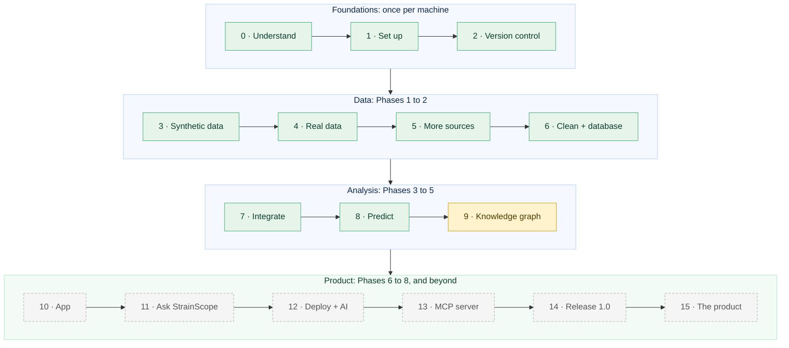
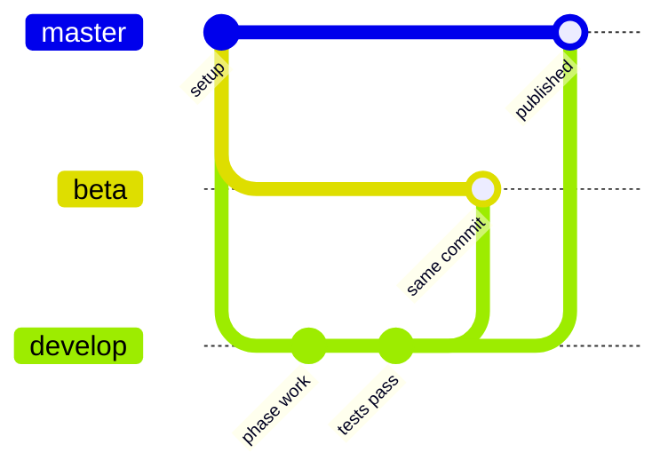
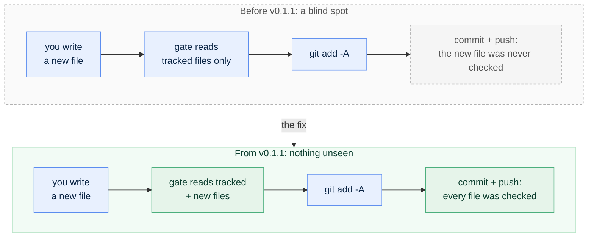

[← README](../README.md) · [Glossary](GLOSSARY.md) · [Architecture](00-architecture.md) · [Roadmap](ROADMAP.md) · [Product roadmap](PRODUCT_ROADMAP.md) · [Query Cookbook](QUERY_COOKBOOK.md)

# The StrainScope Handbook: from day 0 to the finished product

**Handbook version:** 1.3 · **Last updated:** 2026-10-10 · **Repository state it describes:** version v0.1.1 plus Phase 4. Phases 0 → 4 are built and tested (data, real sources, cleaning, database, multi-omics integration, machine learning), along with the v0.1.1 fix release; Phase 5 (the knowledge graph, release v0.2.0) is next. 49 automated tests.

**This is the one document to read first, and the one to come back to.** It walks the whole journey in order (understanding the project, preparing a blank computer, building every phase, releasing, and what lies beyond), explaining *why* at every step and linking to the specialised guide that holds the detail. You should never have to hunt through the repository to find out what to do next; if you ever do, that's a defect in this Handbook.

**Who it's for.** Someone with no background in microbiology, chemistry, statistics, programming, Git or the command line, who wants to end up able to build, run, explain and extend StrainScope, going from zero to confident. Every term used anywhere is defined in plain language in the [Glossary](GLOSSARY.md); keep it open in a second tab.

**How to use it.** Stages are numbered and sequential. Each one tells you what you'll do, why it exists, which guide to open, roughly how long it takes, the checkpoint that proves you're done, and the commit message that saves it. **Do the checkpoint before moving on.** Every stage ends at a natural stopping point with your work safely on GitHub.

**Paths.** Every file is named by its path from the project folder (the folder that contains `README.md`), for example `src/strainscope/integrate.py` or `docs/04-integration.md`. Files in the project folder itself (`README.md`, `CHANGELOG.md`, `renv.lock`, `check-public-safe.sh`) have no folder in front.

---

## The journey at a glance




*Green = built and tested · gold = next · dashed grey = planned.*

| Stage | Area | What you do | Guide | Hands-on time | Status |
|---|---|---|---|---|---|
| 0 | Orientation | Understand what you are building and why | [README](../README.md), [Architecture](00-architecture.md), [Roadmap](ROADMAP.md) | 1 h reading | ✅ |
| 1 | Setup | Set up your workshop (once per machine) | [`docs/01-setup.md`](01-setup.md) Parts A-G, I | 60-90 min | ✅ |
| 2 | Git | Version control and the safety gate | [`docs/01-setup.md`](01-setup.md) Part H | 30 min | ✅ |
| 3 | Data | Phase 1: synthetic multi-kingdom data | [`docs/02-data-generation.md`](02-data-generation.md) | 2-3 h | ✅ |
| 4 | Real data | Phase 1b: real data from public databases | [`docs/02b-real-data-ingestion.md`](02b-real-data-ingestion.md) | 2-3 h | ✅ |
| 5 | Secrets | Phase 1c: more sources, and secrets done right | [`docs/02c-more-real-sources.md`](02c-more-real-sources.md) | 2 h | ✅ |
| 6 | Cleaning | Phase 2: cleaning, the database, SQL | [`docs/03-harmonization-qc.md`](03-harmonization-qc.md), [Cookbook](QUERY_COOKBOOK.md) | 2-3 h | ✅ |
| 7 | Integration | Phase 3: multi-omics integration | [`docs/04-integration.md`](04-integration.md) | ~4 h (3 sittings) | ✅ |
| 7.1 | Fix | Fix release v0.1.1: a safer safety gate, copy-safe commands | [`docs/01-setup.md` Part H](01-setup.md#the-pre-push-safety-gate-check-public-safesh), [`CHANGELOG.md`](../CHANGELOG.md) | ~20 min | ✅ |
| 8 | Prediction | Phase 4: machine learning, measured carefully | [`docs/05-machine-learning.md`](05-machine-learning.md) | ~3½ h (3 sittings) | ✅ |
| 9 | Graph | Phase 5: the knowledge graph | `docs/06-knowledge-graph.md` | 3 h | ⏳ next |
| 10 | App | Phase 6: the app | `docs/07-app.md` | 3-4 h | ⏳ |
| 11 | Assistant | Phase 6b: Ask StrainScope, the documentation assistant | `docs/07b-docs-assistant.md` | 2-3 h | ⏳ |
| 12 | Cloud | Phase 7: deployment and the AI layer | `docs/08-deployment-ai.md` | 3-4 h | ⏳ |
| 13 | MCP | Phase 7b: the MCP server | `docs/08b-mcp-server.md` | 2 h | ⏳ |
| 14 | Release | Phase 8: packaging and release 1.0 | `docs/09-packaging.md` | 2-3 h | ⏳ |
| 15 | Product | Beyond the repository: the product | [`docs/PRODUCT_ROADMAP.md`](PRODUCT_ROADMAP.md) | reading | ✅ plan exists |

Times are hands-on estimates for a beginner following the guides; they don't count time the computer spends running. At roughly 4 to 5 hours a week, the whole journey is a season's work.

---

## Stage 0: Understand what you are building and why

**What.** Read, in this order:

1. [README](../README.md): the sections *"What is a beneficial microbe?"* and *"The problem this project tackles"*, about farmers protecting crops with living helpers instead of synthetic chemicals, and why choosing *which* helper is a data problem.
2. [`docs/00-architecture.md`](00-architecture.md): every box of the system, what it does and why it exists. It also covers the three words all software leans on (backend = kitchen, frontend = dining room, database = pantry) and the one rule that makes the project reproducible (*data flows one way, and no step edits its own input*).
3. [`docs/ROADMAP.md`](ROADMAP.md): the phase plan you're about to follow, and why it's ordered that way.

**Why.** Everything you type later makes sense only if you can say, in one sentence, what StrainScope is for: *reading several molecular fingerprints of beneficial microbes at once to predict which ones are worth developing, and explaining why.* Without that sentence you'd mostly be copying commands. With it, each step has a reason you can follow.

**Checkpoint.** Without notes, you can explain to a friend: what a strain is; what genes, metabolites and a phenotype are (blueprint, exhaust, track time); why the data is simulated and why that is stated everywhere; what each box in the architecture diagram does.

---

## Stage 1: Set up your workshop (once per machine)

**What.** Follow [`docs/01-setup.md`](01-setup.md) Parts A to G and Part I. Each step shows the exact command for Windows, macOS or RHEL 8 / Linux. **Do the one for your machine.**

**Why.** You install Python (the engine), an editor, Git (the save-game system), a GitHub account, R (for one specialist step), and two *sealed toolboxes* (`.venv` for Python, `renv` for R) that record exact package versions so a stranger can rebuild your setup identically. I put all the setup at the front on purpose: after this stage, daily work is the same handful of short commands on every operating system.

**Platform promise.** The code uses `pathlib` for every file path and plain cross-platform tools, so the same commands run on all three systems. Where an operating system really does differ (installing Python, activating the environment, PowerShell quoting), the guides show each variant side by side.

**Checkpoint.** Your prompt shows `(.venv)`; `python -c "import pandas, sklearn, duckdb, networkx, streamlit; print('env OK')"` prints `env OK`; `Rscript -e 'renv::status()'` reports no issues; `ls renv.lock` shows the file.

---

## Stage 2: Version control and the safety gate

**What.** [`docs/01-setup.md`](01-setup.md) Part H: create the repository, the three branches, and the pre-push safety gate `check-public-safe.sh`.

**Why.** Git snapshots every meaningful change so nothing is ever lost and every step is visible. The three branches give the work a calm rhythm:



(The picture draws the updates as merges. In practice the push just moves `beta` and `master` forward to the very same commit, which Git calls a *fast-forward*.) You work only on **`develop`**; one push line moves `beta` and `master` forward to the same commit, and then local `master` is brought in step. The safety gate runs first, every time. It refuses to give the all-clear if a secret, a database file or a machine-specific path is about to become public. It reads both the files Git already tracks **and** the new files `git add -A` is about to add, so running it before staging is safe (since v0.1.1; see Stage 7.1).

> **Copy commands safely.** Every command, commit message and tag message in this repository uses plain keyboard characters only. Look-alike characters from documents and chat (a long dash &mdash;, curly quotes &ldquo; &rdquo;, an ellipsis `…`) can be mangled when pasted into a terminal. Type your own messages with plain characters; the look-alike table is in [`docs/01-setup.md` Part H](01-setup.md#copy-commands-safely-plain-keyboard-characters-only).

**The end-of-phase ritual**, used at the end of every stage from here on (each stage names its own commit message):

```bash
pytest -q                     # all tests pass
./check-public-safe.sh        # must print: SAFE TO PUSH   (Windows: bash check-public-safe.sh in Git Bash)

git switch develop
git add -A
git commit -m "<the stage's commit message>"
git push origin develop develop:beta develop:master

## --tags is optional, only when a release tag was created in this phase
## then switch back to local master and pull in the remote changes

git switch master
git pull --ff-only origin master
git switch develop
```

**Checkpoint.** `git branch -a` lists `master`, `beta`, `develop` locally and as `remotes/origin/…`; the safety gate prints `✓ SAFE TO PUSH`.
**Commit messages used:** `chore: initialise project structure, docs, and toolbox` · `docs: add architecture, setup runbook, README, and public-safety gate`.

---

## Stage 3: Phase 1, synthetic multi-kingdom data

**What.** Follow [`docs/02-data-generation.md`](02-data-generation.md): run `python src/strainscope/generate_data.py`, read its ledger, draw the figures.

**Why.** No public source offers genes *and* chemistry *and* a performance score for the same microbes, so the project *builds* the data in the open: 600 strains across four kingdoms (bacteria, fungi, yeasts, oomycetes), each fighting with its own real weapons. Realistic mess is injected on purpose (missing values, duplicates, outliers, batch drift, impossible scores) so the cleaning phase has real work to do. A fixed random seed makes it identical on every machine. The honesty rule starts here: **the data is simulated, and every document says so.**

**Checkpoint.** The generator's ledger shows 600 strains, 145 effective (24.2 %), Bacteria 267 · Fungi 183 · Yeast 95 · Oomycete 55; the figures in `figures/` regenerate.
**Commit messages used:** `feat: add Phase 1 synthetic multi-omics data generator, figures, and glossary` · `feat: broaden dataset to multi-kingdom microbial strains (bacteria, fungi, yeasts, oomycetes)`.

---

## Stage 4: Phase 1b, real data from public databases

**What.** Follow [`docs/02b-real-data-ingestion.md`](02b-real-data-ingestion.md): `python src/strainscope/fetch_real.py --probe`, then a full fetch.

**Why.** Real strains (BacDive), real chemistry (PubChem) and real pathway links (KEGG, academic-use, attributed) tie the project to real records and teach the craft of ingestion. That means learning what an API is, being polite about rate limits, keeping every raw response untouched in an evidence locker, and logging every request in a provenance log. The framework is "one socket, many plugs": a new source is one new file.

**Checkpoint.** The probe reaches all three sources; `data/processed/real/` holds the tidy real tables; `data/raw/real/fetch_log.csv` records every request.
**Commit message used:** `feat: add real-data ingestion framework with BacDive, PubChem, and KEGG adapters`.

---

## Stage 5: Phase 1c, more sources and secrets done right

**What.** Follow [`docs/02c-more-real-sources.md`](02c-more-real-sources.md): NCBI Datasets (real genome records for all four kingdoms) and Metabolomics Workbench (RefMet names and classes).

**Why.** Two new plugs show that the framework takes in new sources without changes elsewhere. The optional NCBI key is a good place to practise handling secrets, because a mistake with it costs nothing. Keys live in the environment (`.env` or the shell), **never in the repository**; `.env.example` is the committed template; and two independent guards (`.gitignore` and the safety gate) stop leaks. Five real API surprises from this stage are written up in the guides.

**Checkpoint.** `data/processed/real/real_genomes.csv` reports four kingdoms; the SQL console's `avg_Mb` query shows genome sizes rising from bacteria (a few million letters) to fungi and oomycetes (tens of millions); `git status` never shows `.env`.
**Commit message used:** `feat: add NCBI Datasets and Metabolomics Workbench adapters with API-key handling`.

---

## Stage 6: Phase 2, cleaning, the database and SQL

**What.** Follow [`docs/03-harmonization-qc.md`](03-harmonization-qc.md), then work through the [Query Cookbook](QUERY_COOKBOOK.md).

**Why.** A model trained on dirty data learns the dirt. Six documented cleaning rules run in a planned order, and a ledger counts every change. That ledger caught a textbook outlier rule quietly flattening real biology, which turned out to be the main lesson of the phase. The clean tables and every real table land in one DuckDB file, which you question with SQL through a read-only console.

**Checkpoint.** The ledger reconciles with the mess Phase 1 planted (8 duplicates per table, 657 text cells, 3 clipped scores, 41 capped outliers, 1,052 gaps left as NULLs instead of being guessed); `python src/strainscope/sql.py ".tables"` lists the synthetic and real tables.
**Commit message used:** `feat: add cleaning pipeline with ledger, DuckDB database, SQL console, and cookbook`.

---

## Stage 7: Phase 3, multi-omics integration

**What.** Follow [`docs/04-integration.md`](04-integration.md). In three sittings: prepare the blocks (`python src/strainscope/integrate.py prepare`); install mixOmics into the project's R library and run DIABLO (`Rscript R/diablo_integration.R`); run the Python twin, publish the results, draw the figures, query them. Once mixOmics is installed, one command runs prepare → DIABLO → twin → publish: `python src/strainscope/integrate.py all` (without R it runs everything except DIABLO and says so).


**Why.** This is the specialised core of the project: reading genes and chemistry *together* and keeping what they agree on. You'll learn the three ways to integrate, how DIABLO chooses a short list of features per block that tell one shared story, and how to score any method fairly (repeated cross-validation, a balanced error rate, negative controls that must behave like coins). You'll also see how stability separates findings from quota-filling, and how R and Python check each other through plain hand-off files and a contract test. Ten real surprises from the build are written up as lessons. The most important one is to *make the data's yardstick match the outcome's* (centring within kingdom cut the error by a third).

**Checkpoint.** `Rscript -e 'renv::status()'` reports *No issues found* after mixOmics is installed (a BiocManager notice above it is harmless; here's [why](04-integration.md#6-step-2-install-mixomics-into-the-projects-r-library-once-per-machine)); DIABLO reports a cross-validated balanced error rate of 0.155 ± 0.011 (a coin scores 0.50), reproduced to the last printed digit on macOS with R 4.6.1 + mixOmics 6.36.0 and on Linux with R 4.3 + mixOmics 6.37.0; the twin's controls sit near 0.50; the report card shows DIABLO's robust signature and the Python lasso picking *only* true drivers, with every lasso pick also in DIABLO's list; `pytest -q` → 32 passed; the [integration explorer](interactive/integration_explorer.html) opens in a browser.
**Commit message:** `feat: add multi-omics integration (DIABLO in R + Python twin), handbook and roadmaps`, then tagged **v0.1.0**, the project's first version (the ritual is in [`docs/04-integration.md` §17](04-integration.md#17-save-your-work-safety-gate-then-the-commit-ritual)).

---

## Stage 7.1: Fix release v0.1.1, a safer safety gate and copy-safe commands

**What.** A small release between phases, made of two fixes that real use uncovered. It's also practice in shipping a fix properly, which means tested, documented and versioned.
1. **The safety gate now checks new files too.** Save the updated `check-public-safe.sh` (project folder) and the new `tests/test_safety_gate.py`; run `chmod +x check-public-safe.sh` (macOS/Linux) because a downloaded file loses its "runnable" mark.
2. **Every command, commit message and tag message in the documentation uses plain keyboard characters.**

**Why.** *Fix 1:* the routine runs the gate *before* `git add -A`. The old gate read only files Git already tracked, so a brand-new file (say, a script with a key pasted in) was never checked on its first commit. Nothing leaked, but the gate had a blind spot that needed closing. *Fix 2:* a tag message containing a long dash was pasted into a terminal and arrived garbled (`v0.1. data foundation…0`). Look-alike characters are hard for people to spot, and terminals often mangle them.



Think of a guard who inspects the parcel but not the pile of items about to go into it. From v0.1.1 the guard inspects both. The full picture is in [`docs/01-setup.md` Part H](01-setup.md#the-pre-push-safety-gate-check-public-safesh), with the three kinds of files (tracked, new, ignored) drawn out.

**How it was tested.** Five automated tests in `tests/test_safety_gate.py` build throw-away Git repositories and check the gate's verdict: a clean repository passes; a new, not-yet-added file holding a key is caught; a key in the ignored `.env` passes (Git never publishes it); a key in a *force-added* ignored file is caught; a link anchor containing `sk-` raises no false alarm. One test fails on the old gate, which shows that it guards the fix. Writing the tests also exposed a second hole (`git grep --untracked` skips force-added ignored files), and that was fixed before release. The story is under *Notes from the build* in [`docs/01-setup.md` Part H](01-setup.md#the-pre-push-safety-gate-check-public-safesh).

**Checkpoint.** `pytest -q` → **37 passed** (32 + 5; the gate tests are skipped on Windows, where the gate runs from Git Bash); `./check-public-safe.sh` prints a new line `Scanning N tracked file(s) + M new file(s) that 'git add -A' would add.` and ends with `✓ SAFE TO PUSH`.
**Save it**: tests and gate first, then the commit ritual, then the tag:

```bash
pytest -q                     # 37 passed
./check-public-safe.sh        # must end with: SAFE TO PUSH

git switch develop
git add -A
git commit -m "fix: safety gate also checks new files; copy-safe commands in docs"
git push origin develop develop:beta develop:master

## --tags is optional, only when required: this release earns v0.1.1
git tag -a v0.1.1 -m "v0.1.1: safety gate checks new files; copy-safe commands"
git push origin develop develop:beta develop:master --tags

## then switch back to local master and pull in the remote changes
git switch master
git pull --ff-only origin master
git switch develop
```

Check the result with `git tag -n1`: both `v0.1.0` and `v0.1.1` are listed, each with a readable message.

---

## Stage 8: Phase 4, machine learning measured carefully

**What.** Follow [`docs/05-machine-learning.md`](05-machine-learning.md). Five steps of `python src/strainscope/model.py`, in three sittings: `compare` (a baseline, an elastic net, a random forest and gradient boosting on the same 50 folds, plus a leak check), `calibrate` (do the winner's probabilities mean what they say?), `explain` (what the models rely on, graded against the planted truth; where they go wrong), `final` (the winner on all strains, saved with a model card) and `publish` (the results as `ml_*` tables). One command runs all five: `python src/strainscope/model.py all` (two to four minutes). Then `python figures/make_phase4_figures.py`.


**Why.** Integration told us *which* features matter. This phase answers the question a screening team actually asks (*"we can test 50 strains next season: which 50?"*) with a model that predicts, probabilities that can be trusted, and a clear account of where it fails. You'll learn what a prediction model is and how four kinds decide, and why preparation must be learned *inside* each fold. (The Phase 3 leak is closed and measured, and it turns out to be harmless; next to it sits a real, label-using leak that manufactures signal from noise.) After that come why accuracy lies when winners are rare, tuning without peeking (nested cross-validation), calibration, permutation importance, error analysis, and handing a model over responsibly with a model card. Eight real lessons from the build are kept in the guide's §12.

**Checkpoint.** `compare` names the elastic net the winner: balanced error **0.128 ± 0.007**, AUC 0.948 (the lazy baseline: 0.500, with 76 % accuracy); the shuffled-label control sits at 0.48. The leak check: Phase 3's recipe 0.948 vs leak-proof 0.947 AUC; a real leak on noise labels 0.594 vs 0.527. Calibration error falls from 0.081 to 0.033. Of the elastic net's 23 reliably important features, 22 are true drivers. Mistakes crowd within 5 points of the 65 % line. `final`: of the top 50 ranked strains, **47** are truly effective (chance: 12); the model file is under 20 KB. `pytest -q` → **49 passed**. The [model explorer](interactive/model_explorer.html) opens in a browser.
**Commit message:** `feat: add leak-proof machine learning with calibration, importance and error analysis`. There's no tag this time (v0.2.0 arrives with Phase 5; the ritual is in [`docs/05-machine-learning.md` §17](05-machine-learning.md#17-save-your-work-safety-gate-then-the-commit-ritual)).

---

## Stage 9: Phase 5, the knowledge graph

**What.** `docs/06-knowledge-graph.md` (arrives with the phase): write the domain model in English first (an **ontology**, which you can picture as a family tree for concepts: what is a strain, a gene, a compound, a pathway, and how may they connect?), then build the graph with NetworkX from real KEGG/RefMet edges, Phase 3's gene ↔ product correlations and Phase 4's importances; find hubs, communities and paths.

**Why.** In a table, relationships are scattered across rows and columns, while a graph lets you walk along them. The graph answers *why* a strain ranks high ("it carries ituA → makes iturin → which sits in the lipopeptide pathway…") and is the foundation for GraphRAG in Stage 12.
**Checkpoint (planned).** A graph file plus an interactive graph view; path queries return real, sourced edges. **Tag:** v0.2.0.

---

## Stage 10: Phase 6, the app

**What.** `docs/07-app.md`: a Streamlit app where you choose data (**Upload · Synthetic · Fetch-real**), explore the integration results, rank strains, view the graph, and query everything in the built-in SQL console with the cookbook one click away.

**Why.** Results are far more useful to other people once they can click around in them. Streamlit turns Python into a web page without needing web-development knowledge; the app reads only the small `artifacts/` files, which keeps it fast.
**Checkpoint (planned).** `streamlit run app/streamlit_app.py` opens the app locally on all three operating systems.

---

## Stage 11: Phase 6b, Ask StrainScope (the documentation assistant)

**What.** `docs/07b-docs-assistant.md`: `python src/strainscope/ask.py "your question"` and an *Ask* tab in the app. It searches every document of this repository, answers with the matching passages and links to the exact sections, and shows starter questions and "you might also ask" suggestions. It **refuses questions that aren't about StrainScope** instead of inventing an answer. Optionally (switched on by an environment variable) it writes a short answer from those passages only, using a local open model (Ollama) or a hosted provider. Full design: [Roadmap: Ask StrainScope](ROADMAP.md#ask-strainscope-the-documentation-assistant-in-detail).

**Why.** By this stage the documentation is large; a newcomer's most frequent question is "where is X explained?". A golden set of in-scope and off-topic questions, run with the tests, proves it answers from the documents and refuses the rest.
**Checkpoint (planned).** `src/strainscope/ask.py` with no question prints starter questions; `ask.py "what is a balanced error rate?"` returns the glossary passage with its link; `ask.py "what is the capital of France?"` returns the polite out-of-scope refusal; the golden set passes. **Tag:** v0.3.0.

---

## Stage 12: Phase 7, deployment and the AI layer

**What.** `docs/08-deployment-ai.md`: deploy the app free on Streamlit Community Cloud (keys stored as host secrets, never in Git); add plain-language explanations of results; switch on grounded answers in Ask StrainScope; add a read-only **data assistant** (a question becomes a SQL query on the read-only database, shown to you with its answer) and **GraphRAG** (answers built by walking the knowledge graph, citing the path).

**Why.** Results become usable by anyone with a link, and the AI features turn "read the tables" into "ask the project". Every answer stays traceable to a document, a query or a graph path, and every feature still works without any key (the AI parts just switch off).

---

## Stage 13: Phase 7b, the MCP server

**What.** `docs/08b-mcp-server.md`: a small **Model Context Protocol** server. It's a standard "USB port" through which AI assistants can use StrainScope's tools directly: `ask_docs`, `query_database` (read-only), `get_signature`, `rank_strain`. Every call is validated and logged.

**Why.** It turns the repository from "code someone reads" into "a tool an assistant can use", reusing exactly the functions the app already calls.

---

## Stage 14: Phase 8, packaging and release 1.0

**What.** `docs/09-packaging.md`: the one-command pipeline (`python src/strainscope/pipeline.py`, which runs generate → clean → integrate → model → graph); automated tests on Windows, macOS and Linux at every push (continuous integration on GitHub); the MIT LICENSE; the CHANGELOG brought to 1.0; an uninstall guide; an optional container; the **v1.0.0** tag.

**Why.** As long as only its author can run it, a project is still a prototype. This stage turns "it works on my laptop" into "it works anywhere, and here's the proof at every push".

---

## Stage 15: Beyond the repository, the product

**What.** Read [`docs/PRODUCT_ROADMAP.md`](PRODUCT_ROADMAP.md).

**Why.** It describes what an industrial StrainScope would add (real matched multi-omics data, a multi-user web front end and API, a cloud database, scheduled pipelines, monitoring, ontologies, regulation), and for every technology it gives a verdict (*required now · recommended later · optional · not needed*) and the event that would change it. Thanks to the design choices you made in Stages 3 to 14, that list can be added on top of what exists; nothing has to be rewritten.

---

## Every session, after setup

```bash
cd ~/projects/strainscope                 # Windows PowerShell: cd $HOME\projects\strainscope
source .venv/bin/activate                 # Windows PowerShell: .\.venv\Scripts\Activate.ps1
git switch develop && git pull --ff-only origin develop
pytest -q                                 # everything still green?
# ... work on the current stage ...
```

Then the end-of-phase ritual (Stage 2) when the stage is complete.

## When something goes wrong

| Symptom | Look in |
|---|---|
| a command "is not recognized" / "not found" | your setup guide: is `(.venv)` in your prompt? On Windows, is R on your PATH? ([`docs/01-setup.md`](01-setup.md) Part F and Part I) |
| `R -e ...` does nothing sensible on Windows | PowerShell treats `r` as "repeat last command", so use `Rscript -e ...` instead ([`docs/04-integration.md` §16](04-integration.md#16-what-could-go-wrong-mini-faq)) |
| a test fails | the *What could go wrong* section of the phase guide you are on |
| the database is missing or a table is gone | rebuild: `python src/strainscope/generate_data.py`, then `python src/strainscope/harmonize.py`, then `python src/strainscope/integrate.py publish` and `python src/strainscope/model.py publish` ([`docs/03-harmonization-qc.md` §11](03-harmonization-qc.md#11-what-could-go-wrong-mini-faq)) |
| `mixOmics is not installed in this project's R library` | [`docs/04-integration.md` §6](04-integration.md#6-step-2-install-mixomics-into-the-projects-r-library-once-per-machine): the package is installed, but invisible to the project |
| an API call fails or returns odd numbers | the real-data guides' FAQs ([`02b`](02b-real-data-ingestion.md), [`02c`](02c-more-real-sources.md)) and their *Notes from the build* |
| the safety gate says NOT SAFE | read the flagged line; never weaken the check ([`docs/01-setup.md`](01-setup.md) Part H) |
| the gate flags a file you have not added yet | that's the gate working: `git add -A` would add it, so it's checked now (since v0.1.1, see Stage 7.1) |
| a pasted command prints strange characters, or a commit/tag message arrives garbled | a look-alike character (long dash, curly quote, ellipsis); retype it with plain keyboard characters ([`docs/01-setup.md` Part H](01-setup.md#copy-commands-safely-plain-keyboard-characters-only)); a wrong tag message is replaced as in [`docs/04-integration.md` §17](04-integration.md#17-save-your-work-safety-gate-then-the-commit-ritual) |
| `./check-public-safe.sh: Permission denied` | the file lost its runnable mark when downloaded: `chmod +x check-public-safe.sh` (macOS/Linux) |
| a push fails with `HTTP 400` / `RPC failed` | [`docs/01-setup.md`](01-setup.md) Part H, "If a push fails partway" |
| a word you don't know | the [Glossary](GLOSSARY.md), and from Stage 11 also `python src/strainscope/ask.py "what is ...?"` |
| a ready-made SQL question | the [Query Cookbook](QUERY_COOKBOOK.md) |
| a figure looks wrong or is missing | re-run the phase's figure script in `figures/` (each guide names it) |
| `model built with scikit-learn X, running Y`, or `Can't get attribute 'KingdomPrep'` | rebuild the model: `python src/strainscope/model.py final` ([`docs/05-machine-learning.md` §16](05-machine-learning.md#16-what-could-go-wrong-mini-faq)) |
| `python src/strainscope/model.py compare` takes many minutes | normal on a laptop with few processor cores (about 250 model fits); for a quick trial add `--repeats 2` ([`docs/05-machine-learning.md` §16](05-machine-learning.md#16-what-could-go-wrong-mini-faq)) |

## Every file in the repository, and where it is explained

Nothing in this repository is undocumented magic. Paths are relative to the project folder.

| Path | What it is | Explained in |
|---|---|---|
| `README.md` | the front page | n/a |
| `CHANGELOG.md` | what changed, phase by phase | this Handbook |
| `requirements.txt` | the Python toolbox's packing list | [`docs/01-setup.md`](01-setup.md) Part G |
| `renv.lock`, `.Rprofile`, `renv/activate.R`, `renv/settings.json` | the R toolbox's receipt and its switch | [`docs/01-setup.md`](01-setup.md) Part I, [`docs/04-integration.md`](04-integration.md) §6 |
| `strainscope.Rproj` | optional RStudio project file | [`docs/01-setup.md`](01-setup.md) Part I |
| `.gitignore` | what Git must never save | [`docs/01-setup.md`](01-setup.md) Part G |
| `check-public-safe.sh` | the pre-push safety gate | [`docs/01-setup.md`](01-setup.md) Part H |
| `.env.example` | template for optional keys (`.env` itself is never committed) | [`docs/02c-more-real-sources.md`](02c-more-real-sources.md) |
| `src/strainscope/generate_data.py` | the synthetic data generator | [`docs/02-data-generation.md`](02-data-generation.md) |
| `src/strainscope/fetch_real.py`, `src/strainscope/sources/*.py` | real-data ingestion: the command and its source plugs | [`02b`](02b-real-data-ingestion.md), [`02c`](02c-more-real-sources.md) |
| `src/strainscope/harmonize.py` | cleaning, the ledger, the database loader | [`docs/03-harmonization-qc.md`](03-harmonization-qc.md) |
| `src/strainscope/sql.py` | the read-only SQL console | [`docs/03-harmonization-qc.md`](03-harmonization-qc.md) §7 |
| `src/strainscope/integrate.py` | integration, Python side | [`docs/04-integration.md`](04-integration.md) |
| `R/diablo_integration.R` | integration, R side (DIABLO) | [`docs/04-integration.md`](04-integration.md) §7 |
| `src/strainscope/model.py` | machine learning: compare, calibrate, explain, final, publish; `load_model()` and `score_strains()` for the app | [`docs/05-machine-learning.md`](05-machine-learning.md) |
| `tests/test_sources.py`, `tests/test_harmonize.py`, `tests/test_integrate.py`, `tests/test_model.py` | the automated checks | each phase guide's *tests* section |
| `tests/test_safety_gate.py` | the safety gate's own tests | [`docs/01-setup.md`](01-setup.md) Part H, Stage 7.1 above |
| `figures/make_phase*_figures.py`, `figures/make_illustrations.py`, `figures/*.png` | every figure and the script that draws it | each phase guide's *figures* section |
| `artifacts/integration/*.csv` | Phase 3's small result tables (committed; the app will read them) | [`docs/04-integration.md`](04-integration.md) §2, §9 |
| `artifacts/model/*.csv`, `artifacts/model/model_card.json`, `artifacts/model/strainscope_model.joblib` | Phase 4's result tables, the saved model and its card (committed; the app and the MCP server will read them) | [`docs/05-machine-learning.md`](05-machine-learning.md) §2, §8 |
| `docs/*.md` | the tutorial, glossary, cookbook, roadmaps and this Handbook | this table |
| `docs/img/*.svg` | the logo, icon and journey map | `figures/make_illustrations.py` |
| `docs/interactive/*.html`, `docs/interactive/plotly.min.js` | the interactive charts (open in a browser; work offline) | each phase guide's *figures* section |
| `data/` | generated data and the database: **never in Git**, rebuilt on demand | [`02`](02-data-generation.md), [`03`](03-harmonization-qc.md), [`04`](04-integration.md) |

## How this Handbook is maintained

It is a living document and the **first** one to update. At the end of every phase, in the same commit as the phase itself:

1. Flip the stage's status in the table at the top and write the real checkpoint numbers into the stage. (Stage headings carry no status marks on purpose: their link addresses then never change.)
2. Link the phase guide that now exists.
3. Update the version, date and repository state at the top.
4. Make the same status change in [`docs/ROADMAP.md`](ROADMAP.md), the README's *Build log*, and the `STAGES` list in `figures/make_illustrations.py` (then re-run it, so the journey map matches).
5. Add a line to `CHANGELOG.md`.

Small changes between phases (a fix, a renamed command, a new FAQ entry) update the Handbook in the same commit too. **If the Handbook falls behind the code, treat that as a bug.**

**One house rule for every document in the repository:** whenever a document names a file, it writes the file's full path from the project folder (`src/strainscope/harmonize.py`, not `harmonize.py`), so a reader always knows where the file lives without searching.
