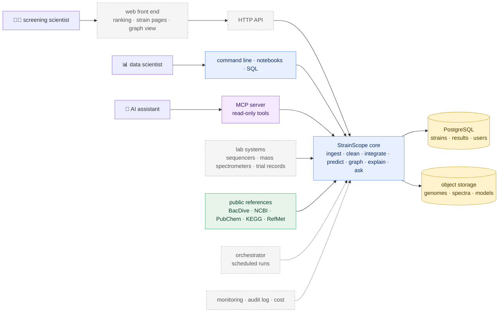

[← README](../README.md) · [Handbook](HANDBOOK.md) · [Repository roadmap](ROADMAP.md) · [Architecture](00-architecture.md) · [Glossary](GLOSSARY.md)

# Product and technology roadmap — from this repository to a finished product

**Prerequisites:** [`docs/00-architecture.md`](00-architecture.md) (the boxes that exist) and [`docs/ROADMAP.md`](ROADMAP.md) (what this repository builds, phase by phase).
**Learning goal:** understand what an industrial, hosted version of StrainScope would consist of; be able to explain every technology in it to someone with no background; and know, for each one, whether it is needed now, later, optionally or not at all — and what would change that answer.

## How to read this document

[`docs/ROADMAP.md`](ROADMAP.md) covers this repository: a complete, documented product that runs on one laptop and online for a handful of users. This document looks past it — at what a research organisation running a real strain-discovery programme would need. Every technology below answers the same three questions — **is it required? why? what does it give, and what does it cost?** — and receives one verdict:

| Verdict | Meaning |
|---|---|
| **Required now** | part of this repository's build plan; without it the product is not a product |
| **Recommended later** | not needed to run or prove the workflow; needed to serve many users, many strains or real laboratory data |
| **Optional** | nice to have; adopt only when a concrete user asks |
| **Not needed** | adds cost without benefit at any foreseeable scale, or is the wrong tool |

Each verdict comes with a **trigger**: the observable event that would change it. The principle throughout is *justify, don't accumulate* — a technology earns its place by solving a problem someone actually has. The repository is designed so the "later" items are **additions, not rewrites**: data flows one way through small plain files, every step is a function with a thin command line on top, results live in a database with a documented schema, and real and synthetic data meet the same contracts.

*Everyday analogy:* this repository is a well-equipped home kitchen that cooks one excellent meal reliably and writes down every recipe. This document describes the restaurant: more cooks, a dining room, deliveries, food-safety inspections — and which of those a restaurant genuinely needs on day one.

## Who the finished product is for

| User | Their problem | What StrainScope gives them |
|---|---|---|
| 🧑‍🔬 **Screening scientist** — tests strains in the lab and greenhouse | hundreds of candidate strains, room to test only a few dozen properly each season | a ranked shortlist, each strain with the genes and compounds behind its rank and a stated uncertainty |
| 📊 **Data scientist** in a biologicals research team | genomic, chemical and trial data in separate spreadsheets and formats | one cleaned, queryable database; integration and models that are reproducible and graded |
| 🧭 **Research lead** | which strain families to invest in next year | a portfolio view across kingdoms, with the evidence — not just a score — for every recommendation |
| 📄 **Regulatory and documentation specialist** | dossiers need to say *why* a strain works (its mode of action) | the knowledge graph's sourced paths: strain → gene → compound → pathway → effect |
| 🤖 **An AI assistant** working for any of them | needs safe, structured access to the data | the MCP server: read-only tools with validation and a log |

## The finished product in one picture

Everything inside **StrainScope core** is this repository (solid boxes are built or scheduled in [`docs/ROADMAP.md`](ROADMAP.md)); the dashed boxes are this document.

---

## A. Product surface — how people use it

### A1. Web front end (React with TypeScript)

**What it is.** A website where a scientist logs in, filters the strain ranking, opens a strain page (its genes, its chemistry, its predicted performance, its graph neighbourhood) and leaves notes for colleagues. *Analogy:* the difference between a workshop (Streamlit) and a showroom with staff accounts. TypeScript is JavaScript with *types* — seatbelts that catch mistakes such as passing a strain name where a number was expected, before the page ever runs.
**Required?** Not to prove the workflow — the Streamlit app (Phase 6) does that. Required for many users with logins, saved views and history.
**Benefit / cost.** Multi-user work, permissions, a polished interface. / A second codebase and language, authentication, hosting, front-end tests.
**Verdict: Recommended later.** **Trigger:** a second regular user, or the first request Streamlit cannot meet (per-user saved views, fine-grained permissions).
*Prepared today by:* the app reads only small, documented files in `artifacts/` and the database — an API can serve the same things.

### A2. HTTP API (FastAPI)

**What it is.** The same functions the command line and the app already call, offered over the web so any program can use them. *Analogy:* a restaurant's order hatch — the kitchen is unchanged; there is simply a standard way to place orders.
**Verdict: Recommended later**, together with A1. **Trigger:** A1, or a laboratory system that wants to send new strains automatically.

### A3. Connections to laboratory systems and bioinformatics tools

**What it is.** Importers for what a real programme produces: genome assemblies and annotations from sequencing, feature tables from mass-spectrometry software, trial results from a laboratory information system (LIMS) or electronic lab notebook (ELN), and gene-cluster predictions from tools such as antiSMASH (which finds the gene neighbourhoods that build antimicrobial compounds).
**Why.** These are where real matched multi-omics data would come from (see B1).
**Verdict: Formats recommended later; specific connectors optional.** **Trigger:** B1 — the first real matched dataset.
*Prepared today by:* the "one socket, many plugs" ingestion framework ([`02b`](02b-real-data-ingestion.md)) — each importer is one new plug — and the hand-off files of Phase 3, which are the slot real blocks plug into.

### A4. Ask StrainScope — the documentation assistant

**What it is.** A question box over the project's own documentation that answers with passages and links, optionally writes a short grounded answer, and refuses questions that are not about StrainScope. Full design in [`docs/ROADMAP.md`](ROADMAP.md#ask-strainscope--the-documentation-assistant-in-detail).
**Required?** Yes. A from-zero reader's most frequent question is "where is X explained?", and the documentation grows with every phase.
**Constraints.** Every answer cites its sources; out-of-scope questions are refused *before* any language model runs; a golden question set runs with the tests; the language-model backend (local Ollama or a hosted provider) is optional and switched on by environment variable; only documentation text is ever sent.
**Verdict: Required now — level 1 (find and quote) and optional level 2 (grounded answers) in Phase 6b; level 3 (chat panel, `ask_docs` MCP tool) in Phases 7 and 7b.** **Trigger for embedding-based search:** questions phrased differently from the documents start being missed.

### A5. Desktop or mobile apps, app-store distribution

**Verdict: Not needed.** A browser does everything required. **Trigger:** field use without connectivity (for example, recording trial observations in a greenhouse) — even then a mobile-friendly web page comes first.

### A6. Licensing and payments

**Verdict: Optional.** **Trigger:** the first external team that wants a hosted service. The repository itself is open source (MIT, added in Phase 8).

---

## B. Data platform — where data lives and how it moves

### B1. Real matched multi-omics data — the most important item on this page

**What it is.** Genomes, metabolite profiles **and** measured performance for the *same* strains. No public dataset offers all three today, which is why this repository simulates them transparently ([`docs/02-data-generation.md`](02-data-generation.md)) and uses real public data wherever it exists ([`02b`](02b-real-data-ingestion.md), [`02c`](02c-more-real-sources.md)).
**Why.** Models trained on simulated data prove the *workflow*, not real-world accuracy. Every performance number in this repository says so.
**Benefit / cost.** Real predictive value. / Laboratory work, data agreements, curation — the real cost of any discovery programme.
**Verdict: Recommended later — it is what turns the workflow into a discovery tool.** **Trigger:** access to a matched dataset (one's own laboratory, a collaboration, or a future public release).
*Prepared today by:* real and synthetic data meet the same table contracts; the integration step reads plain block files; a test checks that R and Python agree on those files.

### B2. PostgreSQL (multi-user relational database)

**What it is.** A database server that many people and programs use at once, with accounts and permissions. *Analogy:* DuckDB is a personal notebook — fast, private, one writer; PostgreSQL is the shared office ledger with a front desk.
**Verdict: Recommended later.** **Trigger:** A1/A2, or more than one person writing results.
*Prepared today by:* standard SQL throughout, and a [Query Cookbook](QUERY_COOKBOOK.md) whose recipes port with small changes.

### B3. Cloud data warehouses and lakehouses (Snowflake, Databricks)

**What they are.** Rented analytics databases and compute platforms built for very large data and many analysts.
**Verdict: Not needed now.** Hundreds of strains fit in DuckDB on a laptop with room to spare. **Trigger:** raw sequencing reads or spectra for thousands of strains analysed together, or an organisation that already runs one. DuckDB's SQL is close enough to both that the move is a documented change, not a rewrite.

### B4. dbt (tested, documented SQL transformations)

**Verdict: Not needed now.** The cleaning rules are Python functions with a ledger and tests. **Trigger:** B2 or B3 adopted and transformations written mostly in SQL.

### B5. Orchestrator (Prefect, Airflow)

**What it is.** A scheduler that runs pipeline steps in order, retries failures and keeps a history. *Analogy:* an alarm clock with a checklist.
**Verdict: Recommended later.** **Trigger:** scheduled refreshes — new strains every week, or nightly re-fetches from public sources.
*Prepared today by:* every step is already a separate command with clear inputs and outputs; Phase 8 adds a one-command pipeline that an orchestrator would simply call step by step.

### B6. Data and model versioning (DVC, MLflow)

**Verdict: Recommended later.** Today the data is rebuilt from a seed, so code version = data version. **Trigger:** real data that cannot be regenerated, or more than one trained model in use.

### B7. Object storage (S3-compatible)

**Verdict: Recommended later.** **Trigger:** raw genome files or spectra too large for the repository or one laptop.

---

## C. AI components

### C1. Plain-language explanations of results

**What it is.** Short written explanations of a strain's rank, a figure or a signature, generated from the computed numbers and the knowledge graph, never from imagination.
**Verdict: Required now (Phase 7).** Works without any key (template text); a language model, when configured, only rephrases facts it is given.

### C2. Data assistant — questions answered with SQL

**What it is.** "Which oomycete strains carry the strongest antifungal signature?" becomes a SQL query on the **read-only** database; the query is shown alongside the answer so it can be checked.
**Verdict: Required now (Phase 7)**, with guardrails: read-only connection, query shown, row limits, refusal when the question is outside the schema.

### C3. GraphRAG — answers by walking the knowledge graph

**What it is.** Answers built by following edges in the graph (strain → gene → compound → pathway) and citing the path. *Analogy:* asking for directions and receiving the route, not just the destination.
**Verdict: Required now (Phase 7).**

### C4. MCP server — StrainScope as a tool for AI assistants

**What it is.** A Model Context Protocol server: a standard "USB port" through which an assistant can call `ask_docs`, `query_database`, `get_signature` and `rank_strain` — read-only, validated, logged.
**Verdict: Required now (Phase 7b).**

### C5. Ontologies and a graph database

**What they are.** Shared, published vocabularies — NCBI Taxonomy for organisms, ChEBI for chemical entities, the Gene Ontology for gene functions, KEGG and RefMet (already used) for pathways and metabolite classes — so that "iturin", "Iturin A" and a database identifier mean the same thing everywhere. A graph database (Neo4j) stores the graph for many simultaneous users.
**Verdict: Ontology identifiers recommended later; graph database recommended later.** **Trigger:** B1 (real data brings real names that need reconciling), or the NetworkX graph outgrowing memory.
*Prepared today by:* the Phase 5 domain model is written in English first, with node and edge types that map onto these vocabularies.

### C6. Genome and protein foundation models

**What they are.** Large models pre-trained on millions of sequences that turn a gene into a numerical summary of its likely function.
**Verdict: Optional.** **Trigger:** real genomes with genes not yet in any reference database, where similarity search alone fails.

### C7. Autonomous analysis agent

**What it is.** A language model that plans multi-step analyses and calls StrainScope's tools in a loop.
**Verdict: Recommended later.** **Trigger:** the MCP server (C4) is stable and its tools are well tested — an agent is only as safe as the tools it may call.

---

## D. Cloud and operations

| Item | What it is | Verdict | Trigger |
|---|---|---|---|
| **D1. Hosting the app** | Streamlit Community Cloud (free) | **Required now (Phase 7)** | — |
| **D2. Continuous integration** | tests run automatically on Windows, macOS and Linux at every push | **Required now (Phase 8)** | — |
| **D3. Containers** (Docker, Podman) | the whole toolbox — Python, R, packages — in one portable box | **Optional (Phase 8)** | a user who cannot install R, or a hosting platform that requires a container |
| **D4. Continuous deployment** | every tested change goes live automatically | Recommended later | a hosted service with users who expect updates |
| **D5. High-performance computing** | clusters for genome assembly, annotation and antiSMASH runs | Recommended later | B1 with raw sequencing data |
| **D6. Kubernetes** | orchestration of many containers | Not needed | a multi-tenant hosted service at scale |
| **D7. Monitoring, logging, audit log** | who ran what, when, with which data; alerts on failures | Recommended later | the first hosted multi-user deployment |
| **D8. Cost model** | a spreadsheet of hosting, storage and compute per user | Recommended later | the first paying or budgeted user |

---

## E. Security, licensing and regulatory constraints

These are **required now as constraints on design**, not as technologies — designing for them is cheap; retrofitting them is expensive.

| Constraint | What it means for StrainScope | Status |
|---|---|---|
| **Secrets** | API keys live only in the environment (`.env` or the host's secret store); never in Git, never in logs | designed in: `.gitignore` + the pre-push safety gate ([`docs/01-setup.md`](01-setup.md) Part H), [`02c`](02c-more-real-sources.md) |
| **Source licences** | KEGG is academic-use only — a commercial product needs a KEGG licence or an open alternative; every real row carries its attribution | designed in: an `attribution` column travels with the data ([`02b`](02b-real-data-ingestion.md)) |
| **Honesty about simulated data** | synthetic data and its limits are stated wherever a number appears | designed in: README, every guide, every result printout |
| **Confidential strain data** | a company's strain collection and trial results are trade secrets | hosted deployments need access control and encryption (B2, D7); the AI layer sends only documentation text to external models, never data |
| **Access and benefit-sharing** (Nagoya Protocol) | microbial strains collected from another country's environment may carry legal obligations on use and on sharing benefits | out of scope for public reference data; a real programme tracks each strain's origin and permits — a column to add with B1 |
| **Plant-protection regulation** (e.g. EU Regulation 1107/2009; US EPA biopesticide registration) | a microbial product needs a regulatory dossier, including its mode of action and safety data | StrainScope is a **research decision-support tool**, not a dossier; its value to regulatory work is sourced mode-of-action evidence (C3, C5) |
| **Personal data** (GDPR) | none is processed; user accounts would be the first personal data | designed in: strain identifiers are not personal; revisit with A1 |

---

## F. Discoverability and go-to-market

### F1. Search and answer-engine visibility for the documentation

**What it is.** Writing pages so search engines rank them (SEO) and answer engines and AI assistants quote them accurately (AEO, GEO): clear titles, one concept per section, plain definitions, explicit sources.
**Verdict: Optional — and largely done.** The Handbook, glossary and guides are already written one concept per section in plain language. **Trigger:** a public product site.

### F2. Packaging sketch

For orientation only; there is no product to sell.

| Tier | Who | What |
|---|---|---|
| Open source | anyone | this repository, MIT licence |
| Hosted team | one research group | web front end, PostgreSQL, user accounts, support |
| Enterprise | a biologicals company | private deployment, laboratory connectors, ontology mapping, audit log, single sign-on |

**Verdict: Optional.** **Trigger:** external interest.

---

## G. The end-to-end product pipeline, and what already exists

| Stage | What the finished product does | Exists today | Arrives with |
|---|---|---|---|
| **Ingest** | public references, laboratory systems, uploads | synthetic generator; five real sources behind one framework; evidence locker; provenance log | Phases 1–1c ✅; A3, B1 later |
| **Clean** | documented rules with a ledger; a shared database | six rules + ledger; DuckDB; read-only SQL console; cookbook | Phase 2 ✅; B2 later |
| **Integrate** | genes and chemistry read together; graded signatures | DIABLO + Python twin; controls; stability; R↔Python contract | Phase 3 ✅ |
| **Predict** | calibrated predictions with uncertainty | — | Phase 4 |
| **Explain** | knowledge graph, explanations, GraphRAG | real KEGG/RefMet edges; Phase 3 correlations | Phases 5, 7; C5 later |
| **Serve** | app, docs assistant, data assistant, MCP server | — | Phases 6, 6b, 7, 7b; A1/A2 later |
| **Operate** | one-command pipeline, CI, releases; later scheduling and monitoring | tests (37), a tested safety gate, three-branch workflow | Phase 8; B5, D4, D7 later |

## Sequencing summary

1. **This repository (Phases 0–8, plus 6b and 7b):** everything marked *Required now*.
2. **First real data:** B1 matched data → A3 importers → C5 ontology identifiers → B6 versioning.
3. **First hosted team:** B2 PostgreSQL → A2 HTTP API → A1 web front end → D7 monitoring → D4 continuous deployment.
4. **Scale:** B5 orchestrator → D5 high-performance computing → B7 object storage → C7 agent.
5. **Only on demand:** B3/B4 warehouse and dbt, C6 foundation models, D6 Kubernetes, A6/F2 commercial, F1 product site.

## How this document is maintained

Re-read at every release tag (v0.1.0, v0.2.0, v0.3.0, v1.0.0). A verdict changes only when its trigger has observably fired; the change is recorded in [`CHANGELOG.md`](../CHANGELOG.md) and mirrored in [`docs/ROADMAP.md`](ROADMAP.md) and the [Handbook](HANDBOOK.md) in the same commit.
