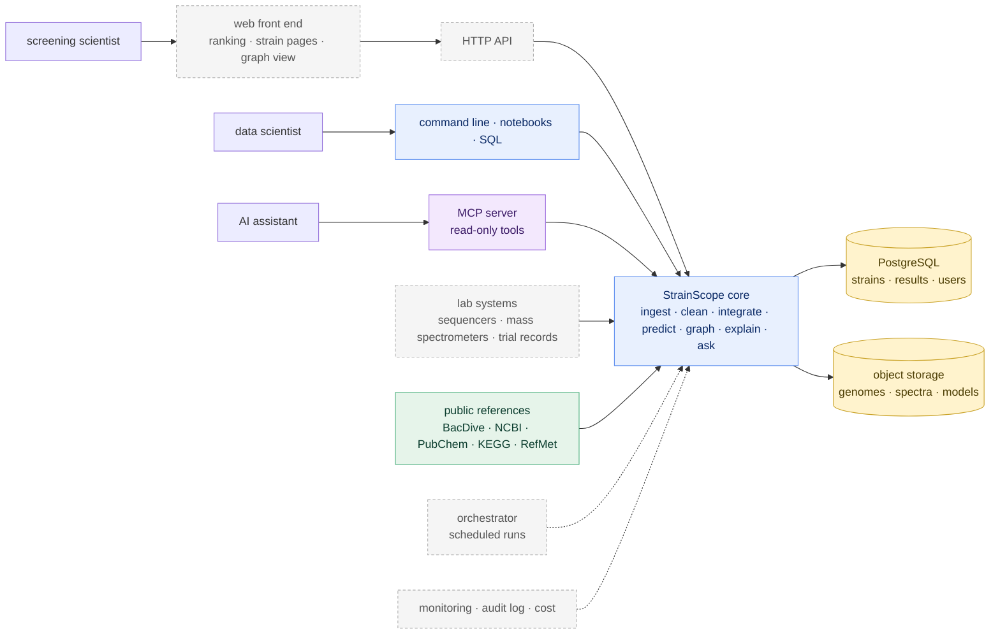

[← README](../README.md) · [Handbook](HANDBOOK.md) · [Repository roadmap](ROADMAP.md) · [Architecture](00-architecture.md) · [Glossary](GLOSSARY.md)

# Product and technology roadmap: from this repository to a finished product

**Prerequisites:** [`docs/00-architecture.md`](00-architecture.md) (the boxes that exist) and [`docs/ROADMAP.md`](ROADMAP.md) (what this repository builds, phase by phase).
**Learning goal:** understand what an industrial, hosted version of StrainScope would consist of; be able to explain every technology in it to someone with no background; and know, for each one, whether it's needed now, later, optionally or not at all, and what would change that answer.

## How to read this document

[`docs/ROADMAP.md`](ROADMAP.md) covers this repository: a complete, documented product that runs on one laptop and online for a handful of users. This document looks further ahead, at what a research organisation running a real strain-discovery programme would need. Each technology below is checked against the same three questions (is it required? why? what does it give, and what does it cost?) and then gets one verdict:

| Verdict | Meaning |
|---|---|
| **Required now** | part of this repository's build plan; the product isn't complete without it |
| **Recommended later** | not needed to run or prove the workflow; needed to serve many users, many strains or real laboratory data |
| **Optional** | nice to have; adopt only when a concrete user asks |
| **Not needed** | adds cost without benefit at any foreseeable scale, or is the wrong tool |

Each verdict comes with a **trigger**: the observable event that would change it. The principle throughout is *justify, don't accumulate*: a technology is added only when it solves a problem someone actually has. The repository is built so that the "later" items can be added without rewriting what's already there. Data flows one way through small plain files, every step is a function with a thin command line on top, results live in a database with a documented schema, and real and synthetic data meet the same contracts.

In kitchen terms, this repository is a well-equipped home kitchen that cooks one meal well, every time, and writes down every recipe. This document describes the restaurant (more cooks, a dining room, deliveries, food-safety inspections) and which of those a restaurant actually needs on day one.

## Who the finished product is for

| User | Their problem | What StrainScope gives them |
|---|---|---|
| **Screening scientist**, who tests strains in the lab and greenhouse | hundreds of candidate strains, room to test only a few dozen properly each season | a ranked shortlist, each strain with the genes and compounds behind its rank and a stated uncertainty, in an app that needs no code (Phase 6), where they can also upload their own strains |
| **Data scientist** in a biologicals research team | genomic, chemical and trial data in separate spreadsheets and formats | one cleaned, queryable database; integration and models that are reproducible and graded |
| **Research lead** | which strain families to invest in next year | an overview across kingdoms, with the evidence behind every recommendation as well as the score |
| **Regulatory and documentation specialist** | dossiers need to say *why* a strain works (its mode of action) | the knowledge graph's sourced paths: strain → gene → compound → pathway → effect |
| **An AI assistant** working for any of them | needs safe, structured access to the data | the MCP server (Phase 7b): nine read-only tools, with every input checked and every call logged |

## The finished product in one picture

Everything inside the "StrainScope core" box is this repository (solid boxes are built or scheduled in [`docs/ROADMAP.md`](ROADMAP.md)), and the dashed boxes are what this document covers.

---

## A. Product surface: how people use it

### A1. Web front end (React with TypeScript)

**What it is.** A website where a scientist logs in, filters the strain ranking, opens a strain page (its genes, its chemistry, its predicted performance, its graph neighbourhood) and leaves notes for colleagues. Next to Streamlit, it's the difference between a workshop and a showroom with staff accounts. TypeScript is JavaScript with *types*, which act like seatbelts: they catch mistakes such as passing a strain name where a number was expected, before the page ever runs.
**Required?** Not to prove the workflow, because the Streamlit app (Phase 6) already does that. It becomes necessary once there are many users with logins, saved views and history.
**Benefit / cost.** Multi-user work, permissions, a polished interface. / A second codebase and language, authentication, hosting, front-end tests.
**Verdict: Recommended later.** **Trigger:** a second regular user, or the first request Streamlit can't meet (per-user saved views, fine-grained permissions).
*Prepared today by:* the app reads only small, documented files in `artifacts/` and the database, through a service layer (`src/strainscope/service.py`) that holds no screen code, and an API can serve those same things.

### A2. HTTP API (FastAPI)

**What it is.** The same functions the command line and the app already call, offered over the web so any program can use them. Picture an order hatch added to a restaurant: the kitchen stays exactly as it was, and now there's a standard way to place orders.
**Verdict: Recommended later**, together with A1. **Trigger:** A1, or a laboratory system that wants to send new strains automatically.
*Prepared today by:* the service layer of Phase 6. Each of its functions (status, safe SQL, check-score-explain an upload, a strain's graph neighbourhood) would become one endpoint, with the same tests behind it.

### A3. Connections to laboratory systems and bioinformatics tools

**What it is.** Importers for what a real programme produces: genome assemblies and annotations from sequencing, feature tables from mass-spectrometry software, trial results from a laboratory information system (LIMS) or electronic lab notebook (ELN), and gene-cluster predictions from tools such as antiSMASH (which finds the gene neighbourhoods that build antimicrobial compounds).
**Why.** These are where real matched multi-omics data would come from (see B1).
**Verdict: Formats recommended later; specific connectors optional.** **Trigger:** B1, the first real matched dataset.
*Prepared today by:* the "one socket, many plugs" ingestion framework ([`02b`](02b-real-data-ingestion.md)), where each importer is one new plug, and the hand-off files of Phase 3, which are the slot that real blocks plug into.

### A4. Ask StrainScope: the documentation assistant

**What it is.** A question box over the project's own documentation that answers with passages and links, optionally writes a short grounded answer, and refuses questions that are not about StrainScope. Full design in [`docs/ROADMAP.md`](ROADMAP.md#ask-strainscope-the-documentation-assistant-in-detail).
**Required?** Yes. The question a reader starting from zero asks most often is "where is X explained?", and the documentation grows with every phase.
**Constraints.** Every answer cites its sources; out-of-scope questions are refused *before* any language model runs; a golden question set runs with the tests; the language-model backend (local Ollama or a hosted provider) is optional and switched on by environment variable; only documentation text is ever sent.
**Verdict: Required now.** Level 1 (find and quote) and the optional level 2 (grounded answers) are built in Phase 6b ([`docs/07b-docs-assistant.md`](07b-docs-assistant.md)); level 3 is built in the online copy of Phase 7 ([`docs/08-deployment-ai.md`](08-deployment-ai.md)) and in the `ask_docs` tool of the MCP server, Phase 7b ([`docs/08b-mcp-server.md`](08b-mcp-server.md)). Switching a model on or off, at home or online: [`docs/LANGUAGE_MODEL.md`](LANGUAGE_MODEL.md). **Trigger for embedding-based search:** questions phrased differently from the documents start being missed (the golden set already records one such question as a known limitation).
*Prepared today by:* `ask_docs()` in the service layer, which returns an answer as plain data, already the MCP tool's answer and ready to become an API endpoint; the golden question set, which will measure any better search against the current one.

### A5. Desktop or mobile apps, app-store distribution

**Verdict: Not needed.** A browser does everything required. **Trigger:** field use without connectivity (for example, recording trial observations in a greenhouse), and even then a mobile-friendly web page comes first.

### A6. Licensing and payments

**Verdict: Optional.** **Trigger:** the first external team that wants a hosted service. The repository itself is open source (MIT, added in Phase 8).

---

## B. Data platform: where data lives and how it moves

### B1. Real matched multi-omics data: the most important item on this page

**What it is.** Genomes, metabolite profiles **and** measured performance for the *same* strains. No public dataset offers all three today, which is why this repository simulates them transparently ([`docs/02-data-generation.md`](02-data-generation.md)) and uses real public data wherever it exists ([`02b`](02b-real-data-ingestion.md), [`02c`](02c-more-real-sources.md)).
**Why.** Models trained on simulated data can show that the *workflow* works, but they can't show real-world accuracy. Every performance number in this repository says so.
**Benefit / cost.** Real predictive value. / Laboratory work, data agreements and curation, which are the real cost of any discovery programme.
**Verdict: Recommended later.** This is what would turn the workflow into a discovery tool. **Trigger:** access to a matched dataset (one's own laboratory, a collaboration, or a future public release).
*Prepared today by:* real and synthetic data meet the same table contracts; the integration step reads plain block files; a test checks that R and Python agree on those files.

### B2. PostgreSQL (multi-user relational database)

**What it is.** A database server that many people and programs use at once, with accounts and permissions. If DuckDB is a personal notebook (fast, private, one writer), PostgreSQL is the shared office ledger with a front desk.
**Verdict: Recommended later.** **Trigger:** A1/A2, or more than one person writing results.
*Prepared today by:* standard SQL throughout, and a [Query Cookbook](QUERY_COOKBOOK.md) whose recipes port with small changes.

### B3. Cloud data warehouses and lakehouses (Snowflake, Databricks)

**What they are.** Rented analytics databases and compute platforms built for very large data and many analysts.
**Verdict: Not needed now.** Hundreds of strains fit in DuckDB on a laptop with room to spare. **Trigger:** raw sequencing reads or spectra for thousands of strains analysed together, or an organisation that already runs one. DuckDB's SQL is close enough to both that moving would be a documented change rather than a rewrite.

### B4. dbt (tested, documented SQL transformations)

**Verdict: Not needed now.** The cleaning rules are Python functions with a ledger and tests. **Trigger:** B2 or B3 adopted and transformations written mostly in SQL.

### B5. Orchestrator (Prefect, Airflow)

**What it is.** A scheduler that runs pipeline steps in order, retries failures and keeps a history. Think of an alarm clock with a checklist attached.
**Verdict: Recommended later.** **Trigger:** scheduled refreshes, such as new strains every week or nightly re-fetches from public sources.
*Prepared today by:* every step is a separate command with clear inputs and outputs, and since Phase 8 the one-command pipeline (`src/strainscope/pipeline.py`) runs them in order, stops at a failure and can start again from any step (`--from`), which is what an orchestrator does on a schedule.

### B6. Data and model versioning (DVC, MLflow)

**Verdict: Recommended later.** Today the data is rebuilt from a seed, so code version = data version. **Trigger:** real data that cannot be regenerated, or more than one trained model in use.

### B7. Object storage (S3-compatible)

**Verdict: Recommended later.** **Trigger:** raw genome files or spectra too large for the repository or one laptop.

---

## C. AI components

### C1. Plain-language explanations of results

**What it is.** Short written explanations of a strain's rank and of what testing the best N strains would bring, generated from the computed numbers and the knowledge graph, with nothing made up.
**Verdict: Required now; built in Phase 7** (`src/strainscope/narrate.py`, the *In plain words* boxes on the Strain and Ranking pages). The text is written by rules from the results, so every number in it can be traced, and a test checks that for all 600 strains. I decided against letting a language model rephrase it: the model would have to be sent a strain's results, which the AI layer never does. **Trigger for model-written wording:** readers find the rule-written paragraphs hard to follow; then only with a model on the same computer, and never for uploads.
*Built on:* Phase 5's explanation of every strain (`artifacts/graph/explanations.csv`): its strongest mechanism paths, data-only flags and missing weapons, each with its sources, plus the full count of mechanism paths.

### C2. Data assistant: questions answered with SQL

**What it is.** "Which strains are borderline?" becomes a SQL query on the **read-only** database; the query is shown alongside the answer so it can be checked.
**Verdict: Required now; built in Phase 7** as *Ask the data* (`src/strainscope/ask_data.py`). A tested Query Cookbook recipe answers whenever one fits; a language model writes a new query only when none does, and is sent the table and column names but never a row. Guardrails: instructions, changes and off-topic questions are refused before anything runs; a model's query passes a fifth guard (one read-only statement, no file functions) and the SQL console's four (read-only, no file access, a time limit, a row limit); every query is shown and can be opened in the console; 37 golden questions run with the tests.

### C3. GraphRAG: answers by walking the knowledge graph

**What it is.** Answers built by following edges in the graph (strain → gene → compound → pathway) and citing the path. (It's a bit like asking for directions and getting the whole route along with the destination.)
**Verdict: Required now; built in Phase 7** as *Ask the graph* (`src/strainscope/ask_graph.py`). Code finds the things a question names and chooses the walks (Phase 5's `path` and `show`, which prefer a mechanism to a statistics-only shortcut), so the retrieval can be tested; each step becomes a numbered fact with its source. An optional language model only phrases the answer, must cite the facts, and may not add a number; a question about a strain is answered by rules and never reaches a model. 23 golden questions run with the tests. **Trigger for a model that chooses the walks:** questions that name nothing in the graph turn out to be common and answerable.

### C4. MCP server: StrainScope as a tool for AI assistants

**What it is.** A Model Context Protocol server: a standard socket through which an assistant app can call `ask_docs`, `ask_data`, `ask_graph`, `describe_database`, `query_database`, `get_signature`, `rank_strain`, `explain_strain` and `shortlist`. Every tool is read-only, and every call is checked and logged.
**Verdict: Required now; built in Phase 7b** as `src/strainscope/mcp_server.py` ([`docs/08b-mcp-server.md`](08b-mcp-server.md)). It runs on the user's own computer, started by their assistant app over stdio; each tool is a thin door onto the service layer, so the answers match the app's; SQL passes five guards and returns at most 200 rows; refusals come back as sentences; the call log keeps no results; 40 tests include a real MCP session over stdio. **Trigger for a server other people reach over the internet** (the protocol's "streamable HTTP" transport): people want the tools without installing anything; it needs sign-in, rate limits and a host that keeps connections open, so it comes with A1/A2.

### C5. Ontologies and a graph database

**What they are.** Shared, published vocabularies, so that "iturin", "Iturin A" and a database identifier mean the same thing everywhere. Examples are NCBI Taxonomy for organisms, ChEBI for chemical entities, the Gene Ontology for gene functions, and KEGG and RefMet (already used) for pathways and metabolite classes. A graph database (Neo4j) stores the graph for many simultaneous users.
**Verdict: Ontology identifiers recommended later; graph database recommended later.** **Trigger:** B1 (real data brings real names that need reconciling), or the NetworkX graph outgrowing memory.
*Prepared today by:* the Phase 5 domain model (`src/strainscope/ontology.py`) is written in English first, with ten node types and eleven relations that could later be mapped onto these vocabularies, and every edge already records its source. The graph is saved as two plain tables and a GraphML file, which Neo4j can import (the GraphML through its APOC plugin, the tables with `LOAD CSV`).

### C6. Genome and protein foundation models

**What they are.** Large models pre-trained on millions of sequences that turn a gene into a numerical summary of its likely function.
**Verdict: Optional.** **Trigger:** real genomes with genes not yet in any reference database, where similarity search alone fails.

### C7. Autonomous analysis agent

**What it is.** A language model that plans multi-step analyses and calls StrainScope's tools in a loop.
**Verdict: Recommended later.** **Trigger:** the MCP server (C4, built in Phase 7b) has been used for a while without changes to its tools, because an agent is only as safe as the tools it may call, and a question comes up that assistant apps can't plan by chaining the tools themselves.

---

## D. Cloud and operations

| Item | What it is | Verdict | Trigger |
|---|---|---|---|
| **D1. Hosting the app** | Streamlit Community Cloud (free): the online copy in shared mode, exact package versions, secrets in the host's box, the database built on the first start, a health page | **Required now; built in Phase 7** | n/a |
| **D2. Continuous integration** | tests run automatically on fresh machines at every push: Windows, macOS and Linux with Python 3.12 and 3.14, RHEL 8 (Red Hat's UBI 8 image), the online copy's exact versions, a keyboard and screen-reader check, the safety gate, the container; every result rebuilt and compared | **Required now; built in Phase 8** (`.github/workflows/ci.yml`) | n/a |
| **D3. Containers** (Docker, Podman) | the app in one portable box: the online copy's Python and exact packages, the database built inside | **Optional; built in Phase 8** (`Dockerfile`, tested at every push) | R in the box too, for a user who can't install it; a ready image in a registry, for a hosting platform that requires one |
| **D4. Continuous deployment** | every tested change goes live automatically | Recommended later | a hosted service with users who expect updates |
| **D5. High-performance computing** | clusters for genome assembly, annotation and antiSMASH runs | Recommended later | B1 with raw sequencing data |
| **D6. Kubernetes** | orchestration of many containers | Not needed | a multi-tenant hosted service at scale |
| **D7. Monitoring, logging, audit log** | who ran what, when, with which data; alerts on failures | Recommended later | the first hosted multi-user deployment |
| **D8. Cost model** | a spreadsheet of hosting, storage and compute per user | Recommended later | the first paying or budgeted user |

---

## E. Security, licensing and regulatory constraints

These are **required now**, as constraints on the design rather than as technologies. Designing for them early is cheap; retrofitting them later is expensive.

| Constraint | What it means for StrainScope | Status |
|---|---|---|
| **Secrets** | API keys live only in the environment (`.env` or the host's secret store), and never in Git or in logs | designed in: `.gitignore` + the pre-push safety gate ([`docs/01-setup.md`](01-setup.md) Part H), [`02c`](02c-more-real-sources.md); the online copy's Secrets box and its committed template since Phase 7 ([`docs/08-deployment-ai.md`](08-deployment-ai.md) §1) |
| **Source licences** | KEGG is for academic use only, so a commercial product needs a KEGG licence or an open alternative; every real row carries its attribution | designed in: an `attribution` column travels with the data ([`02b`](02b-real-data-ingestion.md)) |
| **The project's own licence and reuse** | anyone may reuse the code and documents; the few facts from public databases keep their sources' terms; a security problem is reported privately first | built in Phase 8: `LICENSE` (MIT), `CITATION.cff`, `CONTRIBUTING.md`, `SECURITY.md` with GitHub's private reporting, Dependabot alerts ([`docs/09-packaging.md`](09-packaging.md) §8, §13) |
| **Accessibility** | anyone, also using a keyboard or a screen reader, can use the app (WCAG 2.1 level AA) | built in Phase 8: a check at every push (axe-core rules, a walk with the Tab key, the accessibility tree) and the fixes it led to ([`docs/09-packaging.md`](09-packaging.md) §10); a hosted product would add a review with real screen-reader users |
| **Disclosing simulated data** | synthetic data and its limits are stated wherever a number appears | designed in: README, every guide, every result printout |
| **Confidential strain data** | a company's strain collection and trial results are trade secrets | hosted deployments need access control and encryption (B2, D7); the AI layer sends a model only text that is public in the repository (documentation passages, table and column names, facts about concepts from the graph), never a row of data, a strain's results or an upload |
| **Access and benefit-sharing** (Nagoya Protocol) | microbial strains collected from another country's environment may carry legal obligations on use and on sharing benefits | out of scope for public reference data; a real programme tracks each strain's origin and permits (a column to add with B1) |
| **Plant-protection regulation** (e.g. EU Regulation 1107/2009; US EPA biopesticide registration) | a microbial product needs a regulatory dossier, including its mode of action and safety data | StrainScope is a **research decision-support tool** rather than a dossier; what it offers regulatory work is sourced mode-of-action evidence (C3, C5) |
| **Personal data** (GDPR) | none is processed; user accounts would be the first personal data | designed in: strain identifiers are not personal; revisit with A1 |
| **Uploaded strain data** | somebody's own strains are their business | designed in (Phase 6): an upload is kept in the app's memory for that browser tab only and never written to disk; the shared mode (`STRAINSCOPE_MODE=public`) hides the real-data buttons and allows the database build only on the first start; Streamlit's usage statistics are switched off; the online copy keeps no record of visitors (Phase 7) |
| **Querying without harm** | a SQL box on a shared site is an open door unless it's guarded | designed in (Phase 6): read-only, file access off and locked, a 10-second limit, a 10,000-row cap; since Phase 7 the data assistant goes through the same guards, and a model's query passes a fifth guard first (one read-only statement, no file functions) |
| **A language model that can't invent or leak** | an AI answer must be checkable, and a request must never carry data to a provider, or a key anywhere but its own provider | designed in (Phases 6b and 7): models are off by default and every assistant answers without one; a model is asked only about a question the assistant has already judged in scope (Ask StrainScope and Ask the graph: one the search answered; Ask the data: one no tested recipe fits); a model is sent documentation passages, table and column names or facts about concepts, never rows, a strain's results or uploads; answers must cite what they were given (and Ask the graph's may add no number) or they aren't shown, and the request shows the model what a citation looks like, which made a small local model (llama3.2:3b) comply in a test, and Ask StrainScope sends only the passages that match nearly as well as the best one (roadmap fix 7.1, Handbook Stage 12.1; `service.py check-model` checks any model); a local option (Ollama) keeps everything on the computer; a hosted key lives in `.env` or the host's secret store; a daily cap limits requests on a shared copy |

---

## F. Discoverability and go-to-market

### F1. Search and answer-engine visibility for the documentation

**What it is.** Writing pages so search engines rank them (SEO) and answer engines and AI assistants quote them accurately (AEO, GEO): clear titles, one concept per section, plain definitions, explicit sources.
**Verdict: Optional, and largely done already.** The Handbook, glossary and guides are written one concept per section, in plain language. **Trigger:** a public product site.

### F2. Packaging sketch

For orientation only; there is no product to sell.

| Tier | Who | What |
|---|---|---|
| Open source | anyone | this repository, MIT licence |
| Hosted team | one research group | web front end, PostgreSQL, user accounts, support |
| Enterprise | a biologicals company | private deployment, laboratory connectors, ontology mapping, audit log, single sign-on |

**Verdict: Optional.** **Trigger:** external interest.

---

## G. The end-to-end product pipeline, and what already exists

| Stage | What the finished product does | Exists today | Arrives with |
|---|---|---|---|
| **Ingest** | public references, laboratory systems, uploads | synthetic generator; five real sources behind one framework; evidence locker; provenance log; uploads of your own strains, checked cell by cell | Phases 1-1c and 6 ✅; A3, B1 later |
| **Clean** | documented rules with a ledger; a shared database | six rules + ledger; DuckDB; read-only SQL console; cookbook | Phase 2 ✅; B2 later |
| **Integrate** | genes and chemistry read together; graded signatures | DIABLO + Python twin; controls; stability; R↔Python contract | Phase 3 ✅ |
| **Predict** | calibrated predictions with uncertainty | four models on the same folds; leak-proof pipeline; calibrated elastic net; model card; out-of-fold ranking | Phase 4 ✅ |
| **Explain** | knowledge graph, explanations, GraphRAG | the knowledge graph (ontology, sourced edges, real KEGG/RefMet/BacDive context, Phase 3 and 4 evidence); hubs, communities, knowledge vs data; an explanation for every strain; `why` / `path` / `show` questions; plain-language explanations by rules; GraphRAG (Ask the graph) | Phases 5 and 7 ✅; C5 later |
| **Serve** | app, docs assistant, data assistant, MCP server | the Streamlit app on a tested service layer: ranking with likely / borderline / unlikely bands, strain pages, the graph, integration, uploads, a guarded SQL console; Ask StrainScope, Ask the data and Ask the graph, each answering on its own and refusing what it can't answer, with an optional model; runs on Windows, macOS and RHEL 8, and online on Streamlit Community Cloud; the MCP server, nine read-only tools for AI assistant apps on the user's own computer | Phases 6, 6b, 7 and 7b ✅; A1/A2 later |
| **Operate** | one-command pipeline, CI, releases; later scheduling and monitoring | the one-command pipeline and its comparison with the committed results (also a button in the app); tests (447, the app's, three golden question sets and a real MCP session included), run on eleven jobs at every push (CI); a tested safety gate, also as an optional pre-push hook; a keyboard and screen-reader check; a test that every link between the documents resolves; three-branch workflow; tagged releases (v0.1.0, v0.1.1, v0.2.0, v0.3.0, v1.0.0) and GitHub releases; Dependabot alerts and update suggestions; a container; a health check (`service.py status`, the app's Home page, *About this copy*); the online copy redeployed on every push, with pinned versions; an uninstall guide | Phases 6 to 8 ✅; B5, D4, D7 later |

## Sequencing summary

1. **This repository (Phases 0 to 8, plus 6b and 7b):** everything marked *Required now*, all built (v1.0.0).
2. **First real data:** B1 matched data → A3 importers → C5 ontology identifiers → B6 versioning.
3. **First hosted team:** B2 PostgreSQL → A2 HTTP API → A1 web front end → D7 monitoring → D4 continuous deployment.
4. **Scale:** B5 orchestrator → D5 high-performance computing → B7 object storage → C7 agent.
5. **Only on demand:** B3/B4 warehouse and dbt, C6 foundation models, D6 Kubernetes, A6/F2 commercial, F1 product site.

## How this document is maintained

Re-read at every release tag (v0.1.0, v0.2.0, v0.3.0, v1.0.0). A verdict changes only when its trigger has observably fired; the change is recorded in [`CHANGELOG.md`](../CHANGELOG.md) and mirrored in [`docs/ROADMAP.md`](ROADMAP.md) and the [Handbook](HANDBOOK.md) in the same commit.
